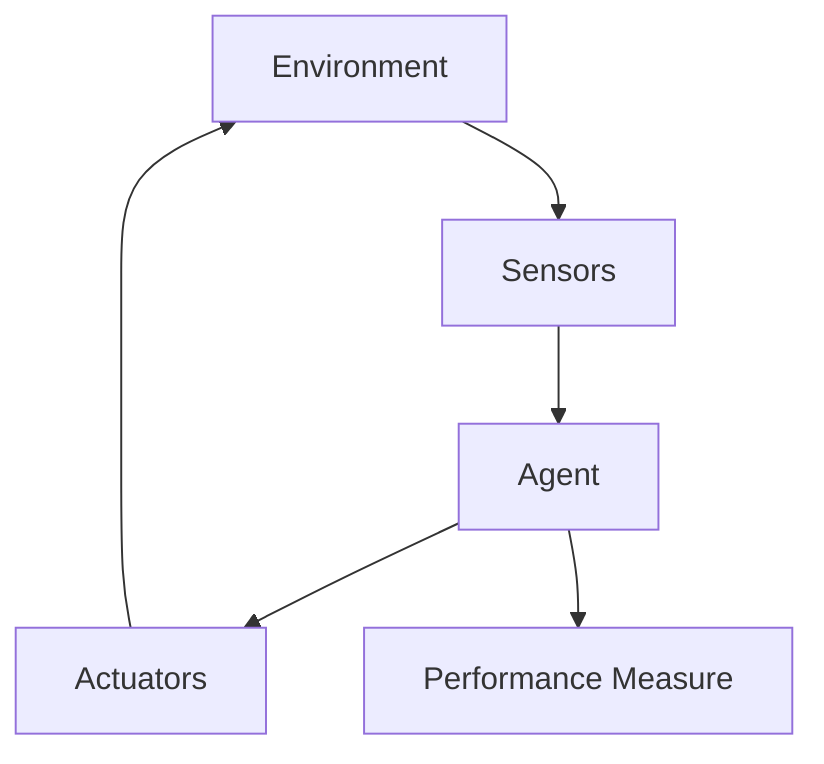
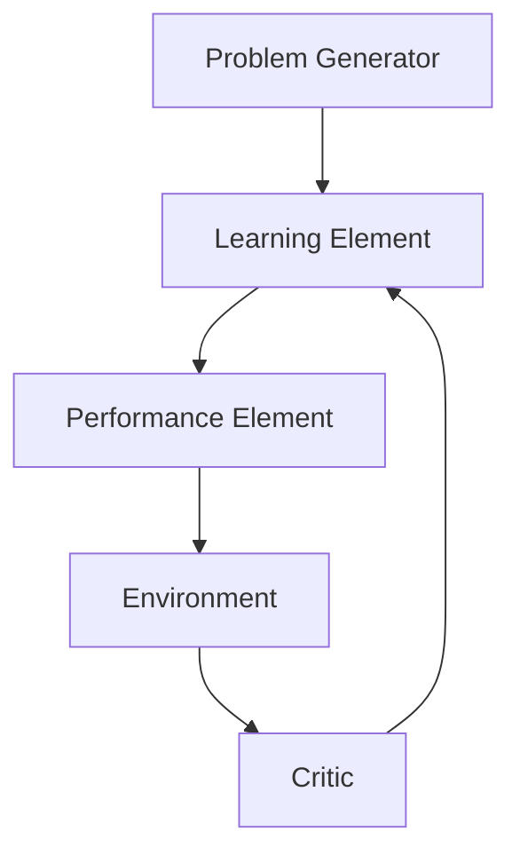
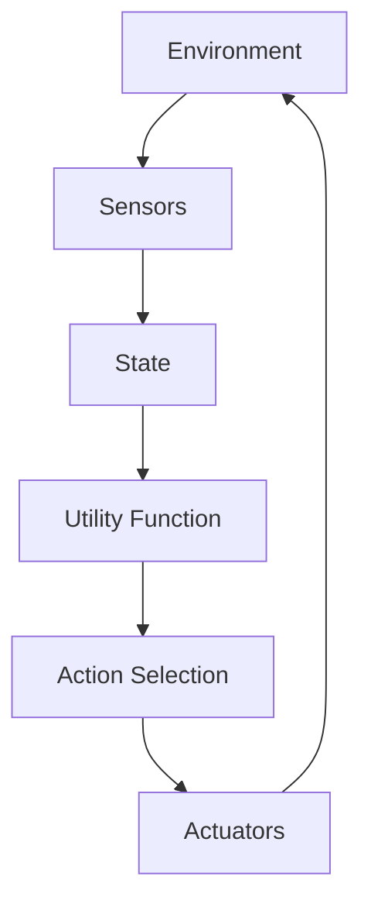
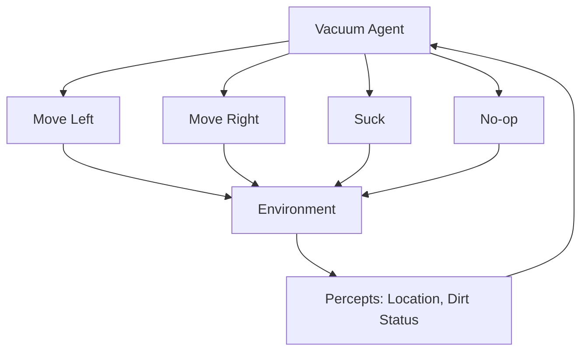

# AI Module 1

## What is a rational agent? Explain with diagram. (5 marks)

A rational agent is an AI system that acts to achieve the best possible outcome or the best expected outcome given its knowledge and capabilities. It perceives its environment through sensors and acts upon it through actuators.

**Key properties of a rational agent:**
- Performs actions that maximize performance measure
- Uses percept history and built-in knowledge
- Acts optimally based on available information

---

## Explain PEAS and also write down the PEAS representations for Medical diagnosis system. (10 marks)

PEAS is a framework for describing task environments in AI. It stands for Performance measure, Environment, Actuators, and Sensors.

**PEAS components:**
- **Performance measure**: Criteria that define success
- **Environment**: Context where agent operates
- **Actuators**: Mechanisms through which the agent acts on the environment
- **Sensors**: Devices that perceive and gather information from the environment

**PEAS representation for Medical diagnosis system:**

| Component | Description |
|-----------|-------------|
| **Performance measure** | Accurate diagnosis, minimal false positives/negatives, fast response time, patient safety |
| **Environment** | Patient, symptoms, medical history, test results, hospital database, medical literature |
| **Actuators** | Display diagnosis, prescribe treatment, recommend tests, alert doctor, update patient record |
| **Sensors** | Keyboard input, symptom questionnaire, vital signs monitor, lab result interface, imaging data |

---

## State PEAS of automated taxi driver. (5 marks)

**PEAS for automated taxi driver:**

| Component | Description |
|-----------|-------------|
| **Performance measure** | Safe driving, reaching destination, passenger comfort, fuel efficiency, obey traffic rules, minimize travel time |
| **Environment** | Roads, traffic signals, pedestrians, other vehicles, weather conditions, road signs, passengers |
| **Actuators** | Steering wheel, accelerator, brakes, indicators, horn, headlights, GPS navigation |
| **Sensors** | Cameras, radar, LIDAR, GPS, wheel speed sensors, accelerometer, microphones |

---

## Explain learning agents with example. (5 marks)

A learning agent improves its performance over time by acquiring knowledge from experience. It consists of four components: learning element, performance element, critic, and problem generator.

**Example - Spam filter agent:**
- **Learning element**: Updates classification rules based on user feedback
- **Performance element**: Decides whether incoming email is spam
- **Critic**: Compares classification to user marking (spam/not spam)
- **Problem generator**: Suggests borderline cases for user review

The agent initially classifies poorly but improves accuracy as it learns from labeled examples.

---

## What are the different types of environments? Give examples. Explain the vacuum world problem with its environment. (10 marks)

**Types of environments in AI:**

| Type | Description | Example |
|------|-------------|---------|
| Fully observable | Agent sees complete environment state | Chess game |
| Partially observable | Agent sees limited information | Poker game |
| Deterministic | Next state fully determined by current action | Traffic light control |
| Stochastic | Random elements affect outcomes | Weather prediction |
| Episodic | Each episode independent of previous | Image classification |
| Sequential | Current action affects future decisions | Robot navigation |
| Static | Environment doesn't change during reasoning | Sudoku puzzle |
| Dynamic | Environment changes while agent thinks | Stock trading |
| Discrete | Limited number of distinct states | Checkers game |
| Continuous | Infinite possible states | Medical diagnosis |
| Single-agent | Only one agent operates | Personal assistant |
| Multi-agent | Multiple agents interact | Autonomous vehicles |

**Vacuum World Problem:**

The vacuum world has a rectangular grid with dirt in some squares. The vacuum cleaner agent can move left, move right, suck dirt, or do nothing.

**Environment characteristics for vacuum world:**
- Partially observable (agent sees only current square)
- Deterministic (actions have predictable results)
- Sequential (future dirt depends on current cleaning)
- Static (dirt doesn't reappear spontaneously in simple version)
- Discrete (grid positions and dirt states are countable)
- Single-agent (one vacuum cleaner)

**Goal:** Clean all dirt in minimum time/actions.

---

## Differentiate between Simple Reflex Agent and Model-Based Reflex Agent. (5 marks)

| Aspect | Simple Reflex Agent | Model-Based Reflex Agent |
|--------|---------------------|--------------------------|
| **Internal state** | No internal memory | Maintains internal state/model |
| **Decision basis** | Only current percept | Current percept + internal state |
| **World knowledge** | No knowledge of unobserved aspects | Tracks aspects not currently visible |
| **Environment requirement** | Fully observable required | Works with partial observability |
| **Complexity** | Simple, fast | More complex, uses more memory |
| **Example** | Thermostat | Self-driving car tracking unseen objects |

---

## Discuss Problem Formulation in AI with an example. (5 marks)

Problem formulation is the process of defining a task in a structured way that an AI agent can solve. It converts a real-world situation into a formal search problem.

**Components of problem formulation:**
- **Initial state**: Starting point of the problem
- **Actions**: Possible moves from any state
- **Transition model**: Result of applying an action
- **Goal test**: Determines if target state is reached
- **Path cost**: Measure of solution quality

**Example - Route finding from A to B:**
- **Initial state**: Current location (A)
- **Actions**: Drive on connected roads
- **Transition model**: New location after driving
- **Goal test**: Reached destination (B)
- **Path cost**: Distance or travel time

---

## Formulate the problem for 8 queens. (5 marks)

**8 Queens Problem Formulation:**

- **Initial state**: Empty 8×8 chessboard (no queens placed)

- **Actions**: Place a queen in any safe square of the next empty row (or column, depending on formulation)

- **Transition model**: New board state with one additional queen placed at the chosen position

- **Goal test**: All 8 queens are placed on the board such that no two queens attack each other (different rows, columns, and diagonals)

- **Path cost**: Number of queens placed (typically equal cost of 1 per placement) or constant cost focusing on finding any valid configuration

**Alternative formulation (incremental):**
- **States**: Any arrangement of 0 to 8 queens with no attacks
- **Initial state**: Empty board
- **Goal test**: 8 queens with no mutual attacks

---

## Explain utility based agent architecture with diagram. (5 marks)

A utility-based agent selects actions that maximize expected utility, a numerical measure of happiness or success. It handles trade-offs between conflicting goals.

**Architecture components:**
- Sensors perceive environment state
- Utility function calculates desirability of each possible outcome
- Decision component selects action maximizing expected utility

**Example:** A rescue robot choosing between saving two people assigns higher utility to saving a child than an adult, or considers both equally based on ethical rules.

---

## Explain PEAS descriptors. Provide PEAS descriptors for Part Picking robot. (5 marks)

PEAS descriptors define the four components of an AI agent's task environment.

**PEAS for Part Picking robot:**

| Component | Description |
|-----------|-------------|
| **Performance measure** | Pick correct parts, minimize pick time, avoid damage to parts, successful placement at destination |
| **Environment** | Conveyor belt, bins with parts, storage containers, obstacles, lighting conditions, other robots |
| **Actuators** | Robotic arm, gripper, suction cup, conveyor belt controller, camera positioning motor |
| **Sensors** | Vision camera, proximity sensors, force sensors, part identification sensor, position encoders |

---

## Explain goal based agents with example. (5 marks)

A goal-based agent selects actions to achieve a specific desired goal. It considers future consequences and plans sequences of actions.

**Working:**
- Maintains internal representation of world state
- Has defined goal (description of desired situation)
- Searches for action sequence from current state to goal
- Executes actions and updates state based on percepts

**Example - Navigation robot:**
- **Goal**: Reach room 105 from current location
- **Actions**: Turn left, turn right, move forward
- **Process**: Robot considers multiple paths, chooses efficient route, adjusts when encountering obstacles
- **Difference from reflex agent**: Plans ahead rather than reacting only to current sensor input

---

## Explain state space based problem formulation. Formulate 8 Puzzle and N Queens problem. (10 marks)

**State Space Problem Formulation:**

State space formulation represents a problem as a graph where nodes are states and edges are actions. The solution is a path from initial state to goal state.

**Components of state space:**
- Set of all possible states
- Initial state (starting node)
- Actions applicable in each state (edges)
- Transition function (results of actions)
- Goal state or goal test
- Path cost function

**8 Puzzle Formulation:**

- **State representation**: 3×3 grid containing numbers 1-8 and one blank (0)
- **Initial state**: Any shuffled configuration
- **Actions**: Move blank up, down, left, right (if within bounds)
- **Transition model**: Blank swaps with adjacent tile
- **Goal state**: Ordered grid [[1,2,3],[4,5,6],[7,8,0]]
- **Path cost**: 1 per move

**N Queens Problem Formulation:**

- **State representation**: Array of N positions (column index for each row)
- **Initial state**: Empty board (no queens placed)
- **Actions**: Place queen in next row at any column not attacking existing queens
- **Transition model**: Add queen at (row, column) with attack checking
- **Goal test**: N queens placed with no mutual attacks
- **Path cost**: Constant per placement (usually 1)

**Comparison table:**

| Aspect | 8 Puzzle | N Queens |
|--------|----------|----------|
| State space size | 9!/2 = 181,440 | Approximately N! |
| Branching factor | 2-4 moves | N - row + 1 |
| Goal condition | Exact configuration match | Constraint satisfaction |
| Solution type | Optimal path | Any valid configuration |

---

## What are the different types of environments? Give examples. Explain the vacuum world problem with its environment. (10 marks)

**Types of environments in AI:**

| Environment Type | Description | Example |
|-----------------|-------------|---------|
| Fully vs Partially observable | Complete vs limited state information | Chess vs Poker |
| Deterministic vs Stochastic | Predictable vs random outcomes | Traffic light vs Weather |
| Episodic vs Sequential | Independent vs dependent decisions | Image recognition vs Robot navigation |
| Static vs Dynamic | Unchanging vs changing during deliberation | Sudoku vs Real-time game |
| Discrete vs Continuous | Countable vs infinite states | Checkers vs Self-driving car |
| Single vs Multi-agent | One agent vs multiple interacting agents | Personal assistant vs Autonomous vehicles |

**Vacuum World Problem:**

The vacuum world consists of a 2D grid (commonly 2 squares or 4 squares). Each square may contain dirt or be clean. The vacuum cleaner perceives its current square's dirt status.

**Environment characteristics:**
- Partially observable (cannot see other squares)
- Deterministic (sucking cleans, moving changes location predictably)
- Sequential (cleaning order affects future dirty squares)
- Static (dirt doesn't appear spontaneously in standard version)
- Discrete (limited positions and dirt states)
- Single-agent (one vacuum cleaner)

**Agent actions:**
- Move left
- Move right
- Suck (removes dirt from current square)
- No operation (idle)

**Performance metrics:**
- Percentage of clean squares after N actions
- Total time to clean all squares
- Energy consumed

