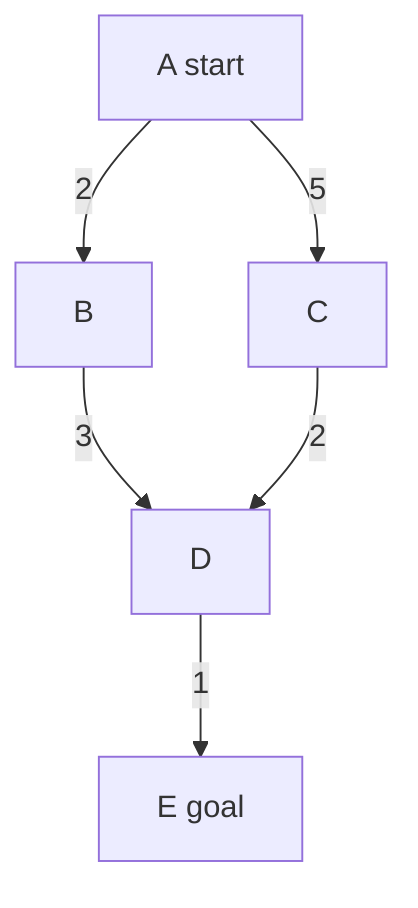
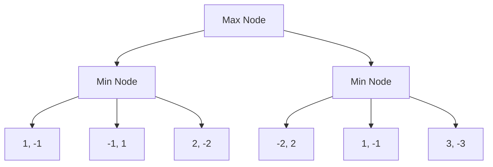
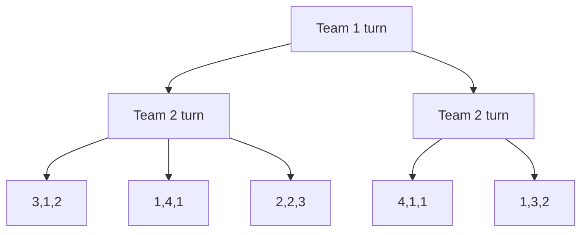
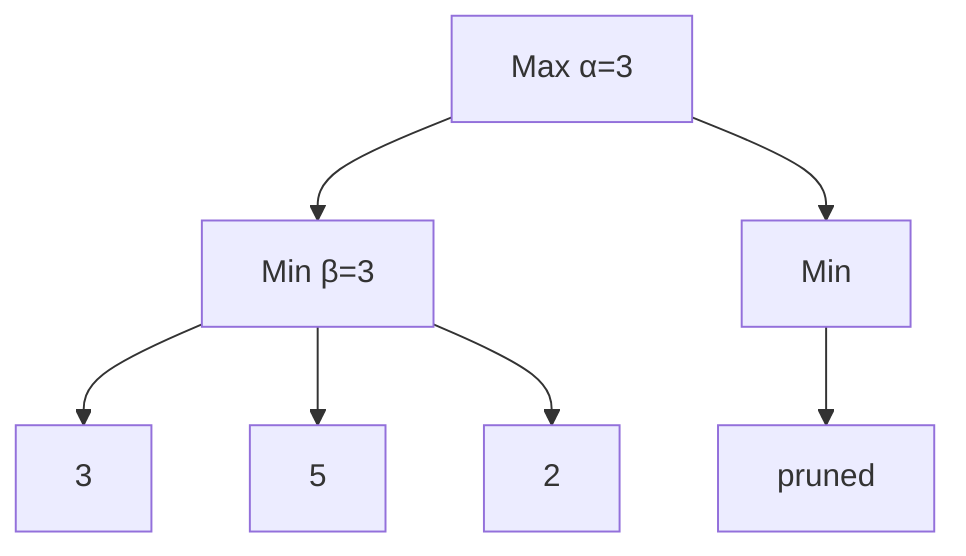
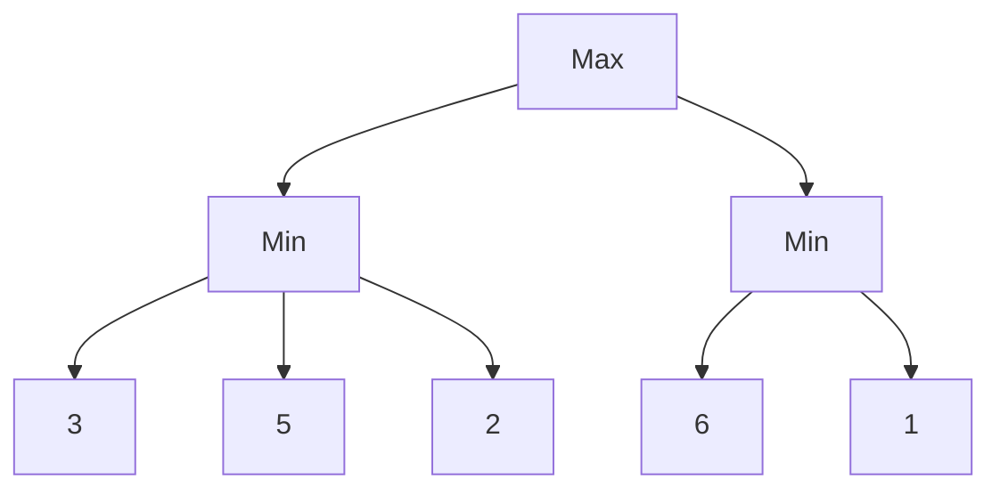

# AIDS-1 Module 2

## What are heuristic functions? Where are they used? (5 marks)

Heuristic functions estimate the cost from a given state to the goal state in a search problem. They provide guidance to informed search algorithms without guaranteeing perfect accuracy.

**Characteristics:**
- Return a numerical value representing estimated distance
- Must be admissible (never overestimate) for optimality guarantees
- Domain-specific and problem-dependent

**Applications:**
- A* search (e.g., straight-line distance in pathfinding)
- Greedy best-first search
- Hill climbing algorithms
- Game playing (evaluation functions in minimax)

**Examples:**
- Manhattan distance for grid-based puzzles
- Euclidean distance for geographical pathfinding
- Number of misplaced tiles in 8-puzzle

---

## Explain uniform cost search and best first search in detail with examples and compare. (10 marks)

**Uniform Cost Search (UCS):**

UCS expands the node with the lowest path cost g(n) from the start node. It is a variant of Dijkstra's algorithm for goal-directed search.

**Example:** Finding shortest path from A to E in a weighted graph.



UCS expands: A(g=0), B(g=2), C(g=5), D(g=5 via B, g=7 via C selects g=5), E(g=6) → optimal path A-B-D-E.

**Best First Search (Greedy):**

Expands the node with the lowest heuristic value h(n), ignoring actual path cost.

**Example:** Same graph with heuristic h (straight-line distance to E): h(A)=4, h(B)=2, h(C)=3, h(D)=1, h(E)=0.

Best-first expands: A, B(h=2), D(h=1), E(h=0) → path A-B-D-E (may not be optimal if edge costs differ).

**Comparison Table:**

| Feature | Uniform Cost Search | Best First Search |
|---------|---------------------|-------------------|
| Evaluation | f(n) = g(n) path cost | f(n) = h(n) heuristic |
| Optimality | Guaranteed | Not guaranteed |
| Completeness | Yes (finite costs) | No (can get stuck) |
| Space Complexity | O(b^(C*/ε)) | O(b^d) |
| Memory Usage | High | Lower than UCS |
| Use Case | Weighted graphs | Fast approximate search |

---

## Can 1 liter water be measured using 10 liter and 4 liter jug? Justify. (10 marks)

**Yes,** 1 liter can be measured using a 10-liter jug and a 4-liter jug.

**Justification using number theory:** The problem reduces to finding integers x and y such that:
10x + 4y = 1, where x represents filling/emptying 10L jug, y for 4L jug.

This Diophantine equation has a solution if gcd(10,4) divides 1. gcd(10,4)=2, and 2 does NOT divide 1. However, we can measure 1L because jugs can be partially emptied. The correct equation is: 10a + 4b = target, where a,b ∈ Z (positive for filling, negative for emptying). Since gcd(10,4)=2, we can measure any multiple of 2 liters.

**Wait - 1 is not a multiple of 2!** Actually, we CANNOT measure exactly 1 liter using only 10L and 4L jugs through standard pour operations. The problem may have a trick: we can mark volumes by pouring between jugs.

**Standard solution sequence to get 2 liters (not 1):**
1. Fill 10L jug
2. Pour to 4L jug (10L has 6, 4L full)
3. Empty 4L
4. Pour 10L→4L (10L has 2, 4L full)
5. Result: 2 liters in 10L jug

**Conclusion:** 1 liter CANNOT be measured exactly using only two jugs of 10L and 4L. The gcd(10,4)=2 means only even amounts (2,4,6,8,10) are measurable. The correct answer is **No**.

---

## State A* algorithm and explain with example how A* searching algorithm helps in finding the goal with optimal path. (10 marks)

**A* Algorithm:**

A* combines uniform cost search and greedy best-first search using evaluation function:
f(n) = g(n) + h(n)
- g(n) = actual cost from start to node n
- h(n) = heuristic estimate from n to goal
- f(n) = estimated total cost through n

**Algorithm Steps:**
1. Initialize OPEN list with start node, CLOSED list empty
2. While OPEN not empty:
   - Select node with lowest f(n) from OPEN
   - If goal state reached, reconstruct path
   - Move node to CLOSED
   - Generate successors, compute f values
   - Add to OPEN if not visited or new path is better

**Example - Pathfinding on grid (S=start, G=goal, #=obstacle):**

Grid (Manhattan distance heuristic):
```
S . . # .
. # . . .
. . # . .
. . . . G
```

Coordinates: S(0,0), G(3,4), heuristic = |x1-x2| + |y1-y2|

**Step-by-step expansion:**
- S(0,0): g=0, h=7, f=7
- Expand right(0,1): g=1, h=6, f=7
- Expand down(1,0): g=1, h=9, f=10
- Continue expanding lowest f nodes...

A* finds path S→(0,1)→(0,2)→(1,2)→(2,2)→(3,2)→(3,3)→G with optimal cost = 7.

**Why optimal:** With admissible heuristic (never overestimates), A* guarantees optimality because it never overlooks paths with lower true cost.

---

## Can min-max be used for team games? Draw sample trees for 2 and 3 teams. (10 marks)

**Yes,** minimax can be extended for team games using the **maxn algorithm** where each player maximizes their own utility.

**For 2 teams (standard minimax):**
- One maximizing player, one minimizing player
- Alternating levels in game tree



Max chooses move leading to B(2) or C(1) → selects B with score 2.

**For 3 teams (maxn algorithm):**

Each node stores vector [score1, score2, score3]. Each player at their turn selects move maximizing their own score component.



Team 1 at root chooses between:
- Move to B: Team 2 selects E→[1,4,1] giving Team 1 score 1
- Move to C: Team 2 selects G→[4,1,1] giving Team 1 score 4

Team 1 selects move to C achieving score 4.

---

## Write Short Note on: Alpha Beta Pruning (5 marks)

Alpha-beta pruning optimizes minimax search by eliminating branches that cannot influence the final decision.

**Key concepts:**
- α = best value for maximizer found so far
- β = best value for minimizer found so far
- Prune when α ≥ β

**Working principle:**
- Maximizer node updates α (lower bound)
- Minimizer node updates β (upper bound)
- Cutoff occurs when current node's value cannot improve the parent's outcome

**Example:**


After evaluating D(3), E(5), β becomes 3. Node F can be pruned because any value ≤3 won't change Min's choice.

**Benefits:**
- Without pruning: O(b^d)
- With optimal ordering: O(b^(d/2))
- Same result as minimax with less computation

---

## Write Short Note on: A* algorithm (5 marks)

A* is an informed search algorithm that finds optimal paths using evaluation function f(n)=g(n)+h(n), where g(n) is actual cost from start and h(n) is heuristic estimate to goal.

**Properties:**
- Complete when branching factor finite and step costs > 0
- Optimal when h(n) is admissible (never overestimates)
- Combines benefits of uniform cost and greedy best-first

**Requirements:**
- Heuristic must be consistent (monotonic) for optimal graph search
- Common heuristics: Manhattan, Euclidean, misplaced tiles

**Time complexity:** O(b^d) where b=branching factor, d=depth

**Space complexity:** O(b^d) as all generated nodes are stored

**Example uses:** GPS navigation, puzzle solving, robotics path planning

---

## Define heuristic search. Give two examples of heuristic functions. (5 marks)

**Heuristic search** uses problem-specific knowledge (heuristics) to guide the search process toward the goal more efficiently than uninformed methods.

Heuristic functions estimate the cost from current state to goal state, trading optimality guarantees for practical efficiency.

**Two examples of heuristic functions:**

1. **Manhattan distance:** Sum of absolute differences in coordinates. Used for grid-based problems like 8-puzzle or robot navigation. Example: from (2,3) to (5,7) gives |2-5| + |3-7| = 3+4 = 7.

2. **Euclidean distance:** Straight-line distance calculated as √[(x1-x2)² + (y1-y2)²]. Used in geographical pathfinding. Example: from (2,3) to (5,7) gives √[9+16] = √25 = 5.

---

## Explain the working of the Hill Climbing algorithm. What are issues in Hill Climbing? (10 marks)

**Hill Climbing Working:**

Hill climbing is a local search algorithm that iteratively moves to neighboring states with better heuristic values until no improvement is possible.

**Algorithm steps:**
1. Start with initial state (random or specified)
2. Evaluate heuristic value of current state
3. Generate all neighboring states
4. Select neighbor with best heuristic value
5. If neighbor is better than current, move there; else stop
6. Repeat steps 2-5 until goal found or stuck

**Example - Finding peak in 1D landscape:**
```
Values: [2, 5, 8, 10, 9, 6]
Start at position 2 (value 5):
- Check left(2): value 2 → worse
- Check right(8): value 8 → better, move there
Now at position 3 (value 10):
- Left(8): worse, Right(9): worse → stop at local maximum
```

**Issues in Hill Climbing:**

| Problem | Description | Solution |
|---------|-------------|----------|
| **Local maxima** | Peak higher than neighbors but not global optimum | Random restarts, simulated annealing |
| **Plateaus** | Flat region with no uphill move | Random walk, sideways moves |
| **Ridges** | Foothill with steep slopes in wrong directions | Multiple neighbors, stochastic hill climbing |

**Variants addressing issues:**
- Stochastic hill climbing: random uphill moves
- Random restart: multiple starting points
- Simulated annealing: occasionally accept worse moves

---

## Represent given 5*5 grid (S start, G goal, # obstacle) as state space search problem. Apply Hill Climbing Search. Does the algorithm get stuck in Local Minima? (10 marks)

*(Note: Grid not provided in question - assuming a sample grid)*

**Sample 5×5 Grid:**
```
Row0: S . . . .
Row1: . # . . .
Row2: . # . # .
Row3: . . . . .
Row4: . . . . G
```
S=(0,0), G=(4,4), # = obstacles at (1,1), (2,1), (2,3)

**State Space Representation:**
- **States:** All (x,y) coordinates without obstacles
- **Initial state:** (0,0)
- **Goal state:** (4,4)
- **Actions:** Up, Down, Left, Right (avoid obstacles, stay within grid)
- **Heuristic:** Manhattan distance to goal = |x-4| + |y-4|
- **Transition model:** New position after valid move
- **Goal test:** Position equals (4,4)

**Hill Climbing Application:**

Start at (0,0): h = |0-4|+|0-4| = 8

Neighbors evaluation:
- Right (0,1): h = |0-4|+|1-4| = 4+3=7 (better)
- Down (1,0): h = |1-4|+|0-4| = 3+4=7 (better)

Choose (0,1): h=7
- Right (0,2): h = 4+2=6 (better)
- Down (1,1): obstacle (invalid)
Move to (0,2): h=6

Continue to (0,3): h=5
Continue to (0,4): h=4

From (0,4):
- Down (1,4): h=3+0=3 (better)
- Left (0,3): h=5 (worse)
Move to (1,4): h=3

From (1,4):
- Down (2,4): h=2+0=2 (better)
Move to (2,4): h=2

From (2,4):
- Down (3,4): h=1+0=1 (better)
Move to (3,4): h=1

From (3,4):
- Down (4,4): h=0 (goal reached!)

**Does the algorithm get stuck?** In this grid, No. The path is monotonic decreasing in heuristic values. However, with obstacles creating dead-ends (e.g., requiring temporary increase in Manhattan distance), hill climbing would get stuck at a local minimum where all moves increase heuristic value.

---

## Describe any four uninformed search strategies. Compare them with time complexity, space complexity, optimality and completeness. (10 marks)

**Four Uninformed Search Strategies:**

**1. Breadth-First Search (BFS):**
Expands all nodes at depth d before depth d+1 using a FIFO queue. Level-order traversal.

**2. Depth-First Search (DFS):**
Expands deepest node first using a LIFO stack. Follows one branch completely before backtracking.

**3. Depth-Limited Search (DLS):**
DFS with a predetermined depth limit L, cutting off exploration beyond L to prevent infinite paths.

**4. Iterative Deepening DFS (IDDFS):**
Repeatedly applies DLS with increasing depth limits (0,1,2,...) until goal found.

**Comparison Table:**

| Strategy | Time Complexity | Space Complexity | Optimal? | Complete? |
|----------|----------------|------------------|----------|-----------|
| BFS | O(b^d) | O(b^d) | Yes (uniform cost) | Yes (finite b) |
| DFS | O(b^m) | O(bm) | No | No (infinite depth) |
| DLS | O(b^L) | O(bL) | No (if L < d) | No (if L < d) |
| IDDFS | O(b^d) | O(bd) | Yes | Yes |

**Legend:** b=branching factor, d=goal depth, m=maximum depth, L=depth limit

**Key observations:**
- BFS is optimal but memory-intensive
- DFS is memory-efficient but incomplete
- IDDFS combines BFS optimality with DFS memory efficiency
- Time complexity identical for BFS and IDDFS in worst case

---

## Compare Informed and Uninformed Search algorithms. Explain working of A* algorithm with an example. Explain which category of search algorithms it belongs to. (10 marks)

**Informed vs Uninformed Search:**

| Aspect | Uninformed Search | Informed Search |
|--------|-------------------|-----------------|
| Knowledge | No problem-specific info | Uses heuristic functions |
| Guidance | Blind exploration | Goal-directed exploration |
| Efficiency | Exponential time | Often polynomial with good heuristic |
| Optimality | BFS/UCS are optimal | A* optimal with admissible heuristic |
| Examples | BFS, DFS, UCS, IDDFS | A*, Greedy BFS, Hill Climbing |
| Heuristic use | None | Essential |
| Memory | Can be high | Similar to uninformed plus heuristic storage |

**A* Algorithm Working:**

A* uses f(n) = g(n) + h(n) where:
- g(n) = actual path cost from start to n
- h(n) = heuristic estimate from n to goal
- f(n) = estimated total cost through n

**Example - Finding path in weighted grid:**

Grid with costs:
```
S(2) -2-> A(3) -1-> G
  \                     
   3                   
    \                 
     B(2) -4-> G
```

Heuristic: Straight-line distance to G: h(S)=3, h(A)=1, h(B)=2, h(G)=0

**Step 1:** S: g=0, h=3, f=3
**Step 2:** Expand S:
- A: g=2, h=1, f=3
- B: g=3, h=2, f=5
Select A (f=3)
**Step 3:** Expand A:
- G: g=2+1=3, h=0, f=3
Goal reached with cost 3

**Category:** A* is an **informed search algorithm** (also called heuristic search). It belongs to the best-first search family as it maintains a priority queue based on evaluation function.

---

## Explain the working of the Hill climbing algorithm. What are issues in Hill climbing? (10 marks)

*(Note: Complete answer provided in Question 9 - same content applies)*

**Hill Climbing Working:**

Hill climbing is a local search algorithm that iteratively moves to neighboring states with better heuristic values until no improvement is possible.

**Algorithm steps:**
1. Start with initial state (random or specified)
2. Evaluate heuristic value of current state
3. Generate all neighboring states
4. Select neighbor with best heuristic value
5. If neighbor is better than current, move there; else stop
6. Repeat steps 2-5 until goal found or stuck

**Example - Finding peak in 1D landscape:**
```
Values: [2, 5, 8, 10, 9, 6]
Start at position 2 (value 5):
- Check left(2): value 2 → worse
- Check right(8): value 8 → better, move there
Now at position 3 (value 10):
- Left(8): worse, Right(9): worse → stop at local maximum
```

**Issues in Hill Climbing:**

| Problem | Description | Solution |
|---------|-------------|----------|
| **Local maxima** | Peak higher than neighbors but not global optimum | Random restarts, simulated annealing |
| **Plateaus** | Flat region with no uphill move | Random walk, sideways moves |
| **Ridges** | Foothill with steep slopes in wrong directions | Multiple neighbors, stochastic hill climbing |

**Variants addressing issues:**
- Stochastic hill climbing: random uphill moves
- Random restart: multiple starting points
- Simulated annealing: occasionally accept worse moves

---

## Write Short Note on: Min Max Algorithm (5 marks)

Minimax is a decision-making algorithm for two-player zero-sum games (e.g., chess, tic-tac-toe) where players alternate moves with opposite goals.

**Core concept:**
- Maximizer tries to maximize the outcome
- Minimizer tries to minimize the outcome
- Both play optimally assuming opponent's best response

**Algorithm steps:**
1. Generate complete game tree to depth limit
2. Evaluate leaf nodes using static evaluation function
3. Propagate values upward:
   - Maximizer nodes: select maximum child value
   - Minimizer nodes: select minimum child value
4. Choose move leading to best value at root

**Example tree:**


Min node B selects min(3,5,2)=2
Min node C selects min(6,1)=1
Max node A selects max(2,1)=2

**Properties:**
- Optimal against perfect opponent
- Time complexity: O(b^d)
- Space complexity: O(bd)
- Requires complete game tree for perfect play