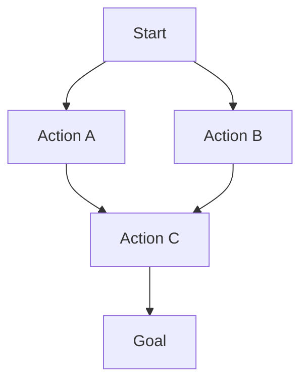
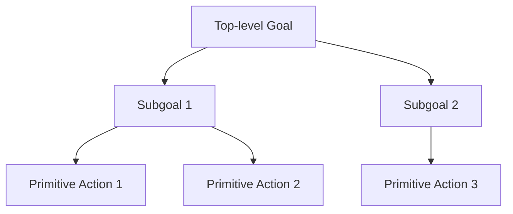
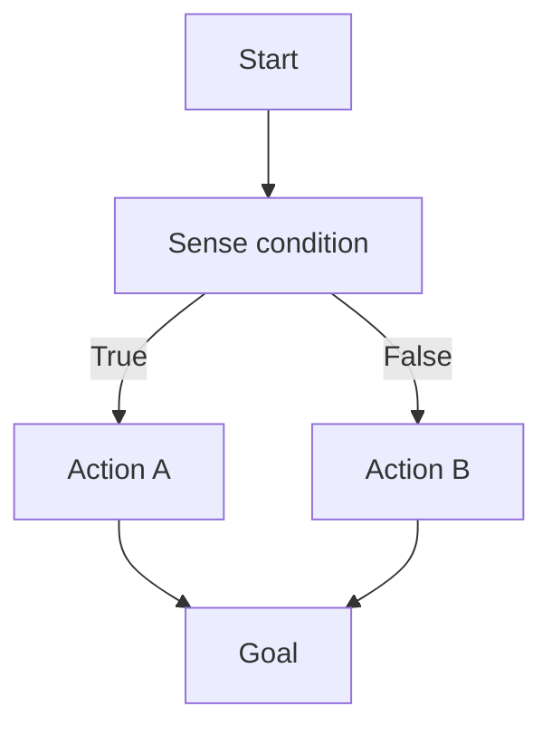
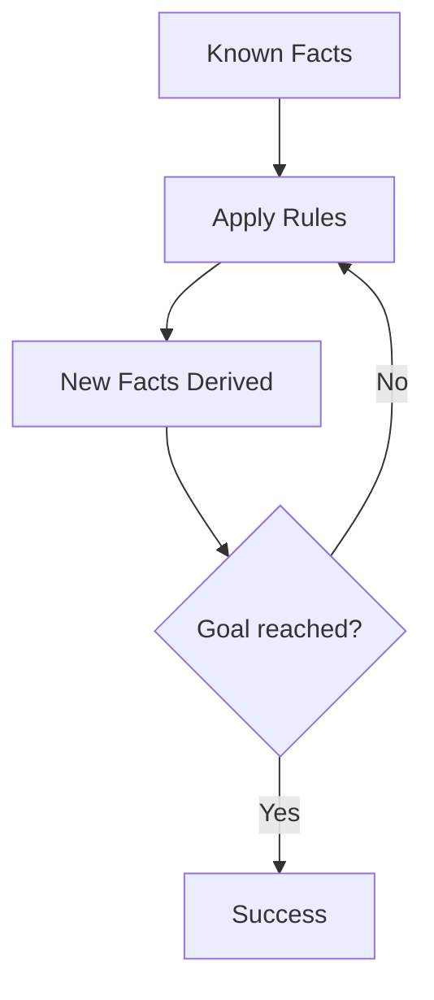
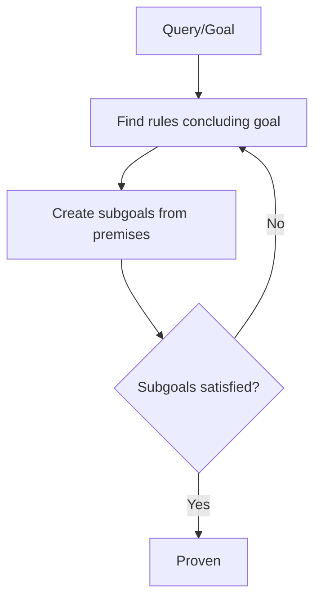

# AIDS-1 Module 3

## What is Unification? Give example. (5 marks)

Unification is the process of finding a substitution that makes two logical expressions identical. It is a fundamental operation in automated theorem proving and logic programming.

**Key points:**
- A substitution maps variables to terms
- Two expressions are unifiable if there exists a substitution that makes them syntactically equal
- The most general unifier (MGU) is the simplest such substitution

**Example:**
Unify the expressions: `P(x, f(y))` and `P(a, f(z))`

The substitution `{x/a, z/y}` makes both expressions become `P(a, f(y))`, so they are unified.

Another example: `Loves(x, y)` and `Loves(John, Mary)` unify with `{x/John, y/Mary}`.

---

## What is Skolemization? Explain Skolem constant and Skolem function. (5 marks)

Skolemization is the process of removing existential quantifiers from a first-order logic formula by replacing existentially quantified variables with Skolem constants or Skolem functions.

**Skolem constant:** Used when an existential quantifier is not within the scope of any universal quantifier. The existential variable is replaced by a new constant symbol not appearing elsewhere.

*Example:* `∃x P(x)` becomes `P(c)` where `c` is a Skolem constant.

**Skolem function:** Used when an existential quantifier appears inside the scope of universal quantifiers. The existential variable becomes a function of the universally quantified variables.

*Example:* `∀y ∃x P(x, y)` becomes `∀y P(f(y), y)` where `f` is a Skolem function.

---

## The law says it is a crime for an American to sell weapons to hostile nations. The country Nono, an enemy of America, has some missiles, and all of its missiles were sold to it by Colonel West, who is American. Prove that Col. West is a criminal! (10 marks)

**Step 1: Represent the knowledge in First-Order Logic**

1. `∀x ∀y ∀z (American(x) ∧ Weapon(y) ∧ Sells(x, y, z) ∧ Hostile(z) → Criminal(x))`
2. `∃x Missile(x) ∧ Owns(Nono, x)`
3. `∀x (Missile(x) ∧ Owns(Nono, x) → Sells(West, x, Nono))`
4. `∀x (Missile(x) → Weapon(x))`
5. `∀x (Enemy(x, America) → Hostile(x))`
6. `American(West)`
7. `Enemy(Nono, America)`

**Step 2: Convert to CNF**

- From 2: `Missile(M1)`, `Owns(Nono, M1)`
- From 3: `¬Missile(x) ∨ ¬Owns(Nono, x) ∨ Sells(West, x, Nono)`
- From 4: `¬Missile(x) ∨ Weapon(x)`
- From 5: `¬Enemy(x, America) ∨ Hostile(x)`
- From 6: `American(West)`
- From 7: `Enemy(Nono, America)`
- Negation of conclusion: `¬Criminal(West)`

**Step 3: Resolution proof**

1. `¬American(x) ∨ ¬Weapon(y) ∨ ¬Sells(x, y, z) ∨ ¬Hostile(z) ∨ Criminal(x)` (From 1)
2. `¬Missile(x) ∨ Owns(Nono, x)` is not used (correction: `Missile(M1)`, `Owns(Nono, M1)` are facts)
3. `¬Missile(x) ∨ ¬Owns(Nono, x) ∨ Sells(West, x, Nono)`
4. `¬Missile(x) ∨ Weapon(x)`
5. `¬Enemy(x, America) ∨ Hostile(x)`
6. `American(West)`
7. `Enemy(Nono, America)`
8. `Missile(M1)`
9. `Owns(Nono, M1)`
10. `¬Criminal(West)` (Negated goal)

Resolve 3 with 8: `¬Owns(Nono, M1) ∨ Sells(West, M1, Nono)` (using x = M1)
Resolve with 9: `Sells(West, M1, Nono)`

Resolve 4 with 8: `Weapon(M1)`

Resolve 5 with 7: `Hostile(Nono)`

Now resolve 1 with 6: `¬Weapon(y) ∨ ¬Sells(West, y, z) ∨ ¬Hostile(z) ∨ Criminal(West)` (x = West)
Resolve with `Weapon(M1)`: `¬Sells(West, M1, z) ∨ ¬Hostile(z) ∨ Criminal(West)`
Resolve with `Sells(West, M1, Nono)`: `¬Hostile(Nono) ∨ Criminal(West)`
Resolve with `Hostile(Nono)`: `Criminal(West)`
Resolve with 10: Empty clause (contradiction)

Therefore, Colonel West is a criminal.

---

## Marcus problem using resolution (10 marks)

**Given facts:**
1. `Man(Marcus)`
2. `Pompeian(Marcus)`
3. `∀x (Pompeian(x) → Roman(x))`
4. `Ruler(Caesar)`
5. `∀x (Pompeian(x) → LoyalTo(x, Caesar) ∨ Hates(x, Caesar))`
6. `∀x ∃y LoyalTo(x, y)`
7. `∀x ∀y (Person(x) ∧ Ruler(y) ∧ TryAssassinate(x, y) → ¬LoyalTo(x, y))`
8. `TryAssassinate(Marcus, Caesar)`

**Question:** Was Marcus loyal to Caesar? (Prove or disprove `LoyalTo(Marcus, Caesar)`)

**Convert to CNF:**

1. `Man(Marcus)`
2. `Pompeian(Marcus)`
3. `¬Pompeian(x) ∨ Roman(x)`
4. `Ruler(Caesar)`
5. `¬Pompeian(x) ∨ LoyalTo(x, Caesar) ∨ Hates(x, Caesar)`
6. `LoyalTo(x, f(x))` (Skolem function)
7. `¬Person(x) ∨ ¬Ruler(y) ∨ ¬TryAssassinate(x, y) ∨ ¬LoyalTo(x, y)`
8. `TryAssassinate(Marcus, Caesar)`
9. `Person(x) ←` (need to add: `∀x (Man(x) → Person(x))` → `¬Man(x) ∨ Person(x)`)
   From 1 and `¬Man(x) ∨ Person(x)`: `Person(Marcus)`

**To prove:** `LoyalTo(Marcus, Caesar)` is false. Assume `LoyalTo(Marcus, Caesar)` and derive contradiction.

Add negated goal: `LoyalTo(Marcus, Caesar)` (assume true to test consistency)

From 5 with x = Marcus: `¬Pompeian(Marcus) ∨ LoyalTo(Marcus, Caesar) ∨ Hates(Marcus, Caesar)`
From 2: `LoyalTo(Marcus, Caesar) ∨ Hates(Marcus, Caesar)`
With assumption `LoyalTo(Marcus, Caesar)`, this is satisfied.

From 7 with x = Marcus, y = Caesar: `¬Person(Marcus) ∨ ¬Ruler(Caesar) ∨ ¬TryAssassinate(Marcus, Caesar) ∨ ¬LoyalTo(Marcus, Caesar)`
From 9: `Person(Marcus)`
From 4: `Ruler(Caesar)`
From 8: `TryAssassinate(Marcus, Caesar)`
This gives: `¬LoyalTo(Marcus, Caesar)`
This contradicts our assumption `LoyalTo(Marcus, Caesar)`.

Therefore, **Marcus was NOT loyal to Caesar**.

---

## What are the rules of conversion from predicate to CNF? Explain each rule with proper example. (10 marks)

**Step-by-step conversion to CNF (Conjunctive Normal Form):**

**Rule 1: Eliminate implications**
Replace `A → B` with `¬A ∨ B`

*Example:* `∀x (Man(x) → Mortal(x))` becomes `∀x (¬Man(x) ∨ Mortal(x))`

**Rule 2: Move negations inward**
Apply De Morgan's laws and eliminate double negations
- `¬(A ∧ B)` → `¬A ∨ ¬B`
- `¬(A ∨ B)` → `¬A ∧ ¬B`
- `¬∀x P(x)` → `∃x ¬P(x)`
- `¬∃x P(x)` → `∀x ¬P(x)`

*Example:* `¬∀x (P(x) ∧ Q(x))` → `∃x (¬P(x) ∨ ¬Q(x))`

**Rule 3: Standardize variables**
Rename variables so each quantifier has a unique variable name

*Example:* `∀x P(x) ∨ ∀x Q(x)` becomes `∀x P(x) ∨ ∀y Q(y)`

**Rule 4: Skolemize**
Remove existential quantifiers by replacing with Skolem constants/functions

*Example:* `∀x ∃y Loves(x, y)` becomes `∀x Loves(x, f(x))`

**Rule 5: Remove universal quantifiers**
Drop all universal quantifiers (assume all variables are universally quantified)

*Example:* `∀x (¬Man(x) ∨ Mortal(x))` becomes `¬Man(x) ∨ Mortal(x)`

**Rule 6: Distribute ∧ over ∨**
Convert to conjunctive normal form using: `A ∨ (B ∧ C)` → `(A ∨ B) ∧ (A ∨ C)`

*Example:* `(P ∧ Q) ∨ R` becomes `(P ∨ R) ∧ (Q ∨ R)`

**Rule 7: Flatten nested conjunctions/disjunctions**
Combine multiple ∧ or ∨ operators

*Example:* `(A ∨ B) ∨ C` becomes `A ∨ B ∨ C`

---

## Write Short Note on: CNF (5 marks)

**CNF (Conjunctive Normal Form)** is a standardized representation of logical formulas where:
- The formula is a conjunction (∧) of clauses
- Each clause is a disjunction (∨) of literals
- Each literal is an atomic proposition or its negation

**Structure:** `(L₁₁ ∨ L₁₂ ∨ ...) ∧ (L₂₁ ∨ L₂₂ ∨ ...) ∧ ...`

**Properties:**
- Every propositional logic formula can be converted to CNF
- Used extensively in resolution theorem proving
- Simplifies automated reasoning algorithms

**Example:** `(¬P ∨ Q) ∧ (R ∨ ¬S) ∧ (P ∨ S ∨ ¬Q)`

**Conversion steps:** Eliminate →, move ¬ inward, distribute ∨ over ∧.

---

## Write Short Note on: Skolemization (5 marks)

**Skolemization** is the process of eliminating existential quantifiers from a first-order logic formula while preserving satisfiability.

**Method:**
- Replace each existentially quantified variable with a new function symbol (Skolem function) whose arguments are all universally quantified variables that scope over the existential quantifier
- For existential quantifiers not under any universal quantifier, use a Skolem constant

**Purpose:**
- Converts formulas to Skolem normal form (only universal quantifiers)
- Prepares formulas for resolution theorem proving

**Example:**
- `∃x P(x)` → `P(c)` (Skolem constant)
- `∀y ∃x P(x, y)` → `∀y P(f(y), y)` (Skolem function)

**Important:** Skolemization preserves satisfiability but not logical equivalence.

---

## Write Short Note on: Rules in Propositional Logic (5 marks)

**Propositional Logic Rules for Inference:**

| Rule | Form | Description |
|------|------|-------------|
| Modus Ponens | `P, P→Q ⊢ Q` | If P is true and P implies Q, Q is true |
| Modus Tollens | `¬Q, P→Q ⊢ ¬P` | If Q is false and P implies Q, P is false |
| Hypothetical Syllogism | `P→Q, Q→R ⊢ P→R` | Implication is transitive |
| Disjunctive Syllogism | `P∨Q, ¬P ⊢ Q` | If one disjunct is false, the other must be true |
| Conjunction | `P, Q ⊢ P∧Q` | Two true statements can be conjoined |
| Simplification | `P∧Q ⊢ P` | From a conjunction, derive either part |
| Addition | `P ⊢ P∨Q` | From a statement, derive its disjunction with anything |
| Resolution | `P∨Q, ¬P∨R ⊢ Q∨R` | Combine clauses eliminating complementary literals |

---

## Describe the process of knowledge representation using First Order Logic. (5 marks)

**Process of Knowledge Representation in FOL:**

**Step 1: Identify objects and relations**
- Define constants for specific objects (John, Book1)
- Define predicates for properties and relations (Loves, Red, FatherOf)

**Step 2: Represent facts**
Express basic knowledge as atomic sentences

*Example:* `Loves(John, Mary)`, `Book(TaleOfTwoCities)`

**Step 3: Represent general rules**
Use universal quantifiers (∀) and implications

*Example:* `∀x (Student(x) → AttendsClass(x))`

**Step 4: Represent existential knowledge**
Use existential quantifiers (∃) for existence claims

*Example:* `∃x (Teacher(x) ∧ Teaches(x, AI))`

**Step 5: Combine into knowledge base**
- Ensure consistent naming
- Avoid contradictions
- Test with query answering

**Output:** A formal, machine-interpretable set of sentences describing a domain.

---

## Discuss Partial Order, Hierarchical, and Conditional Planning. (10 marks)

**Partial Order Planning (POP):**
- Plans represented as a set of actions with ordering constraints
- Actions can be executed in any order that satisfies constraints
- Uses "least commitment" principle - postpones decisions
- Maintains causal links between actions

**Hierarchical Planning:**
- Plans decomposed into abstract levels
- Uses abstraction hierarchies to manage complexity
- Refines high-level actions into primitive actions

**Conditional Planning:**
- Handles uncertainty and partial observability
- Plans include conditional branches based on sensed information
- Uses "if-then-else" structures within plans

**Comparison:**

| Aspect | Partial Order | Hierarchical | Conditional |
|--------|---------------|--------------|-------------|
| Ordering | Flexible | Top-down | Branch-dependent |
| Complexity | Low to medium | Medium | High |
| Uncertainty | No | No | Yes |
| Main use | Scheduling | Complex tasks | Real-world planning |

---

## What is the difference between unification and Skolemization? (5 marks)

| Aspect | Unification | Skolemization |
|--------|-------------|---------------|
| **Purpose** | Find substitutions making expressions identical | Eliminate existential quantifiers |
| **Operation** | Matches variables with terms | Replaces variables with constants/functions |
| **Preserves** | Logical equivalence | Only satisfiability |
| **Direction** | Works on two expressions | Works on entire formula |
| **Variables** | Variables remain variables | Variables are replaced |
| **Output** | Most General Unifier (MGU) | Skolem normal form |
| **Use in resolution** | Matches complementary literals | Preprocessing step before CNF |

**Example - Unification:** `P(f(x), y)` and `P(f(a), b)` unify with `{x/a, y/b}`

**Example - Skolemization:** `∀x ∃y Q(x, y)` → `∀x Q(x, f(x))`

---

## Explain working of Forward and Backward Chaining algorithms. (5 marks)

**Forward Chaining (Data-driven):**
- Starts from known facts
- Applies inference rules forward
- Continues until goal is reached or no more rules apply

**Backward Chaining (Goal-driven):**
- Starts from the goal
- Works backwards to find supporting facts
- Uses recursion/subgoaling

**Comparison:**

| Aspect | Forward Chaining | Backward Chaining |
|--------|-----------------|-------------------|
| Direction | Facts → Goal | Goal → Facts |
| Best for | Planning, monitoring | Diagnosis, query answering |
| Efficiency | May generate irrelevant facts | Focused on goal |

---

## Write Short Note on: Forward chaining based proofs (5 marks)

**Forward Chaining Proofs** are a direct method of theorem proving that starts with known axioms and facts, then repeatedly applies inference rules to derive new facts until the desired conclusion is proved.

**Algorithm:**
1. Initialize working memory with all known facts
2. Apply Modus Ponens using available rules
3. Add newly derived facts to working memory
4. Repeat until goal is derived or no new facts can be added

**Properties:**
- Sound (derives only true conclusions)
- Complete for definite clauses (Horn clauses)
- Data-driven - may derive many irrelevant facts

**Example Knowledge Base:**
- Facts: `Dog(Rover)`, `∀x (Dog(x) → Animal(x))`
- Forward chaining: From `Dog(Rover)` and `Dog(x) → Animal(x)`, derive `Animal(Rover)`

**Applications:** Expert systems (OPS5, CLIPS), production rule systems, semantic reasoning.