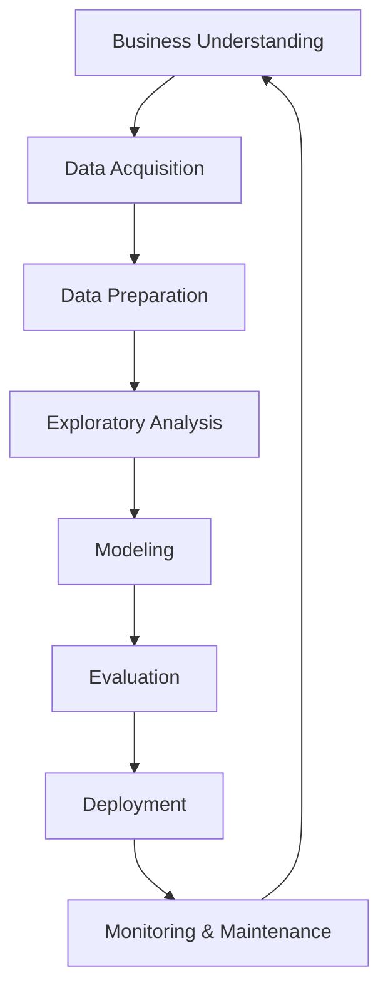
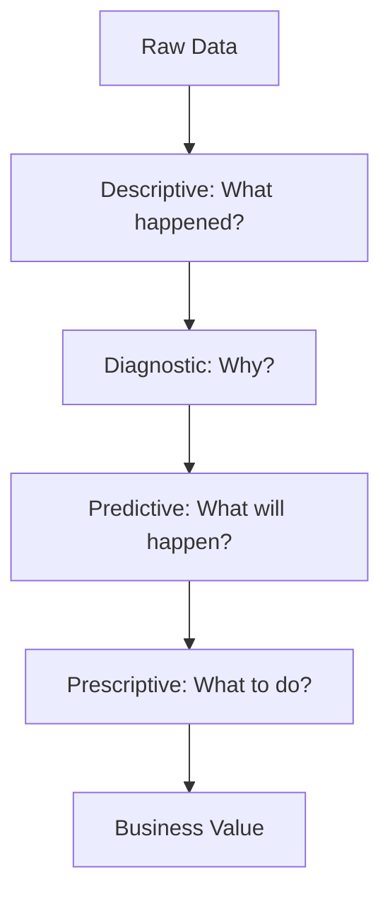
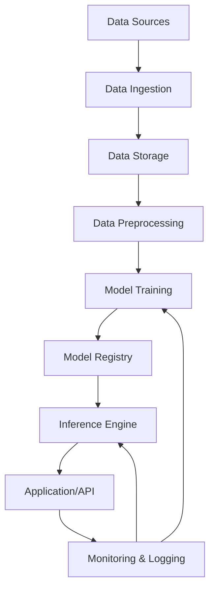
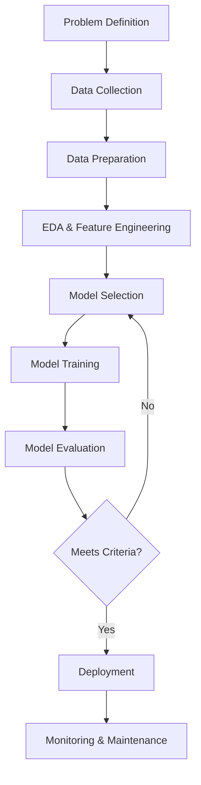

# AIDS-1 Module 4

## Explain various stages in the Data analytics Lifecycle. (10 marks)

The data analytics lifecycle consists of six sequential stages that guide analytics projects from conception to deployment.

**1. Discovery:** Define the problem, formulate initial hypotheses, and identify available data sources. Stakeholders assess project feasibility and success criteria.

**2. Data Preparation:** Extract, transform, and load (ETL) data from multiple sources. This stage includes data cleaning, handling missing values, outlier treatment, and converting data into a usable format.

**3. Model Planning:** Select appropriate analytical techniques such as regression, classification, clustering, or time series analysis. Data is sampled and partitioned into training and testing sets.

**4. Model Building:** Execute the planned models using tools like Python, R, or SAS. This stage involves iterative experimentation, parameter tuning, and comparing model performance metrics.

**5. Results Communication:** Interpret model outputs and translate findings into business recommendations. Visualizations, dashboards, and presentations are created for stakeholders.

**6. Operationalization:** Deploy the model into production environments. This includes monitoring model performance, establishing maintenance schedules, and documenting the entire process for future reference.

Each stage is iterative; insights from later stages may require revisiting earlier stages.

---

## In detail, explain steps in the Data Science Project. (10 marks)

A data science project follows a structured methodology to ensure reliable and actionable outcomes.

**Step 1: Problem Definition** – Collaborate with stakeholders to understand business objectives, define success metrics (e.g., accuracy, ROI), and formulate the problem as a data science task (classification, regression, recommendation, etc.).

**Step 2: Data Collection** – Identify internal and external data sources: databases, APIs, web scraping, log files, or third-party datasets. Ensure data access rights and document provenance.

**Step 3: Data Cleaning and Preprocessing** – Handle missing values (imputation or deletion), remove duplicates, correct inconsistent formats, detect and treat outliers, and standardize or normalize numerical features.

**Step 4: Exploratory Data Analysis (EDA)** – Use summary statistics and visualizations (histograms, box plots, correlation matrices) to understand distributions, identify patterns, and uncover relationships between variables.

**Step 5: Feature Engineering and Selection** – Create new features from existing data (e.g., date parts, interaction terms), encode categorical variables, scale numerical features, and select the most relevant features using techniques like PCA or mutual information.

**Step 6: Model Selection and Training** – Split data into training (typically 60-80%), validation, and test sets. Train multiple candidate models (linear regression, random forest, neural networks) and tune hyperparameters using cross-validation.

**Step 7: Model Evaluation** – Assess performance using appropriate metrics (accuracy, precision, recall, F1-score, RMSE) on the test set. Compare against baseline models and business success criteria.

**Step 8: Deployment and Monitoring** – Package the model as an API or integrate into existing systems. Monitor drift in data distribution or prediction quality, and schedule retraining as needed.

**Step 9: Documentation and Communication** – Create technical documentation, stakeholder reports, and dashboards. Document assumptions, limitations, and maintenance procedures.

---

## Differentiate between data scientists, big data professionals and data analysts. (10 marks)

| Aspect | Data Scientist | Big Data Professional | Data Analyst |
|--------|---------------|----------------------|--------------|
| **Primary Focus** | Predictive modeling, machine learning, and advanced analytics | Infrastructure, distributed computing, and data pipelines | Descriptive analytics, reporting, and business intelligence |
| **Key Skills** | Python/R, statistics, ML algorithms, SQL, experimentation | Hadoop, Spark, Kafka, cloud platforms (AWS/GCP/Azure), Scala/Java | SQL, Excel, Tableau/Power BI, data visualization, business acumen |
| **Typical Tasks** | Building prediction models, A/B testing, feature engineering, algorithm optimization | Designing data architectures, ETL pipelines, managing clusters (HDFS, Spark), data streaming | Creating dashboards, writing SQL queries, generating reports, trend analysis |
| **Data Volume** | Works with moderate to large datasets (sampling common) | Specifically handles massive datasets (terabytes to petabytes) | Typically works with structured, medium-sized data |
| **Output** | Predictive models, actionable insights, ML APIs | Scalable data infrastructure, real-time processing systems | Static reports, interactive dashboards, KPI tracking |
| **Programming** | Python, R, SQL | Java, Scala, Python, Spark | SQL, basic Python/R |

**Example:** A data analyst might report monthly sales trends. A data scientist builds a churn prediction model. A big data professional sets up a Spark cluster to process customer clickstream logs from millions of users.

---

## Describe in detail the stages in the Data Science Lifecycle. (10 marks)

The data science lifecycle is an end-to-end framework for delivering data-driven solutions.

**Stage 1: Business Understanding** – Define objectives, success criteria (quantitative metrics), project constraints, and stakeholder requirements. Translate business problems into analytical tasks.

**Stage 2: Data Acquisition** – Identify relevant data sources (databases, APIs, files, external providers). Collect raw data while ensuring legality, privacy compliance, and representativeness.

**Stage 3: Data Preparation** – Clean data (missing values, duplicates, outliers), transform data types, merge datasets, and perform feature engineering. This typically consumes 60-80% of project time.

**Stage 4: Exploratory Data Analysis** – Generate summary statistics, visualize distributions (histograms, box plots, scatter plots), detect anomalies, and test initial hypotheses. EDA guides modeling decisions.

**Stage 5: Modeling** – Select algorithms (regression, classification, clustering, etc.), split data (train/validation/test), train models, tune hyperparameters, and compare performance using cross-validation.

**Stage 6: Evaluation** – Assess model performance on unseen test data using appropriate metrics (accuracy, F1, RMSE). Validate against business success criteria and check for overfitting or bias.

**Stage 7: Deployment** – Integrate model into production environment (API, batch scoring, embedded system). Implement version control, logging, and rollback procedures.

**Stage 8: Monitoring & Maintenance** – Track model drift, data quality changes, and performance degradation. Schedule regular retraining and update documentation.

The lifecycle is iterative; insights from later stages frequently trigger revisiting earlier stages.

---

## Compare and contrast Data Science, Business Analytics, and Big Data with examples. (10 marks)

| Dimension | Data Science | Business Analytics | Big Data |
|-----------|--------------|--------------------|----------|
| **Primary Goal** | Extract insights and build predictive models from complex data | Support decision-making through descriptive and diagnostic analytics | Process and store massive, high-velocity datasets |
| **Data Characteristics** | Structured and unstructured (text, images, sensor data) | Primarily structured (tables, spreadsheets) | Volume, Velocity, Variety (3 Vs) |
| **Techniques** | Machine learning, deep learning, statistical modeling, experimentation | SQL, dashboards, regression, forecasting, OLAP | Distributed computing (Hadoop, Spark), NoSQL databases, stream processing |
| **Time Orientation** | Predictive (future) and prescriptive (what to do) | Descriptive (past) and diagnostic (why it happened) | Real-time or near-real-time processing |
| **Output** | ML models, recommendation engines, classification systems | Reports, KPIs, dashboards, ad-hoc queries | Scalable data pipelines, data lakes, real-time analytics infrastructure |
| **Typical Tools** | Python, R, TensorFlow, PyTorch, Jupyter | SQL, Excel, Tableau, Power BI, SAS | Hadoop, Spark, Kafka, Hive, Cassandra |
| **Example** | Building a fraud detection model that learns from transaction patterns | Creating a monthly sales report with year-over-year comparison | Processing 1 million social media posts per second using Spark Streaming |

**Convergence:** These fields overlap extensively. A big data infrastructure enables data science on massive scales. Business analytics often uses data science techniques for forecasting. The distinctions lie in primary focus: infrastructure (Big Data), prediction (Data Science), and reporting (Business Analytics).

---

## What do you mean by data analytics? What are the different types of data analytics? (10 marks)

**Data analytics** is the systematic process of collecting, cleaning, transforming, and modeling data to discover meaningful patterns, draw conclusions, and support decision-making. It transforms raw data into actionable intelligence.

**Four types of data analytics:**

**1. Descriptive Analytics** – *What happened?*  
Summarizes historical data using aggregates and visualizations. Examples: monthly sales reports, website traffic dashboards, student grade summaries. Tools: Excel, Tableau, Power BI.

**2. Diagnostic Analytics** – *Why did it happen?*  
Identifies root causes and relationships through drill-down, data mining, and correlation analysis. Examples: analyzing why sales dropped in Q3, investigating customer churn drivers. Techniques: hypothesis testing, cohort analysis.

**3. Predictive Analytics** – *What is likely to happen?*  
Uses statistical models and machine learning to forecast future outcomes. Examples: customer churn prediction, demand forecasting, loan default risk assessment. Techniques: regression, time series, classification.

**4. Prescriptive Analytics** – *What should we do about it?*  
Recommends actions using optimization and simulation algorithms. Examples: dynamic pricing, inventory optimization, treatment recommendations. Techniques: linear programming, reinforcement learning, decision trees.

Organizations typically progress from descriptive to prescriptive as analytical maturity increases.

---

## Describe the architecture of ML application. Explain with a diagram. (10 marks)

Machine learning application architecture consists of interconnected components that handle data flow, model training, inference, and monitoring.

**Component 1: Data Sources** – Databases, APIs, IoT sensors, log files, cloud storage (S3, GCS), or streaming platforms (Kafka).

**Component 2: Data Ingestion** – Batch processing (Airflow, Luigi) or real-time streaming (Kafka, Kinesis). Handles data validation and initial formatting.

**Component 3: Data Storage** – Data lakes (raw data), data warehouses (processed data), or feature stores (curated features). Examples: Snowflake, BigQuery, Delta Lake.

**Component 4: Data Preprocessing** – Cleaning (missing values, outliers), transformation (scaling, encoding), feature engineering, and train/validation/test splitting.

**Component 5: Model Training** – Compute environment (GPU/CPU clusters) running ML frameworks (TensorFlow, PyTorch, Scikit-learn). Includes hyperparameter tuning and experiment tracking (MLflow, Weights & Biases).

**Component 6: Model Registry** – Version-controlled repository storing trained models, metadata, and performance metrics. Examples: MLflow Model Registry, Seldon.

**Component 7: Inference Engine** – Serves predictions via batch (scheduled) or real-time (REST API, gRPC) modes. Handles request batching and scaling.

**Component 8: Application/API** – End-user interface or external system consuming predictions. Manages authentication, rate limiting, and payload validation.

**Component 9: Monitoring & Logging** – Tracks data drift, concept drift, prediction latency, and model performance. Triggers retraining or alerts.

---

## Differentiate between data scientists, big data professionals and data analysts. (10 marks)

| Aspect | Data Scientist | Big Data Professional | Data Analyst |
|--------|---------------|----------------------|--------------|
| **Primary Role** | Build predictive models and discover insights from complex data | Design, implement, and maintain distributed data processing systems | Query and visualize data to answer business questions |
| **Core Techniques** | Machine learning, statistical inference, A/B testing, deep learning | Distributed computing (MapReduce, Spark), stream processing, NoSQL databases | SQL, data visualization, descriptive statistics, reporting |
| **Typical Outputs** | Prediction APIs, classification models, recommendation engines, experiment results | Scalable ETL pipelines, data lakes, real-time processing infrastructure | Dashboards, periodic reports, ad-hoc query results, KPI tracking |
| **Programming Languages** | Python, R, SQL, sometimes Julia or Scala | Java, Scala, Python, SQL, Bash | SQL, basic Python, occasionally R |
| **Data Volume** | Works with sampled or aggregated data (GB to TB) | Handles raw, massive datasets (TB to PB) | Works with curated, moderate-sized data (MB to GB) |
| **Statistical Depth** | Advanced (inferential statistics, probability, experimental design) | Minimal (basic descriptive statistics) | Intermediate (aggregations, trends, basic hypothesis testing) |
| **Business Interaction** | Moderate – translates business problems to technical tasks | Low – focuses on infrastructure reliability | High – directly supports business stakeholders |
| **Example Project** | Predict customer lifetime value using historical behavior | Set up a Spark cluster to process 500 GB of clickstream logs hourly | Create a monthly dashboard of sales by region and product category |

**Overlap note:** In small organizations, one person may perform multiple roles. In large enterprises, these roles are distinct and collaborative.

---

## Describe steps for developing ML applications with a labeled diagram. (10 marks)

Developing machine learning applications follows a systematic pipeline from problem identification to production deployment.

**Step 1: Problem Definition** – Frame the business need as an ML task (classification, regression, clustering, recommendation). Define success metrics (accuracy, precision, recall, RMSE, business KPIs). Identify constraints (latency, interpretability, compute budget).

**Step 2: Data Collection** – Gather data from databases, APIs, web scraping, or sensors. Ensure sufficient volume, variety, and representativeness. Document data provenance and legal compliance.

**Step 3: Data Preparation** – Handle missing values (impute or delete), remove duplicates, correct data types, detect and treat outliers, normalize or standardize numerical features. Split into training (60%), validation (20%), and test (20%) sets.

**Step 4: Exploratory Data Analysis & Feature Engineering** – Visualize distributions, correlations, and patterns. Create new features from existing data (polynomial features, interaction terms, date components). Encode categorical variables (one-hot, label encoding). Select relevant features using statistical tests or feature importance.

**Step 5: Model Selection** – Choose candidate algorithms based on problem type, data size, interpretability needs, and computational constraints. Examples: linear regression for forecasting, random forest for classification, LSTM for time series.

**Step 6: Model Training** – Train models on training data using appropriate loss functions and optimizers. Tune hyperparameters using grid search, random search, or Bayesian optimization with cross-validation.

**Step 7: Model Evaluation** – Assess performance on the validation set using chosen metrics. Compare against baseline models. Check for overfitting (training vs validation performance gap), bias, and variance.

**Step 8: Iteration** – If criteria not met, revisit feature engineering, model selection, or hyperparameter tuning. Document all experiments.

**Step 9: Deployment** – Package the final model (pickle, ONNX, TensorFlow SavedModel). Create inference API using Flask, FastAPI, or TensorFlow Serving. Implement version control and rollback strategy.

**Step 10: Monitoring & Maintenance** – Track prediction latency, data drift, concept drift, and model accuracy in production. Establish retraining schedules (periodic or trigger-based). Log predictions for audit and improvement.