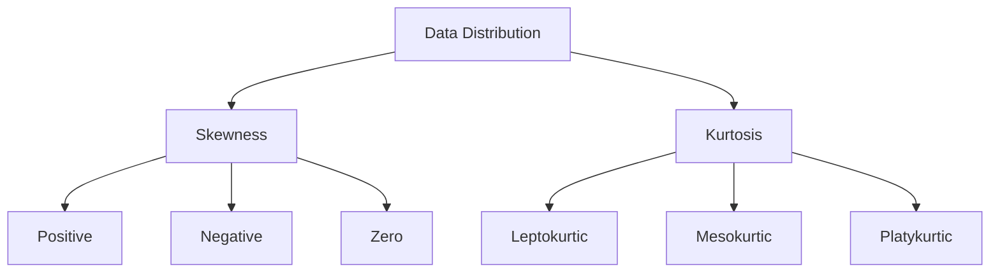
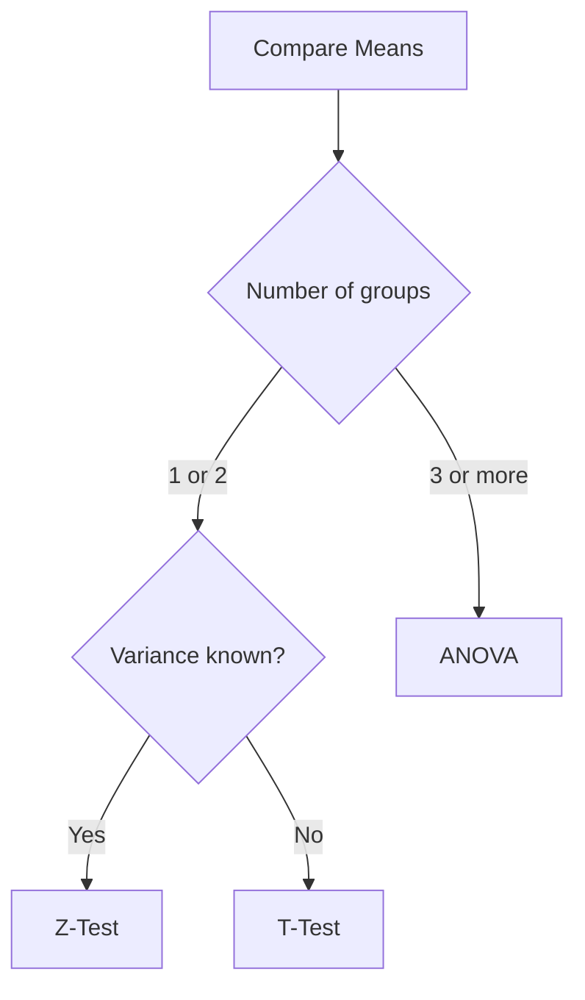
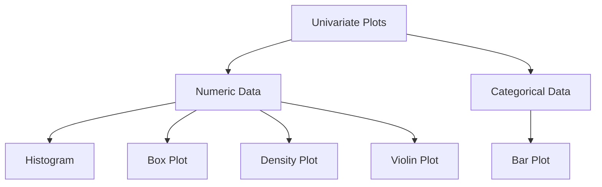
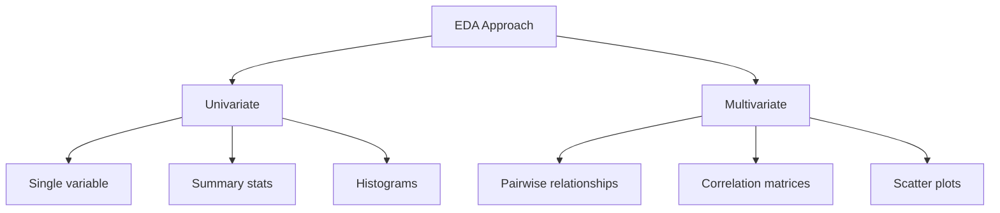
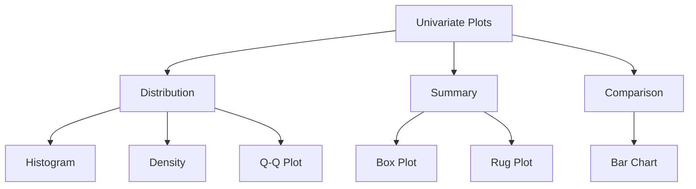
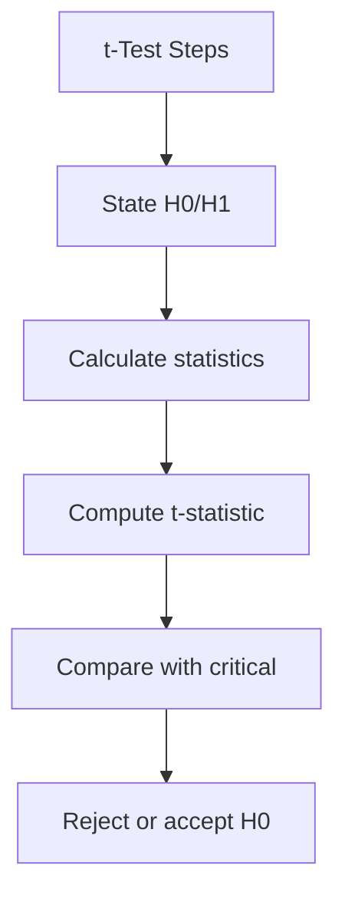
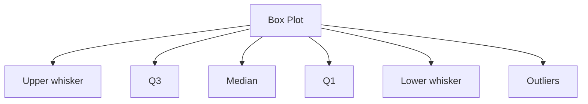
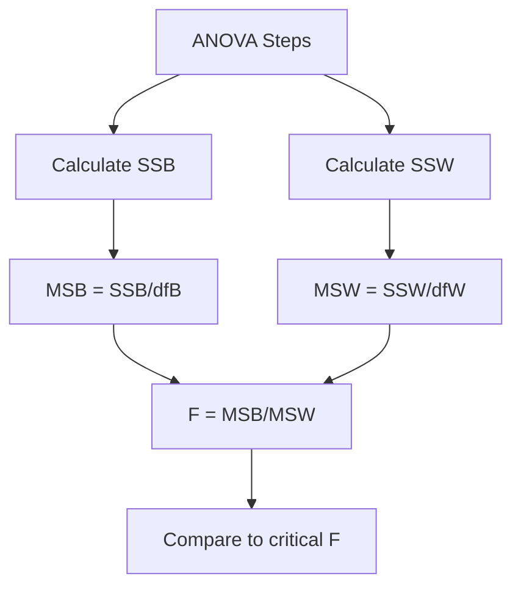

## AIDS-1 Module 5

### Explain what role is played by Correlation and Covariance in EDA? (5 marks)

Correlation and covariance are statistical measures used in EDA to quantify relationships between variables.

**Covariance** indicates the direction of the linear relationship between two variables. A positive value suggests both variables increase together; negative indicates one increases as the other decreases.

**Correlation** standardizes covariance to a dimensionless scale between -1 and +1, making it interpretable across different units.

**Roles in EDA:**
- Identify feature relationships before modeling
- Detect multicollinearity among predictors
- Guide feature selection by revealing redundant variables
- Uncover patterns that warrant further investigation
- Validate scatter plot observations quantitatively

---

### What do you mean by covariance and correlation? Explain the range of coefficients of correlation and covariance. Calculate COV and CORRCOV for given data (Observed Value1, Observed Value2). How do you interpret these values? (10 marks)

**Covariance** measures how two variables change together.
Formula:

$$
\operatorname{COV}(X,Y) = \frac{\sum_{i=1}^{n} (X_i - \bar{X})(Y_i - \bar{Y})}{n-1}
$$

**Correlation** measures the strength and direction of linear relationship between variables. Formula:

$$
\operatorname{CORR}(X,Y) = \frac{\operatorname{COV}(X,Y)}{\sigma_X \cdot \sigma_Y}
$$

**Ranges:**
- Covariance: No fixed range; values depend on data units (can be any real number)
- Correlation coefficient: Always between -1 and +1

**Interpretation of Correlation:**

| Value | Interpretation |
|-------|----------------|
| +1 | Perfect positive linear relationship |
| +0.7 to +0.99 | Strong positive |
| +0.3 to +0.69 | Moderate positive |
| 0 to +0.29 | Weak positive |
| 0 | No linear relationship |
| -0.29 to 0 | Weak negative |
| -0.69 to -0.3 | Moderate negative |
| -0.99 to -0.7 | Strong negative |
| -1 | Perfect negative linear relationship |

**Calculation Example:**

Data: X = [2,4,6,8], Y = [1,3,5,7]

$$
\bar{X} = 5,\quad \bar{Y} = 4
$$

$$
\begin{aligned}
\operatorname{COV} &= \frac{(2-5)(1-4)+(4-5)(3-4)+(6-5)(5-4)+(8-5)(7-4)}{3} \\
&= \frac{9+1+1+9}{3} = \frac{20}{3} = 6.67
\end{aligned}
$$

$$
\sigma_X = 2.58,\quad \sigma_Y = 2.58
$$

$$
\operatorname{CORR} = \frac{6.67}{2.58 \times 2.58} = \frac{6.67}{6.66} = 1.00
$$

**Interpretation:** Perfect positive correlation; variables move identically together.

---

### With respect to Quantitative data analysis explain: i. Measure of central tendencies. ii. Measure of spread iii. Skewness and Kurtosis (10 marks)

**i. Measures of Central Tendency:**

| Measure | Definition | Best Used When |
|---------|------------|----------------|
| Mean | Sum of values divided by count | Symmetric, no outliers |
| Median | Middle value when sorted | Skewed data or outliers present |
| Mode | Most frequent value | Categorical or multimodal data |

**ii. Measures of Spread:**

- **Range:** Maximum - Minimum (sensitive to outliers)
- **Interquartile Range (IQR):** Q3 - Q1 (robust to outliers)
- **Variance:** Average squared deviation from mean
- **Standard Deviation:** Square root of variance (same units as data)

**iii. Skewness and Kurtosis:**

**Skewness** measures asymmetry of distribution:
- Zero: Symmetric distribution
- Positive: Tail extends right (mean > median)
- Negative: Tail extends left (mean < median)

**Kurtosis** measures tail heaviness:
- Mesokurtic (3): Normal distribution
- Leptokurtic (>3): Heavy tails, more outliers
- Platykurtic (<3): Light tails, fewer outliers

---

### Compare barplot and histogram (5 marks)

| Feature | Barplot | Histogram |
|---------|---------|-----------|
| Data type | Categorical | Continuous (binned) |
| Bars | Separate, with gaps | Touching, no gaps |
| X-axis | Categories | Numeric intervals (bins) |
| Purpose | Compare groups | Show distribution shape |
| Order | Can be reordered | Fixed numeric order |
| Width | Arbitrary, same for all | Represents bin size |

---

### What do you mean by covariance and correlation? Explain the range of coefficients of correlation and covariance. Calculate COV and CORRCOV for given data (Observed Value1, Observed Value2). (10 marks)

**Covariance** quantifies how two variables deviate from their means together. Positive covariance indicates that when one variable increases, the other tends to increase.

**Correlation** normalizes covariance by dividing by the product of standard deviations, producing a unitless measure between -1 and +1.

**Coefficient Ranges:**
- Covariance: $(-\infty, +\infty)$ - depends entirely on measurement units
- Correlation: $[-1, +1]$ - standardized across all datasets

**Calculation (Example Data):**
X = [10,20,30,40,50], Y = [5,15,25,35,45]

Step 1: $\bar{X} = 30$, $\bar{Y} = 25$

Step 2: Deviations: $X-30 = [-20,-10,0,10,20]$; $Y-25 = [-20,-10,0,10,20]$

Step 3: Products = $[400,100,0,100,400]$; Sum = 1000

Step 4: $\operatorname{COV} = \frac{1000}{5-1} = 250$

Step 5: $\sigma_X = 15.81$, $\sigma_Y = 15.81$

Step 6: $\operatorname{CORR} = \frac{250}{15.81 \times 15.81} = \frac{250}{250} = 1.00$

**Interpretation:** Perfect positive correlation (1.00). Every increase in X corresponds proportionally to increase in Y.

---

### Compare Z-Test, T-Test and ANOVA in detail (10 marks)

| Feature | Z-Test | T-Test | ANOVA |
|---------|--------|--------|-------|
| Sample size | Large (n>30) | Small (n<30) | Any |
| Population variance | Known | Unknown (estimated) | Unknown |
| Number of groups | 1 or 2 | 1 or 2 | 3 or more |
| Distribution | Normal | Student's t | F-distribution |
| Test statistic | $Z = \frac{\bar{x} - \mu}{\sigma / \sqrt{n}}$ | $t = \frac{\bar{x} - \mu}{s / \sqrt{n}}$ | $F = \frac{MS_{\text{between}}}{MS_{\text{within}}}$ |

**When to use each:**
- **Z-Test:** Quality control, large sample proportions, known population variance
- **T-Test:** Small sample experiments, comparing two treatment means, unknown variance
- **ANOVA:** Comparing multiple group means (e.g., three teaching methods), factorial designs

**Assumptions for all three:**
- Independence of observations
- Normality (or near-normality)
- Homogeneity of variance (except Welch's variants)

---

### What are the different univariate plots in EDA? Explain them in detail (10 marks)

**Univariate plots** visualize a single variable at a time.

**1. Histogram:**
- Divides continuous data into bins
- Bar height shows frequency in each bin
- Reveals distribution shape, skewness, modes
- Optimal bin count $= \sqrt{n}$ or Sturges' rule

**2. Box Plot (Box-and-Whisker):**
- Shows five-number summary: min, Q1, median, Q3, max
- IQR box contains middle 50% of data
- Whiskers extend to $1.5 \times \text{IQR}$
- Points beyond whiskers = potential outliers

**3. Density Plot:**
- Smooth version of histogram
- Area under curve = 1
- Better for comparing multiple distributions
- Uses kernel smoothing

**4. Bar Plot:**
- For categorical data
- Bar height represents frequency or proportion
- Bars separated by gaps

**5. Q-Q Plot (Quantile-Quantile):**
- Compares data quantiles to theoretical distribution
- Points along diagonal = normal distribution
- Deviations indicate skewness or heavy tails

**6. Violin Plot:**
- Combines box plot with density plot
- Wider sections indicate higher probability
- Shows full distribution shape

---

### Compare and contrast univariate and multivariate EDA with suitable examples (10 marks)

| Aspect | Univariate EDA | Multivariate EDA |
|--------|---------------|------------------|
| Variables analyzed | One at a time | Two or more simultaneously |
| Purpose | Understand individual variable distribution | Discover relationships and interactions |
| Typical plots | Histogram, box plot, bar plot | Scatter plot, heatmap, parallel coordinates |
| Statistics | Mean, median, variance, skewness | Correlation, covariance, regression coefficients |
| Insights | Outliers, shape, central tendency | Interactions, dependencies, clusters |

**Examples:**

**Univariate EDA - Customer Age Analysis:**
- Histogram shows age distribution
- Mean = 42 years, median = 40 years
- Slight positive skew indicates younger customers

**Multivariate EDA - Age vs Spending:**
- Scatter plot reveals positive correlation
- Heatmap shows age, income, spending relationships
- Older customers with high income spend most

**When to use each:**
- Univariate first: Understand each variable individually
- Multivariate second: Explore how variables interact

---

### Explain the importance of graphical methods in EDA (10 marks)

Graphical methods are essential in EDA because they reveal patterns that summary statistics miss.

**Key Importance:**

**1. Pattern Detection:**
- Trends, cycles, and seasonality become visible
- Clusters and gaps appear naturally
- Nonlinear relationships emerge clearly

**2. Outlier Identification:**
- Box plots show points beyond whiskers
- Scatter plots reveal isolated points
- Histograms display unexpected gaps

**3. Distribution Assessment:**
- Skewness visible in histogram shape
- Modality (unimodal vs multimodal) apparent
- Q-Q plots assess normality visually

**4. Communication:**
- Stakeholders understand graphs intuitively
- Complex findings explained visually
- Reports become more compelling

**5. Assumption Checking:**
- Linearity for regression
- Constant variance (homoscedasticity)
- Independence of residuals

**6. Data Quality:**
- Missing data patterns
- Measurement errors (heaping at round numbers)
- Data entry mistakes

**Limitations:**
- Can be subjective
- Overplotting with large datasets
- Requires appropriate scale selection

---

### What do you mean by covariance and correlation? Explain their interpretation and the range of coefficients. Calculate Covariance and Correlation Coefficient for given X and Y data. Interpret results (10 marks)

**Definition of Covariance:**
Statistical measure of how two variables change together. Formula:

$$
\operatorname{COV}(X,Y) = \frac{\sum_{i=1}^{n} (X_i - \bar{X})(Y_i - \bar{Y})}{n-1}
$$

**Definition of Correlation:**
Standardized measure of linear relationship strength, independent of units. Formula:

$$
r = \frac{\operatorname{COV}(X,Y)}{\sigma_X \cdot \sigma_Y}
$$

**Range and Interpretation:**

**Correlation Coefficient ($r$):**
- $r = +1$: Perfect positive (points on upward line)
- $r = 0.7$ to $0.9$: Strong positive
- $r = 0.3$ to $0.6$: Moderate positive
- $r = 0$ to $0.2$: Weak positive
- $r = 0$: No linear relationship
- $r = -0.2$ to $0$: Weak negative
- $r = -0.6$ to $-0.3$: Moderate negative
- $r = -0.9$ to $-0.7$: Strong negative
- $r = -1$: Perfect negative

**Covariance Interpretation:**
- Positive: Variables move same direction
- Negative: Variables move opposite directions
- Zero: No linear relationship
- Magnitude not directly interpretable (unit dependent)

**Calculation Example:**
X = [1,2,3,4,5], Y = [2,4,6,8,10]

$\bar{X} = 3$, $\bar{Y} = 6$

Products: $(1-3)(2-6)=8$, $(2-3)(4-6)=2$, $(3-3)(6-6)=0$, $(4-3)(8-6)=2$, $(5-3)(10-6)=8$

Sum = 20

$\operatorname{COV} = \frac{20}{5-1} = 5$

$\sigma_X = 1.58$, $\sigma_Y = 3.16$

$\operatorname{CORR} = \frac{5}{1.58 \times 3.16} = \frac{5}{5} = 1.00$

**Interpretation:** Perfect positive correlation. X and Y have exact linear relationship $Y = 2X$.

---

### What are the different univariate plots in EDA? Explain them in detail (10 marks)

**1. Histogram:**
- Construct bins covering data range (Sturges: $k = 1 + \log_2 n$)
- Count observations per bin
- Plot bars touching to show continuity
- Reveals: shape, center, spread, gaps, outliers

**2. Box Plot:**
- Calculate median (Q2), Q1 (25th percentile), Q3 (75th percentile)
- $\text{IQR} = Q3 - Q1$
- Lower whisker $= \max(\text{minimum}, Q1 - 1.5 \times \text{IQR})$
- Upper whisker $= \min(\text{maximum}, Q3 + 1.5 \times \text{IQR})$
- Plot outliers as individual points

**3. Density Plot:**
- Place kernel (typically Gaussian) at each data point
- Sum kernels to create smooth curve
- Bandwidth controls smoothness
- Area integrates to 1

**4. Bar Chart:**
- Categorical variable on x-axis
- Frequency or proportion on y-axis
- Bars separated by gaps (unlike histogram)

**5. Q-Q Plot:**
- Sort data in ascending order
- Calculate theoretical quantiles for chosen distribution
- Plot data quantiles vs theoretical quantiles
- Reference line indicates perfect fit

**6. Rug Plot:**
- Small tick marks on axis
- Each tick represents one observation
- Often added to density plots

---

### Perform t-test on given Tea/Coffee customer preference data (5 trials). Comment if means are same. State Null/Alternate hypothesis (10 marks)

**Given Data (5 trials each):**
Tea preference scores: [7, 8, 6, 9, 7]
Coffee preference scores: [5, 6, 4, 7, 5]

**Step 1: State Hypotheses**
- $H_0$ (Null): $\mu_{\text{tea}} = \mu_{\text{coffee}}$ (Mean preferences are equal)
- $H_1$ (Alternative): $\mu_{\text{tea}} \neq \mu_{\text{coffee}}$ (Mean preferences are different)

**Step 2: Calculate Summary Statistics**
Tea: $\bar{X}_1 = 7.4$, $s_1 = 1.14$, $n_1 = 5$
Coffee: $\bar{X}_2 = 5.4$, $s_2 = 1.14$, $n_2 = 5$

**Step 3: Pooled Variance**
$$
s^2_{\text{pooled}} = \frac{(n_1-1)s_1^2 + (n_2-1)s_2^2}{n_1+n_2-2} = \frac{(4 \times 1.30) + (4 \times 1.30)}{8} = \frac{5.2+5.2}{8} = \frac{10.4}{8} = 1.3
$$

**Step 4: Calculate t-statistic**
$$
t = \frac{\bar{X}_1 - \bar{X}_2}{\sqrt{s^2_{\text{pooled}} \left( \frac{1}{n_1} + \frac{1}{n_2} \right)}} = \frac{7.4-5.4}{\sqrt{1.3 \left( 0.2+0.2 \right)}} = \frac{2}{\sqrt{1.3 \times 0.4}} = \frac{2}{\sqrt{0.52}} = \frac{2}{0.72} = 2.78
$$

**Step 5: Determine Critical Value**
Degrees of freedom $= n_1+n_2-2 = 8$
Critical $t(\alpha=0.05$, two-tailed$) = 2.306$

**Step 6: Decision**
$|t| = 2.78 > 2.306$, therefore reject $H_0$

**Conclusion:** There is sufficient evidence that tea and coffee preference means are different. Tea preference (7.4) is significantly higher than coffee preference (5.4).

---

### What are the different univariate plots in EDA? Explain them in detail (10 marks)

**1. Histogram:**
Most fundamental univariate plot. Process: Determine bin width using Freedman-Diaconis rule ($2 \times \text{IQR} / n^{1/3}$) or Sturges' formula. Each bar represents frequency count. Interpretation: Peaks indicate modes; spread indicates variability; gaps suggest data issues.

**2. Box Plot Components:**
- Central box spans Q1 to Q3 (interquartile range)
- Line at median (Q2)
- Whiskers extend to last points within $1.5 \times \text{IQR}$
- Points outside whiskers flagged as outliers

**3. Empirical Cumulative Distribution Function (ECDF):**
- Step function increasing by $1/n$ at each data point
- Shows proportion of data $\leq$ each value
- No bin selection required
- Useful for comparing distributions

**4. Strip Plot:**
- Points plotted along single axis
- Jitter added to prevent overlap
- Shows individual observations
- Reveals gaps and clusters

**5. Probability Plot:**
- Compares data to theoretical distribution
- Special case: Normal probability plot
- Departures from line indicate non-normality

**Choosing appropriate plot:**
- Small datasets: Strip plot or ECDF
- Large datasets: Density plot or histogram
- Outlier focus: Box plot
- Distribution shape: Histogram or density plot

---

### For given data (Observed Value 1 & 2), draw scatter plot. Comment on relationship. Find Coefficient of correlation. Does statistic confirm observation? (10 marks)

**Given Data:**
Observed Value 1 (X): [2, 4, 5, 7, 8, 9]
Observed Value 2 (Y): [3, 6, 7, 10, 11, 13]

**Scatter Plot Description:**
Points: (2,3), (4,6), (5,7), (7,10), (8,11), (9,13)
Plot shows points ascending from bottom-left to top-right, roughly following a straight line.

**Visual Observation Comment:**
Strong positive linear relationship. As X increases, Y consistently increases at approximately the same rate.

**Calculate Correlation Coefficient:**

Step 1: 
$$
\bar{X} = \frac{2+4+5+7+8+9}{6} = \frac{35}{6} = 5.83
$$

Step 2: 
$$
\bar{Y} = \frac{3+6+7+10+11+13}{6} = \frac{50}{6} = 8.33
$$

Step 3: Products of deviations:
$$
\begin{aligned}
(2-5.83)(3-8.33) &= (-3.83)(-5.33) = 20.41 \\
(4-5.83)(6-8.33) &= (-1.83)(-2.33) = 4.26 \\
(5-5.83)(7-8.33) &= (-0.83)(-1.33) = 1.10 \\
(7-5.83)(10-8.33) &= (1.17)(1.67) = 1.95 \\
(8-5.83)(11-8.33) &= (2.17)(2.67) = 5.79 \\
(9-5.83)(13-8.33) &= (3.17)(4.67) = 14.80 \\
\text{Sum} &= 48.31
\end{aligned}
$$

Step 4: Covariance = $\frac{48.31}{6-1} = 9.66$

Step 5: 
$$
\begin{aligned}
\sigma_X &= \sqrt{\frac{\sum (X-\bar{X})^2}{5}} = \sqrt{\frac{14.67+3.35+0.69+1.37+4.71+10.05}{5}} = \sqrt{\frac{34.84}{5}} = \sqrt{6.97} = 2.64 \\
\sigma_Y &= \sqrt{\frac{\sum (Y-\bar{Y})^2}{5}} = \sqrt{\frac{28.41+5.43+1.77+2.79+7.13+21.81}{5}} = \sqrt{\frac{67.34}{5}} = \sqrt{13.47} = 3.67
\end{aligned}
$$

Step 6: 
$$
r = \frac{9.66}{2.64 \times 3.67} = \frac{9.66}{9.69} = 0.997
$$

**Interpretation:**
$r = 0.997$ indicates very strong positive correlation (nearly perfect).

**Statistic Confirmation:**
Yes, the correlation coefficient (0.997) strongly confirms the visual observation of a strong positive linear relationship. The near-perfect value indicates the points lie very close to a straight line.

---

### Write Short Note on: ANOVA (5 marks)

ANOVA (Analysis of Variance) tests whether means of three or more groups are significantly different.

**Basic Concept:**
Compares variance between groups to variance within groups.

**F-statistic:** 
$$
F = \frac{MS_{\text{between}}}{MS_{\text{within}}}
$$
- Large $F$ $\rightarrow$ groups differ significantly
- Small $F$ $\rightarrow$ groups similar

**Types:**
- One-way ANOVA: One independent variable
- Two-way ANOVA: Two independent variables (with interaction)
- Repeated measures ANOVA: Same subjects measured multiple times

**Assumptions:** Independence, normality, homogeneity of variance.

**Example:** Comparing exam scores across three teaching methods (lecture, online, hybrid). Reject $H_0$ if $p < 0.05$, indicating methods produce different mean scores.

---

### Write Short Note on: Non graphical EDA (5 marks)

Non-graphical EDA uses numerical summaries to describe data without visualizations.

**Key techniques:**
- Five-number summary (minimum, Q1, median, Q3, maximum)
- Measures of central tendency (mean, median, mode)
- Measures of dispersion (range, IQR, variance, standard deviation)
- Skewness and kurtosis coefficients
- Correlation and covariance matrices

**Advantages:**
- Objective and precise
- Easy to automate and report
- Works well in text-based outputs

**Limitations:**
- May miss patterns visible graphically
- Can be misleading if distribution is unusual (Anscombe's quartet)

**Example output:** Mean=42.3, Median=40, SD=8.2, Skew=0.35, Kurtosis=2.8

---

### Write Short Note on: Box Plot (5 marks)

A box plot (box-and-whisker plot) graphically displays a dataset's five-number summary.

**Components:**
- Box spans from Q1 (25th percentile) to Q3 (75th percentile)
- Line inside box shows median (Q2)
- Lower whisker extends to smallest point within $Q1 - 1.5 \times \text{IQR}$
- Upper whisker extends to largest point within $Q3 + 1.5 \times \text{IQR}$
- Points beyond whiskers are outliers

**Uses:**
- Compare distributions across groups
- Identify outliers automatically
- Assess skewness (median position in box)
- Compare spread via box height (IQR)

**Advantage:** Compact display of distribution characteristics without assuming normality.

---

### Perform one way ANOVA F Test on house price prediction data (Models A, B, C, 5 trials) and comment if mean prices are same (α=0.05) (10 marks)

**Given Data:**
Model A: [220, 235, 218, 242, 230] (thousand \$)
Model B: [210, 225, 208, 232, 220]
Model C: [245, 260, 248, 255, 250]

**Step 1: State Hypotheses**
$H_0$: $\mu_A = \mu_B = \mu_C$ (All model means equal)
$H_1$: At least one mean differs

**Step 2: Calculate Group Means**
$$
\begin{aligned}
\bar{X}_A &= \frac{220+235+218+242+230}{5} = \frac{1145}{5} = 229 \\
\bar{X}_B &= \frac{210+225+208+232+220}{5} = \frac{1095}{5} = 219 \\
\bar{X}_C &= \frac{245+260+248+255+250}{5} = \frac{1258}{5} = 251.6
\end{aligned}
$$

Grand mean:
$$
\bar{X} = \frac{1145+1095+1258}{15} = \frac{3498}{15} = 233.2
$$

**Step 3: Sum of Squares Between (SSB)**
$$
\begin{aligned}
\text{SSB} &= 5\left[ (229-233.2)^2 + (219-233.2)^2 + (251.6-233.2)^2 \right] \\
&= 5\left[ (-4.2)^2 + (-14.2)^2 + (18.4)^2 \right] \\
&= 5\left[ 17.64 + 201.64 + 338.56 \right] = 5 \times 557.84 = 2789.2
\end{aligned}
$$

**Step 4: Sum of Squares Within (SSW)**
$$
\begin{aligned}
\text{SSW}_A &= (220-229)^2+(235-229)^2+(218-229)^2+(242-229)^2+(230-229)^2 \\
&= 81+36+121+169+1 = 408 \\
\text{SSW}_B &= (210-219)^2+(225-219)^2+(208-219)^2+(232-219)^2+(220-219)^2 \\
&= 81+36+121+169+1 = 408 \\
\text{SSW}_C &= (245-251.6)^2+(260-251.6)^2+(248-251.6)^2+(255-251.6)^2+(250-251.6)^2 \\
&= 43.56+70.56+12.96+11.56+2.56 = 141.2 \\
\text{SSW} &= 408+408+141.2 = 957.2
\end{aligned}
$$

**Step 5: Calculate Mean Squares**
$$
\begin{aligned}
df_{\text{between}} &= 3-1 = 2, \quad MSB = \frac{\text{SSB}}{2} = \frac{2789.2}{2} = 1394.6 \\
df_{\text{within}} &= 15-3 = 12, \quad MSW = \frac{\text{SSW}}{12} = \frac{957.2}{12} = 79.77
\end{aligned}
$$

**Step 6: Calculate F-statistic**
$$
F = \frac{MSB}{MSW} = \frac{1394.6}{79.77} = 17.48
$$

**Step 7: Decision**
Critical $F(\alpha=0.05, df1=2, df2=12) = 3.89$

Since $17.48 > 3.89$, reject $H_0$

**Conclusion:** There is significant evidence that mean house prices differ across models. Post-hoc tests would reveal Model C (251.6) highest, Model B (219) lowest.

