# AIDS-1 Module 6

## Write comparison between Business Intelligence and Data Science. (5 marks)

Business Intelligence (BI) and Data Science serve different purposes in data analysis.

| Aspect | Business Intelligence | Data Science |
|--------|----------------------|--------------|
| Focus | Past and present performance | Future predictions and discoveries |
| Data | Structured, historical data | Structured, semi-structured, unstructured |
| Output | Dashboards, reports, KPIs | Predictive models, ML algorithms |
| Approach | Descriptive and diagnostic analytics | Predictive and prescriptive analytics |
| Tools | SQL, Tableau, Power BI | Python, R, TensorFlow |
| Users | Managers, executives | Data scientists, analysts |
| Goal | Monitor business health | Discover patterns and forecast |

BI answers "what happened and why?" while Data Science answers "what will happen and how can we influence it?"

---

## Write in detail issues in machine learning. (10 marks)

Machine learning faces several critical issues that affect model performance and reliability.

Data Issues
- **Insufficient data** – Not enough data for the model to learn properly.
- **Non-representative samples** – Training data does not match the real-world situation.
- **Missing values** – Some data values are blank or unknown, making learning difficult.
- **Outliers** – Extreme values that are very different from the rest of the data.
- **Noisy data** – Wrong, incorrect, or messy values like typos or sensor errors.
- **Imbalanced classes** – One category has many examples while another has very few.

Model Issues
- **Overfitting** – Model learns noise in training data, performs poorly on unseen data.
- **Underfitting** – Model is too simple to capture the true relationship in data.

Training Issues
- **Vanishing gradients** – Model stops learning because updates become extremely tiny.
- **Exploding gradients** – Model becomes unstable because updates become extremely large.
- **Local minima** – Model gets stuck in a average solution but misses the optimal one.
- **High computational cost** – Training requires too much time, memory, or processing power.

Deployment Issues
- **Concept drift** – Real-world patterns change over time, but the model still uses old rules.
- **Poor interpretability** – Nobody can explain why the model made a particular decision.
- **Scalability problems** – Difficulty in handling big data efficiently

---

## Elaborate in detail the steps in developing a Machine Learning application with architectural diagram. (10 marks)

Developing an ML application follows a systematic lifecycle of interconnected steps.

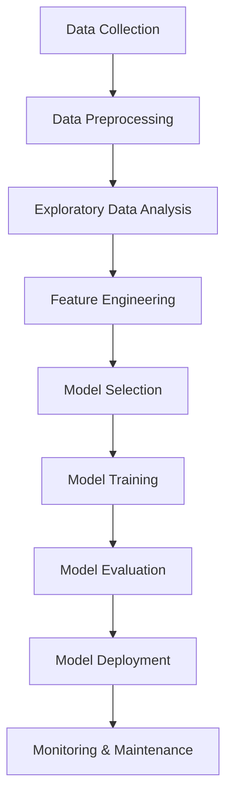

**Step 1: Problem Definition** – Clearly state the business problem as a machine learning task (classification, regression, clustering).

**Step 2: Data Collection** – Gather relevant data from databases, APIs, files, or web scraping. Ensure data volume is adequate.

**Step 3: Data Preprocessing** – Handle missing values through imputation or deletion. Remove duplicates. Detect and treat outliers. Normalize or standardize numerical features. Encode categorical variables.

**Step 4: Exploratory Data Analysis (EDA)** – Visualize data distributions using histograms and box plots. Identify correlations between features. Detect patterns and anomalies.

**Step 5: Feature Engineering** – Create new features from existing ones. Select relevant features. Reduce dimensionality using PCA if needed. Split data into training (70-80%), validation (10-15%), and test (10-15%) sets.

**Step 6: Model Selection** – Choose algorithms based on problem type, data size, and interpretability requirements (e.g., Linear Regression, Random Forest, SVM, Neural Networks).

**Step 7: Model Training** – Feed training data to the algorithm. Tune hyperparameters using cross-validation. Iterate to minimize loss function.

**Step 8: Model Evaluation** – Assess performance using appropriate metrics (accuracy, precision, recall, F1 for classification; MSE, R² for regression). Validate on unseen test data.

**Step 9: Model Deployment** – Integrate model into production environment. Expose via API or embed in application.

**Step 10: Monitoring & Maintenance** – Track prediction performance. Detect concept drift. Retrain periodically with new data.

---

## Explain SVM in detail. (10 marks)

Support Vector Machine (SVM) is a powerful supervised learning algorithm used for classification and regression, primarily binary classification.

**Core Concept:** SVM finds the optimal hyperplane that maximizes the margin between different classes. The hyperplane is a decision boundary separating data points of one class from another.

**Key Terminology:**
- **Hyperplane**: Decision boundary in n-dimensional space. For 2D, it is a line; for 3D, a plane.
- **Margin**: Distance between the hyperplane and the nearest data points from each class.
- **Support Vectors**: Data points closest to the hyperplane that determine its position. Only these points influence the decision boundary.
- **Kernel Trick**: Transforms non-linearly separable data into higher dimensions where linear separation becomes possible.

**Working Mechanism:**

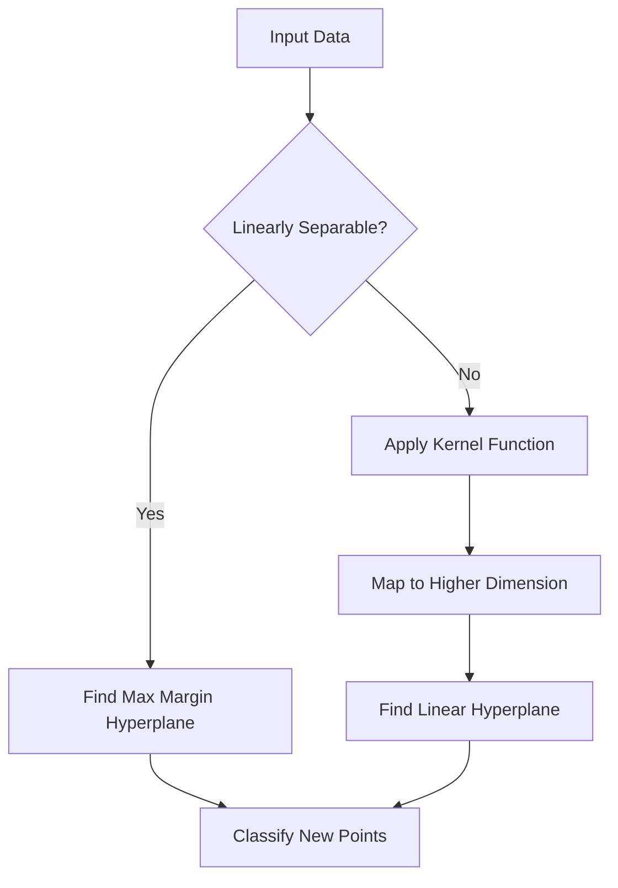

**Kernel Functions:**
- **Linear Kernel**: Use for linearly separable data. Formula: K(x,y) = x·y
- **Polynomial Kernel**: Captures polynomial relationships. K(x,y) = (x·y + c)^d
- **RBF (Radial Basis Function) Kernel**: Most popular for non-linear data. K(x,y) = exp(-γ||x-y||²)
- **Sigmoid Kernel**: Similar to neural network activation.

**Mathematical Formulation:** SVM solves the optimization problem:
Minimize (1/2)||w||² subject to yᵢ(w·xᵢ + b) ≥ 1 for all i

Where w is weight vector, b is bias, and yᵢ are class labels (±1).

**Advantages:** Effective in high dimensions. Memory efficient using support vectors. Versatile through kernel functions.

**Disadvantages:** Poor performance on very large datasets. Less interpretable when using non-linear kernels. Sensitive to parameter tuning.

---

## Compare Linear Regression vs Logistic Regression with suitable diagrams and formulas. (10 marks)

Linear and Logistic Regression serve fundamentally different purposes in machine learning.

**Basic Definitions:**
- **Linear Regression**: Predicts continuous numerical output (e.g., house prices, temperature)
- **Logistic Regression**: Predicts categorical probability output (e.g., spam or not spam)

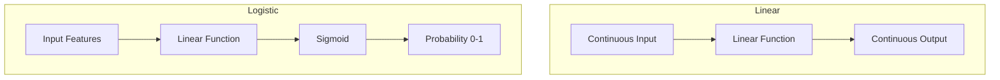

**Comparison Table:**

| Aspect | Linear Regression | Logistic Regression |
|--------|-------------------|----------------------|
| Output Type | Continuous value | Probability (0 to 1) |
| Problem Type | Regression | Classification |
| Equation | y = mx + b | p = 1/(1 + e^-(mx+b)) |
| Link Function | Identity | Logit (Sigmoid) |
| Loss Function | MSE (Mean Squared Error) | Log Loss (Cross-Entropy) |
| Decision Boundary | Linear line | Linear or non-linear curve |
| Output Range | -∞ to +∞ | 0 to 1 |

**Formulas:**

Linear Regression: `y = β₀ + β₁x₁ + β₂x₂ + ... + βₙxₙ + ε`

Logistic Regression (Sigmoid function): `p(x) = 1 / (1 + e^-(β₀ + β₁x₁ + ... + βₙxₙ))`

**When to use each:**
- Linear Regression: Predicting sales, temperature, stock prices, distance
- Logistic Regression: Email classification, disease diagnosis, churn prediction

---

## What are the different types of Machine Learning algorithms? Give example of each category. (10 marks)

Machine Learning algorithms fall into three main categories based on learning approach.

**1. Supervised Learning:** Models learn from labeled data where inputs map to known outputs.

| Algorithm Type | Examples | Use Case |
|---------------|----------|----------|
| Regression | Linear Regression, Ridge, Lasso | Price prediction |
| Classification | Logistic Regression, SVM, Decision Trees, KNN | Spam detection |
| Ensemble | Random Forest, Gradient Boosting, XGBoost | Complex predictions |

**2. Unsupervised Learning:** Models find patterns in unlabeled data without predefined outputs.

| Algorithm Type | Examples | Use Case |
|---------------|----------|----------|
| Clustering | K-Means, Hierarchical, DBSCAN | Customer segmentation |
| Dimensionality Reduction | PCA, t-SNE, LDA | Data visualization |
| Association Rule | Apriori, Eclat | Market basket analysis |

**3. Reinforcement Learning:** Models learn through trial and error by receiving rewards or penalties.

| Algorithm | Example Applications |
|-----------|---------------------|
| Q-Learning | Game playing (AlphaGo) |
| Deep Q-Network | Robotics control |
| Policy Gradient | Autonomous driving |
| SARSA | Resource management |

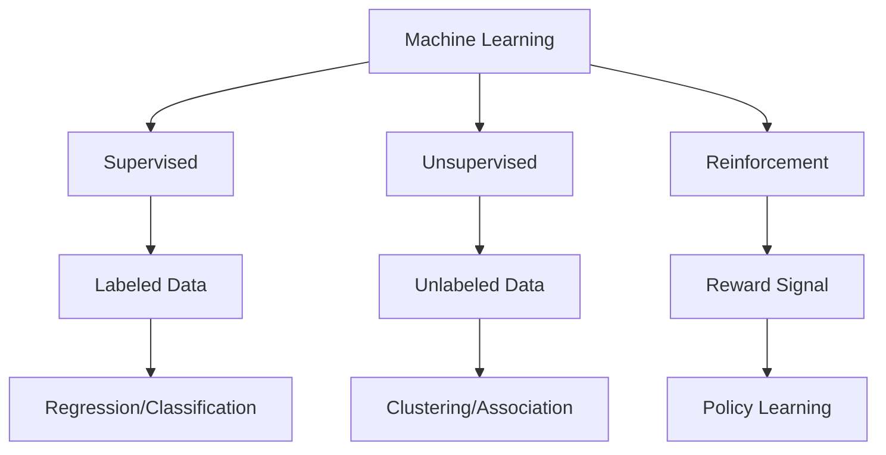

**Semi-Supervised Learning:** Combines small labeled data with large unlabeled data (e.g., document classification).

**Self-Supervised Learning:** Creates labels from data itself (e.g., masked language modeling in BERT).

---

## What are the different issues in ML algorithms? (5 marks)

Common issues in ML algorithms include:

Data Issues
- **Insufficient data** – Not enough data for the model to learn properly.
- **Non-representative samples** – Training data does not match the real-world situation.
- **Missing values** – Some data values are blank or unknown, making learning difficult.
- **Outliers** – Extreme values that are very different from the rest of the data.
- **Noisy data** – Wrong, incorrect, or messy values like typos or sensor errors.
- **Imbalanced classes** – One category has many examples while another has very few.

Model Issues
- **Overfitting** – Model learns noise in training data, performs poorly on unseen data.
- **Underfitting** – Model is too simple to capture the true relationship in data.

Training Issues
- **Vanishing gradients** – Model stops learning because updates become extremely tiny.
- **Exploding gradients** – Model becomes unstable because updates become extremely large.
- **Local minima** – Model gets stuck in a average solution but misses the optimal one.
- **High computational cost** – Training requires too much time, memory, or processing power.

Deployment Issues
- **Concept drift** – Real-world patterns change over time, but the model still uses old rules.
- **Poor interpretability** – Nobody can explain why the model made a particular decision.
- **Scalability problems** – Difficulty in handling big data efficiently

---

## Define and state effects of overfitting and underfitting. (5 marks)

**Overfitting:** Model learns training data too perfectly, including noise and irrelevant patterns. It memorizes rather than generalizes.

**Effects:**
- Exceptionally high training accuracy (approaching 100%)
- Poor performance on unseen test data
- Model fails to generalize to real-world scenarios
- High variance with low bias

**Underfitting:** Model is too simple to capture underlying patterns in data.

**Effects:**
- Poor performance on both training and test data
- High bias with low variance
- Model fails to capture relationships between features and target
- Predictions are overly simplistic or constant

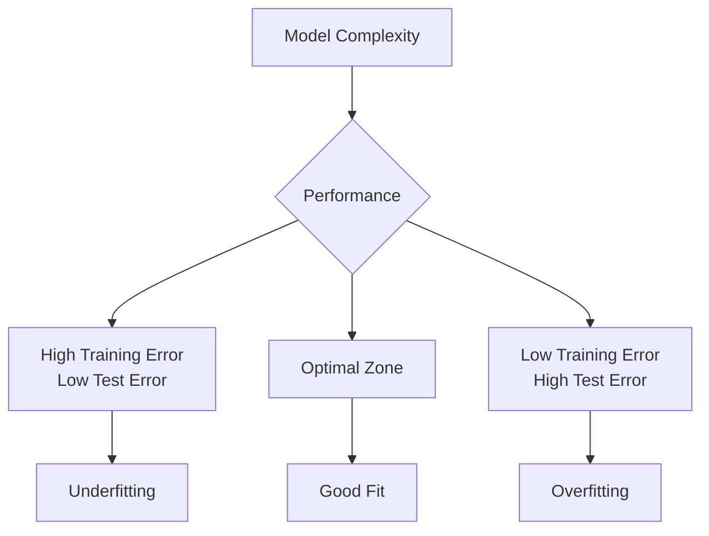

---

## What is SVM? Explain its significance in ML and compare it with logistic regression. (10 marks)

**What is SVM?** Support Vector Machine (SVM) is a supervised learning algorithm that finds the optimal hyperplane maximizing the margin between different classes. It uses support vectors (critical data points) to define decision boundaries.

**Significance in ML:**
- Effective in high-dimensional spaces (more features than samples)
- Memory efficient as it uses only support vectors
- Versatile through kernel trick for non-linear problems
- Robust against overfitting in high dimensions
- Works well on structured data with clear margin separation

**Comparison with Logistic Regression:**

| Aspect | SVM | Logistic Regression |
|--------|-----|---------------------|
| Core Principle | Maximize margin between classes | Maximize likelihood of correct classification |
| Output | Class labels (hard classification) | Probability scores (0 to 1) |
| Loss Function | Hinge loss | Log loss (cross-entropy) |
| Handling Non-linear | Kernel trick transforms data | Requires polynomial features |
| Performance | Better with clear margin | Better with probabilistic interpretation |
| Sensitivity | Sensitive to outliers | More robust to outliers |
| Training Speed | Slower for large datasets | Faster for large datasets |
| Probability Output | Not naturally probabilistic | Naturally probabilistic |

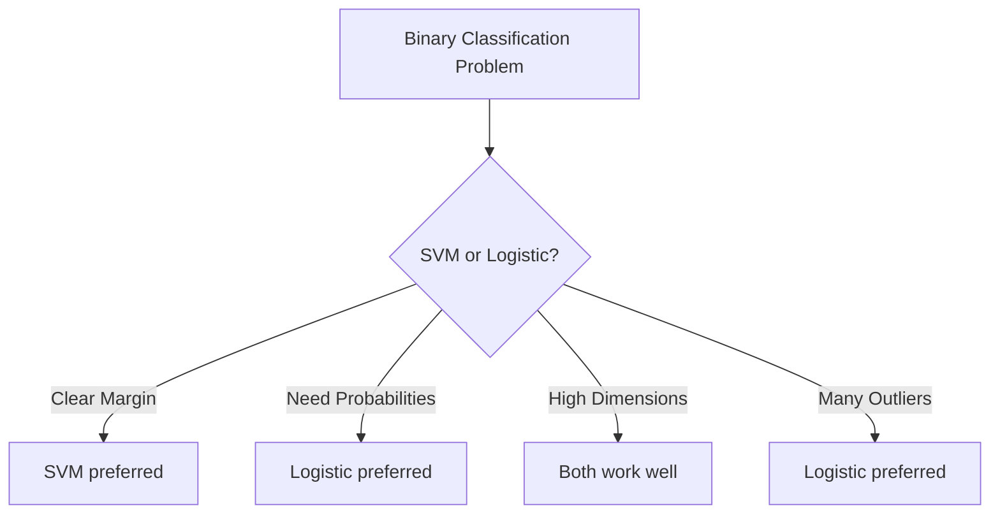

**When to choose SVM:** Image classification, text categorization, bioinformatics, scenarios with clear class separation.

**When to choose Logistic Regression:** Medical diagnosis (needs probabilities), credit scoring, marketing predictions, when interpretability matters.

---

## What is linear regression? Explain its significance in ML and compare it with logistic regression. (10 marks)

**What is Linear Regression?** Linear regression models the relationship between a dependent variable (target) and one or more independent variables (features) by fitting a linear equation. For simple linear regression: y = mx + b. For multiple linear regression: y = β₀ + β₁x₁ + β₂x₂ + ... + βₙxₙ.

**Significance in ML:**
- Foundation for understanding regression concepts
- Highly interpretable coefficients show feature impact
- Serves as baseline model for any regression problem
- Fast training and prediction
- Works well when relationships are approximately linear
- Feature importance is directly readable from coefficients

**Comparison with Logistic Regression:**

| Aspect | Linear Regression | Logistic Regression |
|--------|-------------------|----------------------|
| Prediction Type | Continuous value | Binary/categorical probability |
| Output Range | -∞ to +∞ | 0 to 1 |
| Equation Form | Linear combination | Sigmoid of linear combination |
| Error Metric | MSE, RMSE, MAE | Log Loss, Accuracy, AUC |
| Solution Method | Ordinary Least Squares | Maximum Likelihood Estimation |
| Assumption | Normally distributed errors | Binary outcome, log odds linear |

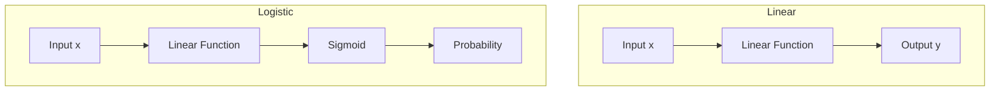

**When to use Linear Regression:** Predicting house prices, sales forecasting, temperature prediction, stock price trends.

**When to use Logistic Regression:** Email spam detection, loan default prediction, disease diagnosis, customer churn.

---

## Describe steps for developing ML applications with a labeled diagram. (10 marks)

Developing ML applications follows a structured pipeline of sequential steps.

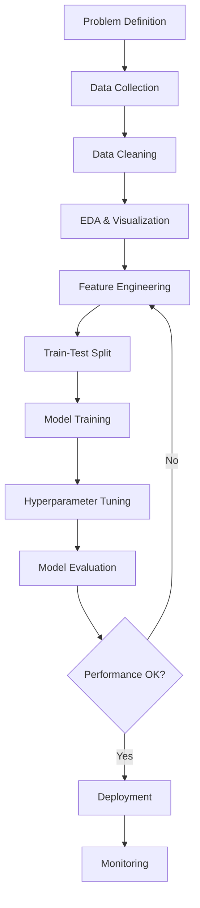

**Step 1 – Problem Definition:** Convert business problem into ML task (classification, regression, clustering, etc.). Define success metrics.

**Step 2 – Data Collection:** Gather data from databases (SQL), APIs, web scraping, CSV files, or streaming sources.

**Step 3 – Data Cleaning:** Handle missing values (impute or delete). Remove duplicates. Correct inconsistent formats. Detect and treat outliers.

**Step 4 – Exploratory Data Analysis (EDA):** Visualize distributions (histograms, box plots). Check correlations. Identify patterns and anomalies using statistical summaries.

**Step 5 – Feature Engineering:** Create new features from existing ones. Scale numerical features (normalization/standardization). Encode categorical variables (one-hot, label encoding). Select most relevant features.

**Step 6 – Train-Test Split:** Divide data into training (typically 70-80%), validation (10-15%), and test (10-15%) sets. Stratify for imbalanced classification.

**Step 7 – Model Training:** Feed training data to selected algorithm. Initialize parameters. Iteratively minimize loss function through optimization algorithms.

**Step 8 – Hyperparameter Tuning:** Use grid search or random search with cross-validation to find optimal parameters. Prevent overfitting through regularization.

**Step 9 – Model Evaluation:** Assess on test set using appropriate metrics (accuracy, precision, recall, F1, MSE, R²). Compare against baseline models.

**Step 10 – Deployment & Monitoring:** Package model as API. Monitor performance drift. Schedule retraining with fresh data.

---

## What are Supervised Machine Learning techniques? Explain Logistic Regression technique. What makes it a Supervised learning technique? (10 marks)

**Supervised Machine Learning Techniques:** Supervised learning algorithms learn from labeled training data where each input example has a corresponding output label. The algorithm learns a mapping function from inputs to outputs.

**Common Supervised Techniques:**

| Category | Algorithms |
|----------|------------|
| Regression | Linear Regression, Ridge, Lasso, Polynomial Regression |
| Classification | Logistic Regression, SVM, Decision Trees, Random Forest, KNN, Naive Bayes |
| Ensemble | Gradient Boosting, XGBoost, AdaBoost, Bagging |

**Logistic Regression Explanation:**

Despite its name, Logistic Regression is a classification algorithm. It predicts the probability that an instance belongs to a particular class.

**Mathematical Foundation:**
1. Compute linear combination: z = β₀ + β₁x₁ + β₂x₂ + ... + βₙxₙ
2. Apply sigmoid (logistic) function: p(x) = 1 / (1 + e^(-z))
3. Convert probability to class: If p ≥ 0.5, predict class 1; else class 0

```mermaid
graph TD
    A[Input Features] --> B[Linear Combination<br/>z = w·x + b]
    B --> C[Sigmoid Function<br/>p = 1/(1+e^-z)]
    C --> D[Probability 0 to 1]
    D --> E{Decision Threshold}
    E -->|p ≥ 0.5| F[Class 1]
    E -->|p < 0.5| G[Class 0]
```

**Why Logistic Regression is Supervised:**
- Requires labeled training data (each input has known correct output)
- Learns from explicit input-output pairs (xᵢ, yᵢ)
- Loss function (log loss) compares predicted probabilities against true labels
- Model parameters (β coefficients) are optimized to minimize error on labeled data
- Cannot learn without knowing target values for training examples

**Key Characteristics:**
- Output is a probability (0-1) not a linear value
- Decision boundary is linear
- Fast training and prediction
- Provides feature importance through coefficient magnitude

---

## Explain the basic steps in developing a Machine Learning application. (10 marks)

The development of an ML application follows a systematic lifecycle approach.

**Step 1 – Define the Problem:** Clearly articulate business objectives. Determine if problem is regression (continuous output), classification (discrete categories), clustering (group discovery), or reinforcement (sequential decisions).

**Step 2 – Gather Data:** Collect raw data from multiple sources including databases, APIs, flat files, and web scraping. Ensure data covers the problem domain comprehensively.

**Step 3 – Prepare Data:** Clean missing values through deletion or imputation. Remove duplicate records. Standardize formats. Transform data types. Identify and handle outliers using IQR or Z-score methods.

**Step 4 – Explore Data:** Calculate summary statistics (mean, median, standard deviation). Create visualizations including histograms, box plots, scatter plots. Identify correlations between features using heatmaps. Detect class imbalances.

**Step 5 – Engineer Features:** Create new meaningful features from existing data. Normalize or standardize numerical features using Min-Max scaling or Z-score. Encode categorical variables using one-hot or label encoding. Reduce dimensionality using PCA if needed.

**Step 6 – Split Data:** Partition dataset into training (60-80%), validation (10-20%), and test (10-20%) sets. Use stratified splitting for imbalanced classification problems.

**Step 7 – Select Model:** Choose algorithms based on data size, feature count, interpretability needs, and problem type. Compare multiple candidate models.

**Step 8 – Train Model:** Feed training data into algorithm. Initialize parameters. Optimize loss function using gradient descent or variants. Monitor convergence.

**Step 9 – Evaluate Model:** Test on unseen validation and test data. Calculate appropriate metrics. Compare against baseline models. Diagnose overfitting or underfitting.

**Step 10 – Deploy and Monitor:** Package trained model for production. Set up API endpoint. Monitor prediction performance over time. Retrain periodically with new data.

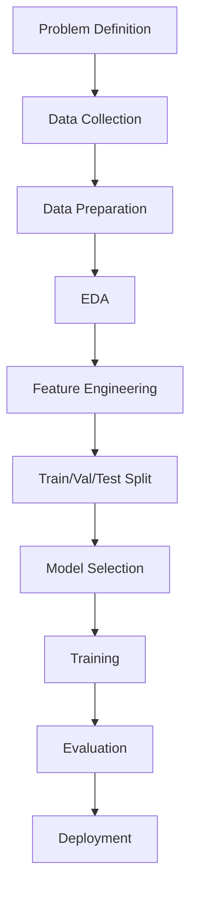

---

## Define Unsupervised Machine Learning techniques. Discuss K-Means and Hierarchical Clustering in detail. (10 marks)

**Unsupervised Machine Learning Techniques:** Unsupervised learning works with unlabeled data, discovering hidden patterns, structures, or groupings without predefined outputs. The algorithm must find inherent relationships within the input data alone.

**Common Unsupervised Techniques:**
- **Clustering:** K-Means, Hierarchical, DBSCAN, Gaussian Mixture Models
- **Dimensionality Reduction:** PCA, t-SNE, LDA, Autoencoders
- **Association Rule Learning:** Apriori, Eclat, FP-Growth
- **Anomaly Detection:** Isolation Forest, One-Class SVM

**K-Means Clustering:**

K-Means partitions n observations into k clusters where each observation belongs to the cluster with the nearest mean (centroid).

**Algorithm Steps:**
1. Choose number of clusters k
2. Initialize k centroids randomly
3. Assign each data point to nearest centroid (distance metric: Euclidean)
4. Recalculate centroids as mean of all points in cluster
5. Repeat steps 3-4 until convergence (centroids stop changing)

**Key Parameters:**
- k (number of clusters) – determined by elbow method or silhouette score
- Distance metric – Euclidean, Manhattan, Cosine
- Initialization – Random, K-Means++, or Forgy

**Advantages:** Fast and scalable. Easy to implement. Works well for spherical clusters.

**Disadvantages:** Must specify k in advance. Sensitive to outliers. Assumes spherical clusters.

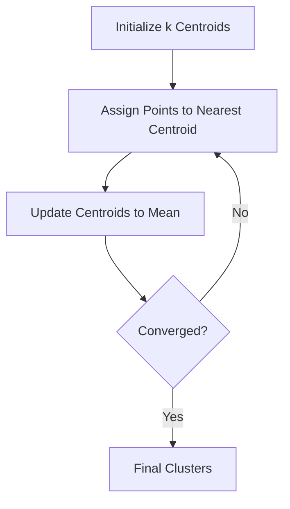

**Hierarchical Clustering:**

Hierarchical clustering builds a tree of clusters (dendrogram) without requiring the number of clusters as input.

**Two Approaches:**

**Agglomerative (Bottom-Up):** Start with each point as its own cluster. Repeatedly merge closest clusters until one cluster remains.

**Divisive (Top-Down):** Start with all points in one cluster. Recursively split clusters until each point is its own cluster.

**Linkage Methods:**
- **Single Linkage:** Distance between nearest points of clusters
- **Complete Linkage:** Distance between farthest points
- **Average Linkage:** Average distance between all point pairs
- **Ward's Method:** Minimize within-cluster variance

**Advantages:** No need to specify k beforehand. Dendrogram shows hierarchical relationships. Works well for nested clusters.

**Disadvantages:** Computationally expensive O(n³). Cannot undo merges/splits. Sensitive to noise.

---

## Define overfitting and underfitting in detail with a diagram. (5 marks)

**Overfitting:** Model learns training data too well, capturing noise and random fluctuations rather than underlying patterns. The model becomes too complex relative to the data.

**Characteristics:**
- Very high training accuracy (often near 100%)
- Poor generalization to test/unseen data
- High variance, low bias
- Typically occurs with complex models on small datasets

**Underfitting:** Model is too simple to capture the underlying structure of the data. It fails to learn even the training set patterns.

**Characteristics:**
- Poor performance on both training and test data
- High bias, low variance
- Typically occurs with overly simple models

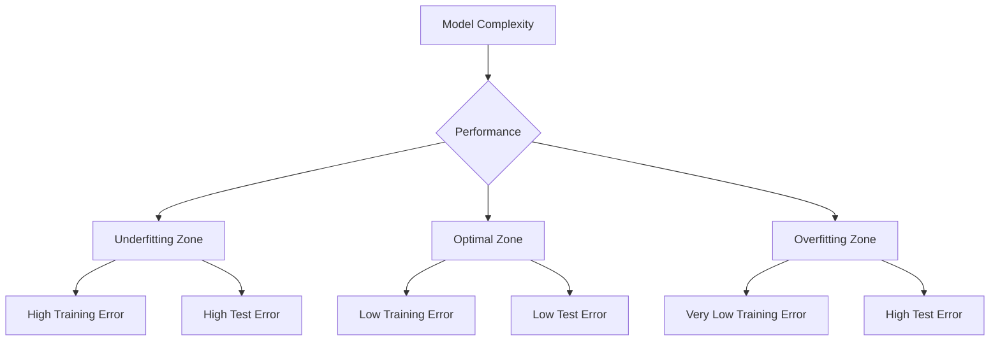

**Effects of Overfitting:** Model makes confident but wrong predictions on new data. Real-world performance degrades significantly.

**Effects of Underfitting:** Model misses important relationships. Predictions are overly simplistic or constant. Business value is limited.

**Solutions for Overfitting:** Get more data, reduce model complexity, apply regularization, use cross-validation, early stopping.

**Solutions for Underfitting:** Increase model complexity, add more features, reduce regularization, train longer.

---

## Write note on following supervised learning techniques: a) SVM b) ID3 (10 marks)

**a) Support Vector Machine (SVM):**

SVM is a supervised learning algorithm for classification and regression that finds the optimal hyperplane maximizing margin between classes.

**Core Concepts:**
- **Hyperplane:** Decision boundary separating classes
- **Margin:** Distance between hyperplane and nearest support vectors
- **Support Vectors:** Critical data points defining the boundary

**Kernel Trick:** Maps data to higher dimensions for non-linear separation using linear, polynomial, RBF, or sigmoid kernels.

**Mathematical Objective:** Maximize margin (2/||w||) while minimizing classification error.

**Advantages:** Effective in high dimensions. Memory efficient. Works well with clear margin separation.

**Disadvantages:** Not suitable for large datasets. Performance degrades with overlapping classes.

**Applications:** Image classification, handwriting recognition, text categorization, bioinformatics.

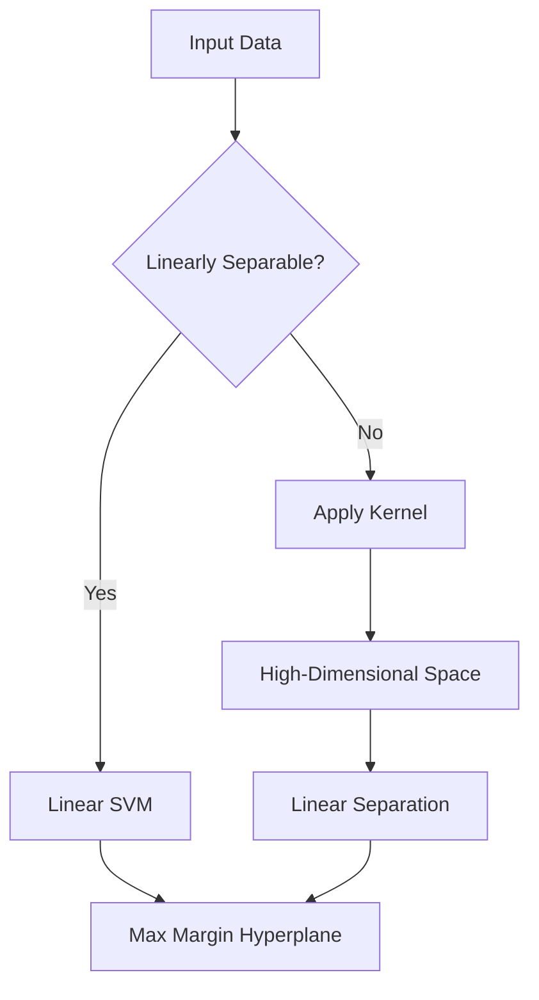

**b) ID3 (Iterative Dichotomiser 3):**

ID3 is a supervised learning algorithm that builds decision trees for classification using entropy and information gain.

**Core Concepts:**
- **Entropy:** Measures impurity/disorder in data. Formula: H(S) = -Σ pᵢ log₂(pᵢ)
- **Information Gain:** Reduction in entropy after splitting on an attribute. Higher gain means better split.

**Algorithm Steps:**
1. Calculate entropy of current dataset
2. For each attribute, calculate information gain
3. Select attribute with highest gain as root node
4. Split dataset by unique values of selected attribute
5. Recursively repeat for each branch until stopping criteria met

**Stopping Criteria:**
- All instances in branch belong to same class
- No remaining attributes to split
- No instances remaining

**Advantages:** Simple to understand and implement. Produces interpretable rules. Handles both numerical and categorical data.

**Disadvantages:** Prone to overfitting. Cannot handle continuous attributes directly. Biased toward attributes with many values. No backtracking (greedy algorithm).

**Applications:** Medical diagnosis, customer classification, loan approval systems.

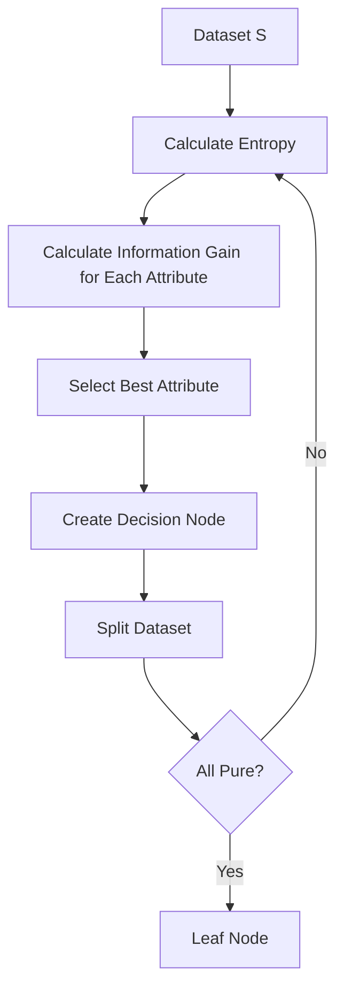

---

## What is linear regression? Explain its significance in ML. Compare it with logistic regression. (10 marks)

**What is Linear Regression?** Linear regression models the relationship between a dependent variable (target Y) and one or more independent variables (features X) by fitting a linear equation.

**Simple Linear Regression:** Y = β₀ + β₁X + ε (one feature)

**Multiple Linear Regression:** Y = β₀ + β₁X₁ + β₂X₂ + ... + βₙXₙ + ε

Where β are coefficients, ε is error term.

**Significance in Machine Learning:**
- Serves as fundamental baseline for all regression problems
- Highly interpretable – coefficients directly indicate feature impact
- Fast training using Ordinary Least Squares or gradient descent
- Provides statistical inference (p-values, confidence intervals)
- Feature importance ranking is straightforward
- Works well when relationships are approximately linear
- Foundation for advanced algorithms like Ridge, Lasso, Elastic Net

**Assumptions:** Linearity of relationship, independence of errors, homoscedasticity (constant variance), normality of errors.

**Evaluation Metrics:** Mean Squared Error (MSE), Root Mean Squared Error (RMSE), Mean Absolute Error (MAE), R-squared (coefficient of determination).

**Comparison with Logistic Regression:**

| Aspect | Linear Regression | Logistic Regression |
|--------|-------------------|----------------------|
| Outcome | Continuous numeric | Binary categorical |
| Range | (-∞, +∞) | (0, 1) probability |
| Function | Identity link | Logit (Sigmoid) link |
| Loss Function | MSE | Log Loss (Cross-Entropy) |
| Parameter Estimation | OLS (closed form) | MLE (iterative) |
| Decision Boundary | Regression line | Probability threshold |
| Output Meaning | Predicted value | Probability of class |

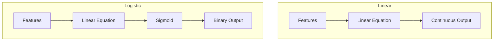

**When to use which:** Linear for predicting quantities (price, temperature, sales). Logistic for classification (spam, disease, churn).

---

## What are the different issues in ML algorithms? (10 marks)

Machine learning algorithms face multiple challenges across the development lifecycle.

**1. Data Quality Issues:**

| Issue | Description | Impact |
|-------|-------------|--------|
| Insufficient Data | Too few samples for complexity | Poor generalization |
| Missing Values | Incomplete feature data | Biased predictions |
| Outliers | Extreme values far from norm | Skewed model parameters |
| Noise | Random errors in measurements | Reduced accuracy |
| Imbalanced Classes | One class dominates dataset | Model ignores minority class |

**2. Model Complexity Issues:**

**Overfitting:** Model memorizes training noise. Symptoms: high training accuracy, poor test accuracy. Solutions: regularization, more data, simpler model.

**Underfitting:** Model too simple for pattern complexity. Symptoms: poor performance everywhere. Solutions: complex model, better features, less regularization.

**3. Training Process Issues:**

- **Convergence Problems:** Gradient descent gets stuck in local minima. Use momentum, adaptive learning rates.
- **Vanishing/Exploding Gradients:** Deep networks fail to train. Use BatchNorm, residual connections.
- **High Computational Cost:** Training takes excessive time/memory. Use distributed computing, model pruning.

**4. Feature Engineering Issues:**
- Irrelevant features add noise
- Redundant features cause multicollinearity
- Scale differences dominate distance-based algorithms
- Missing feature interactions

**5. Evaluation and Validation Issues:**
- Wrong metric choice for problem
- Data leakage from test to training
- Non-representative train-test split
- Ignoring concept drift over time

**6. Deployment Issues:**
- Scalability problems with large-scale prediction
- Model interpretability (black box problem)
- Hardware constraints in production
- Regulatory compliance for sensitive domains

**7. Ethical Issues:**
- Algorithmic bias from training data
- Privacy violations through memorization
- Lack of fairness across demographic groups
- Accountability for automated decisions

**8. Maintenance Issues:**
- Model degradation (concept drift)
- Changing data distributions
- Need for continuous retraining
- Version management for models

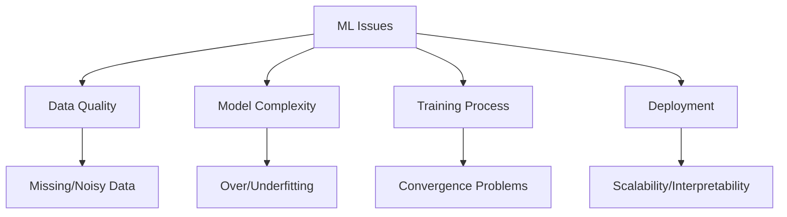

---

## What are the different issues in ML algorithms? (5 marks)

Common issues in ML algorithms include:

**Data-Related Issues:**
- Insufficient data volume for learning patterns
- Non-representative samples causing biased models
- Poor quality data with missing values and outliers
- Irrelevant or redundant features

**Model-Related Issues:**
- Overfitting (memorizing noise instead of patterns)
- Underfitting (model too simple for data complexity)

**Training Issues:**
- High computational cost for large datasets
- Convergence to suboptimal local minima
- Vanishing/exploding gradients in deep networks

**Deployment Issues:**
- Concept drift where data distributions change over time
- Poor interpretability of complex models
- Scalability limitations for real-time predictions

---

## Define and state effects of overfitting and underfitting. (5 marks)

**Overfitting:** Occurs when a model learns training data too perfectly, capturing noise and random fluctuations instead of underlying patterns.

**Effects of Overfitting:**
- Exceptionally high training accuracy (often near 100%)
- Poor performance on test/unseen data
- High variance – small training changes cause large prediction differences
- Model fails to generalize to real-world scenarios

**Underfitting:** Occurs when a model is too simple to capture the underlying structure of the data.

**Effects of Underfitting:**
- Poor performance on both training and test data
- High bias – model makes overly simplistic assumptions
- Predictions are inaccurate and miss important relationships
- Model has high training error that does not improve

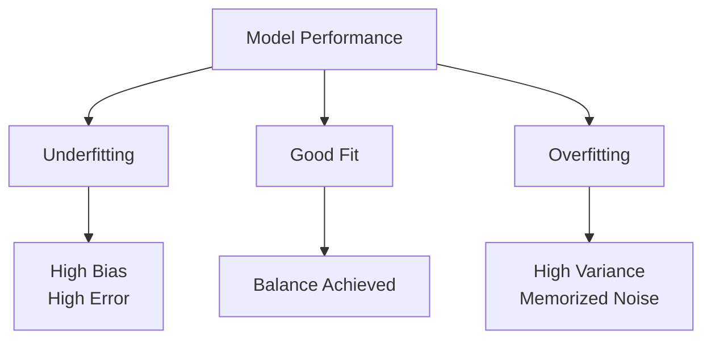

---

## Describe steps for developing ML applications with a labeled diagram. (10 marks)

Developing machine learning applications follows a systematic lifecycle with iterative refinement.

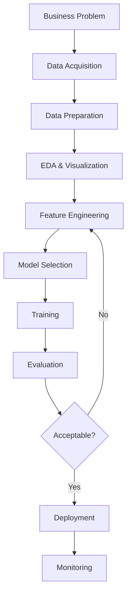

**Step 1 – Business Problem Definition:** Convert business requirements into ML task specification. Define success metrics and acceptance criteria.

**Step 2 – Data Acquisition:** Identify data sources including internal databases, external APIs, public datasets, web scraping, or sensor data. Collect sufficient volume covering problem domain.

**Step 3 – Data Preparation:** Handle missing values through imputation (mean, median, mode) or deletion. Remove duplicate records. Standardize inconsistent formats. Detect and treat outliers using statistical methods (IQR, Z-score).

**Step 4 – Exploratory Data Analysis:** Generate summary statistics (mean, median, distribution). Create visualizations: histograms for distributions, box plots for outliers, scatter plots for relationships. Calculate correlation matrices. Identify class imbalances.

**Step 5 – Feature Engineering:** Create new features combining existing ones. Scale numerical features using Min-Max normalization or Z-score standardization. Encode categorical variables via one-hot or label encoding. Select most relevant features using correlation or feature importance. Reduce dimensionality with PCA if needed.

**Step 6 – Train-Validation-Test Split:** Partition data into training (60-70%), validation (15-20%), and test (15-20%) sets. Maintain class distribution through stratified sampling. Shuffle data to avoid ordering bias.

**Step 7 – Model Selection:** Choose algorithm family (regression, classification, clustering) based on problem type. Compare multiple candidate models. Consider trade-offs between accuracy, interpretability, and speed.

**Step 8 – Model Training:** Initialize model parameters. Feed training data through algorithm. Optimize loss function using gradient descent. Tune hyperparameters using validation set and cross-validation.

**Step 9 – Model Evaluation:** Apply final model to test set. Calculate performance metrics: accuracy, precision, recall, F1 for classification; MSE, RMSE, R² for regression. Compare against baseline models. Check for overfitting (training vs test performance gap).

**Step 10 – Deployment and Monitoring:** Package model as API endpoint or embed in application. Monitor prediction performance over time. Detect concept drift. Schedule periodic retraining with fresh data. Log predictions for audit and improvement.

**Iterative Nature:** Return to feature engineering or data preparation steps when evaluation is unsatisfactory. Continuously improve through feedback loops.