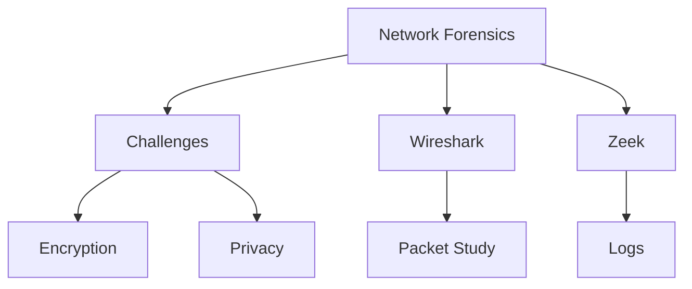
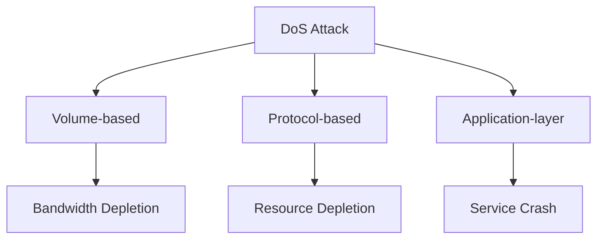

# EHF Module 0

## Explain the attacks on Network and Prevention (10 marks)

Network attacks are malicious activities designed to disrupt, deny, access, or degrade network services and data. These attacks exploit vulnerabilities in network protocols, configurations, or security policies.

**Common Network Attacks and Prevention Measures:**

| Attack Type | Description | Prevention |
|-------------|-------------|-------------|
| Eavesdropping | Unauthorized interception of network traffic | Encryption (TLS/SSL, IPSec), VPNs |
| Man-in-the-Middle | Attacker relays and alters communication between two parties | Digital certificates, mutual authentication, strong encryption |
| Denial of Service (DoS) | Overwhelming target with traffic to exhaust resources | Rate limiting, traffic filtering, load balancers |
| Packet Sniffing | Capturing unencrypted data packets on shared networks | Network segmentation, switch port security, encryption |
| Session Hijacking | Stealing session tokens to impersonate legitimate users | Secure cookies, short session timeouts, HTTPS |
| ARP Spoofing | Associating attacker's MAC address with legitimate IP | Dynamic ARP inspection, static ARP entries |
| DNS Spoofing | Corrupting DNS cache to redirect users to malicious sites | DNSSEC, DNS filtering, regular cache validation |

**Key Prevention Strategies:**

- Implement defense-in-depth with firewalls, IDS/IPS, and antivirus
- Enforce strong access controls and authentication mechanisms
- Regularly update and patch network devices and software
- Conduct continuous network monitoring and log analysis
- Deploy network segmentation using VLANs and DMZ
- Provide security awareness training for users

---

## What are the various types of network attacks? How do these attacks impact a network? (10 marks)

Network attacks are classified into passive and active categories based on their operational nature and objectives. Each type affects network resources, data integrity, and service availability differently.

**Types of Network Attacks and Their Impacts:**

| Specific Attack     | Impact on Network                                         |
| ------------------- | --------------------------------------------------------- |
| Eavesdropping       | Confidentiality breach, data leakage                      |
| Traffic analysis    | Exposure of communication patterns and relationships      |
| Denial of Service   | Service unavailability, resource exhaustion, revenue loss |
| Man-in-the-Middle   | Data manipulation, identity theft, session compromise     |
| Replay Attack       | Unauthorized transactions, false authentication           |
| Malware Propagation | System corruption, data theft, network degradation        |
| Password Attacks    | Unauthorized access, privilege escalation                 |
| Port Scanning       | Vulnerability identification, reconnaissance              |
| Spoofing            | Trust violation, access bypass, false data injection      |

**Network-Wide Impacts:**

- **Availability Impact:** DoS and DDoS attacks render services inaccessible, causing downtime and financial losses. Critical systems like banking or healthcare become unusable.

- **Confidentiality Impact:** Eavesdropping and packet sniffing expose sensitive data including passwords, financial records, and personal information.

- **Integrity Impact:** MITM and data modification attacks alter information during transmission, leading to corrupted databases, false transactions, and compromised decision-making.

- **Performance Degradation:** Malware and scanning activities consume bandwidth, increase latency, and reduce throughput for legitimate users.

---

## What are Challenges in network forensics? (5 marks)

Network forensics faces several technical and operational challenges that complicate evidence collection and analysis.

**Key Challenges:**

- **Massive Data Volume:** Modern networks generate terabytes of traffic daily, making full packet capture and storage impractical. Investigators must balance capture completeness with resource constraints.

- **Encrypted Traffic:** Widespread encryption (TLS, HTTPS, VPNs) hides payload contents from forensic tools, limiting visibility into malicious activities.

- **Time Synchronization:** Inconsistent timestamps across network devices complicate event correlation and reconstruction of attack timelines.

- **Evidentiary Integrity:** Maintaining chain of custody for volatile network data requires specialized procedures to prevent tampering or spoliation.

- **Performance Impact:** Forensic capture tools can introduce latency or packet loss, affecting production networks during investigation.

- **Jurisdictional Issues:** Network traffic crossing multiple legal boundaries raises privacy laws and data sovereignty concerns.

---

## What are Challenges in network forensics? (Part of 20 marks)

Network forensics involves capturing, recording, and analyzing network traffic for investigative purposes. Several challenges hinder effective forensic analysis.

**Major Challenges:**

- **Storage Limitations:** Continuous capture of high-speed networks (10Gbps+) requires petabytes of storage, leading organizations to use sampling or aggregation.

- **Evasion Techniques:** Attackers use fragmentation, encryption, covert channels, and traffic shaping to bypass detection and hide forensic evidence.

- **Tool Limitations:** Many forensic tools cannot process modern protocols or handle custom application traffic, creating analysis blind spots.

- **Privacy Concerns:** Capturing full packets may include legally protected communications, requiring careful scope definition and data minimization.

- **Real-time Analysis:** Performing deep packet inspection at line speed demands significant computational resources and specialized hardware.

- **Log Inconsistencies:** Different devices log in proprietary formats with varying detail levels, complicating centralized correlation.

---

## What are the challenges in network forensics? Explain any two tools used for network forensics (10 marks)

Network forensics faces distinct technical, legal, and operational challenges that investigators must address. Two widely used tools help overcome these challenges.

**Challenges in Network Forensics:**

| Challenge Category | Specific Issues |
|--------------------|-----------------|
| Technical | Encrypted traffic, high data volumes (terabytes/day), high-speed networks (10Gbps+), packet loss during capture |
| Operational | Time synchronization across devices, storage limitations, performance impact on live networks |
| Legal | Privacy regulations (GDPR, HIPAA), chain of custody for volatile data, cross-border data transfer restrictions |
| Analytical | Evasion techniques (fragmentation, covert channels), proprietary protocols, log format inconsistencies |

**Tool 1: Wireshark**

Wireshark is an open-source packet analyzer used for deep inspection of captured network traffic.

- **Capabilities:** Captures live traffic from hundreds of protocols, supports display and capture filters, provides detailed protocol decodes
- **Forensic Use:** Analyzes PCAP files, reconstructs TCP streams, extracts transferred files, identifies suspicious patterns
- **Limitations:** Cannot handle multi-gigabit capture rates; requires manual analysis expertise

**Tool 2: Zeek (formerly Bro)**

Zeek is a powerful network analysis framework focused on security monitoring and event generation.

- **Capabilities:** Parses protocols into connection logs (HTTP, DNS, SMTP, etc.), generates rich metadata without full payload storage
- **Forensic Use:** Creates correlation-ready logs, detects anomalies through custom scripts, supports SSL certificate analysis
- **Limitations:** Steep learning curve; may drop packets under high load without tuning

---

## Explain various guidelines for digital forensic report writing along with its goals (10 marks)

Digital forensic report writing transforms technical findings into legally admissible, understandable documentation for stakeholders including lawyers, judges, and management.

**Goals of Digital Forensic Reporting:**

| Goal | Description |
|-------|-------------|
| Clarity | Present complex technical evidence in plain language |
| Reproducibility | Enable another examiner to reach identical conclusions |
| Legal Admissibility | Maintain evidentiary standards for court acceptance |
| Objectivity | Present facts without bias or unsupported opinions |
| Completeness | Include all relevant findings, including exculpatory evidence |

**Guidelines for Digital Forensic Report Writing:**

**1. Report Structure Requirements:**
- Title page with case identifier, examiner name, date
- Table of contents for documents exceeding 10 pages
- Executive summary (1-2 pages) for management audience
- Detailed methodology section explaining tools and procedures
- Findings presented chronologically or by evidence category
- Conclusions limited to facts supported by evidence
- Appendix containing raw logs and hash values

**2. Content Guidelines:**
- Use passive voice for impartiality: "The file was accessed" not "The user accessed"
- Define all technical terms on first use
- Include SHA-256 or MD5 hash values for all evidence files
- Document chain of custody with timestamps and signatures
- State limitations explicitly (e.g., "Encrypted traffic prevented payload analysis")

**3. Presentation Rules:**
- Number all pages as "Page X of Y"
- Use tables for comparison data and timelines
- Include screenshots with annotations and source paths
- Avoid absolute certainty statements; use "indicates" or "suggests"

**4. Quality Assurance:**
- Peer review by second examiner before finalization
- Version control for draft reports
- Proofreading for spelling, grammar, and technical accuracy

---

## Explain goals and guidelines for one Incident Report Writing (10 marks)

Incident report writing documents security events from detection through resolution, serving operational, legal, and improvement purposes within organizations.

**Goals of Incident Report Writing:**

| Goal | Explanation |
|-------|-------------|
| Accurate Documentation | Capture what happened, when, where, and how without speculation |
| Root Cause Analysis | Identify underlying vulnerabilities that enabled the incident |
| Remediation Tracking | Document containment, eradication, and recovery actions |
| Legal Preservation | Maintain evidence for potential litigation or regulatory action |
| Improvement Driver | Provide lessons learned for security control enhancement |

**Guidelines for Incident Report Writing:**

**1. Timeliness and Format:**
- Draft initial report within 24 hours of incident discovery
- Use standardized template with sections: Identification, Containment, Eradication, Recovery, Lessons Learned
- Include incident severity rating (P1 to P4 based on impact)

**2. Factual Content Rules:**
- Separate observations from interpretations using clear labeling
- Record all timestamps in UTC with device source noted
- Document actions taken, who performed them, and exact times
- Include negative findings (e.g., "No evidence of data exfiltration found")

**3. Audience Considerations:**
- Executive summary (150 words maximum) for leadership
- Technical section with IOCs, logs, and command history for analysts
- Legal section documenting chain of custody and preservation steps

**4. Specific Incident Elements:**
- Attack vector and entry point identification
- Affected systems, accounts, and data assets
- Business impact (downtime hours, financial loss, data exposure count)
- Containment measures with effectiveness assessment
- Preventive controls to be implemented with ownership and deadlines

**5. Confidentiality and Distribution:**
- Mark report as "Confidential - Attorney-Client Privilege" where applicable
- Limit distribution to incident response team, legal counsel, and approved management
- Never include passwords, private keys, or PII in main report body

---

## Denial of Service (DoS) Attack (Part of 20 marks)

A Denial of Service (DoS) attack aims to make a network service, machine, or resource unavailable to legitimate users by overwhelming it with malicious traffic or exploiting system vulnerabilities.

**Types of DoS Attacks:**

| Type | Mechanism | Example |
|-------|-----------|---------|
| Volume-based | Saturates bandwidth with massive traffic | UDP flood, ICMP flood |
| Protocol-based | Exploits protocol weaknesses | SYN flood, Ping of Death |
| Application-layer | Targets specific application features | HTTP GET flood, Slowloris |
| Distributed (DDoS) | Uses multiple compromised systems (botnet) | Amplification attacks (NTP, DNS) |

**Common Attack Vectors:**
- SYN flood exhausting connection tables
- ICMP echo request floods (Smurf attack)
- HTTP/S request floods overwhelming web servers
- DNS amplification using spoofed source addresses

**Mitigation Strategies:**
- Rate limiting and blackholing of suspicious traffic
- Anycast network distribution to absorb attacks
- Web application firewalls (WAF) for application-layer attacks
- SYN cookies to prevent connection table exhaustion
- Traffic scrubbing services (Cloudflare, Akamai)

