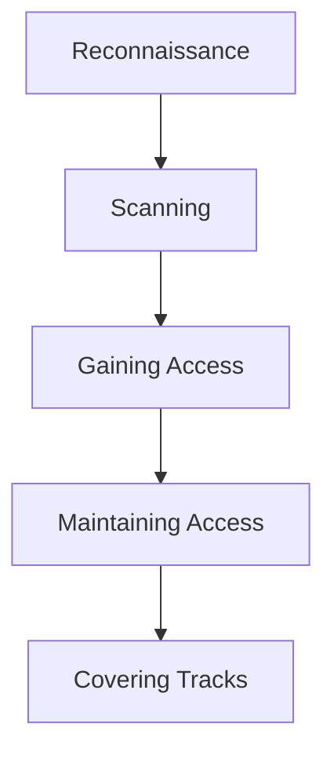
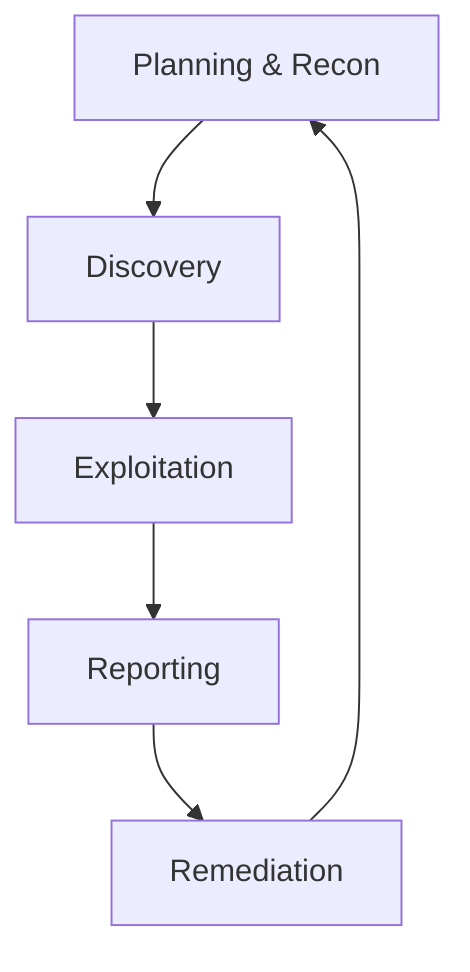
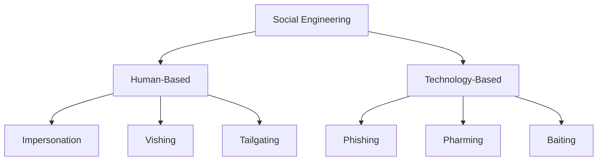
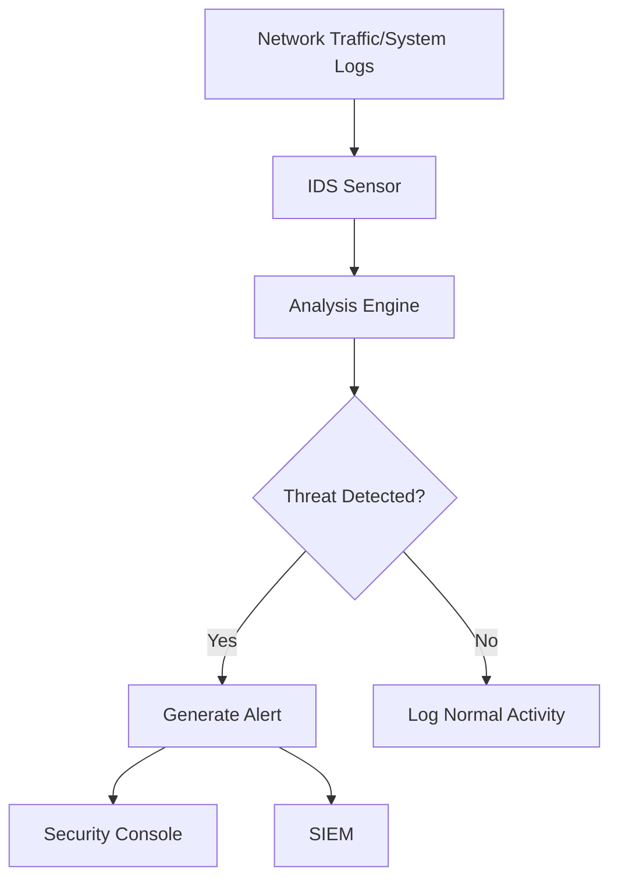

# EHF Module 1

## Explain cybercrime and its types. (Part of 20)

Cybercrime refers to illegal activities conducted through computers, networks, or digital devices. These crimes either target computer systems directly or use computers as tools to commit traditional offenses.

**Types of Cybercrime:**

- **Cybercrimes against persons**: Cyberstalking, identity theft, phishing, and online harassment
- **Cybercrimes against property**: Credit card fraud, intellectual property theft, online auction fraud, and ransomware
- **Cybercrimes against government**: Cyberterrorism, hacking government websites, digital espionage

**Common cybercrimes include:**
- Hacking (unauthorized system access)
- Malware distribution (viruses, worms, trojans)
- Denial of Service (DoS) attacks
- Child exploitation and trafficking
- Online financial frauds

---

## Differentiate White, Black and Grey Hat Hackers. (Part of 20)

| Aspect | White Hat Hacker | Black Hat Hacker | Grey Hat Hacker |
|--------|-----------------|------------------|-----------------|
| Intent | Ethical, defensive | Malicious, personal gain | Mixed; may violate laws without evil intent |
| Authorization | Has permission | No permission | No permission |
| Actions | Finds and fixes vulnerabilities | Exploits for theft/damage | Discovers flaws, may disclose or exploit |
| Legality | Legal | Illegal | Illegal (but often discloses findings) |
| Motivation | Security improvement | Money, revenge, notoriety | Recognition, curiosity |

---

## Compare active attacks vs Passive attacks. Classify the cybercrimes and explain any one briefly. (10 marks)

**Active vs Passive Attacks:**

| Parameter | Active Attacks | Passive Attacks |
|-----------|---------------|-----------------|
| Nature | Modifies data/system state | Monitors/observes without alteration |
| Detection | Easier to detect | Difficult to detect |
| Goal | Disruption, destruction, unauthorized access | Information gathering |
| Examples | DoS, modification, replay attacks | Eavesdropping, traffic analysis |
| Impact | High (service/system damage) | Medium (privacy breach) |

**Classification of Cybercrimes:**

1. **Against individuals**: Phishing, cyberbullying, identity theft
2. **Against property**: Credit card fraud, IP theft, ransomware
3. **Against government**: Cyberterrorism, website defacement, espionage

**Phishing**:
Phishing is a cybercrime where attackers impersonate legitimate organizations via email, SMS, or fake websites to steal sensitive information such as passwords, credit card numbers, or personal data. Attackers create urgent messages claiming account issues or prize winnings, tricking victims into clicking malicious links or attachments.

---

## What are the primary goals of ethical hacking and what are its phases? (10 marks)

**Primary Goals of Ethical Hacking:**

- Identify security vulnerabilities before malicious hackers exploit them
- Strengthen network and system defenses based on findings
- Ensure compliance with security regulations and standards
- Protect sensitive data from unauthorized access
- Maintain business continuity by preventing successful attacks
- Create security awareness within organizations

**Phases of Ethical Hacking:**

1. **Reconnaissance**: Gathering information about target using passive (social engineering, public records) or active (direct system probing) methods
2. **Scanning**: Using tools like port scanners, network mappers to identify open ports, running services, and potential entry points
3. **Gaining Access**: Exploiting identified vulnerabilities to penetrate the system (password cracking, SQL injection, buffer overflow)
4. **Maintaining Access**: Creating backdoors, rootkits for future access without re-exploitation
5. **Covering Tracks**: Clearing logs, hiding files, removing evidence of the ethical hack

---

## Define phishing attack and explain how attackers execute it. (5 marks)

Phishing is a social engineering attack where cybercriminals impersonate legitimate entities via electronic communication to trick victims into revealing sensitive information such as passwords, credit card numbers, or banking credentials.

**Attack Execution Steps:**

1. **Planning**: Attacker identifies target group (e.g., bank customers, employees of a company) and crafts convincing fake messages
2. **Setup**: Creates fraudulent websites mimicking legitimate ones and sets up email/spoofed communication channels
3. **Delivery**: Sends mass emails/SMS containing urgent messages (account suspended, unusual activity detected) with malicious links or attachments
4. **Deception**: Victim clicks link, lands on fake login page, and enters credentials believing it is genuine
5. **Exploitation**: Attacker collects stolen credentials and uses them for unauthorized access, financial theft, or further attacks

---

## Explain the Ethical Hacking lifecycle with a neat diagram. (10 marks)

The Ethical Hacking Lifecycle is a systematic, repeatable process that ethical hackers follow to assess and improve organizational security. It ensures thorough testing while maintaining legal and professional boundaries.

**Phases of Ethical Hacking Lifecycle:**

1. **Planning & Reconnaissance**: Define scope, obtain written authorization, gather target information from public sources (WHOIS, social media, search engines)

2. **Discovery**: Perform vulnerability scanning, network mapping, service enumeration, and system fingerprinting to identify potential weaknesses

3. **Exploitation**: Attempt to exploit discovered vulnerabilities using controlled methods to prove existence and assess impact (escalating privileges, accessing data)

4. **Reporting**: Document all findings including exploited vulnerabilities, compromised systems, data accessed, and provide actionable remediation recommendations

5. **Remediation**: Client fixes identified issues; ethical hacker retests to verify fixes are effective and no new vulnerabilities introduced

6. **Repeat**: Continuous security assessment required as new threats emerge and systems change

---

## Elaborate common types of cybercrimes with suitable real-world examples. (10 marks)

**Common Types of Cybercrimes with Real-World Examples:**

**1. Phishing**
- *Example*: 2020 Twitter Bitcoin scam where attackers compromised high-profile accounts (Elon Musk, Obama) using phone spear-phishing to post fake giveaway links, stealing over $120,000

**2. Ransomware**
- *Example*: Colonial Pipeline attack (2021) where DarkSide ransomware encrypted critical systems, causing fuel shortages across US East Coast, resulting in $4.4 million ransom payment

**3. Identity Theft**
- *Example*: 2017 Equifax breach exposed 147 million Americans' SSNs, birth dates, addresses; criminals opened fraudulent credit accounts, filed false tax returns

**4. Distributed Denial of Service (DDoS)**
- *Example*: 2016 Dyn attack using Mirai botnet (compromised IoT devices) took down Twitter, Netflix, Reddit, PayPal across US and Europe

**5. Online Financial Fraud**
- *Example*: 2021 Nigerian romance scam networks defrauded elderly US victims of over $10 million through fake online relationships and investment schemes

**6. Cyberstalking/Harassment**
- *Example*: 2018 case where a man used GPS tracker on victim's car, sent threatening messages via fake social media accounts, leading to arrest under cyberstalking laws

---

## Explain Hackers, Crackers, Phreakers. (5 marks)

| Term | Definition | Motivation | Legal Status |
|------|------------|------------|--------------|
| **Hackers** | Individuals with advanced computer skills who explore systems, often to find vulnerabilities | Curiosity, learning, security improvement (white hat) | Varies (ethical legal, unethical illegal) |
| **Crackers** | Malicious hackers who break into systems with intent to steal, damage, or profit | Financial gain, destruction, revenge | Always illegal |
| **Phreakers** | Specialized hackers focusing on telephone systems and PBX networks | Free calls, toll fraud, system exploration | Illegal (telecommunications fraud) |

**Additional Context:**
- Hackers may be white, black, or grey hat based on authorization and intent
- Crackers specifically engage in illegal activities like software cracking, password breaking
- Phreaking originated in 1970s with blue boxes mimicking telephone tones

---

## Write the difference between hacking and ethical hacking with examples. (5 marks)

| Aspect | Hacking (Black Hat) | Ethical Hacking |
|--------|--------------------|-----------------|
| Definition | Unauthorized system intrusion with malicious intent | Authorized system testing to improve security |
| Permission | No permission required/obtained | Written authorization mandatory |
| Goal | Theft, damage, disruption, personal gain | Identify and fix vulnerabilities |
| Legality | Illegal, prosecutable | Legal within defined scope |
| Outcome | Financial loss, data breach, system damage | Security report, remediation plan |

**Examples:**
- **Hacking**: A criminal steals credit card database from e-commerce site and sells on dark web
- **Ethical Hacking**: A certified professional tests bank's online portal for vulnerabilities, documents findings, and helps patch flaws before attackers exploit them

---

## Describe the role of computers in modern-day crimes with examples. (10 marks)

Computers play three primary roles in modern-day crimes: target, tool, and storage medium.

**1. Computer as Target**
Criminals directly attack computer systems to disrupt, damage, or gain control.
- *Example*: Ransomware encrypting hospital servers, demanding payment to restore patient records
- *Example*: DDoS attack taking down online gaming platform, extorting developers

**2. Computer as Tool**
Computers enable traditional crimes at scale and with anonymity.
- *Example*: Phishing emails sent to millions using automated tools to steal banking credentials
- *Example*: Drug dealers using encrypted messaging apps and cryptocurrency for transactions
- *Example*: Online marketplaces (dark web) selling illegal weapons, stolen data, counterfeit goods

**3. Computer as Storage/Evidence Container**
Computers hold evidence of criminal planning, execution, and proceeds.
- *Example*: Terrorist organizations storing propaganda, manuals, communication logs on encrypted drives
- *Example*: Child exploitation rings sharing illegal content via cloud storage and peer-to-peer networks
- *Example*: Corporate espionage agents keeping stolen trade secrets on USB drives

**Additional Roles:**
- **Communication facilitator**: Coordination of criminal activities via email, chat apps, VoIP
- **Identity concealer**: VPNs, proxy chains, Tor network hiding criminal identity
- **Automation enabler**: Botnets performing automated attacks (credential stuffing, spam distribution)

---

## Rules of ethical hacking and types of hackers. (Part of 20)

**Rules of Ethical Hacking:**

1. **Obtain explicit written permission** from system owner before testing
2. **Define clear scope** including target systems, testing methods, time window
3. **Respect privacy** - do not access or retain sensitive personal data found during testing
4. **Report all vulnerabilities** discovered immediately and provide remediation guidance
5. **Do not damage systems** - avoid destructive exploits, DoS attacks, data modification
6. **Maintain confidentiality** of findings; disclose only to authorized personnel
7. **Do not leave backdoors** or maintain access after testing completion

**Types of Hackers:**

| Type | Description |
|------|-------------|
| White Hat | Ethical, authorized, defensive security professionals |
| Black Hat | Malicious, unauthorized, criminal intent |
| Grey Hat | Unauthorized but discloses findings (legal grey area) |
| Red Hat | Aggressive, retaliatory hackers targeting black hats |
| Blue Hat | Security professionals invited to test before product launch |
| Green Hat | Beginners learning hacking techniques |
| Script Kiddie | Amateurs using pre-made tools without understanding |
| Hacktivist | Political/social motives (WikiLeaks, Anonymous) |
| State-Sponsored | Government-employed, espionage or warfare |

---

## What is malware? Explain in brief concept of Virus. (Part of 20)

**Malware** (Malicious Software) is any program intentionally designed to damage, disrupt, or gain unauthorized access to computer systems. Types include viruses, worms, trojans, ransomware, spyware, adware, and rootkits.

**Virus Concept:**
A virus is self-replicating malware that attaches itself to clean files or programs and spreads to other files/systems when the host is executed.

**Characteristics of Virus:**
- Requires human action (opening file, running program, clicking link) to activate
- Attaches to executable files (.exe, .com, .dll, scripts)
- Replicates by inserting its code into other programs or boot sectors
- May carry payload (damage) triggered by specific conditions (date, action, count)

**Virus Infection Methods:**
- File infector: Attaches to executable programs
- Boot sector virus: Infects master boot record, activates during startup
- Macro virus: Embedded in documents (Word macros)
- Multipartite virus: Combines boot sector and file infection

---

## Write Malware handling in detail. (10 marks)

Malware handling is a systematic process for detecting, containing, eradicating, and recovering from malware infections while preserving evidence for analysis.

**Phase 1: Preparation**
- Deploy antivirus/EDR solutions, firewalls, email filtering
- Maintain offline backups and system images
- Develop incident response plan and train staff
- Establish network segmentation and least privilege access

**Phase 2: Detection and Identification**
- Monitor system logs, network traffic, and security alerts
- Look for indicators: unusual CPU/memory usage, unexpected file changes, strange outbound connections
- Use signature-based (antivirus) and behavior-based (sandboxing, heuristics) detection
- Run offline scans with multiple security tools

**Phase 3: Containment**
- Isolate infected systems from network (pull cable, disable Wi-Fi)
- Block malicious IPs/domains at firewall
- Disable compromised user accounts
- Create forensic image before cleanup (preserve evidence)

**Phase 4: Eradication**
- Run full antivirus scans with updated definitions
- Remove malicious processes, registry entries, scheduled tasks
- Reinstall OS from clean media if infection is severe
- Apply security patches to prevent reinfection

**Phase 5: Recovery**
- Restore clean data from verified backups
- Change all passwords (user and service accounts)
- Monitor for signs of persistence or reinfection
- Resume normal operations gradually

**Phase 6: Post-Incident Activities**
- Conduct root cause analysis (how malware entered)
- Document timeline, actions taken, lessons learned
- Update security controls to prevent similar incidents
- Report legal/regulatory obligations if data breach occurred

---

## Discuss basic security precautions to be taken to safeguard Laptops and wireless devices and What are the devices related to security issues? (10 marks)

**Basic Security Precautions for Laptops:**

**Physical Security:**
- Use cable locks in public spaces
- Never leave unattended in vehicles or public areas
- Enable theft tracking software (LoJack, Find My Device)
- Apply privacy screen filters in crowded places

**Technical Security:**
- Full disk encryption (BitLocker, FileVault, LUKS)
- Strong password/biometric login + automatic lock on idle
- Regular OS and application security updates
- Host firewall and updated antivirus
- Disable unnecessary ports and services
- Backup data to encrypted external drive or cloud

**For Wireless Devices (Smartphones, Tablets, IoT):**
- Change default router passwords and disable WPS
- Use WPA3 or WPA2-Enterprise encryption
- Disable Bluetooth/NFC when not in use
- Turn off auto-connect to open Wi-Fi networks
- Use VPN on public networks
- Disable file sharing and network discovery

**Devices Related to Security Issues:**

| Device Category | Security Risks |
|----------------|----------------|
| Routers | Default credentials, outdated firmware, DNS hijacking |
| Smartphones | Malicious apps, SIM swapping, stalkerware |
| IoT (cameras, smart home) | Weak authentication, unpatched firmware, botnet recruitment |
| Printers | Stored documents on hard drive, network exposure |
| USB drives | Malware propagation, data theft, BadUSB attacks |
| Bluetooth devices | Eavesdropping, BlueBorne attacks, unauthorized pairing |
| Wireless keyboards | Keystroke sniffing (unencrypted models) |

---

## What do you understand by social engineering? Give classification (10 marks)

**Social Engineering** is the psychological manipulation of people into performing actions or revealing confidential information. It exploits human trust, helpfulness, and cognitive biases rather than technical vulnerabilities.

**Classification of Social Engineering:**

**1. Human-Based Attacks** (Direct interaction)

| Type | Description | Example |
|------|-------------|---------|
| Impersonation | Posing as authority figure or technical support | Calling helpdesk to reset password "because locked out" |
| Vishing (Voice Phishing) | Phone calls tricking victims | Fake bank caller asking for OTP "for verification" |
| Tailgating/Piggybacking | Following authorized person into restricted area | Carrying boxes, asking to hold door "forgot badge" |
| Shoulder Surfing | Observing screen or keyboard | Watching PIN entry at ATM or checkout |
| Dumpster Diving | Searching trash for sensitive documents | Finding password lists or network diagrams in recycling |

**2. Technology-Based Attacks** (Digital channels)

| Type | Description | Example |
|------|-------------|---------|
| Phishing | Fraudulent emails with malicious links | Fake PayPal "account suspended" email |
| Spear Phishing | Targeted phishing for specific individual | Email referencing CEO's recent trip to request wire transfer |
| Whaling | Phishing targeting executives | Fake IRS audit notice to CFO with malware attachment |
| Pharming | DNS poisoning redirecting to fake sites | User types bank.com but goes to clone site |
| Baiting | Offering free items containing malware | USB drive labeled "Employee Salaries" left in parking lot |
| Pretexting | Fabricated scenario to extract data | Calling HR "from IT" needing employee SSNs for audit |

---

## Differentiate between Vulnerability Assessment and Penetration Testing. (5 marks)

| Aspect | Vulnerability Assessment | Penetration Testing |
|--------|-------------------------|---------------------|
| Goal | Identify and list security weaknesses | Exploit vulnerabilities to prove impact |
| Approach | Automated scanning, non-intrusive | Manual exploitation, intrusive |
| Output | Vulnerability report with severity scores | Evidence of compromised systems and data accessed |
| Timeframe | Short (hours to days for scanning) | Longer (days to weeks for thorough testing) |
| False Positives | Higher, requires verification | Minimal (exploits are confirmed) |
| Business Impact | Low (no disruption) | Potential for service interruption |
| Frequency | Weekly/monthly (continuous) | Annually or after major changes |
| Cost | Lower | Higher (skilled manual labor) |

**Example:**
- **Vulnerability Assessment**: Scanner reports outdated Apache version (CVE-2023-1234) on web server
- **Penetration Test**: Ethical hacker exploits that vulnerability to retrieve database credentials and customer records

---

## Explain Intrusion Detection systems? Explain the detailed types of IDS. (10 marks)

**Intrusion Detection System (IDS)** is a security device or software that monitors network traffic or system activities for malicious actions or policy violations and alerts administrators. IDS is passive - it detects but does not block traffic.

**Detailed Types of IDS:**

**1. Based on Placement/Monitoring Scope:**

| Type | Description | Advantages | Disadvantages |
|------|-------------|------------|---------------|
| **NIDS (Network IDS)** | Monitors entire network segment by analyzing packets | Wide coverage, attacker cannot detect easily | Cannot inspect encrypted traffic, high false positives |
| **HIDS (Host IDS)** | Runs on individual systems, monitors OS logs, file changes | Can see encrypted traffic after decryption, application-level visibility | Resource intensive, requires installation on every host |

**2. Based on Detection Methodology:**

| Type | Description | Example |
|------|-------------|---------|
| **Signature-Based IDS** | Compares activities against known attack patterns (signatures) | Detects "SELECT * FROM users WHERE 1=1" SQL injection attempt |
| **Anomaly-Based IDS** | Creates baseline of normal behavior, alerts on deviations | Alerts when user logs in from unusual geographic location at 3 AM |
| **Specification-Based IDS** | Uses manually created security policies/rules | Detects violation of "no outbound ICMP" organizational policy |

**Hybrid IDS:** Combines signature and anomaly detection for better accuracy.

**Key IDS Components:**
- Sensors: Capture traffic or log data
- Analyzer: Process data using detection methods
- Database: Store signatures, baselines, or policies
- Console: Display alerts to administrator

---

## What is intrusion detection system? Explain. (10 marks)

**Intrusion Detection System (IDS)** is a security technology that continuously monitors network traffic or host activities for suspicious patterns, policy violations, or known attack signatures, generating alerts when threats are detected. IDS operates in passive mode - it observes and reports but does not block or prevent traffic.

**How IDS Works:**

**Core Functions of IDS:**

1. **Monitoring**: Continuously observes network packets, system calls, file integrity, log entries
2. **Analysis**: Compares observed events against known signatures or behavior baselines
3. **Detection**: Identifies potential intrusions (scans, exploits, malware communication, policy violations)
4. **Alerting**: Notifies security team via email, SMS, dashboard, or integration with SIEM
5. **Logging**: Records events for forensic investigation and compliance

**IDS vs IPS (Comparison):**

| Feature | IDS (Detection) | IPS (Prevention) |
|---------|-----------------|------------------|
| Action | Passive (alerts only) | Active (blocks/drops) |
| Network Placement | Out-of-band (mirrored port) | In-line (traffic flows through) |
| Latency | Low | Higher (inspection overhead) |
| Risk of Disruption | None | May block legitimate traffic |

**Common IDS Deployment Locations:**
- Perimeter (between firewall and internal network)
- Internal segments (between departments, server farms)
- Wireless network (monitoring Wi-Fi traffic)
- Critical servers (HIDS on database, web, file servers)

**IDS Limitations:**
- Cannot analyze encrypted traffic fully
- High false positive rates require tuning
- Cannot prevent zero-day exploits (signature-based)
- Does not block attacks (only alerts after detection)