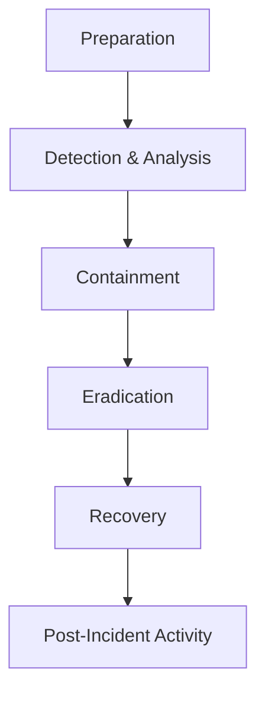
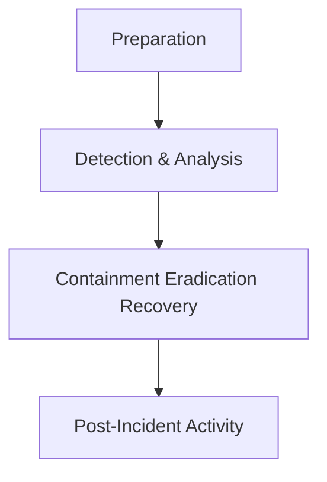
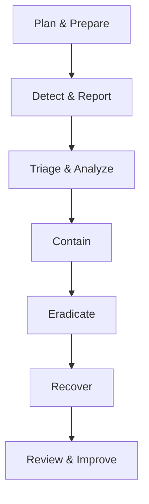

# EHF Module 2

## What is evidence handling procedure? (5 marks)

Evidence handling procedure refers to the systematic process of identifying, collecting, preserving, documenting, and transporting digital evidence while maintaining its integrity and admissibility in legal proceedings.

**Key steps include:**

- **Identification** – Recognizing potential sources of digital evidence
- **Collection** – Properly seizing devices using forensic techniques
- **Preservation** – Creating forensic images, write-protecting original media
- **Documentation** – Recording every action with timestamps and signatures
- **Packaging** – Using anti-static bags and tamper-evident seals
- **Transportation** – Maintaining chain of custody during transfer
- **Storage** – Securing evidence in locked, access-controlled environments

The primary goal is to prevent alteration, damage, or destruction of evidence.

---

## Explain Incident Response Process and its methodology. (10 marks)

Incident response is a structured approach to handling security breaches and cyber attacks. The methodology follows organized phases to detect, contain, eradicate, and recover from incidents.

**Incident Response Process:**

**Methodology components:**

- **Preparation** – Establishing policies, training teams, acquiring tools
- **Detection** – Monitoring systems, analyzing alerts, identifying anomalies
- **Analysis** – Determining scope, impact, and root cause
- **Containment** – Isolating affected systems to prevent spread
- **Eradication** – Removing malware, closing vulnerabilities
- **Recovery** – Restoring systems from clean backups
- **Lessons Learned** – Documenting findings and improving defenses

The methodology ensures consistent, repeatable actions that minimize damage and preserve evidence for legal proceedings.

---

## Discuss Digital Evidence and its types. (Part of 20)

Digital evidence is information stored or transmitted in binary form that may be used in legal proceedings. It includes data from computers, networks, mobile devices, and storage media.

**Types of digital evidence:**

- **Volatile evidence** – Temporary data lost when power is removed (RAM, cache, running processes)
- **Non-volatile evidence** – Persistent data stored on hard drives, SSDs, USB drives
- **Network evidence** – Logs, packet captures, firewall records, router tables
- **Mobile device evidence** – Call logs, SMS, contacts, GPS data, app data
- **Cloud evidence** – Emails, documents, metadata from cloud services
- **Metadata** – Creation dates, modification times, file ownership
- **Log files** – System logs, application logs, security event logs

Each type requires specific collection methods to maintain integrity and admissibility.

---

## What is digital evidence? Discuss the admissibility criteria in court. (5 marks)

Digital evidence is any probative information stored or transmitted in digital form that can be used in legal proceedings. It includes computer files, emails, logs, images, and metadata.

**Admissibility criteria in court:**

- **Relevance** – Evidence must relate directly to facts in dispute
- **Authenticity** – Evidence must be genuine and unaltered
- **Reliability** – Collection methods must be scientifically sound
- **Legality** – Evidence must be obtained through lawful means
- **Chain of custody** – Complete documentation of evidence handling
- **Best evidence rule** – Original evidence preferred over copies, though forensic duplicates are acceptable

Courts typically require demonstration that evidence was collected using standard forensic procedures without alteration.

---

## Explain the role of Chain of Custody in digital investigation (5 marks)

Chain of custody is the documented chronological record showing the seizure, custody, control, transfer, and disposition of digital evidence throughout an investigation.

**Roles in digital investigation:**

- **Maintains integrity** – Proves evidence has not been altered since collection
- **Establishes authenticity** – Links evidence to the original source
- **Ensures admissibility** – Courts require unbroken chain for evidence acceptance
- **Prevents tampering** – Documents every person who accessed evidence
- **Supports reconstruction** – Enables investigators to trace all handling activities

Without proper chain of custody, evidence becomes inadmissible in court, potentially causing case dismissal.

---

## Describe the Incident Response Phases as per NIST framework. (10 marks)

The NIST SP 800-61 framework defines four major phases for effective incident response.

**Phase 1 – Preparation:** Establishing incident response capability, creating policies, training personnel, acquiring necessary tools and resources.

**Phase 2 – Detection and Analysis:** Identifying potential incidents through monitoring, analyzing alerts, validating threats, determining scope and impact.

**Phase 3 – Containment, Eradication, and Recovery:** 
- Containment: Isolating affected systems
- Eradication: Removing threats and vulnerabilities
- Recovery: Restoring normal operations

**Phase 4 – Post-Incident Activity:** Conducting lessons learned, improving processes, updating documentation, preserving evidence for legal action.

The framework emphasizes continuous improvement through documented feedback loops.

---

## Explain Chain of Custody in detail. (10 marks)

Chain of custody is the complete documentation process that tracks digital evidence from initial collection to court presentation, ensuring integrity and admissibility.

**Essential components:**

- **Unique identifier** – Each evidence item receives a distinct case number
- **Initial collection record** – Who, when, where, and how evidence was obtained
- **Handling log** – Every transfer, access, or examination documented
- **Condition documentation** – Original state and any changes observed
- **Storage information** – Location, environmental conditions, security measures

**Standard documentation includes:**

| Element | Description |
|---------|-------------|
| Case number | Unique identifier for investigation |
| Item description | Detailed characterization of evidence |
| Collected by | Name and signature of collector |
| Date and time | Precise timestamp of collection |
| Location | Physical and logical location |
| Hash values | MD5, SHA-1 or SHA-256 checksums |

**Best practices:**
- Use tamper-evident packaging
- Maintain restricted access to storage
- Document all transfers with signatures
- Verify hash values at each stage

A broken chain of custody renders evidence inadmissible in legal proceedings.

---

## Roles of CSIRT in handling incident (Part of 20)

Computer Security Incident Response Team (CSIRT) performs critical functions during security incidents.

**Core roles:**
- **Incident analysis** – Determining scope, impact, and nature of incidents
- **Containment execution** – Isolating affected systems to prevent spread
- **Evidence collection** – Preserving digital evidence for investigation
- **Communication management** – Coordinating with internal and external stakeholders
- **Recovery coordination** – Overseeing restoration of normal operations

**Supporting functions:**
- Developing incident response procedures
- Conducting training and awareness programs
- Performing post-incident analysis
- Maintaining forensic tools and capabilities

CSIRT serves as the central coordinating body for all incident response activities.

---

## roles of CSIRT in incident handling (Part of 20)

CSIRT handles incidents through distinct operational responsibilities.

**Technical roles:**
- **Detection** – Monitoring security alerts and anomalies
- **Triage** – Prioritizing incidents based on severity and impact
- **Forensic analysis** – Examining systems for evidence of compromise
- **Malware analysis** – Understanding malicious code behavior

**Management roles:**
- **Policy enforcement** – Ensuring compliance with security policies
- **Escalation management** – Notifying appropriate authorities
- **Reporting** – Documenting incidents for legal and compliance purposes
- **Coordination** – Working with legal, HR, and public relations teams

**Preventive roles:**
- Vulnerability assessment
- Security architecture review
- Threat intelligence gathering

The team balances technical response with organizational communication requirements.

---

## CSIRT Roles and Responsibilities. (Part of 20)

CSIRT encompasses defined roles with specific responsibilities during incident response.

**Incident Manager:** Overall coordination, resource allocation, stakeholder communication, timeline management.

**Technical Lead:** Directs forensic analysis, containment actions, eradication procedures, recovery validation.

**Forensic Analyst:** Collects evidence, maintains chain of custody, performs disk and memory analysis, generates forensic reports.

**Communications Lead:** Handles internal notifications, external disclosures, media inquiries, legal coordination.

**Tool Specialist:** Maintains forensic software, develops automation scripts, ensures tool validation and updates.

**Responsibilities across incident phases:**
- Preparation: Develop procedures, conduct drills, maintain tools
- Detection: Analyze alerts, validate incidents, determine scope
- Response: Execute containment, preserve evidence, coordinate recovery
- Post-incident: Document lessons, update policies, improve capabilities

Each role requires specific technical expertise and clear reporting relationships.

---

## Explain role of Computer Security Incident Response Team (5 marks)

CSIRT is a dedicated team responsible for receiving, reviewing, and responding to computer security incidents.

**Primary roles:**
- **Incident management** – Coordinating end-to-end incident response activities
- **Technical response** – Performing analysis, containment, and eradication
- **Evidence preservation** – Ensuring forensic soundness of collected data
- **Communication** – Acting as single point of contact for incident reporting

**Additional responsibilities:**
- Publishing security advisories
- Conducting post-incident reviews
- Maintaining incident handling tools
- Providing training to organizational staff

The CSIRT serves as the trusted authority for incident verification, response coordination, and recovery oversight.

---

## Incident Response and Methodology of Incident Response. (Part of 20)

Incident response encompasses the organized approach to managing security breaches with documented methodology.

**Incident Response defined:** The systematic process of detecting, analyzing, containing, eradicating, and recovering from security incidents while preserving evidence.

**Methodology steps:**

**Detailed methodology:**
1. **Preparation** – Policies, procedures, tools, training
2. **Detection** – Monitoring, alerts, user reports
3. **Analysis** – Scope determination, impact assessment, root cause
4. **Containment** – Short-term and long-term isolation strategies
5. **Eradication** – Malware removal, patch application, vulnerability remediation
6. **Recovery** – System restoration, monitoring for reinfection
7. **Lessons learned** – Process improvement, documentation updates

The methodology ensures consistent, repeatable, and legally defensible incident handling.

---

## Anti-Forensic Techniques. (Part of 20)

Anti-forensic techniques are methods used to obstruct, disable, or manipulate digital forensic investigations.

**Common techniques:**

| Category | Technique | Purpose |
|----------|-----------|---------|
| Data hiding | Encryption, steganography | Conceal evidence existence |
| Data destruction | Secure deletion, disk wiping | Make evidence unrecoverable |
| Data obfuscation | Code packing, polymorphism | Hide malicious code patterns |
| Trail cleaning | Log deletion, timestamp manipulation | Remove investigation tracks |
| Artifact poisoning | False metadata, decoy files | Mislead forensic analysis |
| Anti-analysis | Debugger detection, VM detection | Prevent forensic tools from running |

**Specific methods:**
- Overwriting free space with random data
- Modifying file signatures and headers
- Using encrypted containers within legitimate files
- Exploiting RAM-only malware with no disk footprint
- Manipulating MAC timestamps (Modified, Accessed, Created)

Forensic examiners must understand these techniques to counter them effectively.

---

## Chain of custody (Part of 20)

Chain of custody is the documented chronological history tracking the handling, transfer, and disposition of digital evidence from collection to court presentation.

**Key elements:**
- **Unbroken trail** – Every person who handled evidence is documented
- **Timestamp records** – Precise date and time for each action
- **Condition logs** – Original state and any changes observed
- **Signature requirements** – Written acknowledgment from each custodian

**Critical information recorded:**
- Case identifier and evidence number
- Description of evidence
- Collection date, time, and location
- Collector name and signature
- Hash values (MD5, SHA-1, SHA-256)
- Each transfer with receiving party signature
- Storage location and security measures
- Access log with purpose of access

**Legal significance:** Without proper chain of custody documentation, courts may exclude evidence due to inability to prove authenticity and integrity.

---

## Explain Forensic Duplicates as Admissible Evidence. (5 marks)

A forensic duplicate is an exact bit-for-bit copy of original digital evidence created using specialized hardware or software write-blocking techniques.

**Admissibility factors:**
- **Identical content** – Bit-for-bit copy matches original perfectly
- **Hash verification** – Cryptographic hash values (MD5, SHA-1) match original
- **Write protection** – Original media never altered during copying
- **Documented process** – Complete procedural records maintained

**Why duplicates are admissible:**
- Courts accept duplicates under best evidence rule when original is unavailable
- Forensic images preserve original evidence from accidental alteration
- Hash verification proves authenticity without accessing original
- Standard forensic practices satisfy reliability requirements

**Best practices:** Always verify hash values before and after duplication, maintain chain of custody for both original and duplicate, document all tools and procedures used.