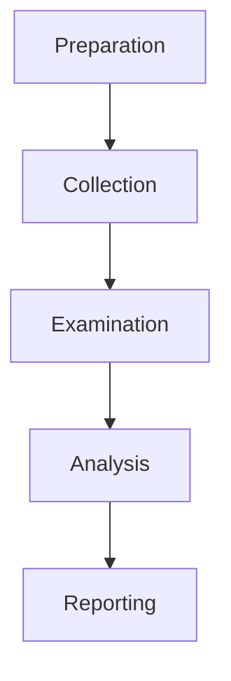
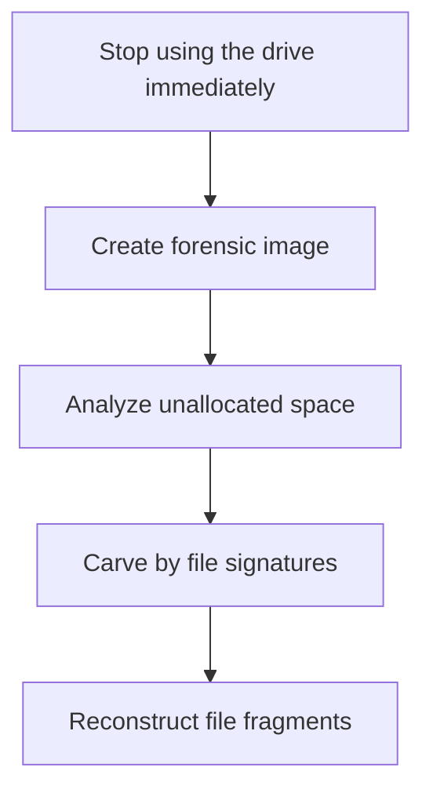
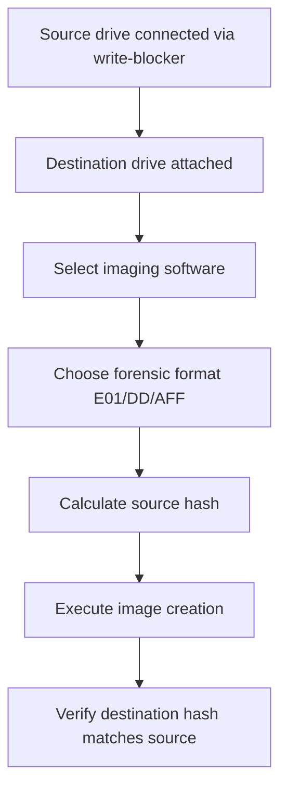
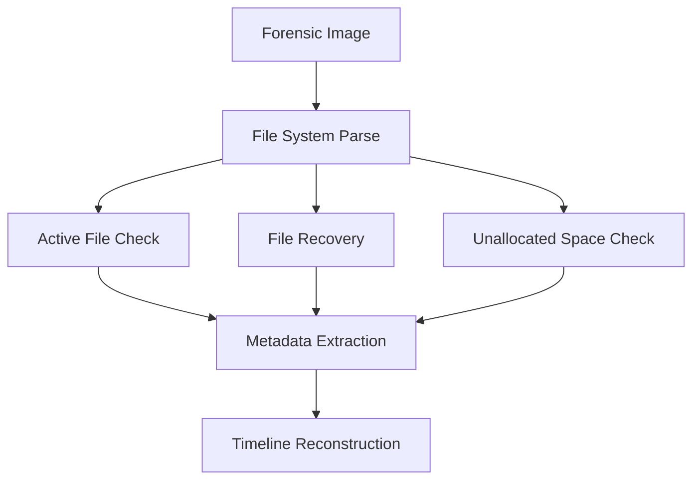
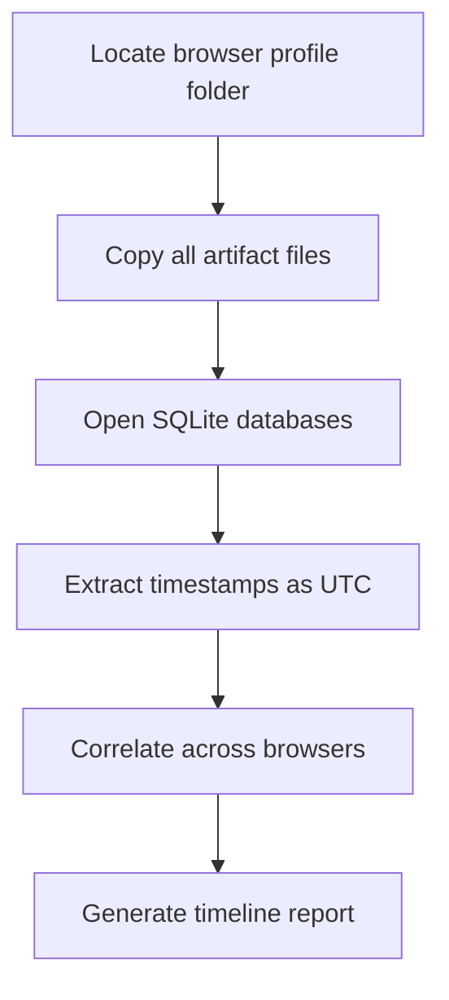

# EHF Module 3

## Explain Volatile Data Collection from Windows system (10 marks)

Volatile data refers to information that exists only in system memory (RAM) and is lost when the computer loses power or is shut down. Collecting volatile data from Windows systems requires specific procedures performed in a particular order, known as the "Order of Volatility."

**Steps for Volatile Data Collection:**

- **Registry and configuration data** - Collect current system settings, running services, and installed applications using `reg query` commands
- **System time** - Record accurate system time using `w32tm /query /status` to establish timeline
- **Logged-on users** - Identify active user sessions with `query user` or `net session`
- **Open network connections** - Capture active connections using `netstat -ano` for local and remote addresses
- **Running processes** - List all active processes with `tasklist /v` including process IDs and memory usage
- **Network activity** - Record real-time traffic using `netsh trace start` or third-party tools
- **Command history** - Capture recent commands executed in the command prompt

**Tools commonly used:** WinPmem, FTK Imager (live acquisition mode), DumpIt, and Redline from Mandiant.

**Best practices:** Never trust the operating system's commands completely; use trusted static binaries from write-protected media. Document every command executed and its output. Perform collection from most volatile to least volatile data.

---

## Briefly explain Types of digital Evidence with examples. (10 marks)

Digital evidence is classified into several distinct categories based on its nature, source, and reliability in forensic investigations.

| Type | Description | Examples |
|------|-------------|----------|
| **Volatile Evidence** | Exists temporarily in memory or active processes; lost upon shutdown | RAM contents, network connections, running processes |
| **Persistent Evidence** | Stored on permanent media and survives reboots | Hard drive files, USB drive data, optical discs |
| **Latent Evidence** | Hidden or not immediately visible without forensic tools | Deleted files, slack space data, alternate data streams |
| **Trace Evidence** | Small fragments indicating activity or presence | Browser history entries, log file entries, metadata |
| **Direct Evidence** | Proves a fact without inference | Surveillance video, recorded keystrokes, exact copies |
| **Circumstantial Evidence** | Requires inference to connect to a fact | Login times, file access patterns, IP addresses |
| **Testimonial Evidence** | Statements from witnesses or experts | Forensic analyst reports, user admissions |

**Additional classifications:**
- **Best evidence** - Original digital item (e.g., original hard drive)
- **Secondary evidence** - Copies or duplicates (e.g., forensic image)
- **Real evidence** - Physical objects containing data (e.g., smartphone, laptop)

---

## What is computer forensics? Why computer forensics is important? (10 marks)

**Computer forensics** is the scientific discipline of identifying, preserving, analyzing, and presenting digital evidence in a manner that is legally acceptable. It applies systematic investigation techniques to extract evidence from computers, networks, and digital storage devices.

**Key components of computer forensics:**
- **Acquisition** - Creating exact bit-for-bit copies of storage media
- **Preservation** - Maintaining evidence integrity using hash verification
- **Analysis** - Examining data structure, content, and metadata
- **Presentation** - Documenting findings for legal proceedings

**Importance of computer forensics:**

| Area | Importance |
|------|-------------|
| **Criminal investigations** | Recovers evidence of cybercrimes, fraud, hacking, child exploitation |
| **Civil litigation** | Provides discoverable evidence in disputes (divorce, intellectual property) |
| **Corporate security** | Investigates insider threats, data breaches, policy violations |
| **Incident response** | Identifies attack vectors and compromised systems |
| **Regulatory compliance** | Demonstrates due diligence in data protection (GDPR, HIPAA) |

**Practical significance:** Without computer forensics, digital evidence would be inadmissible in court. Proper forensic procedures establish chain of custody, prevent spoliation, and maintain the integrity required for legal admissibility under rules such as the Federal Rules of Evidence (FRE 901-902).

---

## Discuss Computer Forensics Investigation Process in detail. (10 marks)

The computer forensics investigation process follows a structured methodology divided into distinct phases to ensure evidence integrity and legal admissibility.

**Phase 1: Preparation**
- Obtain legal authorization (search warrant, consent, subpoena)
- Assemble forensic toolkit (write-blockers, imaging software)
- Establish chain of custody documentation system
- Define investigation scope and objectives

**Phase 2: Collection**
- Preserve volatile data first (order of volatility)
- Create forensic images of all storage media
- Capture network logs and connected device information
- Photograph and document physical scene
- Calculate and record hash values (MD5, SHA-1, SHA-256)

**Phase 3: Examination**
- Perform forensic imaging verification (hash comparison)
- Recover deleted files and hidden partitions
- Extract metadata from all files
- Carve data from unallocated space and slack space
- Decrypt encrypted data when possible

**Phase 4: Analysis**
- Correlate timeline of events
- Identify relevant artifacts (registry, logs, browser history)
- Link digital evidence to specific users or actions
- Reconstruct sequence of events
- Validate findings using multiple tools

**Phase 5: Reporting**
- Document all procedures and findings
- Maintain detailed chain of custody records
- Prepare expert report for legal proceedings
- Present findings clearly for non-technical audiences
- Preserve raw evidence for potential re-examination

**Critical principles:** Never work on original evidence. Document every action performed. Validate tools before and after use. Maintain strict chain of custody.

---

## Explain how digital evidence is collected and preserved from Windows and Linux systems. (10 marks)

**Windows System Collection and Preservation:**

| Step | Windows Procedure |
|------|-------------------|
| **Volatile collection** | Use `netstat -ano`, `tasklist /v`, `pslist` from Sysinternals |
| **Registry acquisition** | Copy `C:\Windows\System32\config` directory files using write-blocker |
| **Forensic imaging** | Use FTK Imager, EnCase, or `dd` for Windows (via WSL or Cygwin) |
| **Preservation** | Calculate SHA-256 hashes; store on write-protected media |
| **Log collection** | Extract Event Logs (`SecEvent.Evt`, `SysEvent.Evt`) |

**Linux System Collection and Preservation:**

| Step | Linux Procedure |
|------|-----------------|
| **Volatile collection** | `lsof`, `netstat -tunap`, `ps aux`, `ss -tulpn`, `cat /proc/meminfo` |
| **System information** | `dmesg`, `last`, `lastlog`, `cat /var/log/auth.log` |
| **Forensic imaging** | `dd if=/dev/sda of=/mnt/evidence/image.dd bs=4096 conv=noerror,sync` |
| **Preservation** | Use `sha256sum` for verification; mount image as read-only |
| **Disk duplication** | Use `dcfldd` (enhanced dd with progress and hashing) or `ddrescue` for damaged drives |

**Common preservation methods for both systems:**
- Always use a hardware or software write-blocker when accessing original media
- Create forensic images in standard formats (E01, RAW/DD, AFF)
- Document collection time and date using NTP-synchronized clock
- Maintain three copies: original, working copy, backup
- Store evidence in tamper-evident containers with seals

**Chain of custody documentation must include:** Collector name, date/time, location, device description, hash values, and every transfer of custody.

---

## Describe the method for recovering deleted files from windows system. (10 marks)

**Understanding Windows Deletion:** When a file is deleted in Windows, the operating system marks the file's space as available for reuse but does not immediately erase the actual data. The file entry remains in the Master File Table (MFT) until overwritten.

**Recovery Methods:**

**Method 1: Using Forensic Software (Recommended)**
- **FTK Imager** - Mount disk image; navigate to deleted files folder; export recovered files
- **Recuva** - Select drive; run deep scan; filter by file type; recover to different drive
- **Autopsy/The Sleuth Kit** - Analyze MFT records; identify unallocated space; carve deleted files
- **PhotoRec** - Signature-based carving independent of file system metadata

**Method 2: Manual Recovery from Recycle Bin**
- Check `C:\$Recycle.Bin` (Windows Vista+)
- For older versions: `C:\RECYCLER` or `C:\RECYCLED`
- Files remain until Recycle Bin is emptied

**Method 3: NTFS-specific Recovery**
- Examine Master File Table entries with $BITMAP attribute
- Look for files with `$FILE_NAME` but deleted `$DATA`
- Check alternate data streams for hidden content

**Step-by-step recovery procedure:**

**Prevention of overwriting:** Immediately shut down the system. Boot from a forensic live CD/USB. Never install recovery software on the affected drive.

**Success factors:** Time since deletion, drive activity level, file system type (NTFS better than FAT), file fragmentation status.

---

## What is file system and explain forensic analysis of file system. (10 marks)

**Definition of File System:** A file system is the structure and logic that an operating system uses to organize, store, retrieve, and manage data on storage media. It creates a hierarchical directory structure and maintains metadata about files including timestamps, permissions, and physical locations.

**Common file systems in forensics:**
- **Windows** - NTFS, FAT32, exFAT, ReFS
- **Linux** - ext2/ext3/ext4, XFS, Btrfs
- **macOS** - APFS, HFS+

**Forensic Analysis of File System:**

**1. Master File Table (MFT) analysis for NTFS**
- Each file has a record containing timestamps ($STANDARD_INFORMATION and $FILE_NAME)
- Deleted files show as in-use but with no data runs
- Analyze $LogFile for transaction records

**2. File system metadata examination**
- Creation, modification, access, entry modification timestamps
- Compare timestamps to identify anomalies (timestamp forgery)
- Examine file permissions and ownership

**3. Unallocated space analysis**
- Identify deleted files awaiting overwrite
- Carve data blocks not referenced by active files
- Recover file fragments using header-footer signatures

**4. Journal and log analysis**
- NTFS $LogFile - tracks all metadata changes
- ext4 journal - recovers recently deleted file references
- FAT directory entries - examine deleted entry markers

**5. Slack space investigation**
- RAM slack (between end of file and end of sector)
- File slack (between end of file and cluster boundary)
- May contain fragments of previous files

**Tools for file system forensic analysis:** The Sleuth Kit (TSK), Autopsy, EnCase, X-Ways Forensics, FTK.

---

## Define digital forensics and state its primary purpose. (5 marks)

**Digital forensics** is the branch of forensic science concerned with the identification, preservation, collection, analysis, and presentation of digital evidence stored on computers, mobile devices, networks, and other electronic storage media.

**Primary purpose:** The primary purpose of digital forensics is to uncover and interpret electronic data in a manner that maintains its integrity and authenticity for use as admissible evidence in legal proceedings, criminal investigations, or internal disciplinary actions.

**Additional objectives:**
- Determine what occurred on a digital device
- Identify responsible parties
- Establish a timeline of events
- Recover deleted or hidden information
- Support or refute claims made by involved parties

The discipline follows strict methodological standards to ensure that findings are reproducible, verifiable, and defensible in court.

---

## Define forensic duplication and explain its importance in digital forensics. (5 marks)

**Forensic duplication** (also called forensic imaging) is the process of creating an exact, bit-for-bit copy of a digital storage device where every sector, including unallocated space, slack space, and deleted files, is replicated exactly as it exists on the original media.

**Key characteristics:**
- Copies all data bits, not just active files
- Preserves file system structure, metadata, and timestamps
- Verifiable using cryptographic hash functions (MD5, SHA-1, SHA-256)
- Performed using write-blocking hardware or software

**Importance in digital forensics:**

| Aspect | Importance |
|--------|------------|
| **Evidence preservation** | Prevents modification or spoliation of original evidence |
| **Legal admissibility** | Courts accept properly imaged copies as equivalent to originals |
| **Working copy** | Allows analysis without risking original data |
| **Verification** | Hash values prove no alteration occurred |
| **Multi-investigation** | Multiple examiners can work simultaneously |

Without forensic duplication, every analysis operation would risk altering the original evidence, rendering it inadmissible in court.

---

## Tools used in Computer forensics (5 marks)

**Commercial Forensic Tools:**

| Tool | Primary Use |
|------|-------------|
| **EnCase** | Full disk imaging, analysis, reporting (industry standard) |
| **FTK (Forensic Toolkit)** | Data carving, indexing, email analysis |
| **X-Ways Forensics** | Lightweight alternative to EnCase and FTK |
| **Cellebrite UFED** | Mobile device extraction and analysis |
| **Magnet AXIOM** | Cloud, mobile, and computer forensic integration |

**Open Source Forensic Tools:**

| Tool | Primary Use |
|------|-------------|
| **Autopsy / The Sleuth Kit** | File system analysis, timeline generation |
| **dd / dcfldd** | Forensic disk imaging |
| **Volatility** | RAM and memory analysis |
| **Wireshark** | Network traffic capture and analysis |
| **Guymager** | Forensic imaging with GUI interface |

**Live Response Tools:**
- **Redline** (FireEye/Mandiant) - Memory and disk analysis
- **KAPE** (Kroll Artifact Parser and Extractor) - Rapid triage
- **Velociraptor** - Digital forensics and incident response

**Hardware Tools:**
- Tableau write-blockers - Prevent accidental writes to evidence drives
- Forensic duplicators - Standalone disk-to-disk copy devices
- Logicube - Forensic imaging hardware

---

## Cyber Forensic tools (5 marks)

**Cyber forensic tools** are specialized software and hardware applications designed to investigate cybercrimes, analyze digital evidence, and reconstruct events across networks, computers, and mobile devices.

**Network Forensic Tools:**

| Tool | Function |
|------|----------|
| **Wireshark** | Packet capture and deep protocol analysis |
| **NetworkMiner** | Passive network sniffing and OS fingerprinting |
| **Xplico** | Extracts applications data from network traffic |
| **Snort** | Intrusion detection and log analysis |

**Memory Forensic Tools:**

| Tool | Function |
|------|----------|
| **Volatility** | Advanced memory dump analysis (processes, network connections) |
| **Rekall** | Memory forensics with Google-developed framework |
| **Magnet RAM Capture** | Acquires physical memory from live Windows systems |

**Email and Web Forensics Tools:**

| Tool | Function |
|------|----------|
| **MailXaminer** | Email analysis from multiple clients and servers |
| **Browser History Examiner** | Extracts artifacts from Chrome, Firefox, Edge, Safari |
| **Hindsight** | Google Chrome browser forensic analysis |

**Database Forensics Tools:**
- **Oracle Forensic Tool** - Reconstructs deleted SQL records
- **SQLite Forensic Reporter** - Extracts data from SQLite databases

**Stenography Detection Tools:**
- **Stegdetect** - Identifies hidden data in images
- **StegExpose** - Steganalysis using multiple detection methods

---

## What are different forensic image formats. (5 marks)

**Forensic image formats** are specialized file formats designed to store exact copies of digital media while preserving metadata and supporting forensic integrity verification.

| Format | Extension | Characteristics |
|--------|-----------|-----------------|
| **RAW/DD** | `.dd`, `.img`, `.raw` | Simplest format; bit-for-bit copy; no compression; fastest access; no metadata embedded; large file size |
| **E01 (EnCase)** | `.E01`, `.E02`, `.EXX` | Industry standard; compression support; password protection; embedded metadata (case number, examiner); verification hashes; segmented files possible |
| **Ex01 (EnCase v7+)** | `.Ex01` | Improved compression; faster processing; 4GB+ segment support; backward compatible with E01 tools |
| **AFF (Advanced Forensic Format)** | `.aff`, `.afm` | Open standard; compression; encryption; metadata embedded; multiple data streams per file |
| **AFF4** | `.aff4` | Modern rewrite of AFF; uses ZIP containers; streaming support; better performance |
| **VMWare/Virtual** | `.vmdk`, `.vhd` | Virtual machine disk formats; can be mounted directly |

**Comparison considerations:**
- **Legal acceptance** - E01 and DD are most widely accepted
- **Storage efficiency** - E01 offers 10-50% compression
- **Interoperability** - RAW works with all tools; E01 requires compatible software
- **Verification** - All formats support hash verification

---

## Describe forensic duplication of Hard drive. (5 marks)

**Forensic duplication of a hard drive** is the process of creating an exact, verifiable copy of every bit on a source hard drive, including active files, deleted files, slack space, and unallocated clusters, without altering the original.

**Required equipment:**
- Source hard drive (evidence)
- Destination drive (clean, forensically wiped)
- Hardware write-blocker (e.g., Tableau, WiebeTech)
- Forensic imaging software

**Step-by-step process:**

**Imaging methods:**

| Method | Command/Software | Best for |
|--------|------------------|----------|
| **Software imaging** | FTK Imager, `dcfldd` | Most investigations |
| **Hardware duplicator** | Logicube, Tableau | Large-scale or damaged drives |
| **dd (Linux)** | `dd if=/dev/sda of=/image.dd bs=4096` | Quick raw copies |
| **ddrescue** | `ddrescue /dev/sda image.dd log.txt` | Damaged or failing drives |

**Verification:** Calculate source and destination SHA-256 hashes. Hashes must match for the copy to be forensically sound.

**Standard output:** Single file (DD/AFF) or segmented files (E01) with associated hash and metadata files.

---

## Explain the forensic duplication and investigation process in detail. (10 marks)

**Forensic Duplication Process:**

**Phase 1: Preparation**
- Forensically wipe destination media using DoD 5220.22-M standard
- Verify write-blocker functionality with test media
- Document all hardware serial numbers and models
- Photograph drive connections and setup

**Phase 2: Acquisition**
- Connect source drive via write-blocker to forensic workstation
- Calculate baseline hash of source drive
- Execute imaging using validated software (EnCase, FTK, `dcfldd`)
- Create hash file simultaneously with image creation

**Phase 3: Verification**
- Calculate hash of created image
- Compare to source drive hash
- Document verification results
- Store original drive and image separately

**Investigation Process in Detail:**

**Phase 4: Examination Preparation**
- Mount forensic image as read-only
- Verify hash again before examination begins
- Select appropriate analysis tools based on file system
- Create working case file with metadata

**Phase 5: Data Extraction**

**Phase 6: Artifact Analysis**
- **Registry analysis** (Windows): User accounts, USB history, recently opened files
- **Browser artifacts**: History, cookies, downloads, cached content
- **Email analysis**: Local stores, headers, attachments
- **Log file examination**: Security events, system events, application logs
- **Recovered file analysis**: Data carved from unallocated space

**Phase 7: Correlation and Reconstruction**
- Build timeline of user activity
- Link artifacts to specific users (SID, username, profile)
- Identify anomalous or suspicious patterns
- Reconstruct sequence of events

**Phase 8: Reporting**
- Document all findings with supporting evidence
- Include hash verification throughout chain of custody
- Prepare expert report in admissible format
- Preserve raw evidence for future re-examination

---

## Illustrate investigation of web browser. (5 marks)

**Web browser investigation** involves extracting and analyzing artifacts left by web browsing activities to determine user actions, visited sites, downloaded files, and search queries.

**Key browser artifacts analyzed:**

| Artifact | Location (Windows Chrome example) | Information Revealed |
|----------|-----------------------------------|---------------------|
| **History** | `History` SQLite database | URLs, visit times, visit count |
| **Cache** | `Cache` folder | Stored webpage fragments, images |
| **Cookies** | `Cookies` SQLite database | Tracked sessions, login tokens |
| **Downloads** | `History` (Downloads table) | Downloaded files, source URLs |
| **Bookmarks** | `Bookmarks` JSON | Saved sites, user interests |
| **Search queries** | `History` keyword searches | Terms entered in search engines |

**Investigation procedure:**

**Timeline interpretation:** Convert Chrome time (1601 epoch microseconds) to standard datetime. Compare system time with UTC offsets.

**Browser-specific locations:**
- **Chrome/Edge (Chromium)**: `%LocalAppData%\Google\Chrome\User Data\Default`
- **Firefox**: `%AppData%\Mozilla\Firefox\Profiles\*.default`
- **Internet Explorer**: WebCacheV01.dat (Extensible Storage Engine format)

**Common findings:** Deleted history recovery, private browsing limitations (data may be reduced but not eliminated), session reconstruction.

---

## What is Redundant Array Inexpensive Disk. (5 marks)

**RAID (Redundant Array of Independent/Inexpensive Disks)** is a data storage virtualization technology that combines multiple physical disk drives into one or more logical units for redundancy, performance improvement, or both.

**Common RAID levels:**

| Level | Description | Minimum Drives | Forensic Challenge |
|-------|-------------|----------------|--------------------|
| **RAID 0** | Striping without parity; data split across drives | 2 | Must reconstruct stripe sequence |
| **RAID 1** | Mirroring; exact copy on each drive | 2 | Any single drive contains complete data |
| **RAID 5** | Striping with distributed parity | 3 | Requires all but one drive; parity calculation |
| **RAID 6** | Striping with double parity | 4 | Tolerates two drive failures |
| **RAID 10** | Mirrored stripes (1+0) | 4 | Complex reconstruction |

**Forensic implications of RAID:**
- Cannot analyze individual drives separately; logical volume must be reconstructed
- Must determine RAID level, stripe size, disk order, and parity rotation
- Hardware RAID controllers write proprietary metadata
- Software RAID (Windows Dynamic Disks, Linux mdadm, ZFS) has known reconstruction methods

**Reconstruction approaches:**
- Use forensic tools with RAID reconstruction (EnCase, FTK, X-Ways)
- Rebuild using software tools like R-Studio or UFS Explorer
- Document original RAID configuration before disassembly

**Best practice:** Photograph drive labels and controller settings. Document drive order and port connections before removing any drives.