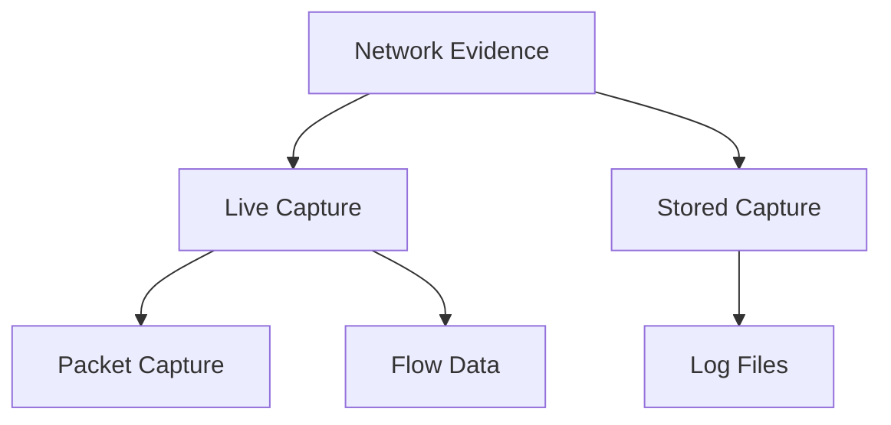
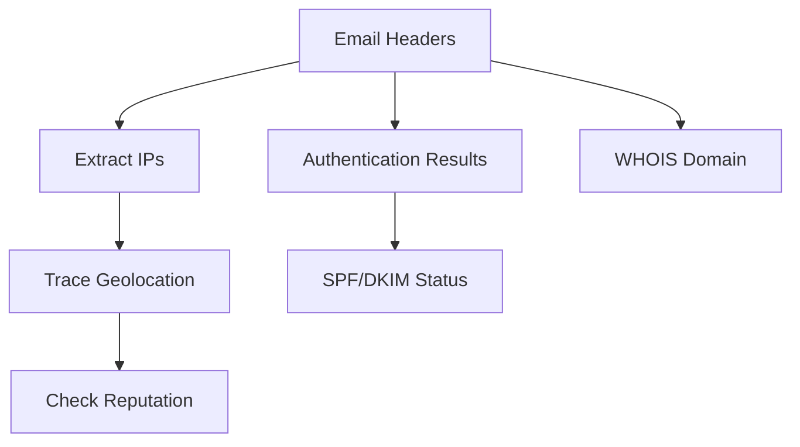
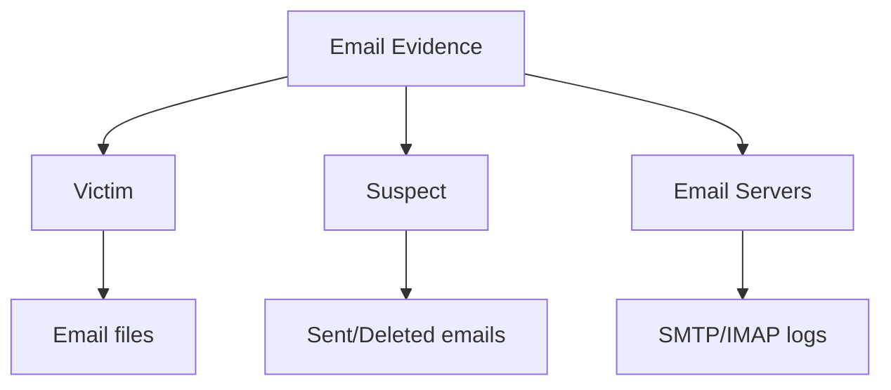

# EHF Module 4

## What are Challenges in network forensics? (05)

Network forensics faces several technical and operational challenges:

- **Encrypted Traffic**: Modern networks extensively use encryption (TLS/SSL, VPNs), making payload inspection impossible without decryption keys.

- **High Data Volume**: Modern networks operate at gigabit speeds, generating massive data volumes that exceed storage and processing capabilities.

- **Privacy Regulations**: Laws like GDPR and data protection requirements restrict data collection and retention practices.

- **Anti-Forensic Techniques**: Attackers use packet fragmentation, covert channels, and traffic obfuscation to evade detection.

- **Dynamic Environments**: Virtualized networks, cloud infrastructures, and mobile devices lack permanent evidence sources.

- **Chain of Custody**: Network evidence is volatile and easily altered, requiring strict handling procedures.

- **Time Synchronization**: Disparate devices may have inconsistent timestamps, complicating event correlation.

---

## Explain process for collecting Network Based Evidence. (10)

The collection of network-based evidence follows a systematic process to ensure integrity and admissibility:

**1. Authorization and Planning**
- Obtain legal authority (warrant or consent)
- Define scope of collection (timeframe, systems, traffic types)
- Document all actions for chain of custody

**2. Identification of Evidence Sources**
- Identify relevant network devices (routers, switches, firewalls)
- Locate log servers, IDS/IPS systems, and packet capture points
- Determine volatile vs. persistent evidence

**3. Evidence Acquisition**

**4. Live Acquisition Techniques**
- Packet sniffing using tools like tcpdump or Wireshark
- NetFlow/sFlow collection from routers
- Memory capture from network appliances

**5. Stored Evidence Collection**
- Copy log files from syslog servers
- Retrieve firewall and IDS logs
- Extract proxy server records

**6. Preservation**
- Create cryptographic hashes (MD5/SHA-256)
- Use write-blockers where applicable
- Store on forensically clean media

**7. Documentation**
- Record timestamps using synchronized sources
- Document collection commands and outputs
- Maintain chain of custody forms

---

## What is Network Forensics? Explain the tools used for analyzing network traffic. (10)

**Network Forensics** is the branch of digital forensics that deals with monitoring, capturing, recording, and analyzing network traffic for investigative purposes. It focuses on identifying security incidents, reconstructing attacks, and gathering admissible evidence from network activities.

**Tools for Network Traffic Analysis:**

**1. Wireshark**
- Most widely used packet analyzer
- Captures live traffic and analyzes saved capture files
- Provides deep inspection of hundreds of protocols
- Features filtering, statistics, and reconstruction capabilities

**2. tcpdump**
- Command-line packet capture tool for Unix/Linux
- Lightweight and scriptable
- Uses BPF (Berkeley Packet Filter) syntax for filtering

**3. NetworkMiner**
- Passive network forensic analysis tool
- Extracts files, images, emails from PCAP files
- Reconstructs sessions and host information

**4. Zeek (formerly Bro)**
- Network security monitoring framework
- Generates rich logs (HTTP, DNS, SMTP, SSH)
- Supports custom scripting for analysis

**5. Xplico**
- Extracts application data from network traffic
- Reconstructs web pages, emails, VoIP calls
- Supports multiple protocols (HTTP, FTP, SMTP, SIP)

**6. ngrep**
- Applies grep-like pattern matching to network traffic
- Searches payload contents for strings or regular expressions

---

## Tools used in network forensics (Part of 20)

Network forensics employs various specialized tools across different categories:

**Capture Tools:**
- tcpdump – Command-line packet capture
- Wireshark – GUI-based capture and analysis
- WinPcap/Npcap – Windows packet capture libraries

**Analysis Tools:**
- Zeek (Bro) – Protocol analysis and log generation
- NetworkMiner – Passive OS fingerprinting and file extraction
- Xplico – Application data reconstruction

**Flow Analysis Tools:**
- ntopng – Real-time flow monitoring
- SiLK (System for Internet-Level Knowledge) – Flow analysis suite

**Specialized Tools:**
- Snort – IDS with packet logging
- Chaosreader – Session reconstruction from PCAP
- Tcpreplay – Traffic replay for testing

**Commercial Solutions:**
- Niksun NetDetector
- RSA NetWitness
- FireEye Network Forensics

These tools support evidence collection, protocol decoding, session reconstruction, and payload extraction for investigative purposes.

---

## Write a short note on different types of scanning tools. (10)

Scanning tools are network forensic utilities used to discover devices, services, and vulnerabilities in networked environments.

**1. Port Scanners**
- Identify open ports and listening services on target systems
- Examples: Nmap, Masscan, Unicornscan
- Techniques: TCP SYN, TCP Connect, UDP, FIN scans
- Used to map network exposure and detect unauthorized services

**2. Vulnerability Scanners**
- Identify known security weaknesses in systems
- Examples: Nessus, OpenVAS, Qualys
- Compare system configurations against vulnerability databases
- Generate prioritized remediation reports

**3. Network Mappers**
- Discover live hosts and network topology
- Examples: Nmap (with OS detection), Zenmap
- Perform ping sweeps, traceroutes, and service enumeration
- Create visual network diagrams

**4. Web Application Scanners**
- Focus on web-specific vulnerabilities (SQLi, XSS, CSRF)
- Examples: Burp Suite, OWASP ZAP, Nikto
- Crawl applications and test input vectors

**5. Wireless Scanners**
- Detect Wi-Fi networks and connected clients
- Examples: Kismet, Aircrack-ng suite, WiFite
- Capture beacon frames and probe requests
- Identify rogue access points

**6. Protocol-Specific Scanners**
- Target particular protocols (SMB, SNMP, LDAP)
- Examples: SMBMap, SNMPWalk
- Enumerate users, shares, and configuration data

---

## Explain the steps in router investigation. (Part of 20)

Router investigation involves examining router configurations, logs, and memory for evidence of network incidents:

**Step 1: Preparation and Authorization**
- Obtain legal permission to access the router
- Document router make, model, firmware version
- Identify router location and network role

**Step 2: Preservation of Volatile Data**
- Capture running configuration (show running-config)
- Record active connections (show connections, show sessions)
- Document ARP cache and routing table
- Note uptime and system time

**Step 3: Evidence Collection**
- Extract logs (show log, show syslog)
- Save startup configuration (show startup-config)
- Capture packet filters or access control lists
- Record NAT translations and firewall rules

**Step 4: Non-Volatile Evidence**
- Copy configuration files to forensic media
- Capture SNMP community strings
- Record user accounts and privilege levels

**Step 5: Timeline Reconstruction**
- Correlate router timestamps with other evidence
- Identify configuration changes (show archive)
- Examine reboot history (show version, show reload)

**Step 6: Analysis**
- Identify unauthorized configuration changes
- Trace traffic flows using ACL hits and logs
- Detect backdoor accounts or modified privileges

**Step 7: Documentation**
- Hash all collected files (MD5/SHA256)
- Maintain chain of custody
- Document all show commands executed

---

## Firewall with Neat diagram (Part of 20)

A firewall is a network security device that monitors and controls incoming and outgoing network traffic based on predetermined security rules. It establishes a barrier between trusted internal networks and untrusted external networks (such as the Internet).

**Types of Firewalls:**
- Packet filtering firewalls (Layer 3-4)
- Stateful inspection firewalls
- Application-level gateways (proxy firewalls)
- Next-generation firewalls (NGFW)

**Core Functions:**
- Traffic filtering based on IP, port, protocol
- Stateful packet inspection
- Network address translation (NAT)
- Logging and alerting
- VPN termination

**How Firewall Works:**
1. Incoming/outgoing packets arrive at firewall interface
2. Firewall checks packet header information
3. Rules are evaluated in sequential order
4. Action taken: ACCEPT, DROP, or REJECT
5. Matched rules are logged based on configuration

**Forensic Value:** Firewall logs provide source/destination IPs, ports, timestamps, and actions taken, making them critical for incident reconstruction.

---

## Describe E-mail Forensics. Explain steps to track header information and trace sender identity. (10)

**E-mail Forensics** is the branch of digital forensics that deals with investigation of email messages as potential evidence. It involves examining email content, headers, metadata, server logs, and related artifacts to determine authenticity, origin, and path of messages.

**Steps to Track Header Information:**

**1. Obtain Complete Email Headers**
- Extract full headers (not just visible fields)
- Different email clients have different methods (Show Original, View Source, View Headers)

**2. Analyze Header Fields**

| Field | Purpose | Forensic Value |
|-------|---------|----------------|
| Received | SMTP server hops | Full delivery path, timestamps |
| Return-Path | Bounce address | Sender's actual mailbox |
| Message-ID | Unique identifier | Track message across servers |
| From/Reply-To | Displayed sender | Potential forgery indicator |
| Authentication-Results | SPF, DKIM, DMARC | Validity checks |

**Steps to Trace Sender Identity:**

**1. Extract IP Addresses**
- Examine each "Received" field from bottom to top
- Identify originating IP (first Received after client)
- Format: Received: from [senderIP] by server...

**2. Trace IP Geolocation**
- Use IP geolocation databases (MaxMind, IP2Location)
- Identify country, city, ISP
- Note: Can be VPN/proxy obscured

**3. Check Blacklists and Reputation**
- Query IP against DNSBL (Spamhaus, Barracuda)
- Identify if IP is known malicious source

**4. Examine Authentication Results**
- SPF (Sender Policy Framework) check
- DKIM (DomainKeys Identified Mail) signature verification
- DMARC policy evaluation

**5. Correlate with Server Logs**
- Request SMTP server logs from provider
- Match timestamp and Message-ID
- Identify authenticated user session (if any)

**6. Perform WHOIS Lookups**
- Query domain registration information
- Identify registrant name, email, address

---

## Describe tasks in investigating e-mail crimes and violations. (10)

Investigating email crimes requires systematic tasks to collect, preserve, and analyze evidence:

**Task 1: Evidence Identification**
- Identify relevant email accounts and timeframes
- Locate email sources (victim, suspect, ISP servers)
- Determine type of violation (harassment, fraud, phishing, threats)

**Task 2: Legal Authorization**
- Obtain search warrants or subpoenas
- Issue preservation letters to email providers
- Document chain of custody requirements

**Task 3: Evidence Collection**

**Task 4: Header Analysis**
- Extract complete email headers
- Trace delivery path using Received fields
- Identify originating IP addresses
- Check for header forgery indicators

**Task 5: Content Analysis**
- Examine email body for language patterns
- Extract embedded images and attachments
- Check metadata of attachments (creation dates, author)
- Identify links and domains used

**Task 6: Server Log Investigation**
- Request SMTP server connection logs
- Match timestamps with email headers
- Identify authenticated user sessions
- Correlate with other user activities

**Task 7: Domain and IP Investigation**
- Perform WHOIS lookups on sending domains
- Trace IP addresses to ISPs
- Identify known malicious infrastructure

**Task 8: Authentication Verification**
- Check SPF, DKIM, DMARC results
- Determine if email passed or failed checks
- Identify spoofing attempts

**Task 9: Timeline Reconstruction**
- Order messages chronologically
- Correlate with other network activities
- Identify pattern anomalies

**Task 10: Reporting**
- Document all findings with supporting evidence
- Prepare expert testimony materials
- Maintain chain of custody documentation

---

## Email Tracing- Internet Fraud (Part of 20)

Email tracing for internet fraud involves tracking fraudulent email communications back to their source to identify perpetrators.

**Common Internet Fraud Email Types:**
- Phishing (credential harvesting)
- Advance fee fraud (Nigerian 419 scams)
- Business email compromise (BEC)
- Lottery/sweepstakes scams

**Tracing Methodology:**

**1. Header Analysis**
- Extract all "Received" fields
- Identify the originating IP (the first non-internal IP from bottom)
- Look for anomalies (mismatched time zones, missing headers)

**2. IP Address Investigation**
- Perform IP geolocation to identify country/region
- Check IP against abuse databases
- Determine if IP belongs to VPN/proxy/VPS service

**3. Domain Analysis**
- Examine sender domain registration (WHOIS)
- Check domain age (recent registrations are suspicious)
- Identify if domain mimics legitimate entities (typosquatting)

**4. Authentication Checks**
- SPF failures indicate forged sender domain
- DKIM failures suggest email alteration
- DMARC policy reveals domain owner's intentions

**5. URL and Attachment Analysis**
- Extract embedded links (often shortened URLs)
- Expand shortened URLs safely using services like CheckShortURL
- Analyze attachments in sandbox environments
- Identify callback infrastructure

**6. Coordination with Providers**
- Report to email service providers
- Contact hosting companies for subscriber information
- Submit legal requests to ISPs for IP assignment records

**7. Pattern Correlation**
- Compare with known fraud campaigns
- Identify reused infrastructure (same IPs, domains, bank accounts)
- Collect payment system information (cryptocurrency wallets, bank accounts)

**8. Documentation for Law Enforcement**
- Preserve full email with headers
- Document all tracing steps
- Maintain screenshots of investigative queries