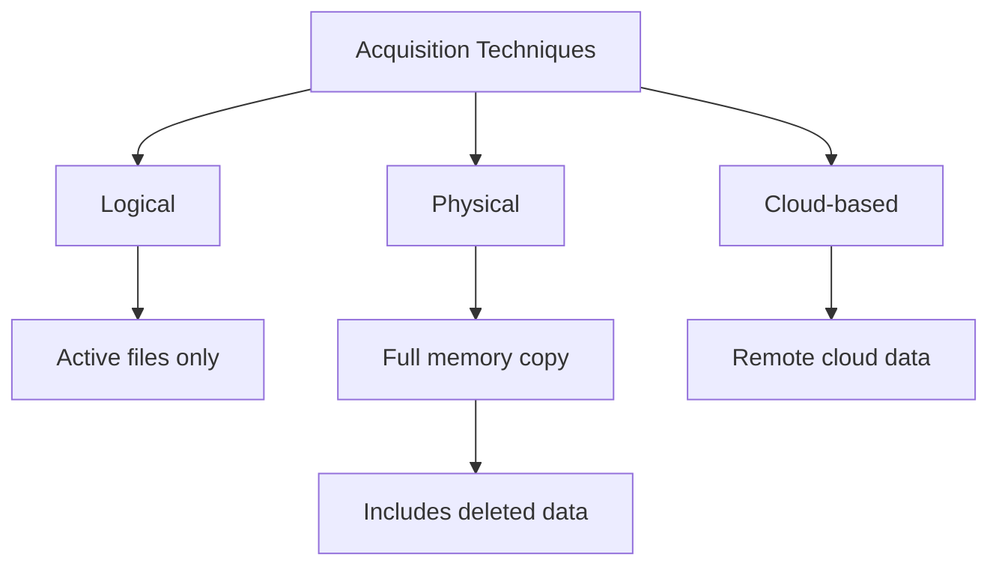
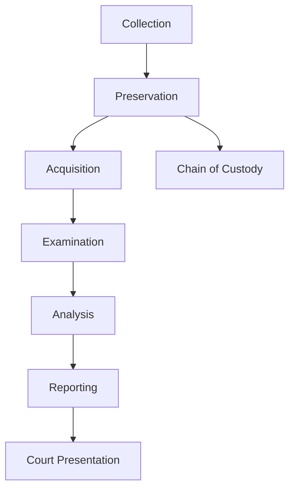
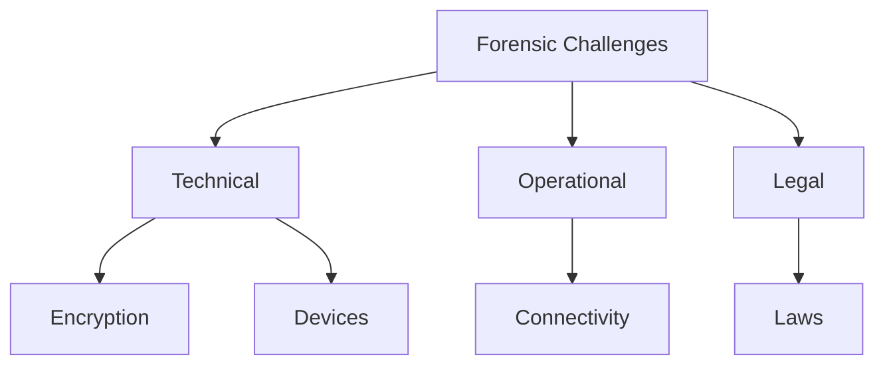

# EHF Module 5

## Explain Mobile forensic. What are various challenges in mobile forensics (05)

Mobile forensics is a branch of digital forensics focused on recovering digital evidence from mobile devices such as smartphones, tablets, and wearables using scientifically accepted methods. It aims to extract, preserve, and analyze data including call logs, messages, contacts, photos, location history, and application data for legal proceedings.

**Challenges in mobile forensics:**

- **Device diversity** – Thousands of models with different hardware, operating systems (Android, iOS), and file structures.
- **Encryption** – Modern devices use full-disk or file-based encryption (e.g., iOS Data Protection, Android File-Based Encryption).
- **Locked devices** – PIN, pattern, password, or biometric locks prevent data access.
- **Constant connectivity** – Remote wipe commands can erase evidence via internet or cellular networks.
- **Proprietary interfaces** – Manufacturers use non-standard connectors and protocols.
- **Anti-forensics** – Apps can detect jailbreaking/rooting and delete data automatically.
- **Rapid OS evolution** – Frequent updates change security mechanisms and forensic methods.

---

## Elaborate about Mobile Device Forensics (10)

Mobile device forensics is the systematic process of identifying, preserving, extracting, analyzing, and presenting digital evidence from mobile devices in a forensically sound manner. It differs from traditional computer forensics due to unique challenges such as volatile memory, built-in encryption, and continuous network communication.

**Key components of mobile device forensics:**

- **Evidence preservation** – Isolation of the device using Faraday bags to prevent remote wipe or network communication. Radio interfaces (cellular, Wi-Fi, Bluetooth) must be blocked immediately.
- **Acquisition methods** – Logical acquisition (file system without deleted data), physical acquisition (bit-by-bit copy including unallocated space), and chip-off (direct memory chip reading).
- **Tools and techniques** – Commercial tools include Cellebrite UFED, Magnet AXIOM, and Oxygen Forensic Detective. Open-source options include AFLogical and LibiMobileDevice.
- **Data types recovered** – Call logs, SMS/MMS, contacts, calendar entries, browsing history, social media messages, GPS coordinates, application databases (WhatsApp, Signal, Telegram), and system logs.
- **Legal considerations** – Chain of custody documentation, adherence to privacy laws (GDPR, HIPAA), and obtaining proper warrants or consent before examination.
- **Reporting** – Generation of court-admissible reports with methodology details, findings, and expert testimony preparation.

Mobile device forensics requires continuous learning due to rapid technological changes and increasing security measures implemented by manufacturers.

---

## Explain various Mobile Forensic acquisition techniques (Logical, Physical, Cloud-based). (10)

Mobile forensic acquisition techniques are methods used to extract data from mobile devices for analysis. Each technique offers different levels of data completeness and technical complexity.

**Logical Acquisition:**

Logical acquisition extracts data visible to the operating system through standard communication protocols (USB, Wi-Fi, Bluetooth). It retrieves active files, databases, and settings without accessing deleted or unallocated space. This method uses backup files (iTunes backup for iOS, ADB backup for Android) or forensic tools that query the device’s file system. Advantages include speed, minimal device alteration, and no need for rooting/jailbreaking. Limitations include inability to recover deleted data and password-protected application content.

**Physical Acquisition:**

Physical acquisition creates a bit-for-bit copy of the device’s internal memory (NAND/NOR flash), including unallocated space, deleted files, and hidden partitions. Methods include:
- **JTAG (Joint Test Action Group)** – Interfaces with test points on the circuit board.
- **Chip-off** – Physically removes the memory chip for reading with specialized hardware.
- **ISP (In-System Programming)** – Connects to test points without chip removal.
- **Bootloader exploitation** – Uses vulnerabilities to bypass security.

Advantages: Recovers deleted data, complete memory image. Disadvantages: Requires technical expertise, device disassembly, potential evidence damage.

**Cloud-based Acquisition:**

Cloud acquisition retrieves data from cloud services associated with the device (iCloud, Google Drive, Samsung Cloud) using legal authorization (warrant, user credentials). It extracts backups, synchronized photos, contacts, messages, and application data stored remotely. Advantages: Bypasses device locks and encryption, recovers data not present on device. Disadvantages: Requires credentials or legal orders, subject to cloud provider retention policies, potential data alteration by provider.

---

## Explain the process of mobile forensic investigation, from evidence collection to reporting. (10)

The mobile forensic investigation process follows a structured methodology to ensure evidence integrity and legal admissibility. The process consists of six sequential phases.

**Phase 1: Evidence Collection and Seizure**
- Isolate device immediately in a Faraday bag or airplane mode (on non-forensic bag) to prevent remote wipe or network changes.
- Document device condition (power state, screen, damage, accessories).
- Photograph device from all angles with evidence identifier.
- Maintain chain of custody log from seizure onward.
- Collect accessories (chargers, cables, SIM cards, memory cards).

**Phase 2: Preservation**
- Prevent data alteration by maintaining faraday isolation.
- Capture volatile data first (cached memory, running processes) using specialized tools.
- Create forensic image copies using write-blocking hardware or software.
- Verify image integrity using hash values (MD5, SHA-256).

**Phase 3: Acquisition**
- Select acquisition method based on device type, lock status, and investigation needs.
- Perform logical extraction for active data or physical extraction for complete memory.
- Document all commands and tool outputs.

**Phase 4: Examination**
- Parse extracted data using forensic tools (Cellebrite, Magnet AXIOM, Autopsy).
- Recover deleted files from unallocated space.
- Decode application databases, chat logs, and encrypted containers.
- Extract metadata (timestamps, location, device identifiers).

**Phase 5: Analysis**
- Correlate data across multiple sources (calls, messages, GPS, app logs).
- Reconstruct timeline of events using timestamps.
- Identify patterns, anomalies, or evidence of criminal activity.
- Verify findings using multiple tools for cross-validation.

**Phase 6: Reporting**
- Prepare detailed forensic report with methodology, tools used, hash values, and findings.
- Include screenshots and relevant data extracts.
- Present conclusions without speculation.
- Prepare expert testimony documentation for court proceedings.

---

## Write Challenges in mobile forensics. (10)

Mobile forensics faces numerous technical, legal, and operational challenges that complicate evidence extraction and analysis. These challenges continue to grow as mobile technology evolves.

**Technical Challenges:**

- **Device diversity** – Over 15,000 distinct smartphone models exist across manufacturers (Samsung, Apple, Xiaomi, Huawei, Google), each with proprietary hardware, firmware, and operating system versions.
- **Encryption** – iOS devices use hardware-based Secure Enclave with AES-256 encryption. Android employs File-Based Encryption (FBE) from version 10 onward. Without decryption keys, data remains inaccessible even with physical acquisition.
- **Locked devices** – PIN (10,000 combinations), pattern, password, and biometric locks block access. Lockout mechanisms permanently disable devices after multiple failed attempts.
- **Anti-forensic techniques** – Jailbreak detection (iOS) and root detection (Android) cause apps to self-delete data. Some apps implement secure ephemeral storage (Signal, Telegram secret chats).
- **Connectivity threats** – Devices can receive remote commands via cellular networks, Wi-Fi, Bluetooth, or NFC, enabling remote wipe or data encryption before forensic isolation.

**Operational Challenges:**

- **Proprietary interfaces** – Non-standard connectors (Lightning, USB-C with vendor extensions), protocols, and drivers require manufacturer-specific solutions.
- **Volatile data** – RAM content (passwords, decryption keys, recent activities) disappears within minutes when power is removed.
- **Rapid obsolescence** – Forensic tools lag behind OS updates (Android monthly patches, iOS quarterly updates). New devices often lack forensic support for months.

**Legal and Procedural Challenges:**

- **Privacy laws** – GDPR (Europe), CCPA (California), and similar laws restrict access to personal data without proper warrants or user consent.
- **Jurisdictional issues** – Cloud data may reside on servers in different countries, requiring international legal cooperation (MLAT requests).
- **Chain of custody** – Mobile devices are small and easily misplaced; maintaining unbroken custody documentation is critical but challenging.
- **Admissibility standards** – Courts require demonstrated forensic soundness (no data alteration). Modified devices (rooted/jailbroken) often face admissibility challenges.

