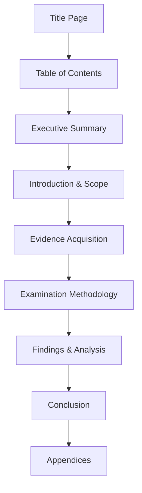

# EHF Module 6

## Explain various guidelines for digital forensic report writing along with its goals. (10 marks)

Digital forensic report writing requires adherence to specific guidelines to ensure the report is professional, objective, and legally admissible.

**Guidelines for Digital Forensic Report Writing:**

- **Clarity and Simplicity** – Use plain language avoiding unnecessary technical jargon. Define all technical terms when first introduced.
- **Objectivity** – Present facts without bias, opinion, or speculation. Avoid conclusive statements not supported by evidence.
- **Accuracy** – Verify all findings and ensure correct spellings of technical terms, hash values, timestamps, and file paths.
- **Completeness** – Include all relevant findings, both inculpatory and exculpatory. Do not omit contradictory evidence.
- **Chronological Order** – Present events and actions in proper temporal sequence to maintain logical flow.
- **Reproducibility** – Provide sufficient detail so another examiner can reproduce the same results independently.
- **Legal Compliance** – Follow jurisdictional requirements regarding format, terminology, and admissible content.

**Goals of Digital Forensic Reporting:**

- **Communication** – Convey technical findings to non-technical audiences (judges, jurors, attorneys).
- **Documentation** – Create permanent record of examination processes, tools used, and findings discovered.
- **Accountability** – Demonstrate chain of custody and prove evidence integrity throughout examination.
- **Legal Admissibility** – Produce report meeting court standards for expert testimony and documentary evidence.
- **Case Resolution** – Support prosecution, defense, or internal investigation conclusions with factual basis.

---

## Explain various guidelines for report writing. (10 marks)

Report writing in digital forensics follows established guidelines that ensure consistency, professionalism, and legal acceptance.

**General Guidelines:**

- **Audience Appropriateness** – Tailor language and detail level to intended readers (technical team, management, legal professionals, or court).
- **Logical Structure** – Organize content into clear sections with descriptive headings for easy navigation.
- **Concise Expression** – Eliminate redundant statements and irrelevant information. Every sentence should serve a purpose.
- **Passive Voice Restriction** – Use active voice where possible to improve readability and clarity.
- **Standard Terminology** – Employ consistent technical terms throughout without synonym switching.
- **Reference Documentation** – Cite tools, software versions, and methodologies used during examination.
- **Timestamp Standardization** – Use consistent time formats (UTC with local offset indicated) for all temporal references.
- **Hash Value Inclusion** – Provide MD5, SHA-1, or SHA-256 hashes for all extracted evidentiary files.
- **Limitation Acknowledgment** – State examination boundaries, constraints, and any limitations affecting conclusions.
- **Review Process** – Subject report to peer review before finalization to catch errors and omissions.

**Formatting Guidelines:**

- Use numbered pages with total page count
- Include header with case identifier and report date
- Maintain consistent font, spacing, and margin settings
- Label all figures and tables sequentially

---

## Describe in detail the structure and layout of an investigative report used in digital forensics. (10 marks)

The investigative report in digital forensics follows a standardized structure to ensure completeness, clarity, and legal acceptance.

**Complete Structure and Layout:**

**1. Title Page**
- Case number and unique identifier
- Report title (e.g., "Forensic Examination Report")
- Author name, title, and credentials
- Submission date
- Requesting party name and organization

**2. Table of Contents**
- Section headings with corresponding page numbers
- List of tables and figures with page references
- Appendices listing

**3. Executive Summary**
- Concise overview of findings (maximum one page)
- Key conclusions without technical details
- Case disposition recommendation when applicable

**4. Introduction and Scope**
- Purpose of examination
- Authority for investigation (warrant, consent, internal policy)
- Scope boundaries and exclusions
- Items examined (hard drives, mobile devices, cloud data)

**5. Evidence Acquisition Section**
- Chain of custody documentation
- Acquisition methods and forensics tools used
- Hash values for original and acquired images
- Evidence handling procedures

**6. Examination Methodology**
- Software tools with version numbers
- Analysis procedures and settings
- Search terms and filtering criteria
- Timeline construction methods

**7. Findings and Analysis**
- Discovered artifacts organized by category
- File system metadata and file carving results
- Registry analysis findings (Windows systems)
- Internet history, emails, and chat logs
- Deleted file recovery results

**8. Supporting Evidence Documentation**
- Screenshots of relevant artifacts
- Log file excerpts
- Timestamp correlation tables

**9. Conclusion**
- Summary of findings
- Answers to specific investigation questions
- Limitations and caveats

**10. Appendices**
- Glossary of technical terms
- Tool validation reports
- Full hash value lists
- Extended log files

---

## Discuss the importance of writing an investigative report in forensic investigations. What goals does it aim to achieve? (10 marks)

**Importance of Investigative Report Writing:**

The investigative report serves as the primary deliverable translating technical forensic findings into actionable intelligence for legal proceedings and organizational decisions.

**Key Importance Aspects:**

- **Legal Bridge** – Connects raw forensic data (files, logs, metadata) to courtroom testimony requirements.
- **Permanent Record** – Creates authoritative documentation surviving memory limitations of human witnesses.
- **Quality Control Mechanism** – Forces examiner to verify all findings before documentation, reducing errors.
- **Peer Review Enabler** – Allows other experts to evaluate methodology and reproduce results independently.
- **Case Continuity** – Preserves examination details for future cases involving same evidence or suspects.
- **Professional Accountability** – Demonstrates adherence to standards (ISO 17025, ACPO principles, NIST guidelines).
- **Decision Foundation** – Provides evidentiary basis for prosecutions, civil litigation, employment actions, or policy changes.

**Goals of Investigative Report:**

| Goal | Description |
| :--- | :--- |
| **Truth Determination** | Establish factual account of digital events and actions |
| **Legal Admissibility** | Meet Federal Rules of Evidence or equivalent jurisdictional standards |
| **Findings Communication** | Convey technical conclusions to judges, juries, and attorneys |
| **Examiner Transparency** | Document all actions preventing allegations of evidence tampering |
| **Reproducibility** | Enable independent verification by opposing experts |
| **Source Attribution** | Associate artifacts with specific users, devices, or timestamps |
| **Narrative Construction** | Present evidence as coherent story explaining digital events |
| **Risk Mitigation** | Protect organization from spoliation claims or procedural challenges |

---

## Report Writing Guidelines in Forensic Investigation (Part of 20 marks)

Forensic investigation report writing guidelines ensure consistency, professionalism, and legal defensibility across all case documentation.

**Core Guidelines:**

- **Use Simple Language** – Avoid acronyms without definition. Write for sixth-grade reading level to accommodate diverse audiences.
- **Maintain Objectivity** – Present facts neutrally. Use phrases like "the evidence indicates" rather than "the suspect clearly did."
- **Document All Actions** – Record every step from evidence receipt through final analysis. Omitted steps create legal vulnerability.
- **Include Negative Results** – State what was searched for and not found. Absence of evidence is evidentiary.
- **Separate Fact from Opinion** – Clearly label interpretations and conclusions as examiner opinions, not absolute facts.
- **Verify Technical Details** – Confirm hash values, file paths, timestamps, and tool outputs before inclusion.

**Writing Style Guidelines:**

- Keep sentences under 25 words where possible
- Use bullet points for lists of artifacts or findings
- Define each technical term at first use
- Maintain consistent verb tense (past tense for actions taken)

**Quality Assurance Guidelines:**

- Conduct peer review before final submission
- Verify all hyperlinks and cross-references function
- Check page numbering and section continuity
- Confirm all legal and procedural citations are current