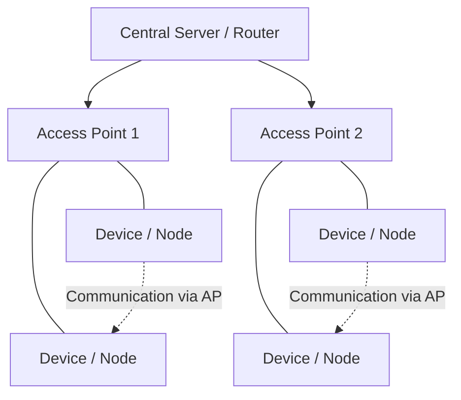
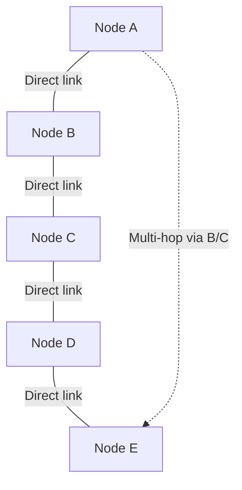
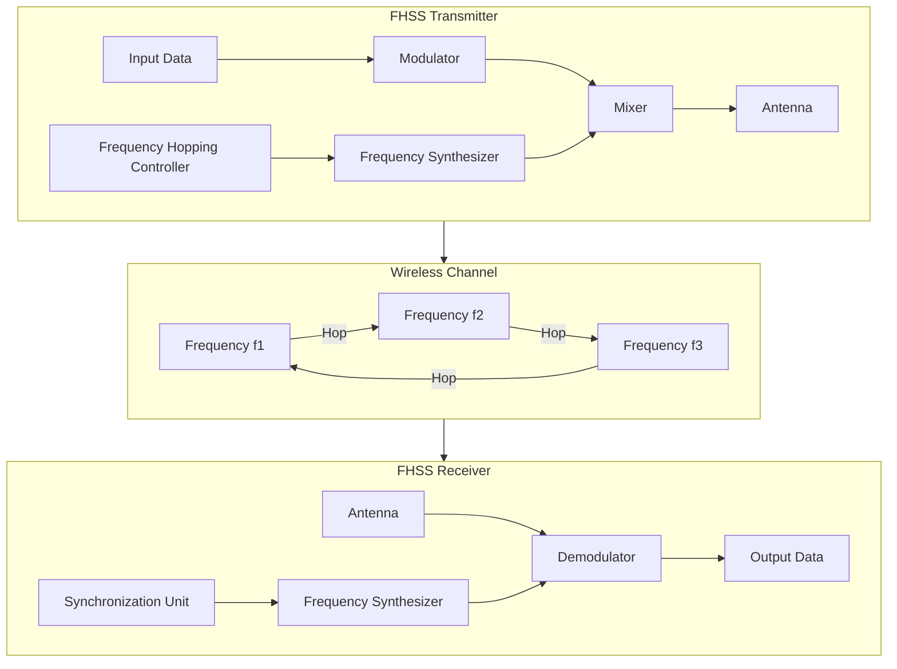
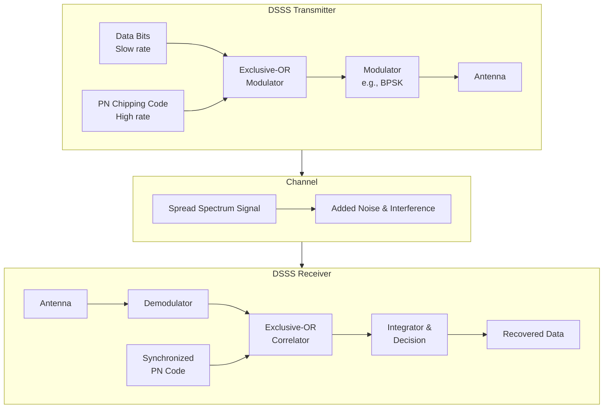
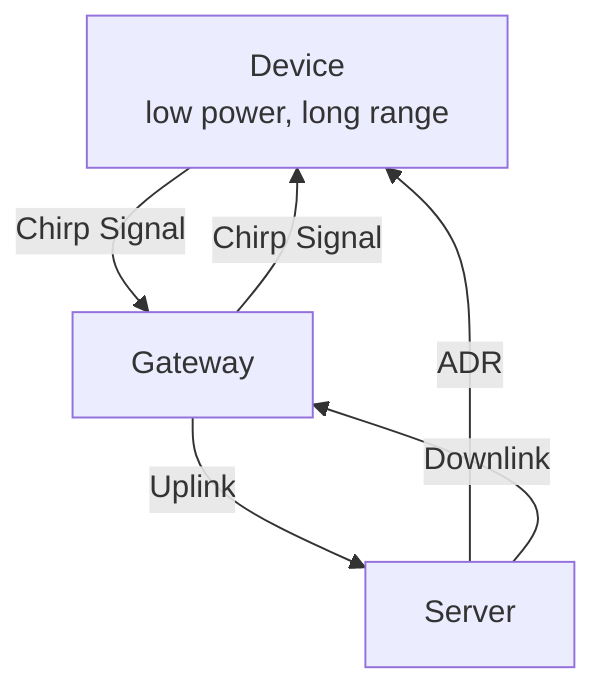

# WT Module 1

## Explain the difference between an Infrastructure-based Network and an Adhoc Network of WLAN.

Infrastructure-based Network:
- Infrastructure networks rely on access points and switches for centralized connectivity.
- Their structure is centralized and fixed, unlike dynamic ad hoc networks.
- Communication happens via a base station rather than directly between devices.
- Data rates are generally higher due to managed network resources.
- Central management is a key feature introduced in infrastructure-based designs.
- Stronger authentication mechanisms make these networks more secure overall.
- Interference is managed centrally, reducing signal disruptions and improving reliability.
- Nodes experience lower complexity because the infrastructure handles most tasks.
- The main limitation is complete dependence on fixed infrastructure components.
- These networks are commonly used for enterprise Wi-Fi and campus deployments.

Adhoc Network:
- Adhoc networks use peer-to-peer wireless connections without any central device.
- Their structure is decentralized and dynamic, adapting quickly to changes.
- Devices communicate directly with each other instead of using a base station.
- Data rates are generally lower due to the lack of central coordination.
- Self-configuring nodes are a key feature introduced in adhoc networks.
- Security is weaker, making these networks more vulnerable to various attacks.
- Interference is higher due to multiple hops between communicating devices.
- Routing complexity is higher because routes must be discovered dynamically.
- Scalability issues arise as the number of nodes increases in the network.
- These networks are applied in military operations and disaster relief scenarios.

---

## Explain the difference between FHSS and DSSS.

FHSS (Frequency Hopping Spread Spectrum):
- FHSS stands for Frequency Hopping Spread Spectrum in wireless communication systems.
- This technology rapidly switches carrier frequencies across a wide spectrum range.
- Its narrowband structure involves continuous frequency switching rather than fixed transmission.
- The system changes frequencies rapidly many times per second to transmit data.
- Data rate per channel is lower compared to direct sequence methods.
- Frequency agility is the key feature introduced by FHSS technology.
- FHSS provides good security against eavesdropping due to unpredictable frequency jumps.
- It effectively avoids narrowband interference by hopping to clear frequencies.
- The complexity is moderate because precise synchronization is required between devices.
- The main limitation is low throughput for high-bandwidth applications.
- FHSS is commonly used in Bluetooth devices and cordless phones.

DSSS (Direct Sequence Spread Spectrum):
- DSSS stands for Direct Sequence Spread Spectrum for wireless data transmission.
- This technology uses pseudo-noise coding to spread signals across wide bandwidth.
- Its wideband structure transmits continuous signals rather than hopping between frequencies.
- It multiplies original data with a high-speed chipping code for spreading.
- Data rate is generally higher compared to frequency hopping systems.
- Code division is the key feature introduced by DSSS technology.
- DSSS offers better anti-jamming capability than frequency hopping methods.
- It spreads interference energy across wide bandwidth to minimize its impact.
- The complexity is higher due to sophisticated code generation requirements.
- The near-far problem limits performance when devices transmit at unequal power.
- DSSS is applied in GPS, CDMA networks, and Wi-Fi standards.

---
## Draw and explain the OFDMA.

OFDMA Orthogonal Frequency Division Multiple Access) is a multi‑user extension of OFDM. It allows multiple users to share the same channel by assigning different subsets of orthogonal subcarriers to each user. This makes it highly efficient for modern wireless systems like 4G LTE and WiMAX.

Working Principle of OFDMA:
- Spectrum Division: The available bandwidth is divided into many narrowband orthogonal subcarriers.
- Subcarrier Allocation: Each user is allocated a group of subcarriers for transmission.
- Orthogonality: Subcarriers overlap in frequency but remain mathematically orthogonal, preventing interference.
- Dynamic Resource Assignment: Subcarriers can be allocated adaptively based on user demand, channel conditions, or QoS requirements.
- Centralized Scheduling: A base station assigns subcarriers and time slots to users, ensuring controlled access.

Advantages of OFDMA:
- Reduced Interference: Orthogonality prevents overlap between users.
- Scalability: Efficiently supports large numbers of users.
- Applications: Used in LTE, WiMAX, and 5G systems.

---
## How does OFDMA handle synchronization and interference between users?

OFDMA (Orthogonal Frequency Division Multiple Access) allows multiple users to share the same channel by assigning different orthogonal subcarriers. It manages synchronization and interference using the following methods:

Synchronization Handling
- Orthogonal Subcarriers: Users are assigned separate orthogonal subcarriers, preventing overlap.
- Time Synchronization: Users are synchronized so transmissions arrive at the correct time.
- Cyclic Prefix (CP): A cyclic prefix is added to reduce inter-symbol interference caused by delay.
- Frequency Synchronization: Ensures carrier frequencies remain aligned to maintain orthogonality.

Interference Handling
- Subcarrier Allocation: Different users get different subcarriers, reducing user-to-user interference.
- Guard Bands / Orthogonality: Orthogonality between subcarriers minimizes inter-carrier interference.
- Power Control and Scheduling: The system controls transmission power and allocates resources efficiently to reduce interference.

Example
In 4G/5G systems, OFDMA assigns different subcarriers to different users while synchronization and cyclic prefix prevent interference.

---
## Explain how LoRaWAN enables long-range, low-power communication using Chirp Spread Spectrum

LoRaWAN (Long Range Wide Area Network) is a low‑power, wide‑area networking protocol designed for IoT. It achieves long‑range communication with minimal energy consumption by using LoRa modulation, which is based on Chirp Spread Spectrum (CSS).

Chirp Spread Spectrum (CSS) Technique:
- Chirp Signals: A chirp is a signal whose frequency increases or decreases over time.
- Spreading: CSS spreads the data signal across a wide frequency band using chirps.
- Orthogonality: Different spreading factors (SFs) allow multiple devices to transmit simultaneously without interfering.
- Robustness: Resistant to noise, multipath fading, and interference.

How CSS Enables Long‑Range, Low‑Power Communication:
- High Sensitivity: CSS allows receivers to detect signals even below the noise floor, enabling communication over 10–15 km in rural areas.
- Low Power Consumption: Devices transmit at low power because CSS ensures reliable decoding even with weak signals.
- Scalability: Multiple spreading factors let thousands of devices coexist in the same network.
- Interference Resistance: CSS makes signals harder to jam or intercept, improving reliability.
- Adaptive Data Rate (ADR): LoRaWAN adjusts spreading factors and transmission rates to balance range, power, and capacity.

