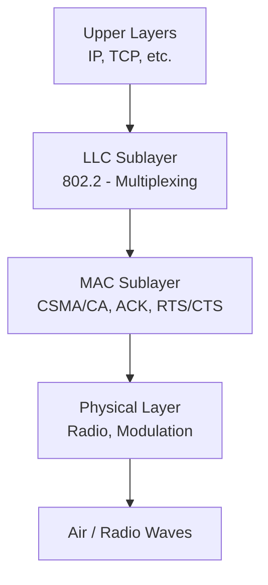

# WT Module 3

## Describe the system architecture of 802.11

IEEE 802.11 is the standard for Wireless LAN Wi‑Fi). Its system architecture defines how stations (devices) connect through access points to form wireless networks, enabling communication with wired infrastructure.

1. Station (STA)
	- Any device with a wireless NIC (laptop, phone, IoT device)
	- Communicates via radio interface
	- Acts as a client in the WLAN
2. Access Point (AP)
	- Connects wireless stations to the wired LAN
	- Provides centralized control in **infrastructure mode**
	- Forwards frames between STAs and the Distribution System
3. Basic Service Set (BSS)
	- A group of STAs controlled by **one AP**
	- Smallest building block of a WLAN
	- Defined by the AP's BSSID (MAC address)
4. Extended Service Set (ESS)
	- Multiple BSSs interconnected via a **Distribution System (DS)**
	- Provides seamless coverage across larger areas
	- Enables roaming between APs (same SSID)
5. Distribution System (DS)
	- Backbone network connecting APs to each other and to the wired LAN
	- Enables roaming between APs
	- Typically Ethernet, but can also be wireless mesh

---
## Draw and explain the protocol architecture of IEEE 802.11. Also, discuss power management in IEEE 802.11 infrastructure networks.

Power Management in IEEE 802.11 Infrastructure Networks
- Sleep Mode: Stations STAs can enter low‑power state to save battery.
- Beacon Frames: Access Point AP) periodically sends beacons with info about buffered data.
- Traffic Indication Map TIM Part of beacon frame showing which STAs have pending data.
- Polling Mechanism: Sleeping STA wakes up, checks TIM, and requests data.
- Delivery Traffic Indication Message DTIM Used for multicast/broadcast traffic delivery.
- Benefit: Extends battery life while ensuring reliable data transfer.

Layers of IEEE 802.11 Protocol Architecture:

Physical Layer PHY
- Handles transmission and reception of data over radio waves.
- Defines modulation techniques DSSS, OFDM, FHSS.
- Provides data rates and frequency bands 2.4 GHz, 5 GHz).

MAC Layer Medium Access Control):
- Controls access to the wireless medium.
- Uses CSMA/CA Carrier Sense Multiple Access with Collision Avoidance).
- Provides frame formats, addressing, and retransmission.
- Supports functions like association, authentication, and encryption.

Logical Link Control LLC
- Common to all IEEE 802 networks.
- Provides interface between MAC and higher layers.
- Ensures error detection and flow control.