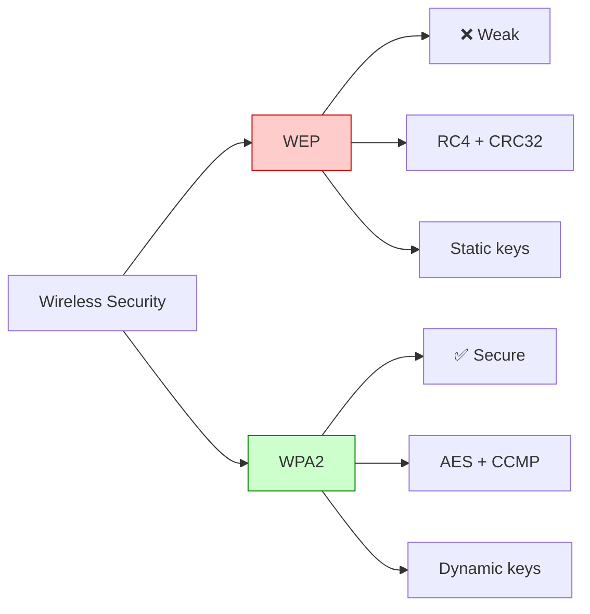
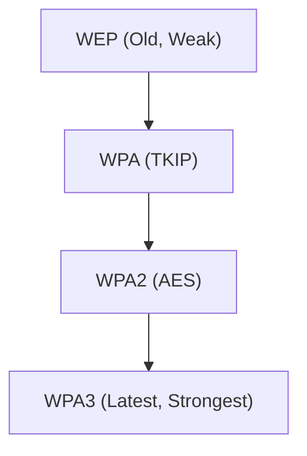

# WT Module 4

## Give the significance of WEP protocols. What are the features of WPA2?

Significance of WEP Protocols

WEP Wired Equivalent Privacy) is a security protocol used in wireless LANs to provide privacy and protect data transmission. It was designed to give wireless networks security similar to wired networks

Key Features & Significance
- Data Encryption: WEP encrypts data before transmission to prevent unauthorized access.
- **Basic encryption** using RC4 stream cipher
- **40‑bit or 104‑bit keys** with a 24‑bit Initialization Vector (IV), Total uses 64-bit and 128-bit keys.
- **Shared‑key authentication** for access control
- **Basic data integrity** using CRC‑32 checksum
- Helped establish the **foundation for wireless security standards**, though later found weak and easily cracked

Features of WPA2

**WPA2 (Wi‑Fi Protected Access 2)** is the successor to WPA, introduced by IEEE to overcome WEP’s weaknesses. It is considered the most secure standard until WPA3.

Key Features
- **Strong Encryption:** Uses AES (Advanced Encryption Standard) with CCMP for confidentiality and integrity
- **Robust Authentication:** Supports IEEE 802.1X with EAP for enterprise networks
- **Data Integrity:** Prevents packet tampering with strong message integrity checks
- **Dynamic Key Management:** Keys are generated and distributed securely, reducing risk of reuse
- **High Security Standard:** Provides strong protection for both personal and enterprise WLANs

Security Standards Used After WEP
1. WPA (Wi-Fi Protected Access)
	- Improved security over WEP
	- Uses **TKIP** (Temporal Key Integrity Protocol) for better encryption
2. WPA2
	- Stronger security standard
	- Uses **AES** (Advanced Encryption Standard) encryption
3. WPA3
	- Latest and more secure standard
	- Provides stronger authentication and protection

---
## Discuss the flaws in WEP's initialization vector (IV) implementation and how it leads to key reuse and susceptibility to attacks.

- **WEP (Wired Equivalent Privacy)** was the first security protocol for IEEE 802.11 WLANs
- Uses the **RC4 stream cipher** with a secret key and a 24‑bit **Initialization Vector (IV)**
- The IV is meant to ensure that each packet is encrypted uniquely

Flaws in IV Implementation
1. **Small IV Size (24‑bit)**
	- Only 2²⁴ ≈ 16 million possible IVs
	- In busy networks, IVs repeat quickly (within hours)
2. **IV Sent in Cleartext**
	- IV is transmitted openly in each packet header
	- Attackers can easily capture IVs without breaking encryption
3. **Weak RC4 Key Scheduling**
	- WEP combines IV with the secret key to form the RC4 seed
	- Certain IV values produce weak keys, making it easier to recover the secret key
4. **Key Reuse**
	- Because IVs repeat, the same RC4 keystream is reused
	- Attackers can compare ciphertexts encrypted with the same keystream to deduce plaintext

Consequences / Susceptibility to Attacks
- **Statistical Analysis Attacks:** Repeated IVs allow attackers to analyze patterns and recover the key
- **Known Plaintext Attacks:** If part of the plaintext is known (e.g., headers), attackers can exploit IV reuse to recover keystreams
- **Key Recovery Attacks (e.g., FMS Attack):** Exploits weak IVs to recover the WEP key in minutes
- **Practical Breakability:** Tools like Aircrack‑ng can crack WEP keys by collecting enough packets with reused IVs
