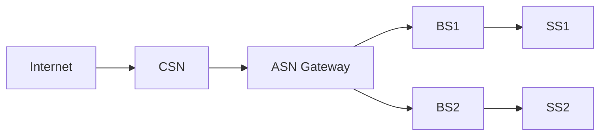

# WT Module 6

## Give the Features of VANET, E-VANET and MANET.

VANET (Vehicular Ad Hoc Network)

- Full Form: Vehicular Ad Hoc Network
- Technology: Dedicated Short Range Communications (DSRC) / IEEE 802.11p
- Structure: Highly dynamic, road-based, constrained by traffic rules and road layouts
- Working: Vehicle-to-Vehicle (V2V) and Vehicle-to-Infrastructure (V2I)
- Data Rate: 3–27 Mbps (with DSRC)
- Feature Introduced: Roadside Units (RSUs) for infrastructure-assisted communication
- Security: Critical – essential for safety applications like collision avoidance
- Interference: High, especially in dense traffic conditions
- Complexity: Very high due to fast-moving nodes and frequent topology changes
- Limitation: Regular disconnections and network fragmentation
- Applications: Collision warning, toll collection, traffic management, infotainment

E-VANET (Emergency / Enhanced Vehicular Ad Hoc Network)

- Full Form: Emergency Vehicular Ad Hoc Network (or Enhanced VANET)
- Technology: DSRC + Cellular (LTE/5G) – often with prioritized emergency channels
- Working: V2V, V2I, and Emergency-to-Vehicle (E2V) with priority-based message queuing and fast broadcast
- Data Rate: 10–100 Mbps (depending on 4G/5G integration)
- Feature Introduced: Priority-based emergency message propagation and dynamic road-side unit activation
- Security: Extremely critical – must prevent false emergency alerts and ensure message authentication
- Interference: High but managed through dedicated emergency channels or time slots
- Complexity: Very high – adds emergency prioritization over standard VANET protocols
- Limitation: Requires reliable cellular coverage for hybrid mode; risk of emergency message flooding
- Applications: Accident alert dissemination, ambulance route clearing, disaster response, hazardous location warning

MANET (Mobile Ad Hoc Network)

- Full Form: Mobile Ad Hoc Network
- Technology: Bluetooth, Wi-Fi Direct, Zigbee, IEEE 802.11 (WLAN)
- Structure: Random mobility with no fixed infrastructure or predefined paths
- Working: Peer-to-peer (P2P) communication between mobile nodes
- Data Rate: 1–100 Mbps (depending on Wi-Fi standard)
- Feature Introduced: Fully self-organizing network – no need for Roadside Units or any fixed infrastructure
- Security: Moderate – security is important but not as critical as VANET; common threats include eavesdropping and denial of service
- Interference: Variable – depends on node density, distance, and environment
- Complexity: Moderate – simpler than VANET due to slower mobility and smaller network sizes typically
- Limitation: Limited battery life of nodes and restricted communication range
- Applications: Disaster recovery, battlefield communications, conference rooms, remote area networking, sensor networks

---

## State the features of Wi-MAX and draw and explain the architecture of Wi-MAX

Wi-MAX stands for Worldwide Interoperability for Microwave Access. It is based on the IEEE 802.16 standard.

Features:

1. Long Range: Provides coverage up to 50 km (30 miles) for fixed stations and 5–15 km for mobile stations.
2. High Data Rate: Supports up to 1 Gbps for fixed stations and 100 Mbps for mobile users (under IEEE 802.16m).
3. Broadband Wireless Access: Delivers broadband internet without needing cables or DSL lines.
4. LOS and NLOS Support:
   - LOS (Line of Sight): For long-distance communication (up to 50 km) using high frequencies (10–66 GHz).
   - NLOS (Non-Line of Sight): For urban areas with obstacles using lower frequencies (2–11 GHz).
1. Scalability: Can serve from a single user to thousands of users across a city.
2. Quality of Service (QoS): Supports different service levels for voice, video, and data traffic.
3. Security: Uses AES (Advanced Encryption Standard) and 3DES for secure data transmission.
4. Duplexing Modes:
   - TDD (Time Division Duplexing): Uses same frequency for uplink and downlink but different time slots.
   - FDD (Frequency Division Duplexing): Uses separate frequencies for uplink and downlink.
1. MIMO Support: Multiple Input Multiple Output antennas improve speed and reliability.
2. Applications: Fixed broadband, mobile internet, backhaul for cellular towers, rural connectivity, and disaster recovery.

Architecture

Wi-MAX architecture consists of two main parts:
1. SS (Subscriber Station) – User device (laptop, smartphone, modem).
2. BS (Base Station) – Tower that manages multiple SSs.

1. Subscriber Station (SS)
	- End-user device (laptop, smartphone, Wi-MAX modem, tablet)
	- Communicates wirelessly with the nearest Base Station
	- Can be fixed (home/office modem) or mobile (phone/laptop)
2. Base Station (BS)
	- Acts like a cellular tower
	- Covers a specific area called a cell (1–10 km for mobile, up to 50 km for fixed)
	- Manages multiple Subscriber Stations
	- Forwards traffic to/from the ASN Gateway
3. Access Service Network (ASN)
	- Collection of one or more Base Stations
	- Provides wireless connectivity and handoff between BSs
	- Manages authentication, QoS, and mobility
4. Connectivity Service Network (CSN)
	- Connects Wi-MAX network to the public internet or private ISP backbone
	- Provides IP address assignment (DHCP)
	- Manages billing, security, and roaming
5. Network Management System (NMS)
	- Centralized system to monitor and control all BSs and SSs
	- Handles fault detection, performance monitoring, and configuration

How Wi-MAX Architecture Works (Step-by-Step)
1. User Request: A laptop (SS) wants to access the internet.
2. Connection to BS: The laptop sends a wireless request to the nearest Wi-MAX Base Station (within 5–15 km range).
3. Authentication: The Base Station verifies the user through the ASN and NMS.
4. Traffic Forwarding: The Base Station forwards the request to the ASN Gateway.
5. Internet Routing: The ASN Gateway passes the request to the CSN, which connects to the internet backbone.
6. Response: Data from the internet travels back through CSN → ASN → BS → SS (laptop).

---
## What role does VANET play in intelligent transportation systems (ITS)?

- **Enables Real-Time Communication**: Provides Vehicle-to-Vehicle (V2V) and Vehicle-to-Infrastructure (V2I) data exchange, forming the wireless backbone of ITS.
- **Enhances Safety**: Broadcasts emergency warnings (e.g., sudden braking, accidents, slippery roads) with near-zero latency, allowing drivers or autonomous systems to avoid collisions.
- **Improves Traffic Efficiency**: Supports dynamic route guidance and adaptive traffic signal control, reducing congestion and travel times by balancing vehicle flow.
- **Facilitates Cooperative Driving**: Enables platooning (vehicles traveling closely at optimized speeds), which increases road capacity and reduces fuel consumption.
- **Supports Vulnerable Road Users**: Integrates with pedestrian and cyclist devices to prevent accidents at intersections.
- **Resilience & Cost-Effectiveness**: Operates in decentralized, ad-hoc mode, ensuring functionality even where fixed infrastructure (e.g., cellular towers) is unavailable.
- **Enables Future ITS**: Serves as a critical platform for autonomous driving and smart city integration by delivering low-latency, high-reliability messaging.