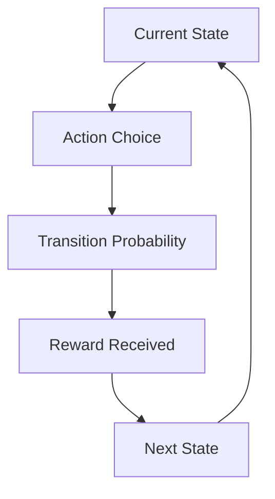
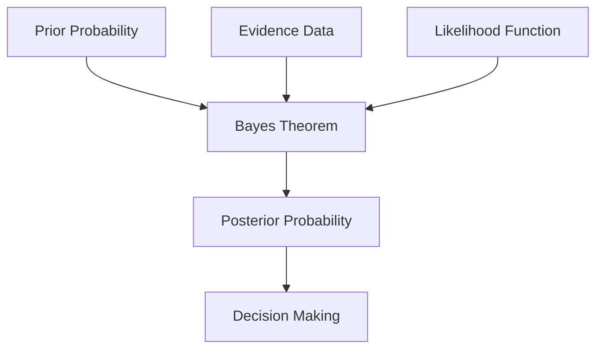
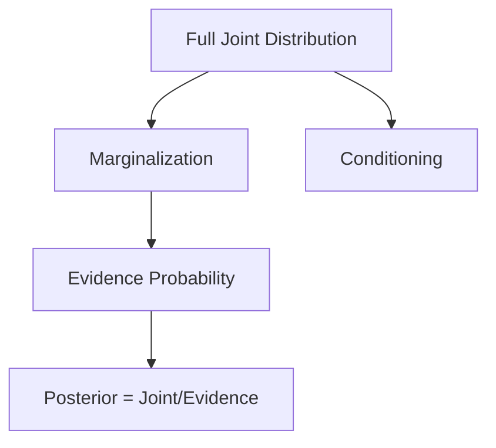
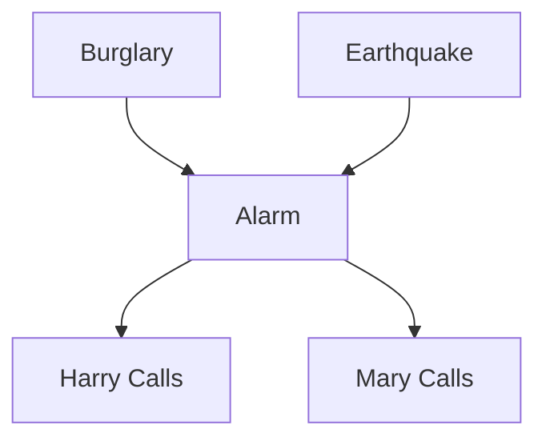
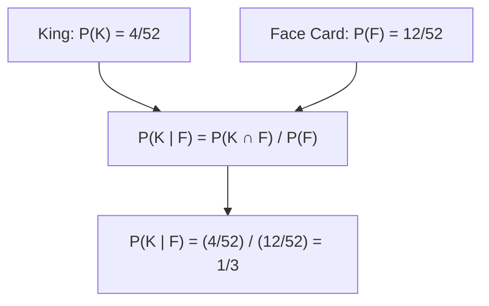
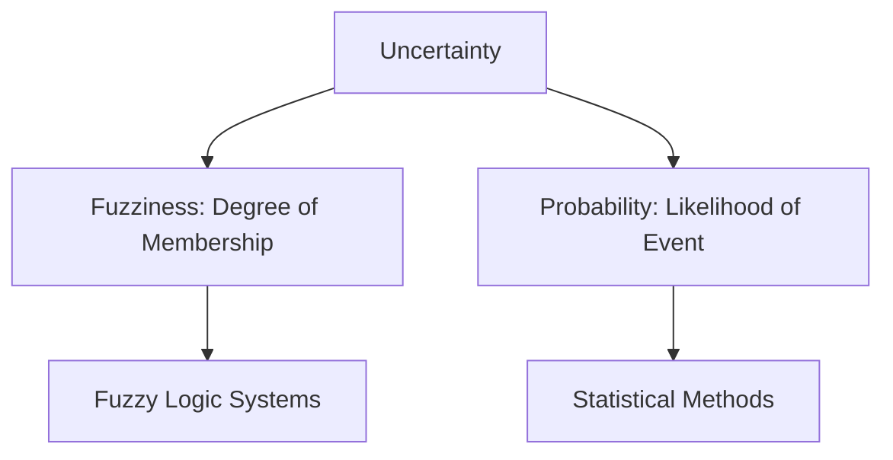
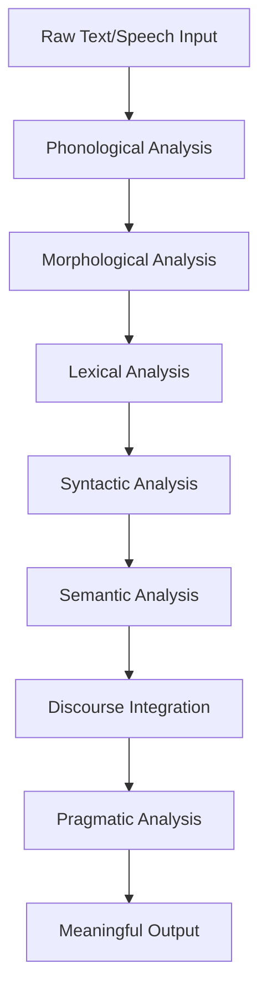

#### Perform the operations of union, intersection, difference, and complement on given fuzzy sets (2 marks)

Let A = {0.3/x₁, 0.7/x₂, 0.5/x₃} and B = {0.6/x₁, 0.2/x₂, 0.9/x₃}

**Union (A ∪ B):** μA∪B(x) = max(μA(x), μB(x))
- x₁: max(0.3, 0.6) = 0.6
- x₂: max(0.7, 0.2) = 0.7
- x₃: max(0.5, 0.9) = 0.9
**Result:** {0.6/x₁, 0.7/x₂, 0.9/x₃}

**Intersection (A ∩ B):** μA∩B(x) = min(μA(x), μB(x))
- x₁: min(0.3, 0.6) = 0.3
- x₂: min(0.7, 0.2) = 0.2
- x₃: min(0.5, 0.9) = 0.5
**Result:** {0.3/x₁, 0.2/x₂, 0.5/x₃}

**Difference (A - B):** μA-B(x) = min(μA(x), 1 - μB(x))
- x₁: min(0.3, 0.4) = 0.3
- x₂: min(0.7, 0.8) = 0.7
- x₃: min(0.5, 0.1) = 0.1
**Result:** {0.3/x₁, 0.7/x₂, 0.1/x₃}

**Complement (Ā):** μĀ(x) = 1 - μA(x)
- x₁: 1 - 0.3 = 0.7
- x₂: 1 - 0.7 = 0.3
- x₃: 1 - 0.5 = 0.5
**Result:** {0.7/x₁, 0.3/x₂, 0.5/x₃}

---

#### Compute the algebraic sum, algebraic product, bounded sum, and bounded difference for given fuzzy sets (2 marks)

Let A = {0.4/x, 0.8/y, 0.2/z} and B = {0.7/x, 0.3/y, 0.9/z}

**Algebraic Sum:** μA⊕B(x) = μA(x) + μB(x) - μA(x)·μB(x)
- x: 0.4 + 0.7 - (0.4×0.7) = 1.1 - 0.28 = 0.82
- y: 0.8 + 0.3 - (0.8×0.3) = 1.1 - 0.24 = 0.86
- z: 0.2 + 0.9 - (0.2×0.9) = 1.1 - 0.18 = 0.92
**Result:** {0.82/x, 0.86/y, 0.92/z}

**Algebraic Product:** μA⊙B(x) = μA(x)·μB(x)
- x: 0.4×0.7 = 0.28
- y: 0.8×0.3 = 0.24
- z: 0.2×0.9 = 0.18
**Result:** {0.28/x, 0.24/y, 0.18/z}

**Bounded Sum:** μA⊕B(x) = min(1, μA(x) + μB(x))
- x: min(1, 0.4+0.7) = min(1, 1.1) = 1
- y: min(1, 0.8+0.3) = min(1, 1.1) = 1
- z: min(1, 0.2+0.9) = min(1, 1.1) = 1
**Result:** {1/x, 1/y, 1/z}

**Bounded Difference:** μA⊖B(x) = max(0, μA(x) - μB(x))
- x: max(0, 0.4-0.7) = max(0, -0.3) = 0
- y: max(0, 0.8-0.3) = max(0, 0.5) = 0.5
- z: max(0, 0.2-0.9) = max(0, -0.7) = 0
**Result:** {0/x, 0.5/y, 0/z}

---

#### List and explain the various fuzzification methods used for assigning membership values (2 marks)

Fuzzification methods assign membership values using predefined mathematical functions. The common ones are:

1. **Triangular (Tri)**: Defined by three points (a, b, c). Membership rises linearly from 0 at 'a' to 1 at 'b', and falls to 0 at 'c'. It is the simplest and most commonly used.
2. **Trapezoidal (Trap)**: Defined by four points (a, b, c, d). It rises from 0 at 'a' to 1 at 'b', stays at 1 until 'c', then falls to 0 at 'd'. Useful for plateau regions.
3. **Gaussian (Gauss)**: Uses a bell-shaped curve based on a mean (center) and standard deviation. It provides a smooth, non-linear transition.
4. **S-shaped (S)**: A sigmoidal curve that starts at 0 and gradually rises to 1. It is an increasing function, useful for assigning "large" or "high" values.
5. **Z-shaped (Z)**: The mirror image of the S-function. It starts at 1 and gradually drops to 0. It is a decreasing function, useful for assigning "small" or "low" values.
6. **Sigmoidal (Sig)**: A general S-shaped curve defined by a mathematical sigmoid (logistic) function. It is open-ended and often used in neural-fuzzy systems for smooth transitions.

---

#### List and explain the different defuzzification methods (2 marks)

Defuzzification converts fuzzy output sets into single crisp values for real-world control.

| # | Method | Description |
|---|--------|-------------|
| 1 | Centroid | Computes geometric center of the fuzzy set. |
| 2 | Bisector | Finds vertical line splitting area equally. |
| 3 | MOM | Selects value with maximum membership degree. |
| 4 | LOM | Chooses largest value among maxima. |
| 5 | SOM | Selects smallest value among maxima. |
| 6 | Weighted Average | Calculates weighted mean of all elements. |

Centroid is most commonly used due to its stability and accuracy.

---

#### Explain the Markov decision process in detail (2 marks)

A Markov Decision Process (MDP) is a mathematical framework used to model sequential decision-making problems where the outcome of an action is uncertain. It is widely used in Artificial Intelligence (AI), Machine Learning, Robotics and Reinforcement Learning to help an agent choose actions that maximize long-term rewards while interacting with an environment.

MDPs consist of states, actions, transition probabilities, and rewards that define the environment. An agent selects actions based on its current state to maximize cumulative future rewards over time. The Markov property ensures that the future depends only on the present state, not on history.

The Bellman equation expresses the optimal value function for each state:

---

#### Explain Bayes' theorem and its significance (2 marks)

Bayes' theorem describes the probability of an event based on prior knowledge of related conditions.

**Formula:**
P(A|B) = P(B|A) × P(A) / P(B)

Where:
- P(A|B) = Posterior probability (after evidence)
- P(B|A) = Likelihood (probability of evidence given hypothesis)
- P(A) = Prior probability (before evidence)
- P(B) = Evidence probability (total probability of evidence)

**Significance:**
Bayes' theorem enables updating beliefs when new evidence becomes available in uncertain situations. It forms the foundation of Bayesian inference in statistics, machine learning, and artificial intelligence. The theorem is essential for classification systems, spam filtering, medical diagnosis, and decision analysis. It provides a systematic way to combine prior knowledge with observed data for rational decision-making.

---

#### Explain the centroid method of defuzzification (2 marks)

The centroid method computes the center of gravity of the aggregated fuzzy output set. The crisp output value is the x-coordinate of the centroid:

**Formula:**
x* = ∫ x·μ(x) dx / ∫ μ(x) dx

For discrete sets: x* = Σ(x·μ(x)) / Σ μ(x)

**Procedure:**
1. Aggregate all fuzzy output sets
2. Calculate the weighted average of all membership values
3. The resulting value is the crisp output

**Example:**
For membership values: μ(1)=0.2, μ(2)=0.5, μ(3)=1.0, μ(4)=0.5, μ(5)=0.2
x* = (1×0.2 + 2×0.5 + 3×1.0 + 4×0.5 + 5×0.2) / (0.2+0.5+1.0+0.5+0.2)
x* = (0.2+1.0+3.0+2.0+1.0) / 2.4 = 7.2/2.4 = 3.0

This method provides continuous outputs and is sensitive to all membership values. It is widely used in fuzzy control systems.

---

#### Given a joint distribution table, perform inference to compute the required probability (2 marks)

**Given Joint Distribution Table:**

| A | B | P(A,B) |
|---|---|---|
| True | True | 0.10 |
| True | False | 0.35 |
| False | True | 0.20 |
| False | False | 0.35 |

**Question:** Compute P(A=True | B=True)

**Step 1:** P(A=True and B=True) = 0.10

**Step 2:** P(B=True) = P(A=True,B=True) + P(A=False,B=True) = 0.10 + 0.20 = 0.30

**Step 3:** P(A=True | B=True) = P(A=True,B=True) / P(B=True) = 0.10 / 0.30 = 0.333

**Answer:** The posterior probability is 0.333 or 33.3%.

---

#### Explain the Bayesian belief network with a suitable example, such as the Harry Burglar Alarm system (2 marks)

A Bayesian Belief Network (BBN) is a probabilistic graphical model that represents conditional dependencies among variables.

The network consists of nodes representing variables and directed edges indicating causal relationships. Each node has a Conditional Probability Table (CPT) showing probabilities given its parents.

**Harry Burglar Alarm Example:**
Variables: Burglary (B), Earthquake (E), Alarm (A), HarryCalls (H), MaryCalls (M)

**CPTs:**
- P(Burglary) = 0.001
- P(Earthquake) = 0.002
- P(Alarm|B,E): B,E=0.95; B,¬E=0.94; ¬B,E=0.29; ¬B,¬E=0.001
- P(HarryCalls|Alarm): True=0.90, False=0.05
- P(MaryCalls|Alarm): True=0.70, False=0.01

Inference computes probabilities like P(Alarm|HarryCalls) by propagating evidence through the network.

---

#### List and explain the advantages and disadvantages of a cognitive system (2 marks)

| Aspect | Advantages | Disadvantages |
|--------|------------|---------------|
| Learning | Adapts to new situations autonomously | Requires extensive training data |
| Reasoning | Handles uncertainty and incomplete data | Computationally expensive |
| Interaction | Provides natural human-like interface | Difficult to explain decisions |
| Performance | Improves with experience over time | May develop unexpected behaviors |
| Scalability | Can process vast amounts of data | Hardware requirements are significant |

**Advantages:**
- Cognitive systems learn from data and improve with experience continuously
- They handle complex, ambiguous problems that traditional systems cannot solve

**Disadvantages:**
- Development and maintenance require specialized expertise and resources
- System decisions are often opaque, creating trust and accountability concerns

---

#### A single card is drawn from a standard deck of 52 playing cards. Given that the probability of drawing a king is 4/52, calculate the posterior probability P(King | Face), which is the probability that the drawn card is a king given that it is a face card (2 marks)

**Given:**
- Total cards: 52
- P(King) = 4/52
- Face cards: King, Queen, Jack (3 per suit × 4 suits = 12)
- P(Face) = 12/52
- P(Face | King) = 1 (all kings are face cards)

**Bayes' Theorem:**
P(King | Face) = P(Face | King) × P(King) / P(Face)

**Calculation:**
P(King | Face) = (1 × 4/52) / (12/52)
P(King | Face) = (4/52) / (12/52)
P(King | Face) = 4/12 = 1/3 ≈ 0.333

**Answer:** The posterior probability is 1/3 or 33.3%.

---

#### Differentiate between fuzziness and probability (2 marks)

| Aspect       | Fuzziness                           | Probability                     |
| ------------ | ----------------------------------- | ------------------------------- |
| Nature       | Vagueness and ambiguity of events   | Uncertainty of event occurrence |
| Mathematical | Membership degrees in [0,1]         | Probability values in [0,1]     |
| Basis        | Degree of truth                     | Likelihood of occurrence        |
| Summation    | Memberships need not sum to 1       | Probabilities sum to 1          |
| Example      | "Tall person" (degrees of tallness) | "90% chance of rain"            |
| Application  | Fuzzy logic, approximate reasoning  | Statistics, risk analysis       |

**Key Distinctions:**
- Fuzziness represents imprecision in categories, while probability represents randomness.
- A fuzzy value of 0.7 for "tall" means partial membership, not chance of being tall.
- Probability quantifies uncertainty about which outcome occurs among well-defined possibilities.
- Both can coexist, but they address fundamentally different types of uncertainty.

**Example:**
- Fuzziness: "The water is warm" (subjective temperature category)
- Probability: "There is 70% chance of rain" (objective likelihood of a specific event)

---

## Explain the elements that constitute a cognitive system (5 marks)

A cognitive system consists of several interconnected elements that work together to simulate human thought processes. The core elements include:

- **Perception**: Captures and interprets raw data from various sensors and external inputs.
- **Learning**: Uses algorithms to improve performance through experience and new information.
- **Reasoning**: Applies logical and probabilistic methods to derive conclusions and make decisions.
- **Memory**: Stores and retrieves past experiences, knowledge, and learned patterns.
- **Action**: Executes responses and communicates outputs to users or other systems.

These elements operate in a continuous feedback loop, enabling adaptive and intelligent behavior.

---

#### Describe the steps involved in building typical cognitive applications, and explain the same for a healthcare application (5 marks)

**Typical cognitive application development steps:**

1. **Problem Definition**: Identify the specific business challenge and user needs.
2. **Data Collection**: Gather relevant structured and unstructured data from multiple sources.
3. **Data Preparation**: Clean, normalize, and annotate data for training and testing.
4. **Model Selection**: Choose appropriate machine learning, NLP, or reasoning algorithms.
5. **Training and Validation**: Train models and validate performance against test datasets.
6. **Deployment**: Integrate the cognitive model into production environment.
7. **Monitoring**: Continuously evaluate and refine the system based on feedback.

**Healthcare application example:**

In a diagnostic support system for radiology, steps 1-2 involve defining the need for early tumor detection and collecting thousands of annotated medical images. Steps 3-4 include image preprocessing and selecting deep learning convolutional neural networks for pattern recognition. Step 5 requires validation against expert radiologist interpretations. Steps 6-7 deploy the system within hospital infrastructure while monitoring diagnostic accuracy and updating the model with new cases.

---

#### With the help of a neat diagram, explain the various phases involved in natural language processing (5 marks)

Natural Language Processing (NLP) follows a sequential pipeline of phases to transform raw text into meaningful insights.

The phases include:

- **Phonological Analysis**: Deals with sound patterns and pronunciation for speech input.
- **Morphological Analysis**: Breaks words into morphemes to understand structure and meaning.
- **Lexical Analysis**: Identifies parts of speech and creates word-level semantic tags.
- **Syntactic Analysis**: Parses sentence structure to establish grammatical relationships.
- **Semantic Analysis**: Determines literal meaning using context and word sense disambiguation.
- **Discourse Integration**: Analyzes relationships between sentences for coherence.
- **Pragmatic Analysis**: Considers real-world knowledge and speaker intent for final interpretation.

---

#### Discuss the applications of fuzzy logic in different domains (5 marks)

Fuzzy logic addresses uncertainty and imprecision by allowing degrees of truth rather than binary values.

**Applications across domains:**

- **Automotive**: Controls anti-lock braking systems by adjusting brake pressure based on road conditions.
- **Consumer Electronics**: Manages washing machine cycles by determining load size and dirt level.
- **Industrial Control**: Regulates temperature in furnaces using linguistic rules for precise heat management.
- **Finance**: Assesses credit risk by evaluating multiple factors like income, history, and stability.
- **Medical Diagnosis**: Assists in disease detection by interpreting symptoms with varying certainty levels.
- **Robotics**: Enables navigation and obstacle avoidance with imprecise sensor data in dynamic environments.

Fuzzy logic excels where mathematical models are complex, and human expertise is expressed in natural language.

---

#### Discuss the foundation of cognitive computing and highlight its distinguishing features (5 marks)

Cognitive computing builds upon artificial intelligence, machine learning, and neuroscience to emulate human reasoning.

**Core foundation:**

The foundation lies in processing vast amounts of data to recognize patterns and learn from interactions. Cognitive systems use natural language understanding, context awareness, and probabilistic reasoning to derive insights. These systems are designed to augment human intelligence rather than replace it.

**Distinguishing features:**

- **Adaptive**: Learns and evolves with new data and user feedback.
- **Interactive**: Engages with users in natural, conversational ways.
- **Contextual**: Understands nuances based on domain, user, and situational context.
- **Iterative**: Continuously refines outputs through iterative cycles.
- **Probabilistic**: Handles uncertainty using confidence scores and alternative hypotheses.

---

#### Discuss the limitations of the deterministic approach and explain how probabilistic reasoning overcomes these limitations with a suitable example (5 marks)

**Limitations of deterministic approach:**

Deterministic systems produce fixed outputs for given inputs without considering uncertainty. They cannot handle incomplete, ambiguous, or noisy data effectively. These systems fail when multiple plausible outcomes exist for the same situation. They are rigid and cannot adapt to dynamic, real-world conditions with variable probabilities.

**How probabilistic reasoning overcomes these limitations:**

Probabilistic reasoning assigns likelihoods to possible outcomes using statistical models. It incorporates prior knowledge and updates beliefs based on observed evidence through Bayesian inference. This approach handles noise, missing data, and contradictory information gracefully.

**Example:**

In medical diagnosis, a deterministic rule might state: "If fever and cough, then influenza." However, these symptoms also indicate pneumonia or COVID-19. Probabilistic reasoning calculates conditional probabilities, for example: P(Influenza | fever, cough) = 0.4, P(Pneumonia | fever, cough) = 0.3, P(COVID-19 | fever, cough) = 0.3. This provides a differential diagnosis with confidence levels, aiding clinicians in decision-making.

---

#### Describe the role of utility and expected utility in decision theory, and illustrate with an example (5 marks)

**Role of utility:**

Utility quantifies the desirability or preference of different outcomes for a decision-maker. It assigns numerical values to reflect subjective satisfaction, risk tolerance, or organizational goals. Utility transforms abstract preferences into measurable quantities for systematic comparison.

**Role of expected utility:**

Expected utility calculates the average utility by weighting each outcome by its probability. This provides a rational basis for selecting actions that maximize long-term satisfaction. Decision-makers choose the option with the highest expected utility under uncertainty.

**Example:**

Consider investing ₹1,00,000 in either stocks or bonds. Stocks have 60% chance of ₹1,50,000 gain (utility 100) and 40% chance of ₹50,000 loss (utility 0). Expected utility for stocks = (0.6 × 100) + (0.4 × 0) = 60. Bonds have 90% chance of ₹1,10,000 gain (utility 80) and 10% chance of ₹90,000 return (utility 50). Expected utility for bonds = (0.9 × 80) + (0.1 × 50) = 77. The decision-maker chooses bonds with higher expected utility.
