#### Differentiate between supervised and unsupervised learning (2 marks)

Supervised and unsupervised learning are two fundamental paradigms in machine learning, distinguished by the presence or absence of labeled data.

| **Aspect**     | **Supervised Learning**                | **Unsupervised Learning**             |
| -------------- | -------------------------------------- | ------------------------------------- |
| **Data**       | Labeled (input-output pairs)           | Unlabeled (input only)                |
| **Goal**       | Predict output for new inputs          | Discover hidden patterns/structure    |
| **Output**     | Known target variable                  | No predefined target                  |
| **Examples**   | Classification, regression             | Clustering, dimensionality reduction  |
| **Algorithms** | SVM, Decision Trees, Linear Regression | K-Means, PCA, DBSCAN                  |
| **Evaluation** | Accuracy, Precision, Recall            | Silhouette score, cluster compactness |

---

#### What is Reinforcement Learning? Explain the significance of reward and action in RL (2 marks)

**Reinforcement Learning (RL)** is a machine learning paradigm where an **agent** learns to make decisions by interacting with an **environment** to maximize cumulative **reward**

**Significance of Reward:**
- **Reward** is a scalar feedback signal indicating how good or bad an action was.
- It defines the **goal** of the agent; the agent aims to maximize total reward over time.
- Rewards can be **immediate** or **delayed**, shaping the learning trajectory.

**Significance of Action:**
- **Action** is the choice made by the agent at each state.
- It directly influences the next state and the reward received.
- The agent must balance **exploration** (trying new actions) and **exploitation** (using known good actions).

---

#### Explain linearly separable and non-linearly separable patterns with examples (2 marks)

**Linearly Separable Patterns:**
- Two classes can be separated by a single straight line (or hyperplane in higher dimensions).
- **Example:** AND gate : points (0,0), (0,1), (1,0) belong to class 0, and (1,1) belongs to class 1. A line \(x + y = 1.5\) separates them.

**Non-Linearly Separable Patterns:**
- No single straight line can separate the classes.
- **Example:** XOR gate : points (0,0), (1,1) belong to class 0, and (0,1), (1,0) belong to class 1. No straight line can separate them; a curved boundary is needed.

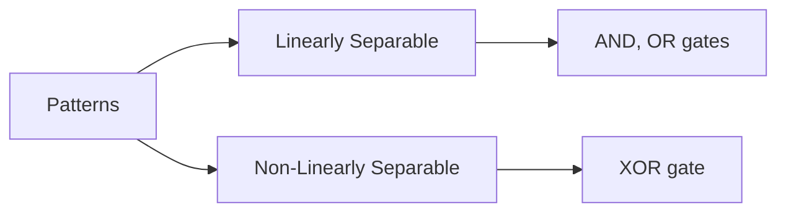

---

#### Discuss the applications of Machine Learning (2 marks)

Machine learning is applied across diverse domains to automate decision-making and extract insights.

1. **Healthcare** : Disease diagnosis, drug discovery, medical imaging analysis.
2. **Finance** : Credit scoring, fraud detection, algorithmic trading.
3. **E-commerce** : Product recommendations, customer segmentation, demand forecasting.
4. **Transportation** : Autonomous vehicles, traffic prediction, route optimization.
5. **Natural Language Processing** : Chatbots, sentiment analysis, machine translation.
6. **Cybersecurity** : Intrusion detection, malware classification.
7. **Agriculture** : Crop yield prediction, pest detection.

---

#### What is neural network architecture? Explain logistic sigmoid function with example (2 marks)

A **neural network architecture** is the structural design of interconnected artificial **neurons** (nodes) arranged in layers that process data, learn patterns, and make predictions.

1. Input Layer: Input layer accepts inputs in several formats provided by the programmer.
2. Hidden Layer: The hidden layer(s) is/are present between input and output layers. It performs all the calculations to find hidden features and patterns.
3. Output Layer: The input goes through a series of transformations using the hidden layer, which finally results in output that is conveyed using this layer.

The artificial neural network takes input and computes the weighted sum of the inputs and includes a bias. This computation is represented in the form of a transfer function.

**Logistic Sigmoid Function Formula:**

The logistic sigmoid function is a mathematical function that maps any real-valued number into a smooth, S-shaped curve with values strictly between 0 and 1.

$$
\sigma(x) = \frac{1}{1 + e^{-x}}
$$

$$
Range: (0 - 1)
$$

$$
\sigma(2) = \frac{1}{1 + e^{-2}} \approx 0.88,\qquad
\sigma(-2) = \frac{1}{1 + e^{2}} \approx 0.12
$$

**Properties:**
- Smooth and differentiable.
- Outputs probabilities, useful for binary classification.
- Suffers from vanishing gradient for extreme inputs.

---

#### What are the important properties of activation functions used in neural networks? (2 marks)

Activation functions introduce non-linearity into neural networks, enabling them to learn complex mappings.

**Properties:**
1. **Non-linearity** : Essential for learning complex relationships.
2. **Differentiability** : Required for backpropagation and weight updates.
3. **Monotonicity** : Ensures consistent gradient direction.
4. **Bounded output** : Restricts activation values within a fixed, safe numerical range.
5. **Computational efficiency** : Ensures fast evaluation, reducing training time cost.
6. **Zero-centered** : Helps avoid zig-zagging during gradient descent (e.g., tanh).

---

#### Explain the basic McCulloch-Pitts neuron model with examples (2 marks)

The **McCulloch-Pitts (MP) neuron** is the earliest mathematical model of a neuron, proposed in 1943.

**Components:**
- **Inputs:** Binary (0 or 1).
- **Weights:** Excitatory (+1) or inhibitory (−1).
- **Threshold:** $\theta$, minimum value needed to output.
- **Output:** 1 if weighted sum ≥ \( $\theta$ \), else 0.

**Example: AND Gate**
- Inputs: \(x_1, x_2\), weights: \(w_1 = w_2 = 1\), threshold \( $\theta$ = 2\).
- Output: \(y = 1\) if \(x_1 + x_2 $\geq$ 2$), else 0.
- Truth table: (0,0)→0, (0,1)→0, (1,0)→0, (1,1)→1.

**Example: OR Gate**
- Threshold \( $\theta$ = 1\).
- Output: \(y = 1\) if \(x_1 + x_2 $\geq$ 1$).

---

#### Differentiate between machine learning and deep learning. Applications of DL (2 marks)

| **Aspect** | **Machine Learning** | **Deep Learning** |
|---|---|---|
| **Feature extraction** | Manual | Automatic |
| **Data requirement** | Smaller datasets | Large datasets |
| **Hardware** | CPU sufficient | Requires GPU/TPU |
| **Training time** | Shorter | Longer |
| **Interpretability** | Higher | Lower (black box) |
| **Architecture** | Shallow models | Deep neural networks |

**Applications of Deep Learning:**
- **Computer Vision** : Image classification, object detection.
- **NLP** : Machine translation, sentiment analysis.
- **Speech Recognition** : Voice assistants, transcription.
- **Healthcare** : Medical imaging diagnosis.
- **Autonomous Vehicles** : Perception and decision-making.

---

#### What is meant by ensemble learning? What are the different types of ensemble classifiers? (2 marks)

**Ensemble Learning** combines multiple base models to produce a stronger, more accurate predictor than any single model.

**Types of Ensemble Classifiers:**
1. **Bagging** : Trains many models on random samples and combines their outputs. (Random Forest)
2. **Boosting** : Trains models one after another, each fixing previous mistakes. (Gradient Boosting)
3. **Stacking** : Trains a meta-model to combine predictions of base models. (Stacked generalization)
4. **Voting** : Combines predictions by majority vote or average probability. (Hard voting, Soft voting)

---

#### Explain Accuracy, Precision, Recall, Specificity, and F1 Score (2 marks)

These metrics evaluate classification performance, especially on imbalanced data.

1. Accuracy: Overall correctness of the model
$$
\text{Accuracy} = \frac{TP + TN}{TP + TN + FP + FN}
$$

2. Precision: How many predicted positives were correct
$$
\text{Precision} = \frac{TP}{TP + FP}
$$

3. Recall (Sensitivity): Actual positives captured
$$
\text{Recall} = \frac{TP}{TP + FN}
$$

4. Specificity: Actual negatives captured
$$
\text{Specificity} = \frac{TN}{TN + FP}
$$

5. F1 Score: Harmonic mean of Precision and Recall
$$
\text{F1 Score} = 2 \times \frac{\text{Precision} \times \text{Recall}}{\text{Precision} + \text{Recall}}
$$
---

#### Explain the confusion matrix with examples (2 marks)

A **confusion matrix** is a table summarizing classification results against actual labels.

| | **Predicted Positive** | **Predicted Negative** |
|---|---|---|
| **Actual Positive** | True Positive (TP) | False Negative (FN) |
| **Actual Negative** | False Positive (FP) | True Negative (TN) |

**Example:** Fraud detection (F = fraud, N = no fraud)
- TP = 20 (fraud correctly detected)
- FN = 10 (fraud missed)
- FP = 10 (false alarms)
- TN = 60 (correctly classified non-fraud)

---

#### What are autoencoders? Discuss types of autoencoders. List applications (2 marks)

**Autoencoders** are neural networks trained to reconstruct their input at the output layer, learning a compressed representation in the bottleneck layer.

**Types:**
1. **Undercomplete Autoencoder** : Bottleneck smaller than input; learns compact features.
2. **Sparse Autoencoder** : Adds sparsity penalty to hidden units.
3. **Denoising Autoencoder** : Trained to reconstruct clean input from noisy version.
4. **Variational Autoencoder (VAE)** : Learns probabilistic latent space.
5. **Contractive Autoencoder** : Penalizes sensitivity to input perturbations.

**Applications:**
- Dimensionality reduction
- Image denoising
- Anomaly detection
- Feature extraction
- Recommendation systems

---

#### Explain RNN and its uses in NLP (2 marks)

**Recurrent Neural Networks (RNNs)** are neural networks designed for sequential data, where connections between nodes form a directed graph along a temporal sequence.

**Key Features:**
- Maintains a **hidden state** that captures information from previous time steps.
- Shares weights across time steps.
- Suitable for variable-length sequences.

**Uses in NLP:**
- **Language Modeling** : Predicting next word.
- **Machine Translation** : Sequence-to-sequence mapping.
- **Sentiment Analysis** : Classifying text polarity.
- **Named Entity Recognition** : Tagging entities in text.
- **Text Generation** : Producing coherent text.

---

#### Write a short note on trends in data science for Audio (2 marks)

Audio data science involves processing, analyzing, and modeling sound signals.

**Trends:**
1. **Speech Recognition** : Deep learning models (e.g., Transformers) for accurate transcription.
2. **Music Information Retrieval** : Genre classification, beat tracking, recommendation.
3. **Audio Surveillance** : Anomaly detection (e.g., gunshots, glass breaking).
4. **Voice Assistants** : NLP + audio for conversational AI.
5. **Emotion Recognition** : Detecting mood from speech.
6. **Audio Synthesis** : Generative models (e.g., WaveNet) for realistic speech/music.

---

#### Explain Data Science for Multimodal applications (2 marks)

**Multimodal Data Science** integrates multiple data types (text, audio, image, video) to improve model performance and user experience.

**Key Aspects:**
- **Fusion Strategies** : Early (feature-level), late (decision-level), or hybrid fusion.
- **Cross-Modal Learning** : Aligning representations across modalities.
- **Applications:**
  - **Video Captioning** : Generating text from video.
  - **Sentiment Analysis** : Combining text and tone.
  - **Human-Computer Interaction** : Gesture + voice + gaze.
  - **Healthcare** : Combining imaging and clinical notes.

**Result:** Multimodal systems leverage complementary information, leading to more robust and context-aware applications.

---

#### Implement binary gates [OR, AND, NOR, XOR] using McCulloch-Pitts ANN (5 marks)

The McCulloch-Pitts neuron uses binary inputs, weights, and a threshold to produce binary output.

**Given:**
- Inputs: \(x_1, x_2 \in \{0, 1\}\)
- Weights: \(w_1, w_2\)
- Threshold: \( $\theta$ \)
- Output: \(y = 1\) if \( $\sum$ w_i x_i $\geq$ $\theta$ \), else 0.

**OR Gate:**
- Weights: \(w_1 = 1, w_2 = 1\), \( $\theta$ = 1\)
- Output: \(y = 1\) if \(x_1 + x_2 $\geq$ 1\)

| \(x_1\) | \(x_2\) | \(x_1 + x_2\) | \(y\) |
|---|---|---|---|
| 0 | 0 | 0 | 0 |
| 0 | 1 | 1 | 1 |
| 1 | 0 | 1 | 1 |
| 1 | 1 | 2 | 1 |

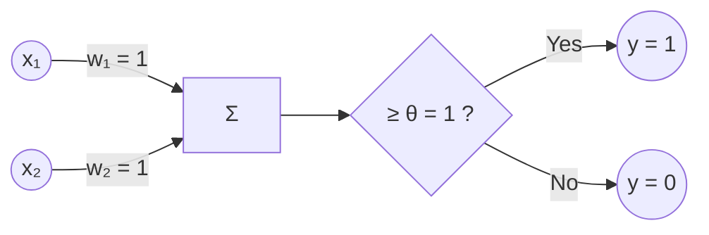

**AND Gate:**
- Weights: \(w_1 = 1, w_2 = 1\), \( $\theta$ = 2\)
- Output: \(y = 1\) if \(x_1 + x_2 $\geq$ 2\)

| \(x_1\) | \(x_2\) | \(x_1 + x_2\) | \(y\) |
|---|---|---|---|
| 0 | 0 | 0 | 0 |
| 0 | 1 | 1 | 0 |
| 1 | 0 | 1 | 0 |
| 1 | 1 | 2 | 1 |

**NOR Gate:**
- Weights: \(w_1 = -1, w_2 = -1\), \( $\theta$ = 0\)
- Output: \(y = 1\) if \(-x_1 - x_2 $\geq$ 0\) (i.e., both inputs 0)

| \(x_1\) | \(x_2\) | \(-x_1 - x_2\) | \(y\) |
|---|---|---|---|
| 0 | 0 | 0 | 1 |
| 0 | 1 | -1 | 0 |
| 1 | 0 | -1 | 0 |
| 1 | 1 | -2 | 0 |

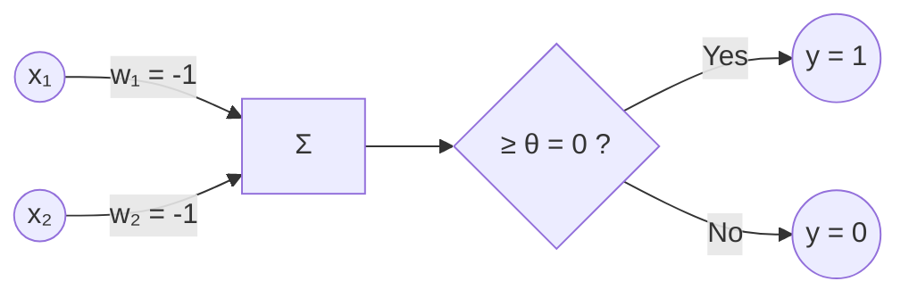

**XOR Gate:**
- XOR is not linearly separable; a single MP neuron cannot implement it.
- **Solution:** Use a two-layer network:
  - Layer 1: \(y_1 = \text{OR}(x_1, x_2)\), \(y_2 = \text{NAND}(x_1, x_2)\)
  - Layer 2: \(y = \text{AND}(y_1, y_2)\)

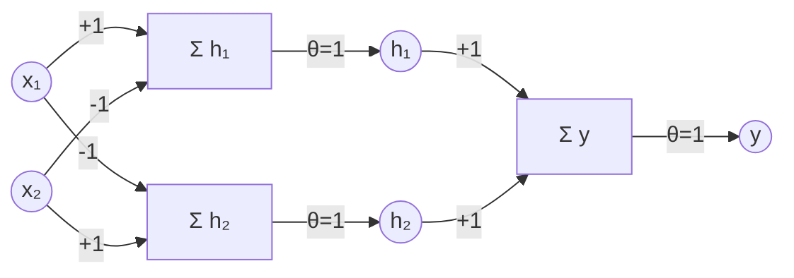

---

#### Explain all the activation functions with neat diagrams (5 marks)

Activation functions introduce non-linearity, enabling neural networks to learn complex patterns.

1. **Linear Activation Function**

$$
Equation:
\
f(x) = x
\
$$
$$
Range: 
\
(-\infty, +\infty)
\
$$

**Use Case:**
Used in regression output layers for predicting continuous unbounded values.

**Diagram:**
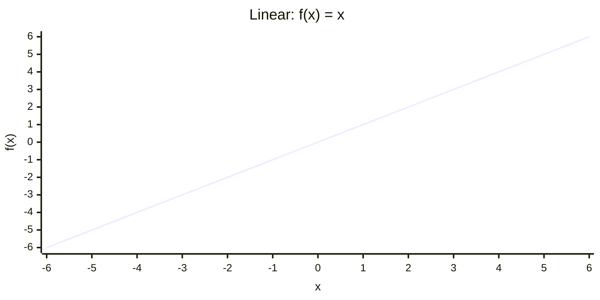

2. **Sigmoid Activation Function**

$$
Equation:
\
\sigma(x) = \frac{1}{1 + e^{-x}}
\
$$
$$
Range:
\
(0, 1)
\
$$

**Use Case:**
Used in binary classification output layers for probability estimation.

**Diagram:**
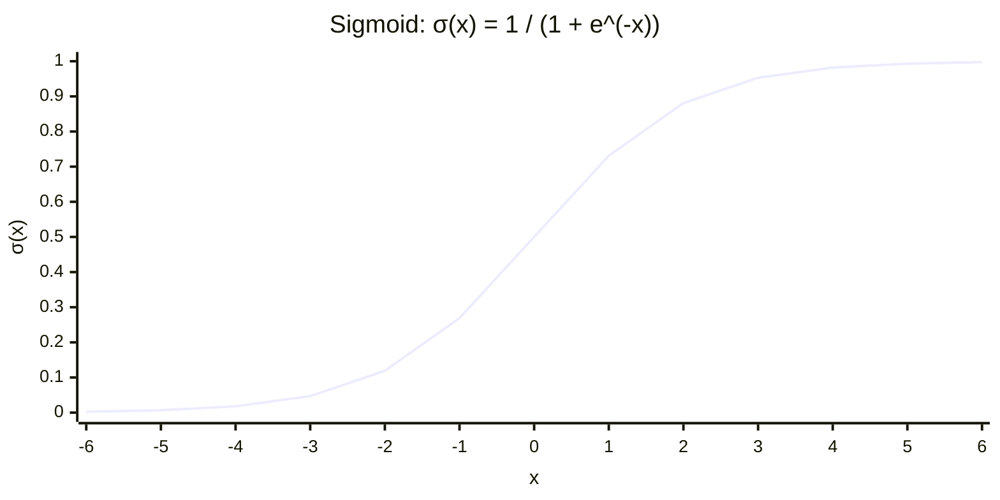

3. **Tanh (Hyperbolic Tangent) Activation Function**

$$
Equation:
\
\tanh(x) = \frac{e^{x} - e^{-x}}{e^{x} + e^{-x}}
\
$$
$$
Range:
\
(-1, 1)
\
$$

**Use Case:**
Used in hidden layers of RNNs for centered zero-mean activations.

**Diagram:**
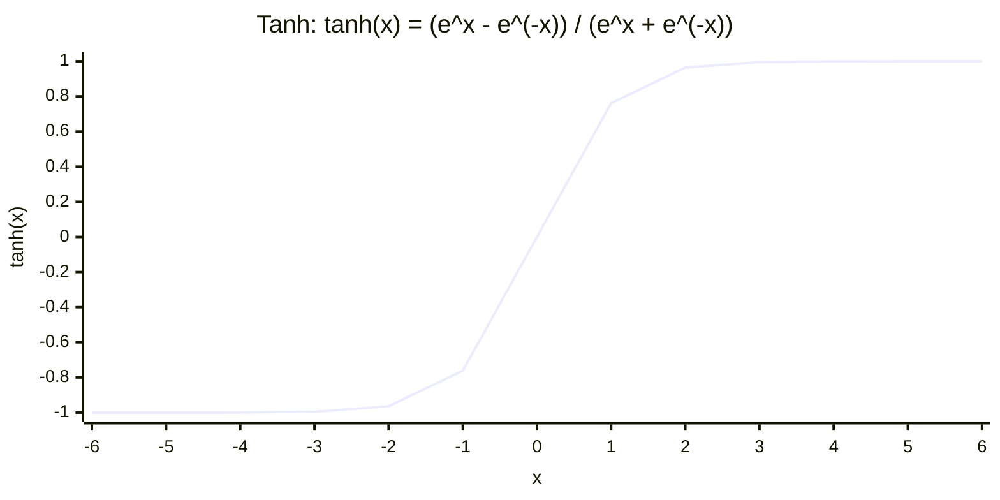

4. **ReLU (Rectified Linear Unit) Activation Function**

$$
Equation:
\
f(x) = \max(0, x)
\
$$
$$
Range:
\
[0, +\infty)
\
$$

**Use Case:**
Used in hidden layers of CNNs for fast sparse training.

**Diagram:**
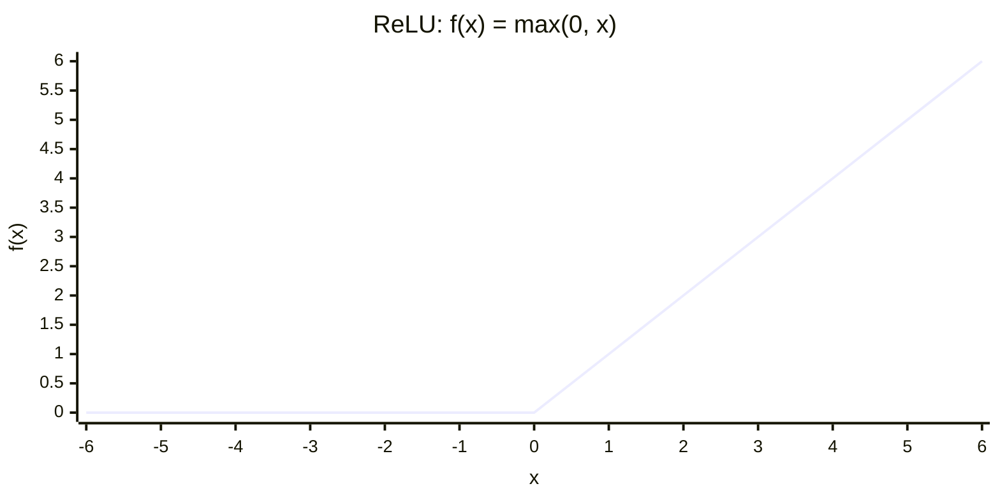

5. **Leaky ReLU Activation Function**

$$
Equation:
\
f(x) = \begin{cases} x, & x > 0 \\ \alpha x, & x \leq 0 \end{cases} \quad (\alpha = 0.01)
\
$$
$$
Range:
\
(-\infty, +\infty)
\
$$

**Use Case:**
Used in deep networks to prevent dying ReLU neurons.

**Diagram:**
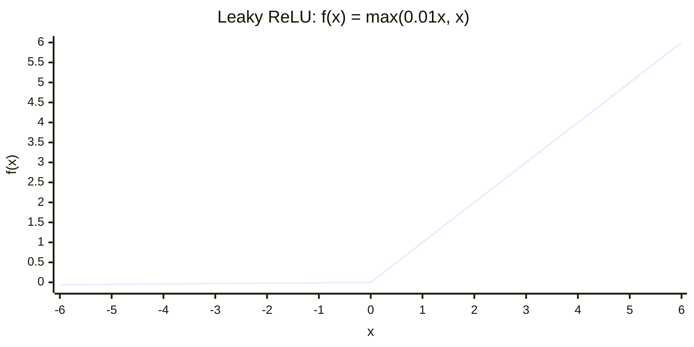

6. **SoftPlus Activation Function**

$$
Equation:
\
f(x) = \ln(1 + e^{x})
\
$$
$$
Range:
\
(0, +\infty)
\
$$

**Use Case:**
Used in probabilistic models ensuring smooth positive outputs.

**Diagram:**
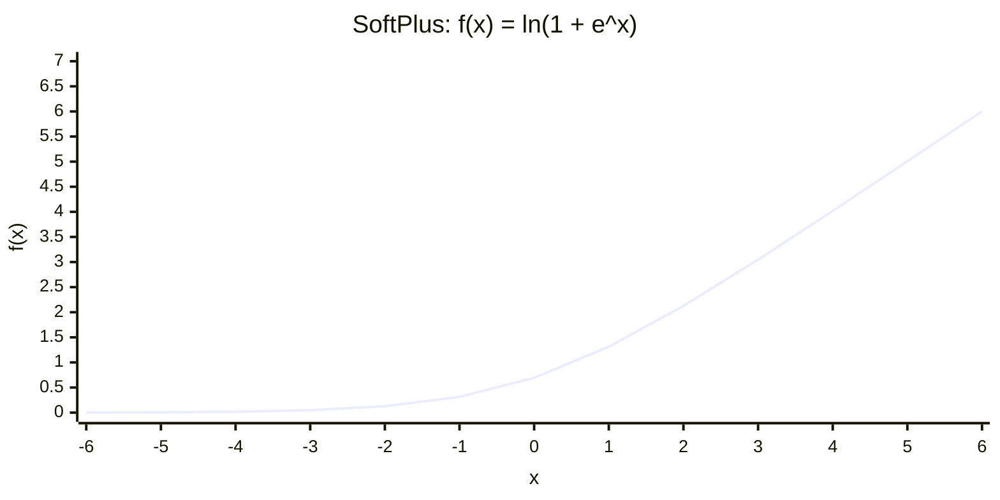

7. Softmax Activation Function

$$
Equation:
\
\text{Softmax}(x_i) = \frac{e^{x_i}}{\sum_{j=1}^{K} e^{x_j}}
\
$$
$$
Range:
\
(0, 1), \quad \sum_{i=1}^{K} \text{Softmax}(x_i) = 1
\
$$

**Use Case:**
Used in multiclass classification output layers for probability distribution.

**Diagram:**
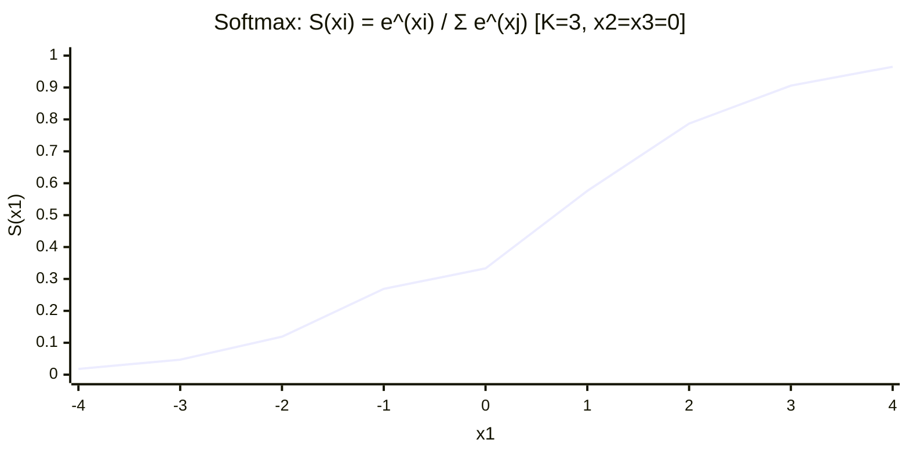

---

#### Explain Bagging and Boosting in detail (5 marks)

**Bagging**:
Reduces **variance** by training multiple models on random samples and then by combining their outputs. 
- Each model trains **independently**
- Predictions combined by **voting** (classification) or **averaging** (regression)
- Works best with **high-variance models** like decision trees

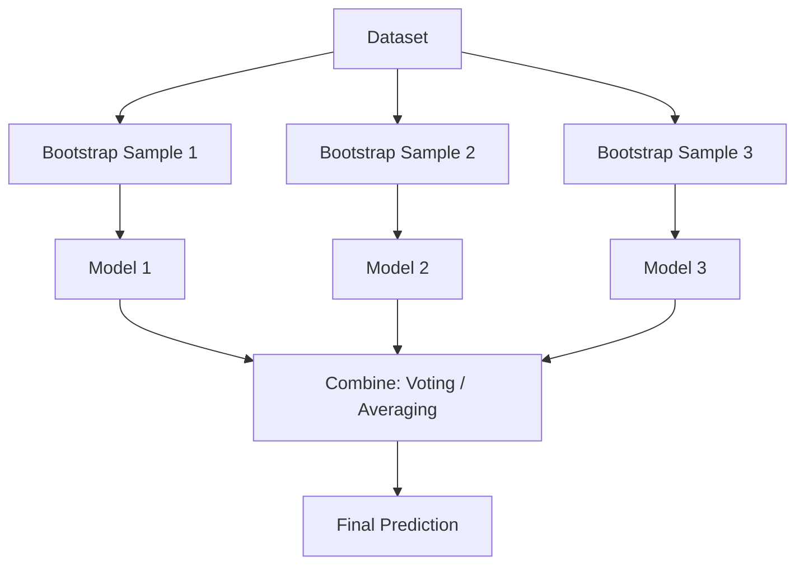

**Boosting**: 
Reduces **bias** by training models **sequentially**, where each new model corrects the errors of the previous ones.
- Each model trains **sequentially**, learning from prior mistakes
- Misclassified points get **higher weights** in the next iteration
- Predictions combined by **weighted voting** (classification) or **weighted sum** (regression)
- Works best with **weak learners** like shallow decision stumps

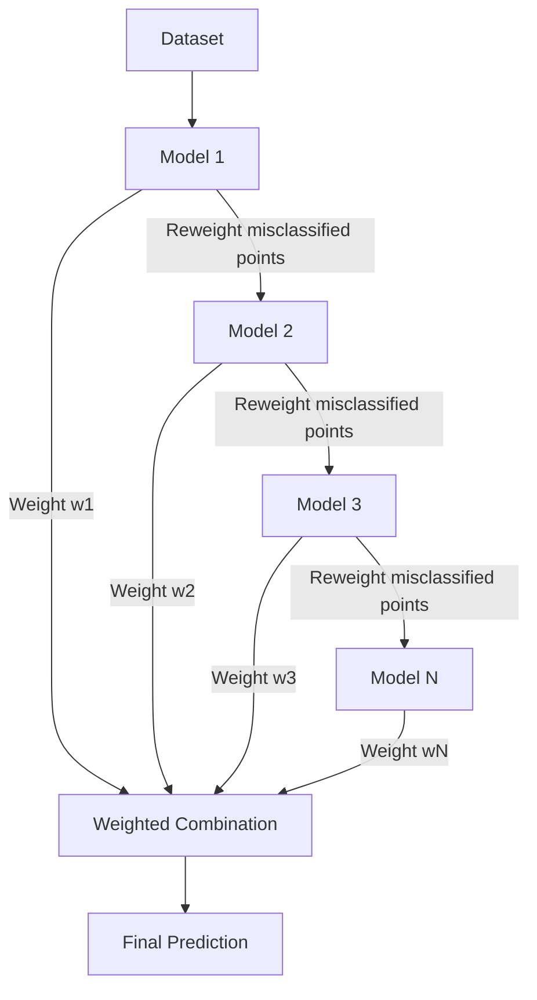

|**#**|**Aspect**|**Bagging**|**Boosting**|
|---|---|---|---|
|1|**Training**|Models trained in **parallel**|Models trained **sequentially**|
|2|**Goal**|Reduces **variance**|Reduces **bias**|
|3|**Data Sampling**|**Bootstrap** (random with replacement)|**Reweighted** (focus on errors)|
|4|**Weights**|Equal weight to all samples|Higher weight to **misclassified** samples|
|5|**Model Combination**|**Voting** / **Averaging**|**Weighted** voting / sum|
|6|**Base Learners**|**High-variance** models (deep trees)|**Weak learners** (stumps)|
|7|**Overfitting**|**Less prone**|**More prone**|
|8|**Examples**|Random Forest|AdaBoost, Gradient Boosting, XGBoost|

---

#### Explain LSTM in detail (5 marks)

**Long Short-Term Memory (LSTM)** is a type of RNN designed to overcome the vanishing gradient problem, enabling learning of long-term dependencies.

**Components:**
1. **Cell State $(C_t)$:** Long-term memory.
2. **Forget Gate $(f_t)$:** Decides what to discard from cell state.
   $$f_t = \sigma(W_f \cdot [h_{t-1}, x_t] + b_f)$$
3. **Input Gate $(i_t)$:** Decides what new information to store.
   $$i_t = \sigma(W_i \cdot [h_{t-1}, x_t] + b_i)$$
   $$\tilde{C}_t = \tanh(W_C \cdot [h_{t-1}, x_t] + b_C)$$
4. **Cell State Update:**
   $$C_t = f_t \cdot C_{t-1} + i_t \cdot \tilde{C}_t$$
5. **Output Gate ($o_t$):** Decides what to output.
   $$o_t = \sigma(W_o \cdot [h_{t-1}, x_t] + b_o)$$
   $$h_t = o_t \cdot \tanh(C_t)$$

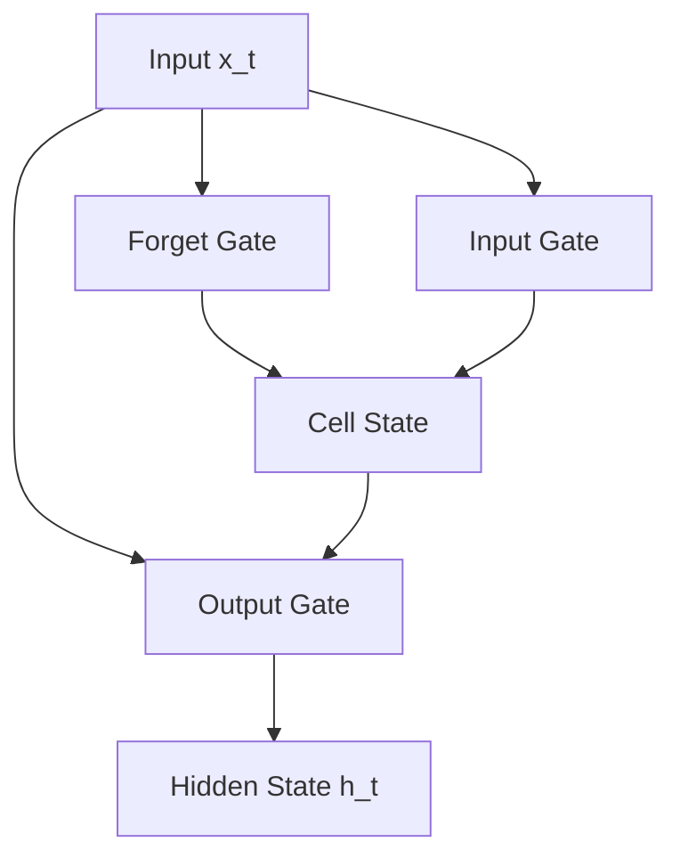

**Applications:** Machine translation, speech recognition, time-series prediction.

---

#### Draw and explain architecture of convolutional neural networks. Explain kernel and pooling (5 marks)

Convolutional Neural Networks (CNNs), are neural network architectures inspired by the human visual system, designed to process image data by capturing spatial relationships between pixels.

- Learn hierarchical features from simple edges to complex objects
- Capture spatial patterns using convolution operations
- Detect objects regardless of their position in the image
- Reduce computation by focusing on local regions instead of the entire image

1. **Input** **Layer**: Receives the raw image data and passes it to the network for processing. In CNNs, input is typically a 3D volume (width × height × depth).
2. **Convolution** **Layer**: Responsible for extracting important features from the input data. It applies a set of learnable filters (kernels) that slide over the image and compute the dot product between the filter weights and corresponding image patches, producing feature maps.
3. **Activation** **Layer**: Introduces non-linearity into the network by applying an element-wise activation function to the output of the convolution layer. This enables the model to learn complex patterns beyond linear relationships.
4. **Pooling** **Layer**: Used to reduce the spatial dimensions of the feature maps, making computation faster, reducing memory usage and helping to prevent overfitting. 
5. **Flattening**: Converts the multi-dimensional feature maps into a one-dimensional vector after convolution and pooling. 
6. **Fully** **Connected** **Layer**: Performs high-level reasoning using extracted features and produces the final classification scores.
7. **Output** **Layer**: Converts final scores into probabilities using activation functions like Sigmoid (binary classification) or Softmax (multi-class classification).

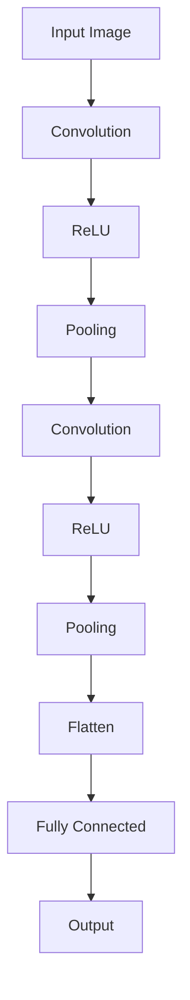

**Kernel (Filter):**
- A small matrix (e.g., 3×3) slid over the input.
- Computes dot product to produce feature maps.
- Learns to detect edges, textures, patterns.

**Pooling:**
- Reduces spatial dimensions.
- **Max Pooling:** Takes maximum value in window.
- **Average Pooling:** Takes average.
- Reduces computation and controls overfitting.

---

#### Explain how different data modalities are integrated to improve user experience in multimodal systems with a real-time application (5 marks)

**Multimodal Integration** combines text, audio, image, and video to create richer, context-aware systems.

**Fusion Strategies:**
- **Early Fusion:** Combine raw features before model training.
- **Late Fusion:** Combine decisions from separate models.
- **Hybrid Fusion:** Intermediate combination.

**Real-Time Application: Multimodal Virtual Assistant**
- **Inputs:** Voice (audio), facial expression (video), text query.
- **Integration:**
  - Audio → Speech-to-text → NLP.
  - Video → Facial emotion recognition.
  - Text → Intent classification.
- **Fusion:** Late fusion of sentiment, intent, and emotion.
- **Output:** Personalized response (e.g., empathetic tone).

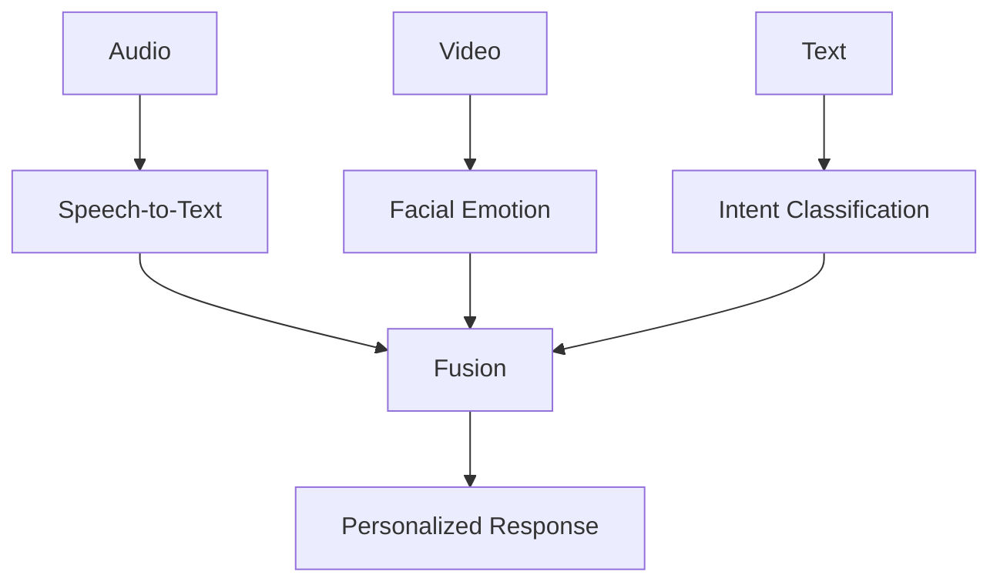

---

#### If TP, FP, FN, TN are given, compute Accuracy, Precision, Error Rate, Sensitivity, Specificity, and F1 Score (5 marks)

**Given:**
- TP = 40, FP = 10, FN = 20, TN = 30

**Calculations:**

- **Accuracy:** \( \frac{TP + TN}{TP + TN + FP + FN} = \frac{40 + 30}{100} = 0.70 \)
- **Precision:** \( \frac{TP}{TP + FP} = \frac{40}{50} = 0.80 \)
- **Error Rate:** \( 1 - \text{Accuracy} = 0.30 \)
- **Sensitivity (Recall):** \( \frac{TP}{TP + FN} = \frac{40}{60} = 0.667 \)
- **Specificity:** \( \frac{TN}{TN + FP} = \frac{30}{40} = 0.75 \)
- **F1 Score:** \( 2 \times \frac{\text{Precision} \times \text{Recall}}{\text{Precision} + \text{Recall}} = 2 \times \frac{0.80 \times 0.667}{1.467} = 0.727 \)

**Result:**
- Accuracy = **0.70**
- Precision = **0.80**
- Error Rate = **0.30**
- Sensitivity = **0.667**
- Specificity = **0.75**
- F1 Score = **0.727**

---

#### Evaluate performance of Classifier 1 and Classifier 2 using confusion matrices (5 marks)

**Classifier 1:**

| | F' | N' |
|---|---|---|
| **F** | 20 | 10 |
| **N** | 10 | 60 |

- TP = 20, FN = 10, FP = 10, TN = 60
- **Accuracy:** \( \frac{20 + 60}{100} = 0.80 \)
- **Precision:** \( \frac{20}{30} = 0.667 \)
- **Recall:** \( \frac{20}{30} = 0.667 \)
- **Specificity:** \( \frac{60}{70} = 0.857 \)
- **F1 Score:** \( 2 \times \frac{0.667 \times 0.667}{1.334} = 0.667 \)

**Classifier 2:**

| | F' | N' |
|---|---|---|
| **F** | 0 | 15 |
| **N** | 5 | 80 |

- TP = 0, FN = 15, FP = 5, TN = 80
- **Accuracy:** \( \frac{0 + 80}{100} = 0.80 \)
- **Precision:** \( \frac{0}{5} = 0 \)
- **Recall:** \( \frac{0}{15} = 0 \)
- **Specificity:** \( \frac{80}{85} = 0.941 \)
- **F1 Score:** \( 0 \)

| **Metric** | **Classifier 1** | **Classifier 2** |
|---|---|---|
| Accuracy | 0.80 | 0.80 |
| Precision | 0.667 | 0 |
| Recall | 0.667 | 0 |
| Specificity | 0.857 | 0.941 |
| F1 Score | 0.667 | 0 |

**Result:** Classifier 1 is superior for fraud detection because it correctly identifies fraud cases (Recall = 0.667), while Classifier 2 fails to detect any fraud (Recall = 0), despite similar accuracy. This highlights the importance of using precision, recall, and F1 over accuracy alone on imbalanced data.
