### Module 1: Uncertainty

**From below given probability distribution find P (Cavity | Toothache). (5 Marks, Dec 2023)**

---

**Explain Bayes theorem. (5 Marks, Dec 2024)**
**How does Bayes Theorem determine the probability of an event with uncertain knowledge? Give one example of it. (5 Marks, Dec 2025)**
**Write short note on: Bayes Theorem. (5 Marks, May 2023)**
**A medical test for a disease is 99% accurate. The disease is rare and affects 1 in 10,000 people. Use Bayes' Theorem to calculate the probability that a person who tests positive actually has the disease. Interpret your result. (5 Marks, Dec 2025)**

Bayes' Theorem is a formula used to determine the conditional probability of an event based on prior knowledge and new evidence. It adjusts probabilities when new information comes in and helps make better decisions in uncertain situations.

Bayes' Theorem determines the probability of an event under uncertainty by combining:
1. **Prior knowledge**: what we already believe about the event before new evidence.
2. **New evidence**: the observed data and how likely it is under each hypothesis (likelihood).

**Formula:**
$$
P(A \mid B) = \frac{P(B \mid A) \times P(A)}{P(B)}
$$
Where:
- **P(A) and P(B)** are the probabilities of events A and B; also, P(B) is never equal to zero.
- **P(A|B)** is the probability of event A when event B happens,
- **P(B|A)** is the probability of event B when A happens.

**Given:**
- Prevalence (prior): P(D) = 1/10,000 = 0.0001, so P(¬D) = 0.9999
- Test accuracy 99%: assume P(+|D) = 0.99 (sensitivity) and P(+|¬D) = 0.01 (false-positive rate)
**Apply Bayes' Theorem (2 marks):**
$$P(D|+) = \frac{P(+|D)\,P(D)}{P(+|D)\,P(D) + P(+|\neg D)\,P(\neg D)}$$
Numerator: 0.99 × 0.0001 = 0.000099
Denominator: 0.000099 + (0.01 × 0.9999) = 0.000099 + 0.009999 = 0.010098
$$P(D\mid +)=\frac{0.000099}{0.010098}\approx 0.0098\approx 0.98\%$$
**Result (1 mark):** The probability that a person who tests positive actually has the disease is approximately **0.98%** (about 1 in 102).

---

**Discuss the limitations of deterministic approaches and how probabilistic reasoning addresses these limitations with example. (5 Marks, Dec 2025)**
**Discuss the limitations of deterministic approaches and how probabilistic reasoning addresses these limitations with example. (5 Marks, May 2025)**

**Limitations of deterministic approach:**
- Produce fixed outputs for given inputs and no uncertainty considered.
- Cannot handle incomplete data effectively.
- Cannot handle ambiguous data effectively.
- Cannot handle noisy data effectively.
- Fail when multiple plausible outcomes exist.
- Rigid as they cannot adapt to dynamic conditions.
- Cannot model variable real-world probabilities.

**How probabilistic reasoning overcomes these limitations:**
**Probabilistic reasoning** assigns probabilities to events and uses Bayes' rule / probability theory to combine evidence, allowing:
- Representation of **uncertainty** via probability distributions.
- **Evidence combination**: updating beliefs as new (possibly noisy) evidence arrives.
- **Reasoning with incomplete data** by marginalizing over unknowns.
- **Ranking of hypotheses** by likelihood rather than yes/no conclusions.

**Example:**

Problem: Cloudy days don't always bring rain. The system says "rain" with 100% certainty, wrong on many days. It also can't express "it _might_ rain" or "rain is likely but not certain." One missing fact (e.g., cloud data unavailable) and the rule simply fails.

Instead of a yes/no rule, we attach probabilities:

- P(rain)=0.3 (prior, it rains 30% of days)
- P(cloudy ∣ rain) = 0.9 (cloudy on 90% of rainy days)
- P(cloudy ∣ no rain)=0.2 (cloudy on 20% of dry days)

Now it's cloudy. Using Bayes' rule:
$$
P(\text{rain} \mid \text{cloudy})
= \frac{0.9 \times 0.3}{0.9 \times 0.3 + 0.2 \times 0.7}
= \frac{0.27}{0.27 + 0.14}
\approx 0.66
$$

**Result:** "66% chance of rain", a graded belief, not a blind yes/no.

---

**Describe the role of utility and expected utility in decision theory with example. (5 Marks, Dec 2025)**
**Describe the role of utility and expected utility in decision theory with example. (5 Marks, May 2025)**

**Role of utility:**
**Utility** is a numerical measure of the satisfaction, value, or desirability that an individual attaches to a particular outcome. In decision theory, utility functions represent an agent's preferences over outcomes: if an agent prefers outcome A to outcome B, then U(A) > U(B).

**Role of expected utility:**
**Expected utility** extends this to decisions under **risk/uncertainty**. When each action can lead to several possible outcomes with known probabilities, the expected utility of an action is the probability-weighted average of the utilities of its possible outcomes:
$$
EU(A)=i∑​pi​⋅U(Oi​)
$$
The **expected utility principle** states that a rational agent should choose the action that maximizes expected utility.

**Example:**
Suppose a student must choose between two options:
- **Option A (safe):** Accept a guaranteed internship offering a utility of **10**.
- **Option B (risky):** Apply for a competitive scholarship. There is a **30% chance** of winning (utility **30**) and a **70% chance** of getting nothing (utility **0**).

Compute expected utilities:
$$
EU(A)=10 
$$
$$
EU(B)=0.3(30)+0.7(0)=9
$$
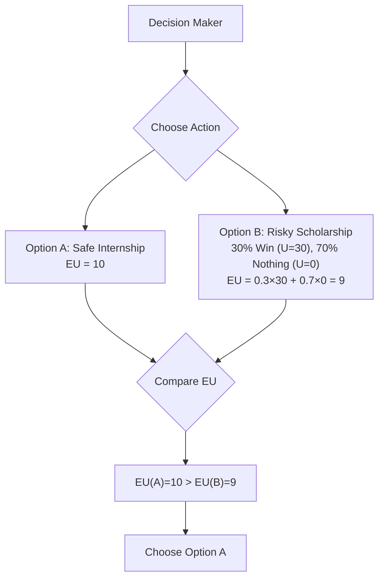

---

**Explain Markov Decision Process Model (MDP). List two applications of it. (5 Marks, Dec 2025)**
**What is need of Markov Decision Processes? Explain MDP in detail. (10 Marks, May 2023)**
**What is a Markov Decision Process (MDP)? List its primary components. Explain in detail. (10 Marks, May 2024)**

A Markov Decision Process (MDP) is a mathematical framework used to model sequential decision-making problems where the outcome of an action is uncertain. It is widely used in Artificial Intelligence (AI), Machine Learning, Robotics and Reinforcement Learning to help an agent choose actions that maximize long-term rewards while interacting with an environment.

Markov Decision Processes consist of states, actions, transition probabilities, and rewards that define the environment. An agent selects actions based on its current state to maximize cumulative future rewards over time. The Markov property ensures that the future depends only on the present state, not on history.

**Need**:
- **Uncertainty**: Actions do not always produce deterministic outcomes.
- **Sequential decisions**: Today's action affects tomorrow's state and future options.
- **Delayed rewards**: The benefit of an action may appear many steps later (e.g., chess moves).
- **Limitations of classical methods**: Search algorithms assume deterministic outcomes; supervised learning cannot handle delayed rewards or exploration.

**Components**:
- **States**: All possible situations the agent can be in.
- **Actions**: Choices the agent can make in each state.
- **Transition Probabilities**: Likelihood of moving between states after an action.
- **Rewards**: Immediate feedback received after taking an action.

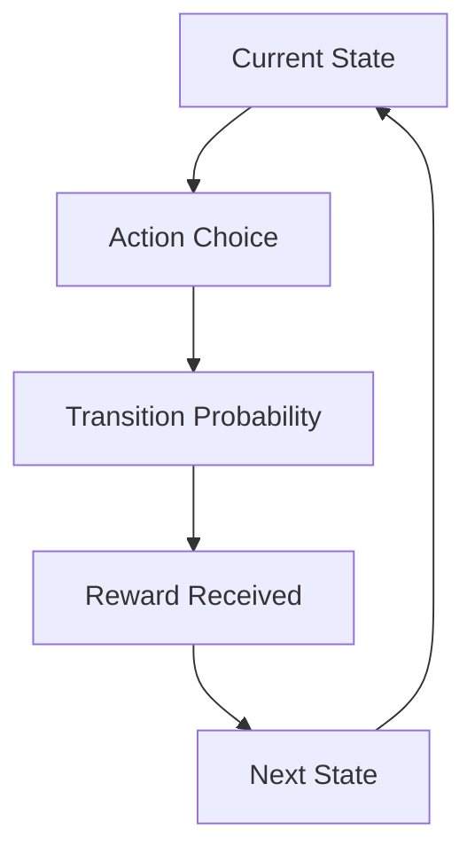

**Applications**:
1. **Robot Navigation & Autonomous Vehicles**: Robots and self-driving cars choose paths avoiding obstacles.
2. **Recommendation Systems**: Platforms decide what to recommend to maximize user engagement.
3. **Dynamic Pricing & Ride-Sharing**: Companies adjust prices and match drivers to riders.
4. **Healthcare Treatment Planning**: Doctors choose therapies over time to maximize patient outcomes.
5. **Inventory & Supply Chain Management**: Businesses decide when and how much stock to order.
6. **Traffic Signal Control**: Systems adapt traffic lights in real time to reduce congestion.

---

**Illustrate inferencing in Bayesian Belief Network with an example. (10 Marks, Dec 2023)**
**What is the Bayesian Belief Network? Illustrate with an example. (10 Marks, Dec 2024)**
**What is Bayesian Belief Network? Explain inferencing with example. (10 Marks, May 2025)**

A **Bayesian Belief Network (BBN)** is a probabilistic graphical model that represents a set of random variables and their conditional dependencies via a **Directed Acyclic Graph (DAG)**.

**Components**
- **Nodes**: random variables (events, symptoms, causes)
- **Directed edges**: direct causal/probabilistic influence (parent → child)
- **Each node** has a **Conditional Probability Table (CPT)** giving P(node | parents)
- **Root nodes** have prior probabilities

**Harry Burglar Alarm Example:**
Variables: Burglary (B), Earthquake (E), Alarm (A), HarryCalls (H), MaryCalls (M)

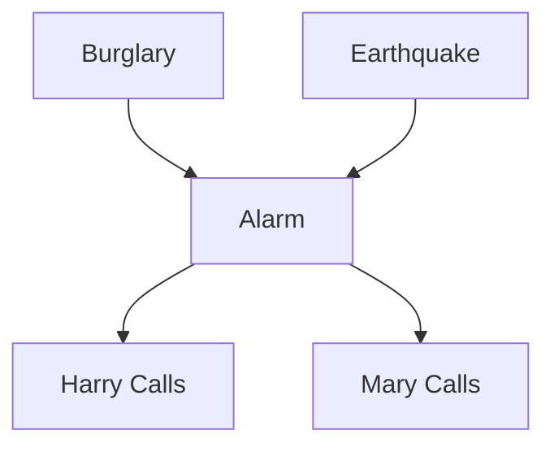

**CPTs:**
- P(Burglary) = 0.001
- P(Earthquake) = 0.002
- P(Alarm|B,E): B,E=0.95; B,¬E=0.94; ¬B,E=0.29; ¬B,¬E=0.001
- P(HarryCalls|Alarm): True=0.90, False=0.05
- P(MaryCalls|Alarm): True=0.70, False=0.01

Inference computes probabilities like P(Alarm|HarryCalls) by propagating evidence through the network.

---
### Module 2: Cognitive Computing

**Illustrate usage of taxonomies and ontologies for knowledge representation in cognitive system. (10 Marks, Dec 2023)**
**Explain the role of representing knowledge in taxonomies and ontologies, and how advanced analytics can be applied to cognitive systems. (10 Marks, Dec 2025)**
**Explain the role of representing knowledge in taxonomies and ontologies, and how advanced analytics can be applied to cognitive systems. (10 Marks, May 2025)**

**Taxonomies**:
A hierarchical classification system organizing concepts from general to specific via parent-child relationships.

**Role in Knowledge Representation:**
- Provide structured skeleton for organizing and navigating data.
- Enable quick knowledge retrieval and domain classification.
- Organize data within ontologies into interpretable structures.

**Advanced Analytics Application:**
- Provide feature hierarchy for machine learning and transfer learning.
- Improve classification and retrieval accuracy.

**Ontologies**:
- A formal specification of concepts, semantic relationships, attributes, and axioms enabling machine reasoning.

**Role in Knowledge Representation:**
- Define rich semantic relationships (causal, part-whole, temporal) beyond hierarchy.
- Support logical inference and semantic consistency.
- Enable systems to "understand" meaning, not just "see" data.

**Advanced Analytics Application:**
- Constrain NLP for better entity extraction and word-sense disambiguation.
- Enable hypothesis generation with confidence levels.
- Support semantic reasoning and knowledge graph construction.

---

**List and explain the design principles of Cognitive System. (10 Marks, Dec 2023)**
**Write short note on: Design Principles for Cognitive Systems. (5 Marks, May 2023)**
**List Design Principles of Cognitive system and justify the role of NLP in enabling adaptability, contextual understanding, and user interaction within cognitive architectures. (10 Marks, Dec 2025)**

**Design Principles**:

**1. Hypothesis Generation and Scoring**
The system must generate multiple possible solutions for every problem and deliver answers with associated confidence levels, rather than providing a single deterministic output.

**2. Continuous Learning and Model Updating**
The system must continuously update its model based on user interactions and new data, becoming smarter over time in an automated way. This requires a corpus comprehensive enough to support hypothesis generation about the domain based on observed facts.

**3. Context-Aware Data Management**
The design must enable the system to access, manage, and analyze data in context, working with both structured and unstructured data.

**4. Transparent and Faithful Representation**
When the system communicates its reasoning to human partners, representations must be perceivable, transformable, and faithful—an explanation that does not match the actual process creates a false mental model, which is worse than no explanation at all.

**5. Minimize Aggregate Distributed Load**
The design goal is to minimize total extraneous cognitive load across the human-AI system while maximizing germane load that builds useful shared mental models. Progressive disclosure (summary → highlights → full trace) matches explanation detail to need.

**6. Self-Organization and Adaptability**
Inspired by biological systems, cognitive systems should exhibit self-repair, self-organization, adaptation to changing environments, and the ability to anticipate user actions.

**7. Learning Through Experience**
Cognitive agents derive decision-making capacity from experiences rather than fixed procedures, improving future results through feedback information.

**Role of NLP in Cognitive Architectures**

**1. Enabling Adaptability**
- Adapts to new language expressions and domain data.
- Learns from new corpora to continuously optimize intent recognition and semantic understanding.
- Supports continuous learning principle of cognitive systems.

**2. Enabling Contextual Understanding**
- Parses questions, extracts features, and generates candidate answers with confidence scores.
- Supports multi-turn dialogue reasoning using dialogue history and situational context.
- Achieves true semantic understanding.

**3. Enabling User Interaction**
- Provides natural language interface for human-computer interaction.
- Parses user questions and returns ranked answers.
- Sentiment analysis and intent recognition enable natural and personalized interactions.

---

**Define Cognitive Computing. Draw a neat diagram of components of the cognitive system and explain the components. (10 Marks, Dec 2024)**
**What is cognitive computing, and how does it differ from traditional computing? List the process of building a cognitive application. (10 Marks, May 2024)**
**Explain the process of building a cognitive application. (10 Marks, May 2023)**

**Definition:**
A **cognitive system** is a technological or biological framework that simulates human-like intelligence, reasoning, and learning to process complex, ambiguous, and unstructured data. Unlike traditional rule-based or deterministic computers, cognitive systems adapt, evolve over time, and incorporate context into their decisions.

**Components:**
1. **Problem Definition**: Identify the specific business challenge and user needs.
2. **Data Collection**: Gather relevant structured and unstructured data from multiple sources.
3. **Data Preparation**: Clean, normalize, and annotate data for training and testing.
4. **Model Selection**: Choose appropriate machine learning, NLP, or reasoning algorithms.
5. **Training and Validation**: Train models and validate performance against test datasets.
6. **Deployment**: Integrate the cognitive model into production environment.
7. **Monitoring**: Continuously evaluate and refine the system based on feedback.

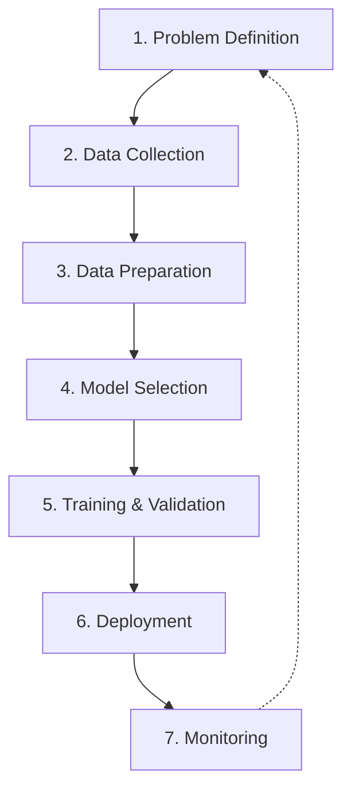

| Factor                | Cognitive Computing                      | Traditional Computing                 |
| --------------------- | ---------------------------------------- | ------------------------------------- |
| **Core Paradigm**     | Learns and infers from data              | Follows pre-programmed rules          |
| **Programming**       | Trained via data and interaction         | Explicitly coded by humans            |
| **Primary Strength**  | Handling ambiguity and unstructured data | Precision and repetitive calculation  |
| **Interaction Style** | Natural, human-like engagement           | Structured, command-based input       |
| **Evolution**         | Adapts and improves over time            | Static unless manually updated        |
| **Typical Goal**      | Augment human expertise and insight      | Automate defined, deterministic tasks |

---

**Describe Natural Language Processing in Support of a Cognitive System. (10 Marks, Dec 2024)**

NLP enables the cognitive system to understand, interpret, and generate human language, bridging unstructured text/speech and machine reasoning.

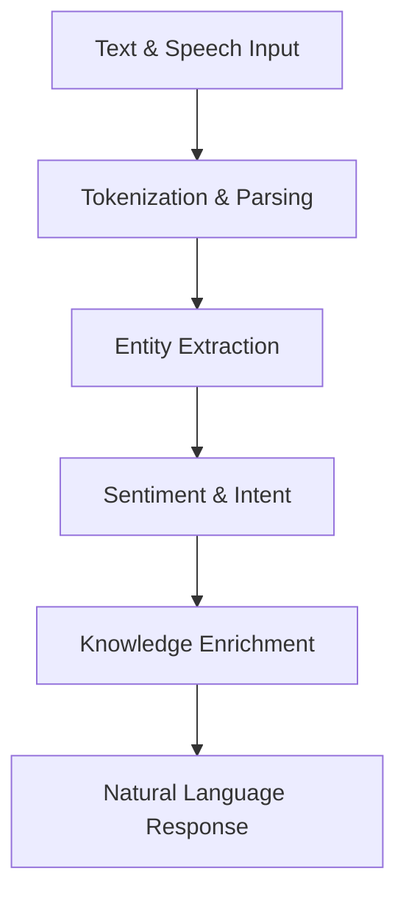

**Role of each stage:**
- **Text & Speech Input**: Captures queries, documents, and voice.
- **Tokenization & Parsing**: Breaks language into grammatical units.
- **Entity Extraction**: Identifies names, dates, terms, and relations.
- **Sentiment & Intent**: Detects user emotion and purpose.
- **Knowledge Enrichment**: Links extracted facts to the knowledge base for reasoning.
- **Natural Language Response**: Generates human-readable answers and explanations.

---
### Module 3: Fuzzy Logic & Its Applications

**Define defuzzification and state the necessity of the defuzzification process. (5 Marks, Dec 2023)**
**Define Defuzzification. Discuss any two methods of defuzzification. (10 Marks, Dec 2024)**
**Write short note on: Defuzzification Methods. (5 Marks, May 2023)**
**Define Defuzzification? Explain any two methods of Defuzzification. (10 Marks, May 2025)**

**Defuzzification** is the process of converting the fuzzy output obtained from the fuzzy inference process into a single crisp value.

**Necessity**:
- **Meeting the input requirements of actuators**: In fuzzy control systems, actuators (such as motors and valves) can only accept and execute precise analog or digital signals, and cannot directly understand fuzzy sets. Therefore, the fuzzy control quantity must be converted into a crisp value through defuzzification before it can drive the actuator.
- **Completing the decision output**: The fuzzy inference process outputs a fuzzy conclusion, but the final decision or control action must be a definite value. Defuzzification provides a method to extract the most representative single value from the fuzzy set, thereby completing the entire reasoning process from fuzzification to output.

| # | Method | Description |
|---|--------|-------------|
| 1 | Centroid | Computes geometric center of the fuzzy set. |
| 2 | Bisector | Finds vertical line splitting area equally. |
| 3 | MOM | Selects value with maximum membership degree. |
| 4 | LOM | Chooses largest value among maxima. |
| 5 | SOM | Selects smallest value among maxima. |
| 6 | Weighted Average | Calculates weighted mean of all elements. |

**1. Centroid Method (Center of Gravity / Center of Area)**
This is the most widely used defuzzification method. Its core idea is to take the geometric center (center of gravity) of the area covered by the fuzzy set membership function as the crisp output value.

**Calculation formula** (for continuous domain):
$$z^* = \frac{\int \mu_C(z) \cdot z \, dz}{\int \mu_C(z) \, dz}$$**Where:**
- $z^*$ = crisp (defuzzified) output value
- $\mu_C(z)$ = membership degree of the aggregated output fuzzy set $C$
- $z$ = value on the output domain (universe of discourse)
- $\int \mu_C(z) \cdot z \, dz$ = numerator, the moment of the area about the origin
- $\int \mu_C(z) \, dz$ = denominator, the total area under the membership curve

**Characteristics**: It comprehensively considers the shape and distribution of the membership function, and the output result is smooth and continuous, but the calculation amount is relatively large (although it can be discretized in engineering practice).

**2. Mean of Maxima Method (MOM)**
This method focuses only on the region with the highest degree of membership in the fuzzy set. If multiple points in the fuzzy set reach the maximum membership degree, the average of these points is taken as the output.

**Calculation formula**:    $$z^* = \frac{\sum_{i=1}^{l} x_i}{l}, \quad x_i \in \{ x \mid \mu_C(x) = \max \mu_C \}$$
**Where:**
- $z^*$ = crisp (defuzzified) output value
- $l$ = number of points (discrete values) in the output domain that attain the maximum membership degree
- $x_i$ = the $i$-th point (value on the domain) at which the membership degree is maximum, for $i = 1, 2, \dots, l$
- $\mu_C(x)$ = membership degree of the aggregated output fuzzy set $C$ at point $x$
- $\max \mu_C$ = the maximum membership degree attained by the aggregated output fuzzy set
- $\{ x \mid \mu_C(x) = \max \mu_C \}$ = the set of all domain values $x$ whose membership degree equals the maximum (i.e., the "maxima" region)
- $\sum_{i=1}^{l} x_i$ = sum of all domain values in that maxima region
- $\frac{\sum_{i=1}^{l} x_i}{l}$ = arithmetic mean (average) of those values, giving the final crisp output

**Characteristics**: The calculation is very simple and fast, but it completely ignores the shape information of the membership function (such as width and area), and in some cases the output may be unstable or not smooth enough.

---

**Consider two fuzzy sets. Find the algebraic sum, algebraic product, bounded sum, and bounded difference of the given fuzzy sets. (5 Marks, Dec 2024)**
**Describe the Properties of Fuzzy Sets with an example. (10 Marks, Dec 2023)**

Let A = {0.3/x₁, 0.7/x₂, 0.5/x₃} and B = {0.6/x₁, 0.2/x₂, 0.9/x₃}

**Union (A ∪ B):** μA∪B(x) = max(μA(x), μB(x))
- x₁: max(0.3, 0.6) = 0.6
- x₂: max(0.7, 0.2) = 0.7
- x₃: max(0.5, 0.9) = 0.9
**Result:** {0.6/x₁, 0.7/x₂, 0.9/x₃}

**Intersection (A ∩ B):** μA∩B(x) = min(μA(x), μB(x))
- x₁: min(0.3, 0.6) = 0.3
- x₂: min(0.7, 0.2) = 0.2
- x₃: min(0.5, 0.9) = 0.5
**Result:** {0.3/x₁, 0.2/x₂, 0.5/x₃}

**Difference (A - B):** μA-B(x) = min(μA(x), 1 - μB(x))
- x₁: min(0.3, 0.4) = 0.3
- x₂: min(0.7, 0.8) = 0.7
- x₃: min(0.5, 0.1) = 0.1
**Result:** {0.3/x₁, 0.7/x₂, 0.1/x₃}

**Complement (Ā):** μĀ(x) = 1 - μA(x)
- x₁: 1 - 0.3 = 0.7
- x₂: 1 - 0.7 = 0.3
- x₃: 1 - 0.5 = 0.5
**Result:** {0.7/x₁, 0.3/x₂, 0.5/x₃}

Let A = {0.4/x, 0.8/y, 0.2/z} and B = {0.7/x, 0.3/y, 0.9/z}

**Algebraic Sum:** μA⊕B(x) = μA(x) + μB(x) - μA(x)·μB(x)
- x: 0.4 + 0.7 - (0.4×0.7) = 1.1 - 0.28 = 0.82
- y: 0.8 + 0.3 - (0.8×0.3) = 1.1 - 0.24 = 0.86
- z: 0.2 + 0.9 - (0.2×0.9) = 1.1 - 0.18 = 0.92
**Result:** {0.82/x, 0.86/y, 0.92/z}

**Algebraic Product:** μA⊙B(x) = μA(x)·μB(x)
- x: 0.4×0.7 = 0.28
- y: 0.8×0.3 = 0.24
- z: 0.2×0.9 = 0.18
**Result:** {0.28/x, 0.24/y, 0.18/z}

**Bounded Sum:** μA⊕B(x) = min(1, μA(x) + μB(x))
- x: min(1, 0.4+0.7) = min(1, 1.1) = 1
- y: min(1, 0.8+0.3) = min(1, 1.1) = 1
- z: min(1, 0.2+0.9) = min(1, 1.1) = 1
**Result:** {1/x, 1/y, 1/z}

**Bounded Difference:** μA⊖B(x) = max(0, μA(x) - μB(x))
- x: max(0, 0.4-0.7) = max(0, -0.3) = 0
- y: max(0, 0.8-0.3) = max(0, 0.5) = 0.5
- z: max(0, 0.2-0.9) = max(0, -0.7) = 0
**Result:** {0/x, 0.5/y, 0/z}

**Properties**:
1. Core:
	The **core** of a fuzzy set \(A\) is the crisp set containing all elements of the universe \(X\) that have a **membership value of exactly 1**. It represents the elements that completely and unambiguously belong to the fuzzy set.
$$
\text{Core}(A)=\{x\in X\mid \mu_{A}(x)=1\}
$$

2. Support:
	The **support** of a fuzzy set \(A\) is the crisp set containing all elements of the universe \(X\) that have a **membership value greater than 0**. It represents all elements that have at least some degree of belongingness to the set.
$$
\text{Supp}(A)=\{x\in X\mid \mu_{A}(x)>0\}
$$

3. Boundary:
	The **boundary** of a fuzzy set \(A\) is the crisp set containing all elements of the universe \(X\) that have a **membership value strictly between 0 and 1**. These elements are partially in the set and partially out of the set.
$$
\text{Boundary}(A)=\{x\in X\mid 0<\mu_{A}(x)<1\}
$$

4. Crossover Points:
	The **crossover points** of a fuzzy set \(A\) are the elements in the universe \(X\) that have a **membership value of exactly 0.5**.
$$
\text{Crossover}(A)=\{x\in X\mid \mu_{A}(x)=0.5\}
$$

5. **Normality (Normal vs. Subnormal)**
	A fuzzy set \(A\) is considered **normal** if its maximum membership value in the universe is exactly 1. If the maximum membership value is less than 1, the set is **subnormal**.

$$
\text{Height}(A)=\max_{x\in X}\mu_{A}(x)
$$
$$
\text{If Height}(A)=1 \implies \text{Normal Fuzzy Set}
$$
---

**Explain different types of membership functions used in fuzzy logic with suitable examples. Differentiate between crisp sets and fuzzy sets in terms of their structure, interpretation, and applicability in real-world scenarios. (10 Marks, Dec 2025)**
**Explain different types of membership functions used in fuzzy logic with suitable examples. Differentiate between crisp sets and fuzzy sets in terms of their structure, interpretation, and applicability in real-world scenarios. (10 Marks, May 2025)**

1. **Triangular (Tri)**: Defined by three points (a, b, c). Membership rises linearly from 0 at 'a' to 1 at 'b', and falls to 0 at 'c'. It is the simplest and most commonly used.
2. **Trapezoidal (Trap)**: Defined by four points (a, b, c, d). It rises from 0 at 'a' to 1 at 'b', stays at 1 until 'c', then falls to 0 at 'd'. Useful for plateau regions.
3. **Gaussian (Gauss)**: Uses a bell-shaped curve based on a mean (center) and standard deviation. It provides a smooth, non-linear transition.
4. **S-shaped (S)**: A sigmoidal curve that starts at 0 and gradually rises to 1. It is an increasing function, useful for assigning "large" or "high" values.
5. **Z-shaped (Z)**: The mirror image of the S-function. It starts at 1 and gradually drops to 0. It is a decreasing function, useful for assigning "small" or "low" values.
6. **Sigmoidal (Sig)**: A general S-shaped curve defined by a mathematical sigmoid (logistic) function. It is open-ended and often used in neural-fuzzy systems for smooth transitions.

| Aspect             | Crisp Sets                                                                                                 | Fuzzy Sets                                                                                                                       |
| ------------------ | ---------------------------------------------------------------------------------------------------------- | -------------------------------------------------------------------------------------------------------------------------------- |
| **Structure**      | Characteristic function maps to {0,1}{0,1}: an element either fully belongs or does not.                   | Membership function maps to [0,1][0,1]: an element can partially belong to multiple degrees.                                     |
| **Interpretation** | Binary logic: "tall" means height > 180 cm; otherwise, not tall. No middle ground.                         | Graded logic: a person 175 cm tall may have membership 0.6 in "tall," acknowledging vagueness.                                   |
| **Applicability**  | Suitable for precise, well-defined categories (e.g., "numbers greater than 10," "citizens of a country") . | Suitable for real-world vague concepts (e.g., "comfortable temperature," "young age," "high risk") where boundaries are gradual. |

---

**Differentiate between Fuzziness and Probability. (5 Marks, May 2025)**

| Factor                | Fuzziness                     | Probability                    |
| --------------------- | ----------------------------- | ------------------------------ |
| Nature of Uncertainty | Ambiguity / imprecision       | Randomness / chance            |
| Truth Values          | Degree of truth               | Event occurs or not            |
| Underlying Theory     | Fuzzy Set Theory              | Probability Theory             |
| Core Concept          | Degree of membership          | Likelihood of occurrence       |
| Source of Uncertainty | Vague linguistic descriptions | Incomplete knowledge of events |
| Additivity            | Need not sum to 1             | Must sum to 1                  |
| Boundaries            | Gradual / blurred             | Crisp                          |
| Typical Application   | Fuzzy logic control           | Risk / forecasting             |

---

**Using Mamdani fuzzy model design a fuzzy model controller to determine the wash time of domestic washing machine. Assume the inputs are dirt & grease on cloths. Use three descriptors for each input variable & five descriptors for output variables. Derive necessary membership functions & required fuzzy rules for the application. (10 Marks, Dec 2025)**
**Using Mamdani fuzzy model design a fuzzy logic controller to determine the wash time of domestic washing machine. Assume the inputs are dirt and grease on clothes. Use three descriptors for each input variable and five descriptors for output variables. Derive necessary membership functions and required fuzzy rules for the application. (10 Marks, May 2023)**
**Using Mamdani fuzzy model design a fuzzy model controller to determine the wash time of domestic washing machine. Assume the inputs are dirt & grease on cloths. Use three descriptors for each input variable & five descriptors for output variables. Derive necessary membership functions & required fuzzy rules for the application. (10 Marks, May 2025)**

---
### Module 4: Introduction to Deep Learning

**Implement AND function using McCulloch-Pitts neuron (take binary data). (5 Marks, Dec 2023)**
**Explain McCulloch-Pitts neuron with an example. (5 Marks, Dec 2024)**
**Explain the XOR function using McCulloch-Pitts model (use binary data representation). (10 Marks, May 2023)**
**Implement AND function using McCulloch-Pitts neuron. (5 Marks, May 2025)**

The McCulloch-Pitts neuron uses binary inputs, weights, and a threshold to produce binary output.

**Given:**
- Inputs: \(x_1, x_2 \in \{0, 1\}\)
- Weights: \(w_1, w_2\)
- Threshold: \( $\theta$ \)
- Output: \(y = 1\) if \( $\sum$ w_i x_i $\geq$ $\theta$ \), else 0.

**OR Gate:**
- Weights: \(w_1 = 1, w_2 = 1\), \( $\theta$ = 1\)
- Output: \(y = 1\) if \(x_1 + x_2 $\geq$ 1\)

| \(x_1\) | \(x_2\) | \(x_1 + x_2\) | \(y\) |
|---|---|---|---|
| 0 | 0 | 0 | 0 |
| 0 | 1 | 1 | 1 |
| 1 | 0 | 1 | 1 |
| 1 | 1 | 2 | 1 |

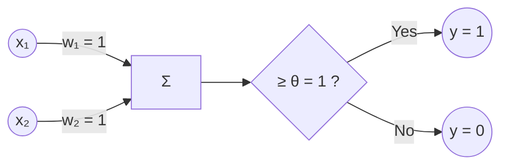

**AND Gate:**
- Weights: \(w_1 = 1, w_2 = 1\), \( $\theta$ = 2\)
- Output: \(y = 1\) if \(x_1 + x_2 $\geq$ 2\)

| \(x_1\) | \(x_2\) | \(x_1 + x_2\) | \(y\) |
|---|---|---|---|
| 0 | 0 | 0 | 0 |
| 0 | 1 | 1 | 0 |
| 1 | 0 | 1 | 0 |
| 1 | 1 | 2 | 1 |


**NOR Gate:**
- Weights: \(w_1 = -1, w_2 = -1\), \( $\theta$ = 0\)
- Output: \(y = 1\) if \(-x_1 - x_2 $\geq$ 0\) (i.e., both inputs 0)

| \(x_1\) | \(x_2\) | \(-x_1 - x_2\) | \(y\) |
|---|---|---|---|
| 0 | 0 | 0 | 1 |
| 0 | 1 | -1 | 0 |
| 1 | 0 | -1 | 0 |
| 1 | 1 | -2 | 0 |

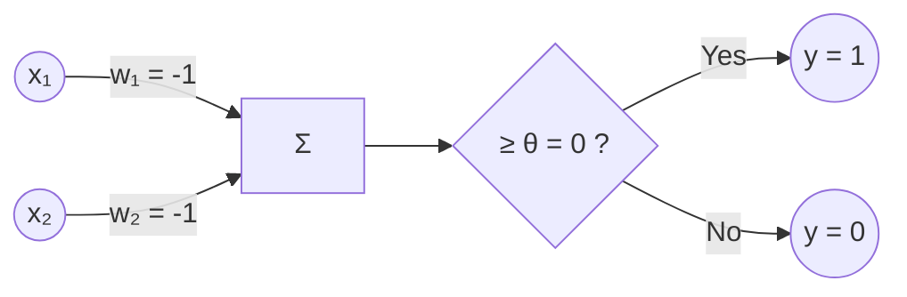

**XOR Gate:**
- XOR is not linearly separable; a single MP neuron cannot implement it.
- **Solution:** Use a two-layer network:
  - Layer 1: \(y_1 = \text{OR}(x_1, x_2)\), \(y_2 = \text{NAND}(x_1, x_2)\)
  - Layer 2: \(y = \text{AND}(y_1, y_2)\)

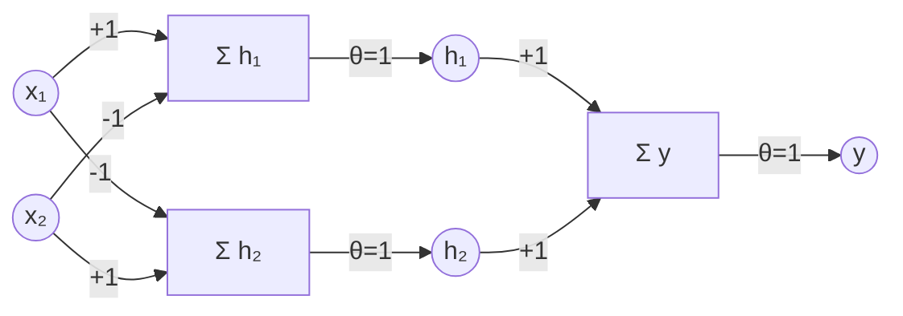

---

**Explain the components of CNN architecture. (10 Marks, Dec 2023)**
**Explain Architecture of CNN in detail. List any two applications of it. (10 Marks, Dec 2025)**
**Briefly explain CNN architecture with detailed. (10 Marks, May 2023)**
**Describe the architecture of a typical CNN. What are the main components, and how do they contribute to the network's performance in image recognition tasks? (10 Marks, May 2024)**
**Explain Architecture of CNN in detail. List any two applications of it. (10 Marks, May 2025)**

Convolutional Neural Networks (CNNs), are neural network architectures inspired by the human visual system, designed to process image data by capturing spatial relationships between pixels.

- Learn hierarchical features from simple edges to complex objects
- Capture spatial patterns using convolution operations
- Detect objects regardless of their position in the image
- Reduce computation by focusing on local regions instead of the entire image

1. **Input** **Layer**: Receives the raw image data and passes it to the network for processing. In CNNs, input is typically a 3D volume (width × height × depth).
2. **Convolution** **Layer**: Responsible for extracting important features from the input data. It applies a set of learnable filters (kernels) that slide over the image and compute the dot product between the filter weights and corresponding image patches, producing feature maps.
3. **Activation** **Layer**: Introduces non-linearity into the network by applying an element-wise activation function to the output of the convolution layer. This enables the model to learn complex patterns beyond linear relationships.
4. **Pooling** **Layer**: Used to reduce the spatial dimensions of the feature maps, making computation faster, reducing memory usage and helping to prevent overfitting. 
5. **Flattening**: Converts the multi-dimensional feature maps into a one-dimensional vector after convolution and pooling. 
6. **Fully** **Connected** **Layer**: Performs high-level reasoning using extracted features and produces the final classification scores.
7. **Output** **Layer**: Converts final scores into probabilities using activation functions like Sigmoid (binary classification) or Softmax (multi-class classification).

**Diagram:**

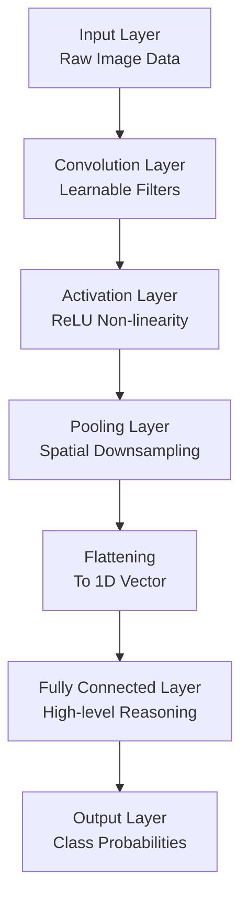

**Applications**:
- **Image Classification**: Categorizing objects in photos
- **Face Recognition**: Verifying identities via facial features
- **Medical Imaging**: Detecting tumors in scans
- **Object Detection**: Locating objects in real-time
- **OCR**: Converting text images to machine-readable

---

**Explain the components of ANN architecture. (10 Marks, Dec 2024)**
**Explain the component of ANN architecture. (10 Marks, May 2025)**

Artificial Neural Networks (ANNs) are computing systems inspired by the biological brain, designed to learn patterns from data through interconnected neurons organized in layers.

- Learn complex patterns through weighted connections between neurons
- Adjust weights and biases during training to minimize error
- Use activation functions to introduce non-linearity
- Approximate any continuous function with enough neurons

1. **Input Layer**: Receives the raw data (features) and passes it to the network for processing. Each neuron in this layer represents one input feature, and no computation occurs here.
2. **Hidden Layers**: One or more layers between the input and output layers that perform computations and extract increasingly abstract features from the data through interconnected neurons.
3. **Weights and Biases**: Learnable parameters that determine the strength of connections and shift activation outputs. They are adjusted during training to minimize the error.
4. **Activation Functions**: Introduce non-linearity into the network so it can learn complex patterns beyond linear relationships. Common examples include ReLU, Sigmoid, Tanh, and Softmax.
5. **Output Layer**: Produces the final prediction of the network using activation functions like Sigmoid (binary classification) or Softmax (multi-class classification).

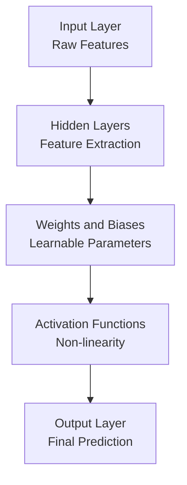

---

**Compare between ANN and RNN. (5 Marks, Dec 2025)**
**Compare between ANN and RNN. (5 Marks, May 2025)**

| Factor                 | ANN                                  | RNN                                    |
| :--------------------- | :----------------------------------- | :------------------------------------- |
| **Data Type**          | Handles fixed-size, independent data | Handles sequential, time-series data   |
| **Memory**             | No memory of previous inputs         | Retains memory of past inputs          |
| **Input/Output**       | One-to-one mapping                   | Many-to-many, one-to-many mapping      |
| **Architecture**       | Feedforward, no cycles               | Recurrent loops with hidden state      |
| **Parameter Sharing**  | Weights unique per layer             | Weights shared across time steps       |
| **Training**           | Standard backpropagation             | Backpropagation through time (BPTT)    |
| **Vanishing Gradient** | Less prone to vanishing gradients    | Prone to vanishing/exploding gradients |
| **Complexity**         | Simpler and faster to train          | More complex, slower to train          |
| **Use Cases**          | Image classification, regression     | Text, speech, stock prediction         |
| **Examples**           | CNN, MLP, Dense networks             | LSTM, GRU, vanilla RNN                 |

---

**Explain in detail the Long Short-Term Memory Network with an example. (10 Marks, Dec 2024)**
**What are all the objective of using LSTM? Explain its architecture. (10 Marks, Dec 2025)**
**Write short note on: LSTM. (5 Marks, May 2023)**

Long Short-Term Memory (LSTM) is a type of recurrent neural network designed to learn long-term dependencies in sequential data. Standard RNNs suffer from vanishing and exploding gradients, which prevent them from remembering information over long sequences. LSTM solves this using a gated memory cell.

**Architecture of an LSTM Cell:**

- **Cell State (Cₜ):** The long-term memory that runs through the cell, modified only by gating operations.
- **Forget Gate (fₜ):** Decides which parts of the previous cell state to discard, using a sigmoid function.
- **Input Gate (iₜ):** Decides which new information from the current input to store in the cell state.
- **Output Gate (oₜ):** Decides which parts of the cell state to expose as the hidden state output.

**Working:** At each time step, the forget gate removes irrelevant past information, the input gate adds useful new information, and the output gate produces the hidden state. This gating mechanism allows gradients to flow over long sequences.

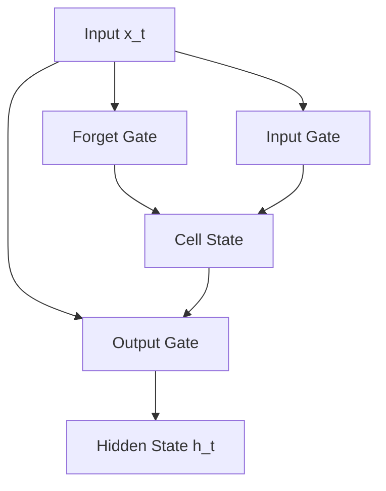

---

**State and elaborate the applications of deep learning. (10 Marks, Dec 2023)**

Deep learning uses multi-layered neural networks to learn hierarchical representations and is applied across many domains.

- **Computer Vision:** Image classification, object detection, facial recognition, and medical image analysis using convolutional networks.
- **Natural Language Processing:** Machine translation, sentiment analysis, chatbots, and text summarisation using transformers and recurrent networks.
- **Speech and Audio:** Speech recognition, voice assistants, speaker identification, and music generation.
- **Healthcare:** Disease diagnosis from scans, drug discovery, and patient risk prediction.
- **Autonomous Vehicles:** Perception, lane detection, obstacle recognition, and path planning.
- **Finance:** Fraud detection, credit scoring, algorithmic trading, and risk assessment.
- **Recommendation Systems:** Personalised content suggestions for e-commerce and streaming platforms.
- **Generative AI:** Image synthesis, text generation, and deepfake detection.

---

**What are the essential components of Autoencoder explain in detail? Which activation function is best for autoencoder. (10 Marks, May 2023)**

---

**Discuss different activation function used in Neural Network. (5 Marks, May 2025)**

Activation functions introduce non-linearity, enabling neural networks to learn complex patterns.

1. **Linear Activation Function**

$$
Equation:
\
f(x) = x
\
$$
$$
Range: 
\
(-\infty, +\infty)
\
$$

**Use Case:**
Used in regression output layers for predicting continuous unbounded values.

**Diagram:**
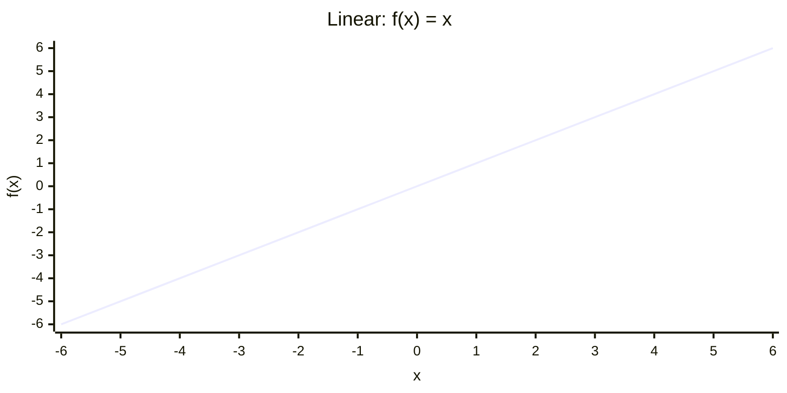

2. **Sigmoid Activation Function**

$$
Equation:
\
\sigma(x) = \frac{1}{1 + e^{-x}}
\
$$
$$
Range:
\
(0, 1)
\
$$

**Use Case:**
Used in binary classification output layers for probability estimation.

**Diagram:**
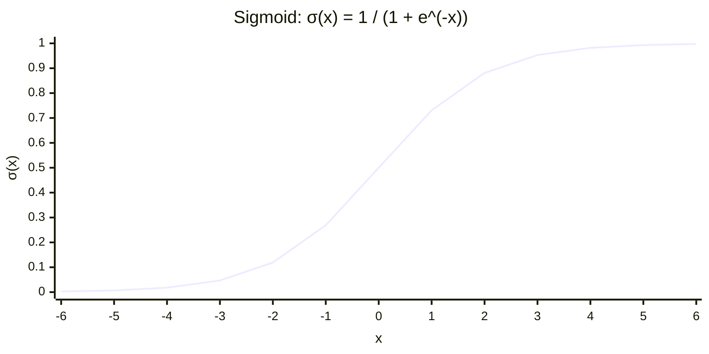

3. **Tanh (Hyperbolic Tangent) Activation Function**

$$
Equation:
\
\tanh(x) = \frac{e^{x} - e^{-x}}{e^{x} + e^{-x}}
\
$$
$$
Range:
\
(-1, 1)
\
$$

**Use Case:**
Used in hidden layers of RNNs for centered zero-mean activations.

**Diagram:**
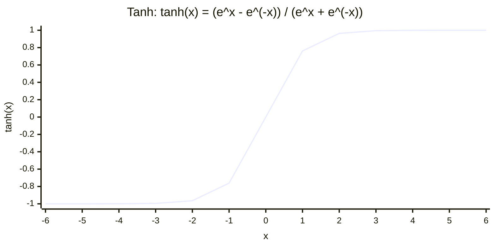

4. **ReLU (Rectified Linear Unit) Activation Function**

$$
Equation:
\
f(x) = \max(0, x)
\
$$
$$
Range:
\
[0, +\infty)
\
$$

**Use Case:**
Used in hidden layers of CNNs for fast sparse training.

**Diagram:**
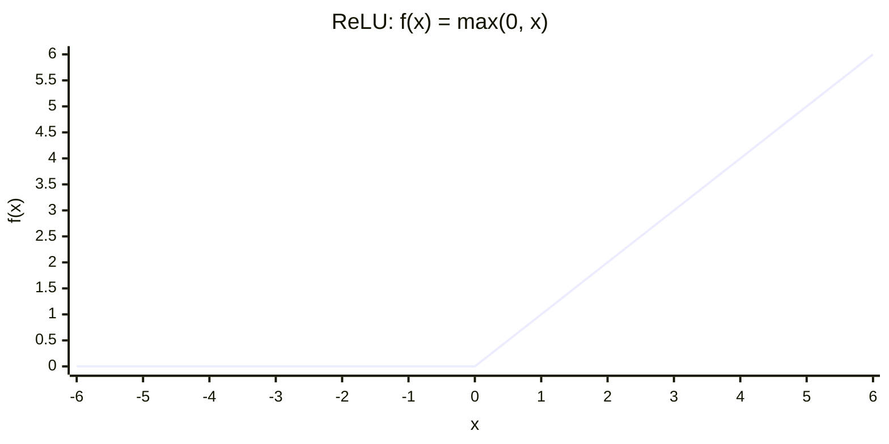

5. **Leaky ReLU Activation Function**

$$
Equation:
\
f(x) = \begin{cases} x, & x > 0 \\ \alpha x, & x \leq 0 \end{cases} \quad (\alpha = 0.01)
\
$$
$$
Range:
\
(-\infty, +\infty)
\
$$

**Use Case:**
Used in deep networks to prevent dying ReLU neurons.

**Diagram:**
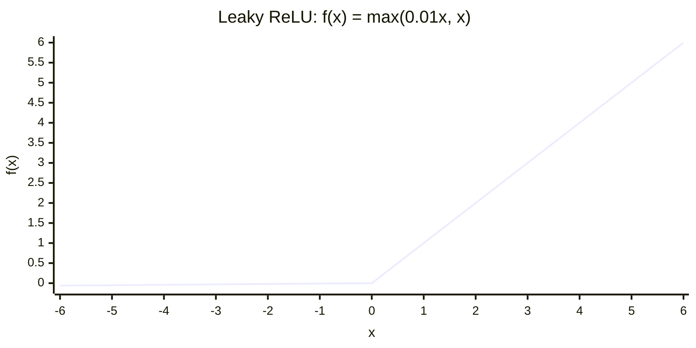

6. **SoftPlus Activation Function**

$$
Equation:
\
f(x) = \ln(1 + e^{x})
\
$$
$$
Range:
\
(0, +\infty)
\
$$

**Use Case:**
Used in probabilistic models ensuring smooth positive outputs.

**Diagram:**
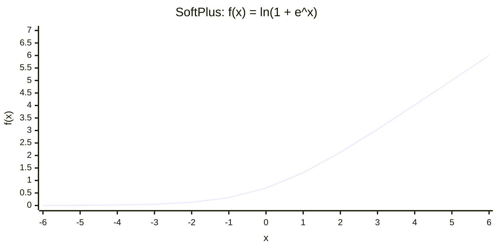

7. Softmax Activation Function

$$
Equation:
\
\text{Softmax}(x_i) = \frac{e^{x_i}}{\sum_{j=1}^{K} e^{x_j}}
\
$$
$$
Range:
\
(0, 1), \quad \sum_{i=1}^{K} \text{Softmax}(x_i) = 1
\
$$

**Use Case:**
Used in multiclass classification output layers for probability distribution.

**Diagram:**
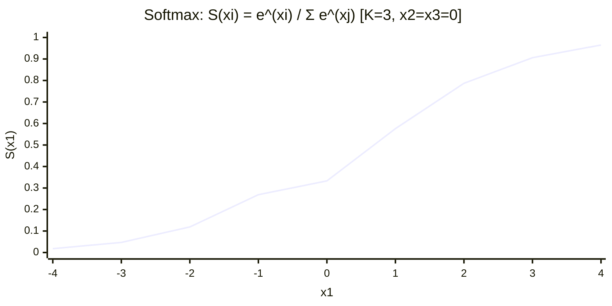

---
### Module 5: Advanced ML Classification Techniques

**What is the significance of ROC curves? (5 Marks, Dec 2023)**

**ROC (Receiver Operating Characteristic) curve** is a graphical plot that illustrates the diagnostic ability of a binary classifier as its discrimination threshold is varied. It plots **True Positive Rate (TPR/Sensitivity/Recall)** on the Y-axis against **False Positive Rate (FPR = 1 − Specificity)** on the X-axis.

**Significance:**
1. **Threshold-independent evaluation**: It shows classifier performance across all possible classification thresholds, not just a single operating point.
2. **Comparison of classifiers**: Multiple models can be compared on the same plot; a curve closer to the top-left corner (0,1) indicates better performance.
3. **AUC (Area Under the Curve)**: A single scalar summary of performance. AUC = 1 is perfect, 0.5 is random guessing. AUC represents the probability that the classifier ranks a random positive instance above a random negative one.
4. **Class imbalance robustness**: Unlike accuracy, ROC curves are insensitive to class distribution, making them useful for imbalanced datasets.
5. **Cost-sensitive decision making**: Helps select an optimal threshold based on the relative costs of false positives vs. false negatives.
6. **Visual diagnostic tool**: Reveals trade-offs between sensitivity and specificity, aiding model selection and tuning.

---

**State Ensemble methods and describe anyone. (10 Marks, Dec 2023)**
**Explain Ensemble Methods. (10 Marks, Dec 2024)**

**Bagging**:
- Trains multiple base models independently on random bootstrap samples (with replacement) drawn from the training data.
- Reduces variance and helps prevent overfitting by averaging out the individual models' errors.
- Each model is trained in parallel, making it computationally efficient and easy to scale.
- **Example:** Random Forestthat is an ensemble of decision trees, each trained on a random subset of data and features, whose predictions are aggregated (majority vote for classification, average for regression).

**Boosting**:
- Trains base models sequentially, where each new model focuses on correcting the errors (residuals) made by the previous ones.
- Converts weak learners into a strong learner by combining them with weighted contributions.
- Reduces both bias and variance, often achieving higher accuracy than bagging, but is more prone to overfitting if not tuned.
- **Example:** Gradient Boosting (e.g., XGBoost, LightGBM)that is each tree is fit to the gradient of the loss function from the previous ensemble, progressively improving predictions.

**Stacking**:
- Trains multiple diverse base models (level-0) and uses their predictions as input features for a meta-model (level-1).
- The meta-model learns how to optimally combine the base models' outputs rather than using a fixed rule like voting or averaging.
- Typically uses out-of-fold predictions to prevent data leakage when training the meta-learner.
- **Example:** Stacked generalizationthat is combining a Random Forest, SVM, and Logistic Regression as base models, with a Logistic Regression meta-model trained on their out-of-fold predictions to produce the final output.

 **Voting:**
- Combines predictions from multiple independently trained models using a simple aggregation rule (majority vote or averaged probabilities).
- Works best when base models are diverse and individually strong, as it leverages their complementary strengths.
- Is simple to implement and interpret, with no additional training required for the combination step.
- **Example:** Soft Voting Classifierthat is averaging the predicted probabilities of a Logistic Regression, Random Forest, and SVM, then choosing the class with the highest average probability (hard voting would use majority vote of predicted labels instead).

---

**How do you explain random forest? Does random forest need pruning, explain in detail? (10 Marks, May 2023)**

**Random Forest** is an ensemble learning method that builds **multiple decision trees** and combines their predictions to produce a more accurate and stable result.

- It uses **bagging (bootstrap aggregating)**: each tree is trained on a random bootstrap sample (with replacement) drawn from the training data.
- At each split, only a **random subset of features** is considered, which decorrelates the trees and reduces variance.
- Predictions are aggregatedthat is **majority vote** for classification, **average** for regression.
- It is robust to noise, handles high-dimensional data well, and provides feature importance scores.

**Does Random Forest need pruning?**

- **No, pruning is generally not required** in Random Forest, unlike single decision trees.
- Individual trees are grown **deep (fully expanded)** to keep bias low, because averaging many decorrelated trees **reduces variance** by itself.
- The ensemble's aggregation step serves the same purpose as pruningthat is controlling overfittingthat is without explicitly cutting back trees.
- Pruning individual trees would actually **increase bias** without meaningful variance reduction, since bagging already handles variance.
- Overfitting is controlled instead through hyperparameters such as **number of trees, max depth, min samples per leaf, and max features per split**.

---

**How Bagging and Boosting handle bias-variance trade-off differently, and analyze their effectiveness in dealing with noisy data and overfitting. Explain with algorithmic such as Random Forest and AdaBoost. (10 Marks, Dec 2025)**
**How Bagging and Boosting handle bias-variance trade-off differently, and analyze their effectiveness in dealing with noisy data and overfitting. Explain with algorithmic such as Random Forest and AdaBoost. (10 Marks, May 2025)**

**Bagging (e.g., Random Forest):**
- Trains base models **independently and in parallel** on bootstrap samples; averaging reduces **variance** primarily, with little effect on bias.
- **Random Forest** builds decorrelated trees using random feature subsets, further reducing variance and making it **robust to noisy data**that is noise gets averaged out across trees.
- **Resistant to overfitting**: adding more trees does not cause overfitting (variance plateaus); performance is stable.
- Handles noisy/mislabeled data relatively well because individual tree errors cancel out in aggregation.

**Boosting (e.g., AdaBoost):**
- Trains base models **sequentially**, each focusing on the errors (misclassified/residual instances) of the previous ones, reducing **both bias and variance**that is primarily bias.
- **AdaBoost** reweights misclassified samples higher each round and combines weak learners with weighted votes, converting weak learners into a strong learner.
- **Sensitive to noisy data and outliers**: noisy points get repeatedly up-weighted, so the model may overfit to them; requires careful tuning (learning rate, number of estimators, regularization).
- More prone to **overfitting** than bagging if not tuned, though it often achieves **higher accuracy** on clean data.

---

**How does class imbalanced affect on classification? What are the ways to solve class imbalanced problem. (10 Marks, May 2023)**

**Class imbalance** occurs when one class heavily outnumbers another in the dataset, causing the classifier to be biased toward the majority class.

**Effects on classification:**
- The model becomes **biased toward the majority class**, often predicting it almost always.
- **Accuracy becomes misleading**that is a 99% accurate model may simply be predicting the majority class.
- **Poor minority-class recall**that is the model fails to detect the important (rare) class.
- Decision boundaries get skewed; the learner may ignore minority patterns due to low error contribution.

**Ways to solve class imbalance:**
- **Resampling:** _Oversampling_ the minority class (e.g., SMOTEthat is synthetic minority samples) and/or _undersampling_ the majority class.
- **Cost-sensitive learning:** assign higher misclassification cost/weights to the minority class.
- **Algorithmic techniques:** use class weights in the loss function (e.g., `class_weight='balanced'`), or ensemble methods like **Balanced Random Forest** and **EasyEnsemble**.
- **Threshold tuning:** adjust the decision threshold instead of default 0.5 to improve minority recall.
- **Better metrics:** evaluate using **precision, recall, F1-score, ROC-AUC, PR-AUC** instead of accuracy.
- **Stratified sampling** during train/test splits and cross-validation to preserve class proportions.

---

**Explain bootstrap for sampling. (5 Marks, Dec 2024)**

**Bootstrap** is a resampling technique where multiple new training sets are created by **randomly sampling with replacement** from the original dataset.

- From a dataset of size *n*, draw *n* samples **with replacement**that is some instances appear multiple times, others are omitted (~36.8% left out, the "out-of-bag" samples).
- Each bootstrap sample is used to train a separate base model independently.
- Predictions from all models are aggregated (vote/average), reducing variance.
- **Example:** Bagging and Random Forest train each tree on a different bootstrap sample; the out-of-bag samples serve as a built-in validation set.

---

**Which are the various metrics for evaluating the classifier performance? (10 Marks, May 2023)**
**Explain Metrics for Evaluating Classifier Performance. (10 Marks, Dec 2025)**
**Calculate Accuracy, Precision, Recall, Sensitivity and Specificity for the following example (Actual Class Buys_Computer=yes/no vs Predicted Class Buys_Computer=yes/no: 6954/46, 412/2588). (10 Marks, Dec 2023)**
**Define Accuracy, precision, and recall. Evaluate performance of classifier1 and classifier 2 on the basis of above evaluation parameters, given confusion matrix (Classifier 1: F*/N*/F 20/10/N 10/60; Classifier 2: F*/N*/F 0/15/N 5/80). (10 Marks, Dec 2024)**
**Let's consider a binary classification problem where we have built a classifier to predict whether a transaction is fraudulent (positive class) or legitimate (negative class). After training the classifier and testing it on a dataset, we obtain the following confusion matrix: Actual Legitimate/Actual Fraudulent/Predicted Legitimate 850/30/Predicted Fraudulent 20/100. Calculate Accuracy, Precision, Recall and F1-score. (10 Marks, May 2024)**
**Explain any 4 Metrics for evaluating classifier performance. Discuss on Hold out method and random sampling. (10 Marks, Dec 2025)**
**Explain any 4 Metrics for evaluating classifier performance. Discuss any two cross validation methods. (10 Marks, May 2025)**
**Write short note on: Holdout method. (5 Marks, May 2023)**

Using the confusion matrix notation:
- **TP** = True Positive
- **TN** = True Negative
- **FP** = False Positive
- **FN** = False Negative

- **Accuracy**: Overall correctness of the model
$$
  \text{Accuracy} = \frac{TP + TN}{TP + TN + FP + FN}
$$

- **Precision**: How many predicted positives were correct
$$
  \text{Precision} = \frac{TP}{TP + FP}
$$

- **Recall (Sensitivity)**: Actual positives captured
$$
  \text{Recall} = \frac{TP}{TP + FN}
$$

- **Specificity**: Actual negatives captured
$$
  \text{Specificity} = \frac{TN}{TN + FP}
$$

- **Error Rate**: Overall incorrectness of the model
$$
  \text{Error Rate} = \frac{FP + FN}{TP + TN + FP + FN} = 1 - \text{Accuracy}
$$

- **F1-Score**: Harmonic mean of Precision and Recall
$$
  F1 = 2 \times \frac{\text{Precision} \times \text{Recall}}{\text{Precision} + \text{Recall}}
$$


**Holdout Method**
**Holdout method** is the simplest model evaluation technique: the dataset is **partitioned once** into two disjoint setsthat is a **training set** and a **test set** (common splits: 70/30, 80/20, or 2/3–1/3).

**Procedure:**
1. Randomly split the labeled data into training and test portions.
2. Train the model on the training set.
3. Evaluate on the unseen test set; the test error estimates generalization error.

**Advantages:**
- Simple, fast, and computationally cheap.
- No dependency on the learning algorithm; works with any model.
- Test set is independent of training, giving an unbiased-ish estimate.

**Disadvantages:**
- **High variance**: the estimate depends heavily on which instances land in train vs. test; a different split can give very different results.
- **Wastes data**: the test portion is not used for training, which hurts when data is scarce.
- **No guarantee of class balance**: random splits may produce unrepresentative sets; **stratified holdout** (preserving class proportions) is often used to mitigate this.
- Single estimate with no confidence measure.

**K-Fold Partition:**
The dataset is split into **K equal-sized folds** (typically K = 5 or 10). The model is trained **K times**, each time using K−1 folds for training and the remaining 1 fold for testing. The K results are then **averaged** to give the final performance estimate.

```
Fold 1: [TEST ] [Train] [Train] [Train] [Train]
Fold 2: [Train] [TEST ] [Train] [Train] [Train]
Fold 3: [Train] [Train] [TEST ] [Train] [Train]
Fold 4: [Train] [Train] [Train] [TEST ] [Train]
Fold 5: [Train] [Train] [Train] [Train] [TEST ]
        → Final accuracy = average of all 5 runs
```

**Procedure:**
1. Partition data into K equal folds.
2. For each fold: train on the other K−1 folds, test on this fold.
3. Average the K test results.

**Advantages:**
- Every data point is used for both training and testingthat is no data wasted.
- Lower variance, more reliable estimate than a single holdout.
- K individual scores show stability/variance.

**Disadvantages:**
- Computationally expensivethat is K training runs.
- Correlated estimates (training sets overlap).
- Plain K-fold can skew class balance → use **stratified K-fold** to preserve class proportions.

**Random Sampling**
Random sampling is a model evaluation technique where the dataset is partitioned into training and test sets by randomly selecting instances for each set, often with a fixed proportion (e.g., 70/30 or 80/20).

**Procedure**
1. Randomly draw a specified number of instances from the labeled data to form the training set, assigning the remainder to the test set.
2. Train the model on the training set.
3. Evaluate on the unseen test set; the test error estimates generalization error.
**Advantages**
- Simple, fast, and computationally cheap.
- No dependency on the learning algorithm; works with any model.
- Random selection avoids systematic bias in assigning instances, giving an unbiased-ish estimate.

**Disadvantages**
- **High variance**: the estimate depends heavily on which instances are randomly selected; a different random draw can give very different results.
- **Wastes data**: the test portion is not used for training, which hurts when data is scarce.
- **No guarantee of class balance**: random sampling may produce unrepresentative sets; stratified random sampling (preserving class proportions) is often used to mitigate this.
- Single estimate with no confidence measure.

---
### Module 6: Trends and Applications in Data Science

**Perform a case study on book recommendation system (data science based). (10 Marks, Dec 2023)**

A book recommendation system predicts titles a user is likely to read using historical ratings and behaviour.

**Case Study: Online Bookstore:**
- **Data:** User ratings, purchase history, browsing logs, book metadata (genre, author).
- **Techniques:** Collaborative filtering (user-user, item-item), content-based filtering using book descriptions, and hybrid models.
- **Process:** Collect data → build user-item matrix → compute similarity → rank unseen books → recommend top-N.
- **Challenges:** Cold start for new users/books, data sparsity, popularity bias.
- **Outcome:** Higher click-through and sales; personalised reading lists improve retention.

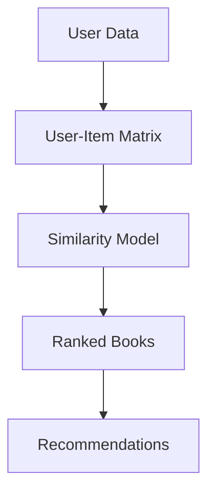

---

**Perform a case-study on video recommendation system (data science based). (10 Marks, Dec 2024)**

A video recommendation system suggests videos matching user interest to maximise watch time.

**Case Study: Video Streaming Platform:**
- **Data:** Watch history, watch duration, likes, search queries, video metadata.
- **Techniques:** Matrix factorisation, deep neural recommenders, sequence models for session behaviour.
- **Process:** Log interactions → build features → train ranking model → serve top-K videos.
- **Challenges:** Scalability, cold start, real-time updates, diversity vs relevance.
- **Outcome:** Increased watch time and user engagement through personalised feeds.

```mermaid
graph TD
    A[Watch Logs] --> B[Feature Store]
    B --> C[Ranking Model]
    C --> D[Top-K Videos]
    D --> E[User Feed]
```

---

**Write a short note on Data Science for Multi modal applications. (10 Marks, Dec 2023)**
**Explain Data science for Multimodal applications. (10 Marks, May 2023)**
**Briefly explain Data science for Multimodal applications. (10 Marks, May 2024)**

Multimodal data science combines multiple data types—text, audio, image, video—into unified models.

- **Data Collection:** Gather paired or aligned data such as image-caption pairs, audio-transcript pairs, and video-subtitle pairs from real-world sources.
- **Preprocessing:** Convert each modality into numeric representations—text embeddings for language, spectrograms for audio, image tensors for visuals, and frame sequences for video.
- **Fusion:** Combine representations using early, late, or intermediate fusion depending on the task and data availability.
- **Modelling:** Use transformers and cross-attention mechanisms to learn relationships across modalities, along with joint embedding spaces that place related content close together.
- **Evaluation:** Measure accuracy on joint tasks such as retrieval, captioning, classification, and question answering.
- **Applications:** Visual question answering, multimodal search, emotion recognition, healthcare diagnostics, and autonomous systems.
- **Challenges:** Alignment and synchronisation of modalities, scalability of training, modality gaps, and interpretability of fused models.

```mermaid
graph TD
    A[Text] --> D[Fusion Model]
    B[Audio] --> D
    C[Image] --> D
    D --> E[Unified Output]
```

---

**Write short note on: Application of Data science for text. (5 Marks, May 2023)**

Data science for text converts unstructured language into actionable insight using statistical and machine learning methods.

- **Tasks:** Sentiment analysis, text classification, named entity recognition, summarisation, and machine translation.
- **Techniques:** Tokenisation, TF-IDF, word embeddings, and transformer-based language models.
- **Applications:** Spam detection, chatbots, review analysis, document search, and topic discovery.
- **Benefit:** Automates understanding of large text volumes and supports data-driven decisions.

---

**Write a short note on Trends in Data Science for audio. (10 Marks, Dec 2024)**

Audio data science extracts meaning from speech, music, and environmental sound using signal processing and machine learning. Recent trends focus on richer representations and real-time deployment.

- **Speech Recognition:** Converting speech to text using deep acoustic and language models, enabling transcription and voice commands.
- **Audio Classification:** Tagging sounds, music genres, or acoustic events for media indexing and monitoring.
- **Speaker Identification:** Recognising and verifying speakers for security and personalisation.
- **Emotion Detection:** Inferring sentiment and stress from voice tone and prosody.
- **Generative Audio:** Text-to-speech synthesis and music generation using generative models.
- **Emerging Trends:** Self-supervised audio models that learn from unlabelled data, edge deployment for low-latency processing, and multimodal audio-text systems that combine sound with language.
- **Applications:** Voice assistants, call centre analytics, media indexing, healthcare monitoring, and smart devices.

```mermaid
graph TD
    A[Audio Input] --> B[Feature Extraction]
    B --> C[Deep Model]
    C --> D[Classification or Text]
```

---

**Explain the role of machine learning in multimodal applications. Discuss how different data modalities (text, audio, image, and video) are integrated to improve the performance and user experience of these systems with real time applications. (10 Marks, Dec 2025)**
**Explain the role of machine learning in multimodal applications. Discuss how different data modalities (text, audio, image, and video) are integrated to improve the performance and user experience of these systems with real time applications. (10 Marks, May 2025)**

Machine learning powers multimodal applications by learning relationships among text, audio, image, and video, and by combining their information into unified predictions. It allows systems to understand context that no single modality could provide alone.

- **ML Functions:** Representation learning, fusion, alignment, and prediction across modalities, often trained end-to-end.
- **Text Processing:** Embeddings and transformer models capture language meaning for search, classification, and conversation.
- **Audio Processing:** Neural networks analyse speech, tone, and sound patterns for recognition and emotion detection.
- **Image Processing:** Vision models extract objects, faces, and scenes for recognition and retrieval.
- **Video Processing:** Temporal models capture motion sequences and events for activity understanding.
- **Integration Strategies:** Early fusion merges raw features, late fusion merges model outputs, and intermediate fusion uses attention mechanisms to build shared representations that respect each modality's strengths.
- **Real-Time Use Cases:** Smart assistants, live video captioning, multimodal search, emotion-aware interfaces, and augmented reality systems.
- **Benefits:** Higher accuracy, contextual understanding, graceful handling of missing data, and a smoother, more intuitive user interaction.

```mermaid
graph TD
    A[Modalities] --> B[ML Feature Models]
    B --> C[Fusion]
    C --> D[Prediction]
    D --> E[User Experience]
```