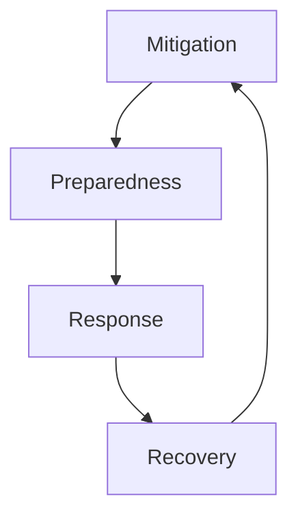

#### 1. Describe tsunamis, earthquakes, floods, and avalanches with a disaster management plan for each. (5 marks)

**Tsunamis:** Tsunamis are massive ocean waves triggered by underwater earthquakes, volcanic eruptions, or landslides that displace large volumes of water.

**Disaster Management Plan:**
- **Preparedness:** Install early warning systems and tsunami buoys to detect seismic activity and issue timely alerts.
- **Preparedness:** Conduct regular evacuation drills and mark high-ground assembly points in vulnerable coastal communities.
- **Response:** Immediately evacuate coastal populations to elevated areas and deploy naval vessels for search operations.
- **Recovery:** Restore mangrove forests as natural barriers and rebuild infrastructure away from high-risk zones.

**Earthquakes:** Earthquakes are sudden ground vibrations caused by the release of stress along tectonic plate boundaries and geological faults.

**Disaster Management Plan:**
- **Preparedness:** Enforce strict building codes for earthquake-resistant construction in high-risk seismic zones.
- **Preparedness:** Conduct public awareness campaigns teaching "Drop, Cover, and Hold On" safety techniques.
- **Response:** Activate search and rescue teams and establish emergency medical camps immediately after shaking stops.
- **Recovery:** Demolish unsafe structures and provide financial aid for rebuilding homes and infrastructure.

**Floods:** Floods are overflow events where water submerges normally dry land due to heavy rainfall, dam failures, or storm surges.

**Disaster Management Plan:**
- **Preparedness:** Construct robust drainage systems, embankments, and dams while implementing floodplain zoning regulations.
- **Response:** Carry out mass evacuations using boats and helicopters while providing clean water and food.
- **Response:** Deploy medical teams to prevent outbreak of waterborne diseases like cholera and typhoid.
- **Recovery:** Clear debris from roads and assess agricultural losses for compensation distribution.

**Avalanches:** Avalanches are rapid flows of snow, ice, and debris that descend mountain slopes with tremendous destructive force.

**Disaster Management Plan:**
- **Preparedness:** Monitor snowpack stability and restrict movement in high-risk avalanche-prone areas.
- **Preparedness:** Use explosives to control snow accumulation and conduct controlled avalanche releases safely.
- **Response:** Deploy specialized rescue teams with avalanche transceivers and rescue dogs immediately.
- **Recovery:** Clear blocked transportation routes and provide medical aid for hypothermia victims.

---

#### 2. Describe tsunamis, earthquakes, floods, and avalanches with the dos and don'ts to follow during each disaster. (5 marks)

**Tsunamis**

| **Do's** | **Don'ts** |
| :--- | :--- |
| Move immediately to high ground after a strong earthquake. | Do not wait for official warnings before evacuating. |
| Follow official evacuation routes and listen to radio updates. | Do not return to coastal areas to watch the approaching wave. |
| Take emergency supplies and stay away from coastal regions. | Do not assume the first wave will be the largest one. |

**Earthquakes**

| **Do's** | **Don'ts** |
| :--- | :--- |
| Drop, cover, and hold under sturdy furniture for protection. | Do not run outside while the ground is still shaking violently. |
| Stay away from windows, glass panes, and heavy falling objects. | Do not use elevators during or immediately after the earthquake. |
| Move to open areas away from buildings and power lines. | Do not stand near walls that could collapse onto you. |

**Floods**

| **Do's** | **Don'ts** |
| :--- | :--- |
| Move to higher ground and turn off all utilities safely. | Do not walk, swim, or drive through any floodwater at all. |
| Evacuate immediately when authorities issue evacuation orders. | Do not drive around barricades placed for your protection. |
| Keep emergency supplies including food, water, and medicines. | Do not ignore flood warnings or underestimate rising water. |

**Avalanches**

| **Do's** | **Don'ts** |
| :--- | :--- |
| Carry avalanche safety equipment like transceivers and probes. | Do not travel alone in any snow-covered mountainous region. |
| Move sideways and swim to stay on the snow surface. | Do not venture onto steep slopes after heavy snowfall occurs. |
| Check local avalanche forecasts before starting any journey. | Do not follow any route without verifying snow stability first. |

---

#### 3. What are the short-term and long-term effects of flood disasters? (5 marks)

**Short-Term Effects**

| **Effect Type** | **Description** |
| :--- | :--- |
| Loss of Life | Drowning, injuries, and electrocution cause immediate fatalities. |
| Displacement | People forced to leave homes and live in relief camps. |
| Disease Outbreaks | Stagnant water causes cholera, typhoid, and other epidemics. |
| Infrastructure Damage | Roads, bridges, and power lines are destroyed instantly. |
| Food Shortage | Submerged crops and contaminated food supplies create scarcity. |

**Long-Term Effects**

| **Effect Type** | **Description** |
| :--- | :--- |
| Economic Devastation | Agricultural losses affect farmers and regional economy for years. |
| Livelihood Disruption | Farmers face debts and loss of income leading to poverty. |
| Mental Health Impact | Survivors suffer from PTSD, anxiety, and depression. |
| Ecosystem Damage | Soil erosion and contamination reduce agricultural fertility. |
| Educational Disruption | Schools destroyed, affecting children's education permanently. |

---

#### 4. Which are the recent disasters that have occurred in India and Maharashtra in the last three years? (5 marks)

**Maharashtra (2023-2026)**

| **Disaster** | **Year** | **Impact** |
| :--- | :--- | :--- |
| Marathwada Floods | September 2025 | Over 80 deaths and 50% crop damage in Marathwada and Vidarbha. |
| Mumbai Urban Flooding | July 2024 | Low-lying areas submerged, disrupting transport and daily life. |
| Konkan Coast Cyclone | June 2023 | Strong winds and heavy rainfall affected coastal districts severely. |
| Pune Landslides | August 2024 | Heavy rains triggered landslides in hilly areas, causing fatalities. |

**India (2023-2026)**

| **Disaster** | **Year** | **Impact** |
| :--- | :--- | :--- |
| Sikkim GLOF Disaster | October 2023 | Glacial lake outburst flooded Teesta River, damaging Chungthang dam. |
| Himachal Pradesh Floods | July 2023 | Massive landslides and flash floods caused widespread destruction. |
| Cyclone Biparjoy | June 2023 | Made landfall in Gujarat, leading to mass evacuations. |
| Assam Annual Floods | 2023-2025 | Repeated seasonal floods affecting millions and damaging crops. |
| Uttarakhand Cloudburst | August 2024 | Sudden heavy rainfall caused flash floods and infrastructure collapse. |

---

#### 5. Define global warming and list its causes. (2 marks)

**Definition:** Global warming is the long-term rise in Earth's average surface temperature primarily caused by increased greenhouse gas emissions.

**Causes:**
- Burning fossil fuels like coal, oil, and natural gas releases carbon dioxide.
- Deforestation reduces the planet's capacity to absorb atmospheric carbon.
- Agricultural activities produce methane and nitrous oxide gases.
- Industrial processes emit various greenhouse gases into the atmosphere.

---

#### 6. What are technological disasters? (2 marks)

**Definition:** Technological disasters are unintended events caused by human error, structural failures, or malfunctions of technological systems.

**Examples:**
- Industrial accidents like the Bhopal gas tragedy and Chernobyl nuclear disaster.
- Infrastructure failures such as dam breaches and building collapses.
- Transport accidents involving airplanes, trains, and ships.

---

#### 7. Define the following terms: (a) Hazard (b) Vulnerability (c) Disaster (d) Capacity Building (2 marks)

**(a) Hazard:** A dangerous process, phenomenon, or activity that may cause loss of life, injury, property damage, or environmental degradation.

**(b) Vulnerability:** The susceptibility of individuals, communities, or systems to suffer damage from hazardous events based on physical, social, and economic conditions.

**(c) Disaster:** A serious disruption of community functioning causing widespread human, material, or environmental losses that exceed local coping capacity.

**(d) Capacity Building:** The process of developing skills, resources, and institutional systems to strengthen resilience against potential disaster risks.

---

#### 8. What are the reasons for earthquakes? (2 marks)

**Tectonic Plate Movement:** Earth's crust consists of tectonic plates that move constantly, creating friction and building pressure along fault lines until sudden release occurs.

**Volcanic Activity:** Movement of magma beneath the earth's surface can cause tremors and minor earthquakes.

**Human Activities:** Mining, reservoir construction, and geothermal extraction can induce seismic activity in stable regions.

---

#### 9. Give the classification of different types of disasters and mention examples of each. (5 marks)

**Natural Disasters**

| **Category** | **Sub-Type** | **Examples** |
| :--- | :--- | :--- |
| Geophysical | Earth-related events | Earthquakes, Tsunamis, Volcanic Eruptions |
| Hydrological | Water-related events | Floods, Flash Floods, Storm Surges |
| Climatological | Climate-related events | Droughts, Wildfires, Heatwaves |
| Meteorological | Weather-related events | Cyclones, Storms, Extreme Temperatures |
| Biological | Organism-related events | Epidemics, Pandemics, Locust Infestations |

**Technological (Man-Made) Disasters**

| **Category** | **Sub-Type** | **Examples** |
| :--- | :--- | :--- |
| Industrial | Factory and plant accidents | Bhopal Gas Tragedy, Chernobyl Disaster |
| Transport | Vehicle and infrastructure accidents | Air Crashes, Train Derailments |
| Structural | Building and dam failures | Dam Breaches, Building Collapses |

**Hybrid Disasters**

| **Category** | **Description** | **Examples** |
| :--- | :--- | :--- |
| Nat-Tech Events | Natural disaster triggers technological failure | Fukushima Nuclear Disaster (earthquake + tsunami) |

---

#### 10. Draw the disaster management cycle and explain each stage with an example. (2 marks)

**Mitigation:** Actions taken to reduce the long-term risk from hazards. *Example: Building earthquake-resistant structures.*

**Preparedness:** Planning and training to ensure effective response when disaster strikes. *Example: Conducting regular evacuation drills.*

**Response:** Actions taken immediately during and after disaster to save lives. *Example: Search and rescue operations after earthquakes.*

**Recovery:** Efforts to return affected communities to normalcy after a disaster. *Example: Rebuilding damaged infrastructure and homes.*

---