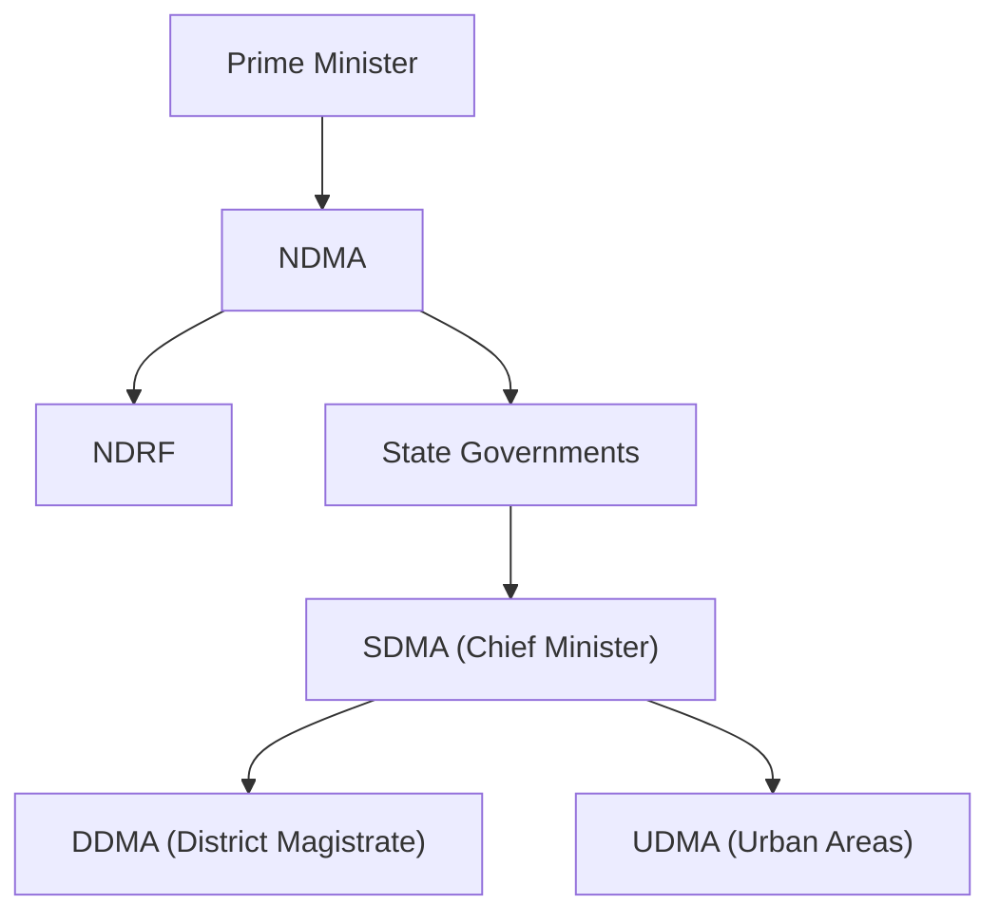

### 1. Role of Non-Governmental Organizations (NGOs) in Disaster Management

NGOs are non-profit organisations or associations of private citizens that assist disaster-affected people. Their roles span the entire disaster cycle:

- **Emergency relief and aid distribution**: NGOs serve as providers and distributors of humanitarian aid, often reaching communities that government machinery cannot easily access.
- **Rescue and technical support**: NGOs bring technical skills important for rescue, coordination, and relief activities.
- **Rehabilitation and reconstruction**: They play a major role in long-term recovery, including construction of transit shelters and trauma counselling.
- **Preparedness and training**: NGOs assist local communities in disaster preparedness planning through training and awareness programmes.

---

### 2. How Early Warning Systems Function in Disaster Management

Early Warning is an integrated system that detects, forecasts, and communicates disaster threats to enable timely protective action. A complete early warning system is **far more than a prediction**, it is an integrated system comprising four interrelated components:

- **Risk Knowledge** : Identifying which hazards threaten a region and who is vulnerable through hazard mapping and risk assessment.
- **Monitoring & Forecasting** : Continuous observation of environmental parameters using satellites, sensors, and radars to predict the likelihood, timing, and severity of a hazard.
- **Dissemination & Communication** : Transmitting timely, clear, and actionable warnings to authorities and at-risk communities through SMS, sirens, radio, TV, mobile apps, and social media.
- **Response Capability** : Ensuring communities and authorities know how to act on warnings through preparedness plans, evacuation routes, shelters, and trained personnel.

---

### 3. Government of India's Institutional Framework for Disaster Management

India's disaster management framework is established through the **Disaster Management Act, 2005** (amended in 2025). The primary responsibility for disaster management rests with **State Governments**, with the Central Government providing supplementary logistical and financial support for severe disasters.

**National Level:**
- **NDMA** (National Disaster Management Authority)
- Chaired by **Prime Minister**
- Lays down policies, plans, and guidelines

**State Level:**
- **SDMA** (State Disaster Management Authority)
- Chaired by **Chief Minister**
- Implements national policy at state level

**District Level:**
- **DDMA** (District Disaster Management Authority)
- Chaired by **District Magistrate/Collector**
- District-level planning and coordination

**Response Level:**
- **NDRF** (National Disaster Response Force)
- 16 battalions for specialised search, rescue, and response

**Urban Level:**
- **UDMA** (Urban Disaster Management Authority)
- New provision for state capitals and cities with municipal corporations

---

### 4. Nodal Officers: Roles and Responsibilities in Disaster Management

A **Nodal Officer** is a designated official responsible for coordinating disaster management activities within a specific jurisdiction or department.

**Key Roles:**
- Act as **single point of contact** between the government and agencies
- **Coordinate** disaster preparedness, response, and recovery efforts
- **Disseminate** early warnings and alerts to concerned departments
- **Coordinate** with NDMA, SDMA, DDMA, and NDRF during emergencies
- **Ensure** timely mobilization of resources and manpower

**Key Responsibilities:**
- **Preparedness** : Conduct training, mock drills, and awareness programs
- **Mitigation** : Identify risk-prone areas and suggest preventive measures
- **Response** : Activate emergency plans and coordinate rescue operations
- **Communication**  Maintain real-time information flow among stakeholders
- **Reporting** : Document damage assessment and submit reports to authorities
- **Resource Management** : Ensure availability of relief materials and funds

---

### 5. Difference Between NIDM and NDMA

| Basis                  | NIDM (National Institute of Disaster Management) | NDMA (National Disaster Management Authority)             |
| ---------------------- | ------------------------------------------------ | --------------------------------------------------------- |
| **Full Form**          | National Institute of Disaster Management        | National Disaster Management Authority                    |
| **Nature**             | Training and research institute                  | Apex policy-making body                                   |
| **Establishment**      | Established under Disaster Management Act, 2005  | Established under Disaster Management Act, 2005           |
| **Head**               | Executive Director                               | Chaired by Prime Minister                                 |
| **Primary Function**   | Training, research, and capacity building        | Policy formulation, coordination, and approval of plans   |
| **Role**               | Provides knowledge, documentation, and awareness | Lays down policies, plans, and guidelines                 |
| **Focus Area**         | Human resource development and academic work     | Strategic decision-making and national-level coordination |
| **Level of Operation** | Works as a supporting institution                | Works as the apex authority at national level             |

---

### 6. Structural Mapping in Disaster Management

Structural mapping refers to the process of identifying and documenting the physical features, infrastructure, and built environment of a region to understand its vulnerabilities and risk exposure to disasters.

**How It Is Carried Out:**
1. **Data Collection** : Gathering information on buildings, roads, drainage, and utilities
2. **Remote Sensing & GIS** : Using satellite imagery and GIS tools for spatial mapping
3. **Field Survey** : Physical inspection of structures and infrastructure
4. **Risk Assessment** : Analyzing vulnerability of structures to specific hazards
5. **Mapping & Documentation** : Preparing maps and reports for planners and authorities
6. **Updating** : Regular revision based on new construction and changing risks

**Common Structural Measures for Disaster Risk Reduction:**
- Dams and reservoirs
- Flood levees and embankments
- Ocean wave barriers and sea walls
- Earthquake-resistant construction
- Evacuation shelters and safe rooms
- Retrofitting of existing buildings

---

### 7. Mitigation Dos and Don'ts for Cyclones, Hurricanes, and Tornadoes

**CYCLONES / HURRICANES**

**Dos:**
1. Secure windows and doors with strong shutters firmly
2. Store drinking water, food, and medicines in advance
3. Keep emergency kit, torch, and batteries ready always
4. Listen to radio and official weather warnings regularly
5. Move to cyclone shelters when authorities issue warnings
6. Trim trees and remove loose objects from surroundings

**Don'ts:**
1. Do not venture outside during the storm period
2. Do not believe rumours and spread false information
3. Do not touch fallen electric wires or poles
4. Do not drive through flooded roads or bridges
5. Do not stay near windows during strong winds
6. Do not ignore evacuation orders from authorities

**TORNADOES**

**Dos:**
1. Move to underground shelter or strong safe room
2. Stay away from windows and glass doors always
3. Crouch low and protect your head with arms
4. Listen to tornado warnings through radio and alerts
5. Keep emergency supplies ready in your shelter place
6. Stay calm and follow official instructions carefully

**Don'ts:**
1. Do not stay in mobile homes or temporary shelters
2. Do not open windows to equalize air pressure
3. Do not hide under bridges or highway overpasses
4. Do not go outside until official all-clear issued
5. Do not stand near tall trees or electric poles
6. Do not use elevators during tornado warnings ever

---

### 8. Role of the National Disaster Response Force (NDRF)

The **NDRF** was raised on **19 January 2006** under the Disaster Management Act, 2005, and has grown from 8 to **16 battalions**. The **National Disaster Response Force (NDRF)** is India's specialized, multi-hazard disaster response agency.

1. Conducts **Collapsed Structure Search & Rescue (CSSR)** in earthquakes and building collapses.
2. Performs **Flood Water Rescue (FWR)** during drowning incidents and boat capsizes.
3. Provides **Chemical, Biological, Radiological & Nuclear (CBRN)** response to hazardous material incidents.
4. Carries out **Mountain & Rope Rescue** operations in difficult and inaccessible terrain.
5. Delivers **Medical First Response (MFR)** and immediate aid during disasters.
6. Undertakes **Animal Rescue** operations for trapped and stranded animals.
7. Handles **Forest Fire Response**, a new mandate added in 2022.
8. Assists in **evacuation, relief, and rehabilitation** of affected communities.

---

### 9. Difference Between Structural and Non-Structural Mitigation Measures

| Basis              | Structural Mitigation                                                    | Non-Structural Mitigation                                                           |
| ------------------ | ------------------------------------------------------------------------ | ----------------------------------------------------------------------------------- |
| **Definition**     | Physical construction or engineering techniques to reduce hazard impacts | Measures not involving physical construction; use knowledge, practice, or agreement |
| **Focus**          | Changes to the **built environment**                                     | Changes to **human behaviour** and **policies**                                     |
| **Approach**       | Engineering and technology-based                                         | Policy, education, and behaviour-based                                              |
| **Examples**       | Dams, levees, flood walls, earthquake-resistant buildings                | Building codes, land-use planning laws, public awareness programmes                 |
| **Other Examples** | Evacuation shelters, ocean wave barriers, sea walls                      | Training, insurance, research and assessment                                        |
| **Timeframe**      | Often long-term and capital-intensive                                    | Can be implemented more quickly and at lower cost                                   |
| **Cost**           | Requires heavy investment and resources                                  | Generally low-cost and cost-effective                                               |
| **Impact**         | Provides direct physical protection from hazards                         | Reduces risk through awareness and preparedness                                     |

---

### 10. Role of the Internet of Things (IoT) in Disaster Management

The **Internet of Things (IoT)** refers to networks of interconnected sensors and devices that collect and transmit real-time data. In disaster management, IoT enables:

**Roles of IoT in Disaster Management:**
- **Real-time monitoring**: Sensors and Wireless Sensor Networks (WSN) provide initial detection of disasters and continuous real-time data on flood levels, seismic activity, fire, and weather conditions.
- **Early warning systems**: IoT applications provide early warning in urban spaces during floods, earthquakes, and fires, allowing search and rescue teams to respond within the **golden response time**.
- **Communication in damaged areas**: Technologies like **LoRaWAN** (Long Range Wide Area Network) and cloud/fog computing maintain connectivity in remote or damaged areas.
- **Data-driven decision-making**: IoT data enables real-time monitoring and decision execution for more effective response.

---

### 11. Role of Geographic Information Systems (GIS) in Disaster Management

**GIS** is a "location science" that allows people to **visualise what is happening and where**, placing information in a spatial framework on a map. Its roles include:

**Roles of GIS in Disaster Management:**
- **Hazard and risk mapping**: Identifying areas prone to flooding, earthquakes, landslides, and other hazards.
- **Vulnerability analysis**: Integrating demographic and socio-economic data to identify at-risk populations and communities.
- **Evacuation planning**: Determining evacuation routes, safe areas, and shelter locations.
- **Resource allocation**: Optimising the placement of emergency resources and personnel based on spatial risk assessment.
- **Real-time situational awareness**: During disasters, GIS provides updated maps of flood impact zones, critical facilities, and affected communities.
- **Post-disaster recovery**: Supporting damage assessment and reconstruction planning.

---

### 12. Key Provisions of the Disaster Management Act, 2005 (as amended 2025)

The **Disaster Management Act, 2005** provides the legal and institutional framework for disaster management in India.

**Key Provisions:**

- **Establishment of Authorities**:
  - **NDMA**: Chaired by Prime Minister; lays down policies and plans
  - **SDMA**: Chaired by Chief Minister in each state
  - **DDMA**: Chaired by District Magistrate at district level

- **National Executive Committee (NEC)**: Assists NDMA; prepares National Plan; coordinates and monitors implementation

- **National Disaster Response Force (NDRF)**: Specialised response force under DM Act

- **National Disaster Management Plan**: First issued 2016, revised 2019; defines roles of all sectors, ministries, and departments

**2025 Amendment Key Changes**:
- Strengthened roles of NDMA, SDMAs, and DDMAs in risk assessment, technical assistance, and multi-hazard planning
- Statutory status to **High-Level Committee (HLC)** and **National Crisis Management Committee (NCMC)**
- Provision for **Urban Disaster Management Authority (UDMA)** in state capitals and cities with municipal corporations
- Recognition of risks from **extreme climate events**
- Improved functioning of NEC, SEC, and DDMAs as planning and execution arms
- Enhanced financial mechanisms and accountability structures

---

### 13. What are the dos and don'ts for all major types of disasters?

**EARTHQUAKE**

**Dos:**
1. DROP to ground, take COVER, and HOLD ON
2. Stay away from windows and hanging objects
3. Use whistle or tap pipe if trapped
4. Stay indoors until shaking completely stops
5. Protect your head and neck with arms
6. Move to open area after shaking stops

**Don'ts:**
1. Do not use elevators during or after earthquake
2. Do not move from one place to another
3. Do not light matches or kick up dust
4. Do not stand near heavy furniture or shelves
5. Do not run outside during severe shaking
6. Do not ignore aftershocks after the main quake

**FLOOD**

**Dos:**
1. Move to higher ground immediately without any delay
2. Use pole or stick to test ground
3. Store drinking water and food in advance
4. Listen to official warnings through radio and TV
5. Turn off electricity and gas before evacuating
6. Keep important documents in waterproof bags

**Don'ts:**
1. Do not walk through flowing water ever
2. Do not drive through flooded areas or roads
3. Do not drive around road barriers at any cost
4. Do not touch electrical equipment in wet areas
5. Do not drink contaminated flood water at all
6. Do not return home until authorities declare safe

**FIRE**

**Dos:**
1. Remain calm, unplug appliances, keep water buckets ready
2. Learn at least two escape routes and keep clear
3. Stop, Drop, and Roll if clothes catch fire
4. Crawl low under smoke to avoid inhalation
5. Close doors behind you to slow fire spread
6. Call fire services and alert neighbours immediately

**Don'ts:**
1. Do not burn crackers in crowded or congested places
2. Do not apply adhesive dressing on burnt areas
3. Do not throw lighted cigarette butts anywhere
4. Do not use water on electrical or oil fires
5. Do not re-enter burning building for belongings
6. Do not open hot doors that may trap fire

**LANDSLIDE**

**Dos:**
1. Stay alert and awake, many fatalities occur during sleep
2. Listen for unusual sounds like trees cracking
3. Move away from the landslide path quickly
4. Avoid river valleys and low-lying areas
5. Plant trees and vegetation to stabilize slopes
6. Report cracks or land movement to authorities

**Don'ts:**
1. Do not build houses near steep slopes or edges
2. Do not ignore warning signs or unusual sounds
3. Do not stay in drainage ways or mountain edges
4. Do not cross landslide-affected areas carelessly
5. Do not delay evacuation during heavy rainfall
6. Do not block natural water flow on slopes

**TSUNAMI**

**Dos:**
1. Treat earthquake or strong ground rumbling as warning
2. Climb to raised platform or highest floor
3. Evacuate immediately if you hear official warning
4. Move at least two kilometres inland from coast
5. Stay tuned to radio for official updates
6. Help elderly and disabled people evacuate safely

**Don'ts:**
1. Do not go down near beach to watch tsunami
2. Do not return home until authorities advise safe
3. Do not ignore natural warning signs like receding water
4. Do not stay in low-lying coastal areas
5. Do not use vehicles that may cause traffic jams
6. Do not assume the first wave is the last

**CYCLONE** / HURRICANE

**Dos:**
1. Follow evacuation orders immediately without any delay
2. Shelter in interior room away from windows
3. Leave mobile homes in any case immediately
4. Store food, water, and medicines for emergency
5. Secure windows and doors with strong shutters
6. Keep emergency kit, torch, and batteries ready

**Don'ts:**
1. Do not venture out during the storm period
2. Do not take shelter in small sheds or trees
3. Do not ignore warnings from official authorities
4. Do not touch fallen electric wires or poles
5. Do not drive through flooded roads or bridges
6. Do not believe rumours or spread false information