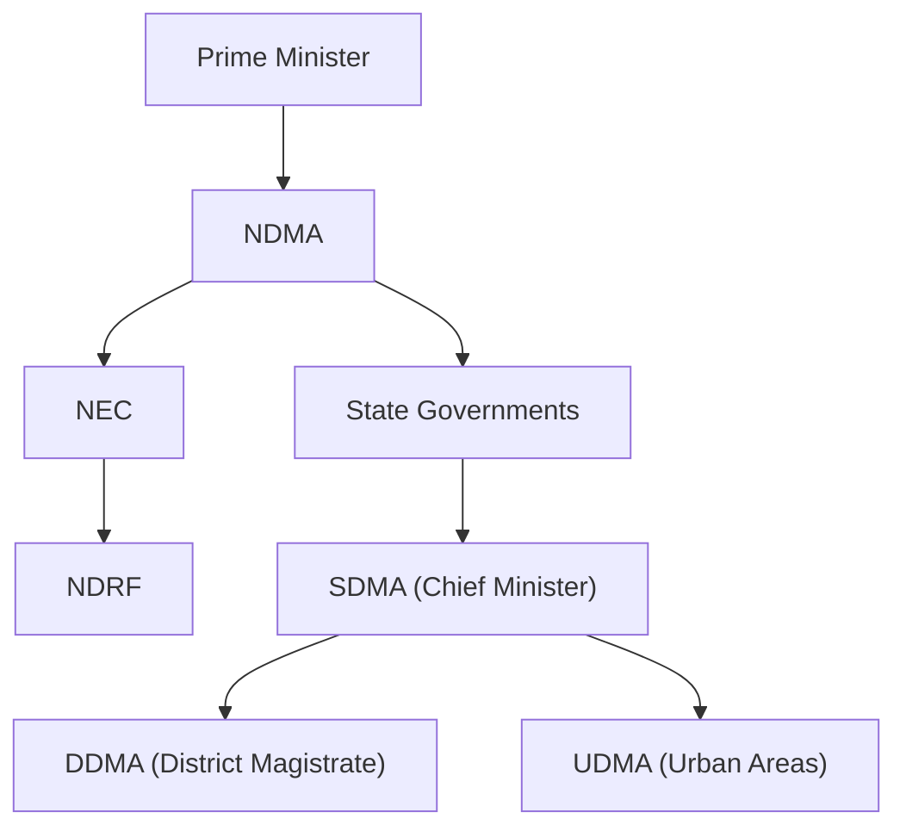

### 1. Role of Non-Governmental Organizations (NGOs) in Disaster Management

NGOs are non-profit organisations or associations of private citizens that assist disaster-affected people. Their roles span the entire disaster cycle:

- **Emergency relief and aid distribution**: NGOs serve as providers and distributors of humanitarian aid, often reaching communities that government machinery cannot easily access.
- **Rescue and technical support**: NGOs bring technical skills important for rescue, coordination, and relief activities.
- **Rehabilitation and reconstruction**: They play a major role in long-term recovery, including construction of transit shelters and trauma counselling.
- **Preparedness and training**: NGOs assist local communities in disaster preparedness planning through training and awareness programmes.
- **Advocacy and policy engagement**: They organise platforms for advocacy, linking local communities with provincial and national governance structures.

---

### 2. How Early Warning Systems Function in Disaster Management

A complete early warning system is **far more than a prediction**—it is an integrated system comprising four interrelated components:

| Component | Function | Key Questions |
|---|---|---|
| **Risk Knowledge** | Systematically collect data and undertake risk assessments | Are hazards and vulnerabilities known? Are risk maps available? |
| **Monitoring & Warning Service** | Develop hazard monitoring and forecasting | Are right parameters monitored? Can accurate warnings be generated? |
| **Dissemination & Communication** | Communicate risk information to those at risk | Do warnings reach all? Are they understood? |
| **Response Capability** | Build national and community response capacities | Are plans updated and tested? Are people prepared to act? |

---

### 3. Government of India's Institutional Framework for Disaster Management

India's disaster management framework is established through the **Disaster Management Act, 2005** (amended in 2025). The primary responsibility for disaster management rests with **State Governments**, with the Central Government providing supplementary logistical and financial support for severe disasters.

| Level | Authority | Composition |
|---|---|---|
| **National** | **NDMA** (National Disaster Management Authority) | Chaired by **Prime Minister**; lays down policies, plans, and guidelines |
| **National** | **NEC** (National Executive Committee) | Assists NDMA; coordinates and monitors implementation |
| **State** | **SDMA** (State Disaster Management Authority) | Chaired by **Chief Minister**; implements national policy at state level |
| **District** | **DDMA** (District Disaster Management Authority) | Chaired by District Magistrate/Collector; district-level planning and coordination |
| **Response** | **NDRF** (National Disaster Response Force) | 16 battalions for specialised search, rescue, and response |
| **Urban** | **UDMA** (Urban Disaster Management Authority) | New provision for state capitals and cities with municipal corporations |

**Key initiatives** include the **National Disaster Management Plan** (first issued 2016, revised 2019), the **Common Alerting Protocol-based Integrated Alert System** covering all 36 States/UTs, and increased financial allocations through **SDRF, NDRF, SDMF, and NDMF**.

---

### 4. Nodal Officers: Roles and Responsibilities in Disaster Management

A **Nodal Officer** is a designated official responsible for coordinating disaster management activities within a specific jurisdiction or department. At the district level, the **Additional District Magistrate** typically serves as the Nodal Officer for Disaster Management and is in charge of the **District Emergency Operations Centre (DEOC)**.

**Key responsibilities include:**

- **Site inspection and immediate response**: Reach the disaster site immediately, inspect affected structures, and initiate rescue operations.
- **Coordination and reporting**: Inform higher authorities (e.g., Zonal Controlling Officer) about the magnitude of the disaster and coordinate rescue operations.
- **Resource mobilisation**: Arrange alternative accommodations and ensure readiness of response teams.
- **DEOC management**: Monitor, coordinate, and implement disaster management actions; activate Emergency Support Functions as needed.
- **Information management**: Maintain databases of disasters, losses, trained personnel, and resources; report to the Relief Commissioner's office.
- **Media coordination**: Brief media during disasters and prepare day-to-day situation reports.

---

### 5. Difference Between NIDM and NDMA

| Aspect | **NDMA** (National Disaster Management Authority) | **NIDM** (National Institute of Disaster Management) |
|---|---|---|
| **Nature** | Apex **policy-making and coordinating** body | Premier **training and research** institute |
| **Chairperson** | **Prime Minister** of India | Headed by a Director |
| **Primary Mandate** | Lay down policies, plans, and guidelines for disaster management | Human resource development, training, research, and documentation in disaster management |
| **Key Functions** | Approve National Disaster Management Plan; coordinate enforcement of policies; provide funds for mitigation | Conduct training programmes; develop educational materials; undertake research; build capacity of stakeholders |
| **Legal Basis** | Established under Section 3 of DM Act 2005 | Constituted under DM Act 2005; functions under Ministry of Home Affairs |
| **Output** | National policies, plans, and guidelines | Trained professionals, research reports, curricula |

**Detailed Functions:**

**NDMA Functions**:
- Lay down policies on disaster management
- Approve the National Plan
- Lay down guidelines for ministries and State Authorities
- Coordinate enforcement and implementation of policy
- Arrange funds for mitigation, preparedness, and response
- Provide support to other countries affected by major disasters

**NIDM Functions**:
- Impart training to government officials, NGOs, and community representatives
- Conduct research on disaster risk reduction and management
- Develop educational and training materials
- Serve as a resource centre for disaster management knowledge
- Collaborate with national and international institutions for capacity building

---

### 6. Structural Mapping in Disaster Management

**Structural mapping** in disaster management refers to the process of identifying, documenting, and spatially representing the physical features and infrastructure of a community or region to understand vulnerabilities, capacities, and risk exposure.

**How it is carried out:**

1. **Participatory mapping**: Community members draw maps using local knowledge, identifying features such as houses, roads, schools, health facilities, and water sources.
2. **Feature identification**: For each mapped feature, information is recorded about **location**, **ownership**, and whether it is a **vulnerability** or a **strength**.
3. **Risk assessment**: Features are assessed against specific hazards (e.g., coastal flooding, inland flooding, wind) to determine risk levels.
4. **Transect walks**: Systematic walks through the community with key informants to observe and document spatial differences, land use zones, and danger areas.
5. **Integration with GIS**: Modern structural mapping uses Geographic Information Systems to layer hazard data, infrastructure data, and demographic information for spatial analysis.

---

### 7. Mitigation Dos and Don'ts for Cyclones, Hurricanes, and Tornadoes

**Before (Watch Area)**:
- **DO** frequently listen to radio, TV, and NOAA Weather Radio for official bulletins
- **DO** fuel and service family vehicles; have extra cash on hand
- **DO** stock up on canned food, first aid supplies, drinking water, and medications
- **DO** prepare to cover windows and doors with shutters or shielding materials
- **DO** bring inside lawn furniture and loose lightweight objects

**Before (Warning Area)**:
- **DO** complete preparation activities (storm shutters, store loose objects)
- **DO** follow instructions issued by local officials; leave immediately if told to do so
- **DO** leave mobile homes in any case
- **DO** notify neighbors and a family member outside the warned area of evacuation plans

**During (If Staying Home)**:
- **DO** stay inside a well-constructed building
- **DO** turn refrigerator to maximum cold and open only when necessary
- **DO** fill bathtub and large containers with water for sanitary purposes
- **DO** take refuge in a small interior room, closet, or hallway away from windows
- **DO NOT** use elevators
- **DO NOT** go outside during the storm

**During (Tornado Specifically)**:
- **DO** go to basement or small, interior, windowless room on lowest level
- **DO** protect head and neck with helmets, pillows, or blankets
- **DO NOT** stay in a mobile home
- **DO NOT** try to outrun a tornado in a vehicle
- **DO NOT** shelter under an overpass

**After the Storm**:
- **DO** wait until area is declared safe before entering
- **DO** avoid weakened bridges and washed-out roads
- **DO NOT** drive into flooded areas
- **DO NOT** drink or prepare food with tap water until certain it is not contaminated
- **DO NOT** use candles or open flames indoors; use a flashlight

---

### 8. Role of the National Disaster Response Force (NDRF)

The **NDRF** was raised on **19 January 2006** under the Disaster Management Act, 2005, and has grown from 8 to **16 battalions**. It is a specialised force mandated to respond to **all natural and man-made disasters** except fires.

**Key Roles and Capabilities:**

- **Collapsed Structure Search & Rescue (CSSR)**: Earthquakes, building collapses, landslides
- **Flood Water Rescue (FWR)**: Drowning incidents, boat capsizes
- **Chemical, Biological, Radiological & Nuclear (CBRN)**: Specialised response to hazardous material incidents
- **Mountain & Rope Rescue**: Operations in difficult terrain
- **Medical First Response (MFR)** and **Animal Rescue**
- **Forest Fire Response**: New mandate added in 2022

**Operational Achievements:**
- Conducted more than **12,000 operations**, rescued over **1,58,000 persons**, and evacuated more than **8.5 lakh persons**
- International response: Japan Triple Disaster (2011), Nepal Earthquake (2015), Turkey Earthquake (2023)
- Pre-positioning during monsoon: 107 teams earmarked for pre-positioning in 2024

---

### 9. Difference Between Structural and Non-Structural Mitigation Measures

| Aspect | **Structural Mitigation** | **Non-Structural Mitigation** |
|---|---|---|
| **Definition** | Physical construction or engineering techniques to reduce hazard impacts | Measures not involving physical construction; use knowledge, practice, or agreement |
| **Focus** | Changes to the **built environment** | Changes to **human behaviour** and **policies** |
| **Examples** | Dams, levees, flood walls, earthquake-resistant buildings, evacuation shelters, ocean wave barriers | Building codes, land-use planning laws, public awareness programmes, training, insurance, research and assessment |
| **Approach** | Engineering and technology-based | Policy, education, and behaviour-based |
| **Timeframe** | Often long-term, capital-intensive | Can be implemented more quickly and at lower cost |

---

### 10. Role of the Internet of Things (IoT) in Disaster Management

The **Internet of Things (IoT)** refers to networks of interconnected sensors and devices that collect and transmit real-time data. In disaster management, IoT enables:

- **Real-time monitoring**: Sensors and Wireless Sensor Networks (WSN) provide initial detection of disasters and continuous real-time data on flood levels, seismic activity, fire, and weather conditions.
- **Early warning systems**: IoT applications provide early warning in urban spaces during floods, earthquakes, and fires, allowing search and rescue teams to respond within the **golden response time**.
- **Communication in damaged areas**: Technologies like **LoRaWAN** (Long Range Wide Area Network) and cloud/fog computing maintain connectivity in remote or damaged areas.
- **Data-driven decision-making**: IoT data enables real-time monitoring and decision execution for more effective response.

---

### 11. Role of Geographic Information Systems (GIS) in Disaster Management

**GIS** is a "location science" that allows people to **visualise what is happening and where**, placing information in a spatial framework on a map. Its roles include:

- **Hazard and risk mapping**: Identifying areas prone to flooding, earthquakes, landslides, and other hazards.
- **Vulnerability analysis**: Integrating demographic and socio-economic data to identify at-risk populations and communities.
- **Evacuation planning**: Determining evacuation routes, safe areas, and shelter locations.
- **Resource allocation**: Optimising the placement of emergency resources and personnel based on spatial risk assessment.
- **Real-time situational awareness**: During disasters, GIS provides updated maps of flood impact zones, critical facilities, and affected communities.
- **Post-disaster recovery**: Supporting damage assessment and reconstruction planning.

---

### 12. Key Provisions of the Disaster Management Act, 2005 (as amended 2025)

The **Disaster Management Act, 2005** provides the legal and institutional framework for disaster management in India.

**Key Provisions:**

- **Establishment of Authorities**:
  - **NDMA**: Chaired by Prime Minister; lays down policies and plans
  - **SDMA**: Chaired by Chief Minister in each state
  - **DDMA**: Chaired by District Magistrate at district level

- **National Executive Committee (NEC)**: Assists NDMA; prepares National Plan; coordinates and monitors implementation

- **National Disaster Response Force (NDRF)**: Specialised response force under DM Act

- **National Disaster Management Plan**: First issued 2016, revised 2019; defines roles of all sectors, ministries, and departments

**2025 Amendment Key Changes**:
- Strengthened roles of NDMA, SDMAs, and DDMAs in risk assessment, technical assistance, and multi-hazard planning
- Statutory status to **High-Level Committee (HLC)** and **National Crisis Management Committee (NCMC)**
- Provision for **Urban Disaster Management Authority (UDMA)** in state capitals and cities with municipal corporations
- Recognition of risks from **extreme climate events**
- Improved functioning of NEC, SEC, and DDMAs as planning and execution arms
- Enhanced financial mechanisms and accountability structures

---

### 13. Dos and Don'ts for Major Disaster Types

**Earthquake**:
- **DO** DROP to the ground, take COVER under sturdy furniture, and HOLD ON until shaking stops
- **DO** stay away from windows, heavy furniture, and hanging objects
- **DO** use a whistle or tap on a pipe if trapped
- **DO NOT** use elevators
- **DO NOT** move from one place to another during severe shaking
- **DO NOT** light matches or kick up dust

**Flood**:
- **DO** move to higher ground immediately
- **DO** use a pole or stick to test ground while walking through flooded areas
- **DO NOT** walk through flowing water—six inches can knock you off your feet
- **DO NOT** drive through flooded areas—more people drown in cars than anywhere else
- **DO NOT** drive around road barriers

**Fire**:
- **DO** remain calm, unplug electrical appliances, and keep buckets of water and blankets ready
- **DO** learn at least two escape routes and keep them free from obstacles
- **DO** Stop, Drop, and Roll if clothes catch fire
- **DO NOT** burn crackers in crowded or congested places
- **DO NOT** apply adhesive dressing on burnt areas
- **DO NOT** throw lighted cigarette butts

**Landslide**:
- **DO** stay alert and awake—many fatalities occur during sleep
- **DO** listen for unusual sounds (trees cracking, boulders knocking)
- **DO** move away from the landslide path as quickly as possible
- **DO** avoid river valleys and low-lying areas
- **DO NOT** build houses near steep slopes, mountain edges, or drainage ways

**Tsunami**:
- **DO** treat earthquake or strong ground rumbling as a warning signal
- **DO** climb to a raised platform or highest floor of a building
- **DO** evacuate immediately if you hear an official warning
- **DO NOT** go down near the beach to watch the tsunami
- **DO NOT** return home until authorities advise it is safe

**Cyclone/Hurricane**:
- **DO** follow evacuation orders immediately
- **DO** shelter in an interior room away from windows if staying
- **DO** leave mobile homes in any case
- **DO NOT** venture out during the storm
- **DO NOT** take shelter in small sheds or under isolated trees
