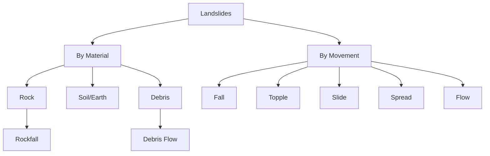
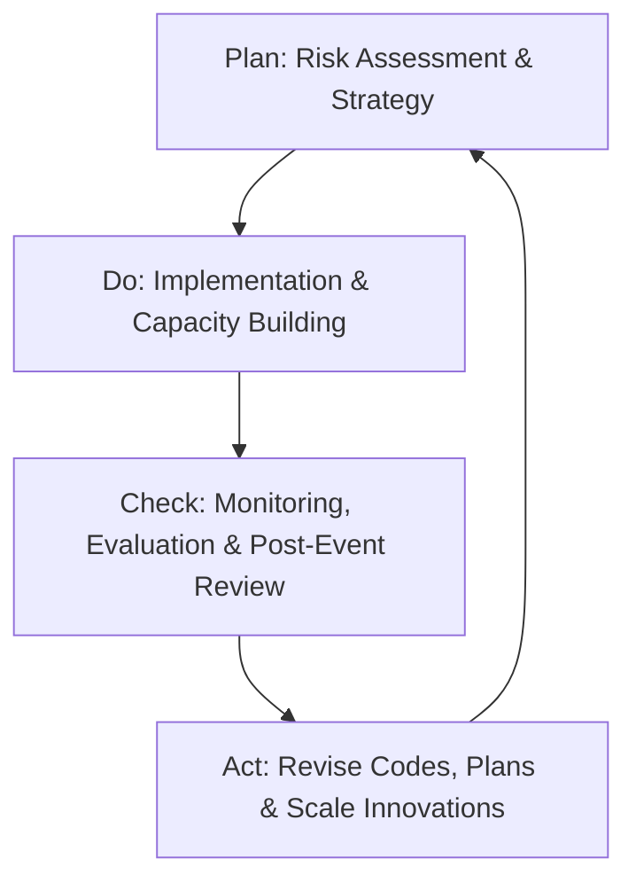

## Module  1: Introduction

**Define the terms: Hazard, Vulnerability, Risk (5 Marks, Dec 2022)**
**Define the terms disaster, hazard, vulnerability and risk (5 Marks, Dec 2025)**
**Define the terms disaster, hazard, vulnerability and risk (5 Marks, May 2025)**

**Disaster**
A **disaster** is a serious disruption of the functioning of a community or society, causing widespread human, material, economic, or environmental losses that exceed the ability of the affected community to cope using its own resources. It results from the combination of a hazard, exposure, and vulnerability, and requires external assistance for recovery.

**Hazard**
A **hazard** is a potentially damaging physical event, phenomenon, or human activity that may cause loss of life, injury, property damage, social and economic disruption, or environmental degradation. A hazard is a **potential threat** — it exists independently of whether people are exposed to it (e.g., an earthquake fault line, a cyclone-prone coastline, a chemical plant).

**Vulnerability**
**Vulnerability** is the condition determined by physical, social, economic, and environmental factors that increases the susceptibility of a community or asset to the damaging effects of a hazard. It represents the **degree to which a system is likely to be harmed** — e.g., poorly built houses in an earthquake zone, or dense settlements on a floodplain.

**Risk**
**Risk** is the **probability of harmful consequences** (loss of life, injury, damage to property, livelihood, or environment) resulting from interactions between hazards and vulnerable conditions. It is commonly expressed as:

$$
\text{Risk} = \text{Hazard} \times \text{Vulnerability}
$$

---

**Discuss the Direct and indirect effects of disasters (5 Marks, Dec 2022)**
**Analyze the enduring impacts of disasters on affected communities, infrastructure, and socio-economic systems (5 Marks, May 2024)**
**Human repercussions of natural calamities (5 Marks, Dec 2024)**
**Evaluate the impact of disasters on infrastructure and their hindrance to developmental projects (5 Marks, Dec 2024)**

Disaster impacts are broadly classified into **direct effects** — immediate, visible damage occurring at the time of the event — and **indirect effects**, the longer-term consequences that unfold through disrupted systems, economies, and social structures.

**Direct Effects**
- **Loss of life and injury**: Immediate casualties from the hazard itself (collapse, flooding, fire, blast).
- **Physical damage**: Destruction of houses, schools, hospitals, roads, bridges, power lines, and communication networks.
- **Displacement**: Sudden homelessness and mass evacuation of affected populations.
- **Damage to assets and livelihood stock**: Loss of crops, livestock, shops, factories, and household belongings.

**Indirect Effects**
- **Economic disruption**: Loss of employment, business closure, market failure, and reduced production.
- **Health consequences**: Disease outbreaks, malnutrition, mental trauma, and interrupted medical care.
- **Social consequences**: Family separation, increased vulnerability of women, children, and the elderly, rise in crime and exploitation.
- **Administrative strain**: Diversion of public funds from development to relief and reconstruction.

**Enduring Impacts on Communities, Infrastructure and Socio-Economic Systems**
- **Communities**: Long-term displacement, loss of social networks, psychological trauma, erosion of traditional livelihoods, and deepening poverty.
- **Infrastructure**: Permanent damage to transport, power, water, and communication links; repeated failures delay repair and reduce service quality for years.
- **Socio-economic systems**: Reduced GDP, fiscal burden of reconstruction, loss of investor confidence, widening inequality, and setback to education and health outcomes.

**Human Repercussions of Natural Calamities**
- **Mortality and morbidity**: Death, injury, and post-disaster epidemics.
- **Displacement and migration**: Loss of shelter, forced relocation, and pressure on host areas.
- **Psychological impact**: Post-traumatic stress, grief, anxiety, and depression.
- **Vulnerability amplification**: Women, children, the disabled, and the poor suffer disproportionately.
- **Livelihood loss**: Destruction of agriculture, fishing, and informal employment.

**Impact on Infrastructure and Hindrance to Developmental Projects**
- **Transport networks**: Damaged roads and bridges cut off access, delay supply chains, and raise construction costs.
- **Utilities**: Failure of power, water, and sanitation sets back industrial and urban development.
- **Public facilities**: Destroyed schools and hospitals divert development budgets to reconstruction.
- **Project delays and cost overruns**: Ongoing development projects are suspended, redesigned, or abandoned; funds are reallocated to relief.
- **Reduced investment**: Repeated disaster risk discourages private investment and slows regional growth.
- **Setback to SDGs**: Infrastructure loss reverses progress on poverty, health, education, and sustainable development goals.

---

**What is Disaster Scenario of India? (5 Marks, Dec 2022)**

India's disaster scenario is characterized by **high multi-hazard vulnerability** due to its unique geo-climatic conditions. Nearly **80% of India's geographical area** is considered at risk to one or more types of natural disaster, making it one of the most disaster-prone countries in the world .

**Hazard-wise Vulnerability Profile:**

| Hazard | Extent of Vulnerability |
| :--- | :--- |
| **Earthquakes** | ~**59%** of India's landmass is prone to earthquakes of moderate to very high intensity (Seismic Zones III–V)  |
| **Floods** | Over **40 million hectares** (mha) of land is flood-prone; floods are the most recurrent disaster, affecting the Indo-Gangetic-Brahmaputra plains annually  |
| **Drought** | ~**68%** of the total area is vulnerable to periodic drought (arid, semi-arid, and sub-humid regions)  |
| **Cyclones** | ~**8%** of the land (mainly the ~7,500 km coastline) is cyclone-prone, with the east coast more severely affected than the west  |
| **Landslides/Avalanches** | Entire Sub-Himalayan region, Western Ghats, and parts of the Himalaya (Kashmir, Himachal, Sikkim) are vulnerable  |

**Recent Disaster Impact (2020–21 to 2025–26):**
- Hydro-meteorological disasters alone killed **13,384 people**, damaged **28.7 lakh houses**, and affected **587.8 lakh hectares** of cropped area .
- Major events include the **2013 Kedarnath floods**, **2001 Bhuj earthquake** (~20,000 deaths), **1999 Odisha Super Cyclone** (~20,000 deaths), and recurring annual floods in Bihar, Assam, and other states .

**Key Institutional Response:**
The **Disaster Management Act, 2005** established a structured framework with **NDMA** (policy), **NDRF** (specialized response force), and **SDMAs/DDMAs** (state/district level implementation) . However, challenges persist — only ~**5%** of disaster damages are covered by insurance, and relief fund disbursement often falls far short of state requests (e.g., less than 5% of requested NDRF funds released in 2024–25) .

---

**What is Climate Change? What are the effects of Global Warming? (5 Marks, Dec 2022)**
**Explain global warming and climate change. (5 Marks, Dec 2023)**
**Discuss Climate change, focusing on its underlying causes, ecological repercussions, and implications for disaster risk management. (5 Marks, May 2024)**
**Explain how global warming affects the water cycle and its various components. (5 Marks, May 2025)**

**Climate Change** refers to long-term shifts in temperatures and weather patterns, primarily driven by human activities since the industrial era. **Global Warming** is the sustained rise in Earth's average surface temperature caused by the accumulation of greenhouse gases (GHGs) that trap heat in the atmosphere. Global warming is thus the principal driver of present-day climate change.

**Underlying Causes**
- **Burning of fossil fuels**: Coal, oil, and gas release CO₂ — the largest single contributor.
- **Deforestation**: Loss of carbon sinks and release of stored carbon.
- **Industrial and agricultural emissions**: Methane from livestock and paddy fields, nitrous oxide from fertilisers, and fluorinated gases.
- **Urbanisation and transport**: Vehicle exhaust and heat-island effects.
- **Natural reinforcement**: Feedback loops such as melting ice lowering albedo and thawing permafrost releasing methane.

**Effects of Global Warming**
- **Rising temperatures**: Heatwaves of greater frequency and intensity.
- **Melting ice and rising seas**: Glacial retreat, polar ice loss, and coastal inundation.
- **Extreme weather**: More intense cyclones, floods, droughts, and wildfires.
- **Ecosystem stress**: Coral bleaching, species migration, biodiversity loss.
- **Agriculture and food security**: Altered growing seasons, crop failure, and water scarcity.
- **Human health**: Heat stress, vector-borne disease spread, and air-quality decline.

**Ecological Repercussions**
- **Ecosystem shift**: Forests, grasslands, and wetlands change composition or collapse.
- **Loss of biodiversity**: Species unable to migrate fast enough face extinction.
- **Ocean acidification**: CO₂ absorption lowers pH, damaging marine life and fisheries.
- **Phenological mismatch**: Pollinators and prey cycles fall out of sync with predators.
- **Soil degradation and desertification**: Reduced fertility and expanded arid zones.

**Implications for Disaster Risk Management**
- **Increased hazard frequency and intensity**: Higher exposure to hydro-meteorological disasters.
- **Shift in risk patterns**: New areas become flood- or drought-prone.
- **Compounded and cascading risks**: Floods followed by disease outbreaks, heatwaves aggravating wildfires.
- **Need for climate-informed DRR**: Risk assessment, early warning systems, resilient infrastructure, and land-use planning must incorporate climate projections.
- **Adaptation and mitigation integration**: Mainstreaming climate action into disaster preparedness, response, and recovery.

**Effect of Global Warming on the Water Cycle and Its Components**

Global warming accelerates the water cycle — warmer air holds more moisture (~7% more per °C), making wet regions wetter and dry regions drier.

| Component | Effect of Global Warming |
| :--- | :--- |
| **Evaporation** | Increases due to higher temperatures, drawing more moisture from oceans and land. |
| **Precipitation** | More intense and erratic rainfall; dry areas receive less, wet areas more. |
| **Condensation and Clouds** | Increased moisture alters cloud formation and lifetime, affecting radiative balance. |
| **Runoff** | Higher but more variable runoff; flash floods in some regions, reduced flow in others. |
| **Groundwater** | Recharge declines due to reduced infiltration and prolonged droughts; over-extraction worsens depletion. |
| **Snow and Ice** | Faster melting reduces seasonal snowpack, shifting streamflow timing and shrinking glacier-fed rivers. |
| **Soil moisture** | Drops in arid regions, increasing drought severity and desertification. |

---

**Justify the significance of studying Disaster Management, highlighting its role in enhancing resilience, minimizing risks, and promoting sustainable development (5 Marks, May 2024)**
**Justify the significance of studying Disaster Management, highlighting its role in enhancing resilience, minimizing risks, and promoting sustainable development. (5 Marks, May 2024)**

**Disaster Management (DM)** is the systematic process of planning, organising, coordinating, and implementing measures to reduce disaster risk, prepare for, respond to, and recover from disasters. Studying it is significant because disasters are increasing in frequency and intensity due to climate change, urbanisation, and environmental degradation — and their impacts fall disproportionately on vulnerable populations.

**Role in Enhancing Resilience**
- **Anticipation over reaction**: Builds capacity to foresee hazards and absorb shocks rather than merely reacting after the event.
- **Community preparedness**: Training, awareness, and drills enable communities to respond effectively and recover faster.
- **Resilient infrastructure**: Encourages hazard-resistant design, land-use planning, and retrofitting of critical facilities.
- **Institutional readiness**: Develops early warning systems, emergency plans, and trained response forces.

**Role in Minimizing Risks**
- **Hazard identification and vulnerability assessment**: Systematic mapping of risks enables targeted mitigation.
- **Prevention and mitigation**: Structural measures (embankments, flood walls) and non-structural measures (zoning, building codes, insurance).
- **Reduction of losses**: Lowers casualties, property damage, and economic disruption.
- **Resource efficiency**: Pre-disaster investment is far cheaper than post-disaster relief and reconstruction.

**Role in Promoting Sustainable Development**
- **Protects development gains**: Prevents destruction of infrastructure, livelihoods, and investments that reverse years of progress.
- **Integrates DRR into planning**: Ensures development projects are risk-informed and climate-sensitive.
- **Poverty reduction**: Reduces disaster-induced impoverishment, especially among marginalised groups.
- **Achievement of SDGs**: Directly supports SDG 11 (sustainable cities), SDG 13 (climate action), and SDG 1 (no poverty).
- **Environmental sustainability**: Promotes ecosystem-based approaches such as mangrove restoration and watershed management.

---

**Explain the concept of Capacity building along with suitable example (5 Marks, Dec 2025)**
**Explain the concept of Capacity building along with suitable example (5 Marks, May 2025)**

**Explain the concept of Capacity building along with suitable example. (5 Marks, Dec 2025)**

**Capacity building** is the process of developing and strengthening the skills, institutions, systems, and resources that individuals, communities, and organisations need to anticipate, prepare for, respond to, and recover from disasters. It is a continuous, long-term investment that transforms existing strengths into sustained capability rather than one-time relief.

**Components of Capacity Building**
- **Human resource development**: Training, education, and skill enhancement of officials, volunteers, and communities.
- **Institutional strengthening**: Building robust organisations, policies, and coordination mechanisms.
- **Infrastructure and technological capacity**: Early warning systems, communication networks, and emergency operations centres.
- **Community capacity**: Awareness, local knowledge, self-help groups, and participatory preparedness.
- **Financial capacity**: Dedicated funds, insurance, and resource mobilisation for disaster risk reduction.

**Role in Disaster Management**
- **Prevention and mitigation**: Enables risk assessment, land-use planning, and hazard-resistant construction.
- **Preparedness**: Supports drills, mock exercises, and early warning dissemination.
- **Response**: Ensures trained personnel, equipped teams, and coordinated action.
- **Recovery**: Builds capability to restore livelihoods and infrastructure efficiently.
- **Resilience**: Strengthens the ability to "bounce back better" after a disaster.

**Example: National Disaster Management Authority (NDMA) Capacity Building Initiatives in India**
- **Training programmes**: NDMA conducts training for state and district officials through NIDM (National Institute of Disaster Management).
- **Community-based preparedness**: Formation of Village Disaster Management Committees, training of volunteers, and mock drills in flood- and cyclone-prone districts (e.g., Odisha's cyclone preparedness model).
- **Early warning systems**: Capacity building of coastal communities through the Indian Tsunami Early Warning Centre, enabling timely evacuation.
- **Outcome**: Odisha's improved cyclone preparedness (e.g., during Cyclone Phailin, 2013) resulted in large-scale evacuation and minimal loss of life — a direct demonstration of capacity building in action.

---

**Evolving approaches to disaster management in India (5 Marks, Dec 2024)**

**Evolving Approaches to Disaster Management in India**

Disaster management in India has evolved from a relief-oriented approach to a comprehensive approach focusing on prevention, mitigation, preparedness, response and recovery.

**1. Traditional Relief Approach:**
- Earlier, disaster management mainly focused on providing food, shelter, medical aid and financial assistance after disasters.
- Less importance was given to prevention and preparedness.

**2. Shift Towards Preparedness and Mitigation:**
- Emphasis shifted towards reducing disaster risks before they occur.
- Development of early warning systems, evacuation plans and disaster-resistant infrastructure.

**3. Institutional Development:**
- Disaster Management Act, 2005 was introduced.
- NDMA, SDMAs and DDMAs were established to coordinate disaster management activities.

**4. Technology-Based Approach:**
- Use of satellites, GIS, remote sensing and weather forecasting.
- Mobile alerts and early warning systems help provide timely information.

**5. Community-Based Approach:**
- Encourages participation of local communities, NGOs and Panchayats.
- Promotes awareness, training, mock drills and local disaster preparedness.

**6. Sustainable and Resilient Development:**
- Focus on climate change adaptation, environmental protection and disaster-resistant construction.
- Promotes the Sendai Framework for Disaster Risk Reduction (2015–2030).

---

///
## Module  2: Natural and Manmade Disasters

**Explain types of Manmade disasters (5 Marks, Dec 2022)**
**Provide an overview of various types of Manmade disasters, elucidating their causes, characteristics, and impacts (5 Marks, May 2024)**
**Explain natural and manmade disasters. Which disasters can be mitigated and how? (10 Marks, May 2025)**

**Manmade disasters** (also called anthropogenic or technological disasters) are events caused entirely or primarily by human acts of omission or commission—including negligence, error, intent, or systemic failure—rather than by natural processes . Unlike natural disasters, they are largely **avoidable and preventable** through legislation, regulation, and safety culture .

**Types of Manmade Disasters**

| Type | Causes | Characteristics | Impacts |
| :--- | :--- | :--- | :--- |
| **Industrial/Technological** | Chemical leaks, explosions, radiation releases, structural failures | Often sudden, cascading, and cross-border; linked to system breakdown or human error | Mass casualties, long-term health effects, environmental contamination, economic loss |
| **Transportation** | Rail derailments, aviation crashes, maritime collisions, road accidents | High-velocity, localized but severe; often due to mechanical failure or human error | Fatalities, injuries, infrastructure damage, service disruption |
| **Civil Disorders/Terrorism** | Intentional violence, riots, cyberattacks, mass unrest | Deliberate, unpredictable, targets populations or critical systems | Loss of life, psychological trauma, infrastructure destruction, social destabilization |
| **Warfare/Conflict** | Armed conflict, displacement, destruction of infrastructure | Protracted, widespread, and compounding with other hazards | Civilian casualties, mass displacement, environmental degradation, economic collapse |
| **Engineering Failures** | Dam breaches, building collapses, bridge failures | Structural failure due to design, material, or maintenance defects | Sudden mass casualty events, long-term liability, loss of public trust |
| **Environmental Pollution** | Oil spills, toxic waste dumping, air/water contamination | Slow-onset or acute; transboundary and cumulative | Ecosystem destruction, health crises, livelihood loss (e.g., fishing, agriculture) |

**Examples:**
- **Bhopal Gas Tragedy (1984, India):** Methyl isocyanate leak from a pesticide plant killed thousands and caused lasting health and environmental damage .
- **Chernobyl Nuclear Disaster (1986, USSR):** Reactor meltdown released radioactive material across Europe, causing acute radiation deaths and long-term health risks .
- **Bikaner-Guwahati Express Derailment (2022, India):** Track or mechanical failure caused casualties and disrupted rail services .

**Natural vs. Manmade Disasters**

| Aspect | Natural Disasters | Manmade Disasters |
| :--- | :--- | :--- |
| **Origin** | Geological, meteorological, hydrological, or biological processes | Human intent, negligence, error, or technological failure  |
| **Predictability** | Often predictable to some degree (seasonal, geological monitoring) | Frequently sudden with little to no warning  |
| **Preventability** | Cannot be prevented, but impacts can be mitigated | Largely preventable through regulation and safety measures  |
| **Examples** | Earthquakes, floods, cyclones, droughts, pandemics | Industrial accidents, transport crashes, terrorism, chemical spills |

**Which Disasters Can Be Mitigated and How?**

Both natural and manmade disasters can be mitigated, though the strategies differ.

**Mitigation of Natural Disasters**
- **Structural measures:** Embankments, flood walls, earthquake-resistant construction, slope stabilization, reservoirs .
- **Non-structural measures:** Land-use zoning, early warning systems, building codes, insurance, public education .
- **Environmental measures:** Mangrove restoration, afforestation, watershed management to buffer hazards .

**Mitigation of Manmade Disasters**
- **Regulatory and legislative controls:** Strict safety standards for industrial facilities, transport safety regulations, and enforcement mechanisms .
- **Early warning and monitoring systems:** Multi-hazard early warning for industrial accidents, chemical release detection, and cross-border notification systems .
- **Risk-sensitive planning:** Industrial land-use planning, separation of hazardous facilities from populated areas, and resilience of critical infrastructure (power, water, emergency centres) .
- **Training and preparedness:** Targeted training for emergency responders, periodic drills, and community awareness programmes .
- **International cooperation:** Sharing lessons learned (e.g., UNECE Industrial Accidents Convention), transboundary notification systems, and technical assistance for developing countries .

---

**Environmental hazard (5 Marks, Dec 2023)**

An **environmental hazard** is a natural or human-induced phenomenon, substance, or condition in the environment that poses a threat to human life, health, property, livelihoods, or ecosystems. It is the potential source of harm — it becomes a disaster only when it interacts with a vulnerable population or exposed assets.

**Types of Environmental Hazards**

| Type | Examples | Nature of Threat |
| :--- | :--- | :--- |
| **Natural hazards** | Earthquakes, floods, cyclones, droughts, landslides, volcanic eruptions | Geological, meteorological, hydrological, and biological processes |
| **Technological/chemical hazards** | Industrial chemical leaks, oil spills, nuclear radiation, toxic waste | Release of harmful substances into air, water, or soil |
| **Biological hazards** | Epidemics, pandemics, pest infestations, zoonotic diseases | Pathogens or biological agents affecting health and food security |
| **Environmental degradation hazards** | Deforestation, desertification, soil erosion, air and water pollution, climate change | Slow-onset, cumulative deterioration of environmental quality |

**Characteristics**
- **Potential harm:** Exists as a threat even before an event occurs; risk = hazard × vulnerability × exposure.
- **Spatial and temporal variability:** Some are sudden-onset (earthquakes, chemical spills), others slow-onset (drought, pollution, desertification).
- **Cascading effects:** One hazard can trigger others (e.g., earthquake → landslide → dam breach; flood → epidemic).
- **Anthropogenic amplification:** Human activities such as urbanisation, deforestation, and industrialisation increase both frequency and severity.
- **Disproportionate impact:** Poor and marginalised communities are usually more exposed and less able to cope.

**Impacts**
- **Human:** Death, injury, disease, displacement, and psychological trauma.
- **Economic:** Damage to infrastructure, loss of livelihoods, and reduced productivity.
- **Environmental:** Ecosystem destruction, biodiversity loss, and resource depletion.
- **Social:** Breakdown of community structures, migration, and increased inequality.

---

**What are different types of flood? Enlist structural mitigation measures for flood (10 Marks, Dec 2022)**
**Explain disaster management for floods in urban areas (5 Marks, May 2025)**
**Urban flooding: Implications for major cities (5 Marks, Dec 2024)**
**Mention the probable reasons of flash floods occurring in Northern parts of the country (5 Marks, Dec 2025)**

**Types of Floods**

Floods are classified by their causative mechanism and temporal characteristics:

| Type | Causative Mechanism | Key Characteristics |
| :--- | :--- | :--- |
| **Riverine (Fluvial) Flood** | Prolonged or intense rainfall over a large catchment; river exceeds bank-full capacity | Slow onset, extended duration, wide areal extent; often compounded by antecedent soil moisture saturation  |
| **Flash Flood** | Sudden, intense rainfall over a small catchment; dam/levee breach | Short duration (typically <6 hours between causative event and flood), high peak discharge, little warning time  |
| **Coastal Flood** | Storm surge, high tides, cyclones, sea-level rise | Saline inundation, wave damage, often coincident with high tide  |
| **Pluvial (Urban) Flood** | Rainfall intensity exceeds drainage/stormwater capacity in built-up areas | Rapid onset in urban areas, surcharged sewers, impermeable surfaces amplify runoff  |
| **Glacial Lake Outburst Flood (GLOF)** | Failure of moraine/ice dam holding a glacial lake | High-magnitude, destructive debris flow; difficult to predict; linked to glacial retreat  |

**Structural Mitigation Measures for Floods**

Structural measures are engineered physical interventions that modify flood behaviour:

- **Embankments/Levees:** Earthen or masonry embankments that confine the river within its channel and prevent overtopping of adjacent land .
- **Dams and Reservoirs:** Store floodwater and attenuate peak flows downstream; effectiveness depends on available storage capacity and spillway design .
- **Channel Improvements:** Widening, deepening, or realigning channels to increase conveyance capacity; may include de-silting and dredging .
- **Diversion Channels/Floodways:** Artificial channels that divert excess floodwater away from vulnerable areas (e.g., flood spill channel for Srinagar) .
- **Sea Walls/Coastal Protection Works:** Prevent seawater inundation during storm surges and high tides .
- **Drainage Improvement:** Construction or upgrading of stormwater drainage networks in urban areas .
- **Catchment Area Treatment:** Afforestation and soil conservation measures to reduce runoff velocity and siltation .

**Disaster Management for Floods in Urban Areas**

Urban flooding differs fundamentally from rural flooding: urbanisation increases flood peaks by **1.8 to 8 times** and flood volumes by up to **6 times**, with flow times measured in minutes rather than hours . Management requires a distinct approach:

- **Risk Assessment and Hazard Mapping:** Identify flood-prone zones using GIS-based hazard maps and vulnerability analysis .
- **Early Warning Systems:** Real-time rainfall and water-level monitoring with public alert dissemination .
- **Drainage Infrastructure Upgradation:** Remodeling culverts, expanding stormwater networks, constructing box drains, and desilting existing drains .
- **Nature-Based Solutions:** Permeable pavements ("sponge zones"), lake rejuvenation, rainwater harvesting pits, and afforestation to reduce surface runoff .
- **Encroachment Removal:** Clear natural streams and watercourses of illegal construction; protect floodplains from development .
- **Institutional Framework:** NDMA National Guidelines on Urban Flooding (2010), Urban Flood Risk Management Programme under NDMF for seven major cities (Mumbai, Chennai, Kolkata, Bengaluru, Hyderabad, Ahmedabad, Pune) .
- **Capacity Building:** Training of municipal administration, community awareness campaigns, and flood response drills .

**Urban Flooding: Implications for Major Cities**

Urban floods have severe and cascading consequences for metropolitan areas:

- **Loss of Life and Injury:** Mumbai (2005) recorded over 1,000 deaths from a single cloudburst (944 mm in 24 hours) .
- **Economic Devastation:** Hyderabad (2020) caused damages exceeding ₹5,000 crore; Bengaluru (2022) submerged IT hubs, disrupting the technology sector .
- **Infrastructure Paralysis:** Transport networks, power supply, and communication systems are disrupted for hours to days; vital infrastructure damage has state, national, and even global implications .
- **Public Health Crises:** Post-flood exposure to infection, contaminated water, and vector breeding lead to epidemic risk .
- **Displacement and Livelihood Loss:** Temporary relocation of affected populations; informal sector workers lose daily wages.
- **Recurrent Pattern:** Delhi, Mumbai, Chennai, Bangalore, Hyderabad, Bhopal, Patna, Guwahati, and Jaipur have all experienced repeated urban flooding since 2000 .

**Probable Reasons for Flash Floods in Northern India**

Flash floods in northern India result from a combination of meteorological, topographic, and anthropogenic factors:

- **Intense Cloudbursts:** Extremely high rainfall in short durations (e.g., Himalayan cloudburst events) overwhelm natural drainage .
- **Glacial Lake Outburst Floods (GLOFs):** Rising temperatures accelerate glacial melt, enlarging moraine-dammed lakes that can breach suddenly in the Hindukush-Himalaya-Karakoram region .
- **Steep Topography and Narrow Valleys:** High-gradient catchments produce rapid runoff concentration with minimal lag time .
- **Deforestation and Land Degradation:** Loss of vegetation cover reduces infiltration and increases surface runoff velocity.
- **Encroachment on Floodplains and Riverbeds:** Unplanned construction in hazard-prone zones increases exposure and reduces natural channel capacity.
- **Inadequate Early Warning:** Flash floods allow less than 6 hours between the causative rainfall and peak flow, limiting evacuation time .
- **Climate Change Amplification:** Changing precipitation patterns produce more frequent high-intensity, short-duration rainfall events .

---

**Discuss the preventive measures for: i) Landslides ii) Urban floods (10 Marks, Dec 2025)**

**i) Preventive Measures for Landslides**

Landslide prevention operates across two levels: **engineering control of slope stability** and **non-structural risk management** through planning, monitoring, and community preparedness.

**Engineering and Structural Measures**
- **Slope strengthening**: Use of soil nails, retaining walls, and stabilizing piles to reinforce vulnerable slopes and prevent failure .
- **Drainage improvement**: Enhancement of slope surface drainage and subsurface drainage systems to reduce pore-water pressure and water infiltration, which are primary triggers of rainfall-induced landslides .
- **Debris flow barriers**: Construction of flexible and rigid barriers to contain debris and minimize impact on downstream facilities and settlements .
- **Ground cover and revegetation**: Planting vegetation on slopes to bind soil and reduce erosion; hydroseeding techniques can revegetate landslide scars on natural hillsides .

**Non-Structural and Planning Measures**
- **Land-use regulation**: Avoid building on known landslide zones, steep slopes, and areas with prior landslide history; enforce setbacks from slope tops and bases .
- **Early warning systems**: Operate rainfall-based landslip warning systems that correlate rainfall intensity with landslide frequency to issue timely public alerts .
- **Monitoring and inspection**: Regular inspection of slopes, retaining walls, and drainage channels; observe warning signs such as new cracks, tilting trees or fences, and bulging ground at slope bases .
- **Community preparedness and education**: Public awareness campaigns on landslide warning signs, evacuation procedures, and self-protection measures; conduct drills and training for emergency responders .

**ii) Preventive Measures for Urban Floods**

Urban flood prevention combines **drainage infrastructure upgrades**, **nature-based solutions**, and **institutional preparedness** to reduce runoff and enhance city resilience.

**Structural and Infrastructure Measures**
- **Stormwater drainage improvement**: Construction, widening, and remodeling of drains, culverts, and box drains; desilting and maintenance of existing drainage networks to ensure full conveyance capacity .
- **Pumping stations and detention facilities**: Installation of pumping stations in critical flooding zones; construction of detention ponds and retention tanks at vulnerable locations to store excess runoff temporarily .
- **Sewerage integration**: Upgrading sewer and septage management systems to facilitate stormwater evacuation and prevent backflow .

**Nature-Based Solutions**
- **Green spaces and permeable surfaces**: Development of parks, green spaces, and permeable pavements to increase infiltration and reduce surface runoff; under AMRUT, over 5,000 acres of permeable green space have been developed .
- **Water body rejuvenation**: Restoration and desilting of lakes, ponds, and urban water bodies to enhance natural storage capacity; AMRUT 2.0 supports nearly 3,000 water body rejuvenation projects .
- **Rainwater harvesting**: Integration of rainwater harvesting pits and parks with stormwater systems to capture and infiltrate rainfall at source .

**Planning and Institutional Measures**
- **Flood risk mapping**: GIS-based hazard mapping to identify flood-prone zones and inform land-use decisions and infrastructure priorities .
- **Early warning systems**: Real-time rainfall and water-level monitoring with public alert dissemination; integrated command and control centers for flood response .
- **Pre-monsoon preparedness**: Ward-level action plans, drain inspection and desilting before monsoon, mock drills for emergency pumping, and 24×7 control rooms .
- **Programmatic interventions**: Urban Flood Risk Management Programme (UFRMP) under NDMF targeting major cities (Mumbai, Chennai, Kolkata, Bengaluru, Hyderabad, Ahmedabad, Pune in Phase I; expansion to Tier-II cities in Phase II) for coordinated structural and non-structural mitigation .

---

**Explain the types of landslide and factors affecting them. Give a case study for the same (10 Marks, Dec 2022)**
**Define liquefaction and debate the merits of retrofitting versus relocation in landslide-prone areas (5 Marks, Dec 2024)**

**Types of Landslides and Factors Affecting Them**

Landslides are classified by the **type of material** (rock, soil, debris) and the **type of movement** (fall, topple, slide, spread, flow) . The main types are:

- **Rockfall**: Detachment of rock fragments falling freely from a steep slope.
- **Topple**: Forward rotation of rock or soil mass about a pivot point.
- **Slide (Rotational/Translational)**: Downslope movement of material along a curved (rotational) or planar (translational) rupture surface .
- **Spread**: Lateral extension of cohesive soil or rock mass, often due to liquefaction or plastic flow of underlying material.
- **Debris Flow**: Rapid downslope flow of saturated, poorly sorted debris (soil, rock, water) behaving like a viscous fluid .
- **Complex Failure**: Combination of two or more movement types (e.g., rock slide transforming into debris flow) .

**Factors Affecting Landslides**

| Category | Factors |
| :--- | :--- |
| **Geological** | Weak/sheared rock, structural discontinuities (joints, faults), weathered material, thick soil mantle  |
| **Hydrological** | Intense or prolonged rainfall, snowmelt, water saturation reducing soil strength and increasing pore pressure  |
| **Seismic** | Earthquake shaking (magnitude ≥ 4.0 can trigger landslides)  |
| **Topographic** | Steep slopes, high relief, erosion at slope base by rivers or waves  |
| **Human Activity** | Deforestation, slope cutting for construction, mining, stockpiling of rock/ore, unplanned urbanisation  |
| **Volcanic** | Loose ash deposits becoming debris flows (lahars) during rain  |

**Case Study: Wayanad Landslide, Kerala (30 July 2024)**

On the morning of 30 July 2024, a catastrophic landslide struck Wayanad in the ecologically sensitive Western Ghats, claiming over 260 lives . A pre-existing crack formed in 2020 acted as the initiation point. The underlying weathered and sheared geology, structural discontinuities, and thick soil strata (>30 m), combined with intense rainfall on 29–30 July, caused a planar slide to transition into a catastrophic debris flow . Numerical simulations indicate the debris flow initiated around 01:00 h, peaked at 04:00 h, and reached a maximum velocity of 28 m/s. The displaced material volume was estimated at 5.17–5.72 × 10⁶ m³, ranking among India's largest debris flows. Run-up height reached 32 m in the transitional zone, amplified by multiple damming effects and topographic features, causing extensive downstream infrastructure damage .

**Liquefaction and the Debate: Retrofitting versus Relocation in Landslide-Prone Areas**

**Liquefaction** occurs in saturated, loose, cohesionless soils (typically sands and silts) when earthquake shaking causes pore water pressure to increase to the point where soil particles lose contact and the soil behaves like a liquid . The soil loses shear strength and can flow, causing ground settlement, lateral spreading, sinking of heavy structures, and floating of light buried structures .

**Retrofitting versus Relocation: Merits Compared**

| Aspect | Retrofitting | Relocation |
| :--- | :--- | :--- |
| **Definition** | Strengthening existing structures (foundations, retaining walls, slope stabilisation) to resist landslide/liquefaction effects | Permanent movement of communities away from high-risk zones |
| **Merits** | Preserves social networks, livelihoods, and cultural ties; lower social disruption; cost-effective for individual structures; enables continued use of existing infrastructure  | Eliminates exposure permanently; no recurring mitigation costs; suitable for extreme, unmitigable risk zones |
| **Demerits** | May be technically infeasible or prohibitively expensive for large areas; residual risk remains; requires maintenance; slope stabilisation beyond individual owner capacity in hilly areas  | High social cost: loss of livelihoods, social networks, and cultural attachment; resistance and non-compliance; resettlement sites may lack services; often fails without community participation  |
| **When Preferred** | Moderate risk zones; where structures can be economically strengthened; where community ties are strong | Extreme risk zones where engineering mitigation is infeasible or cost-prohibitive; after repeated destructive events |

---

**What are droughts? State the mitigation measures taken in drought prone areas (10 Marks, May 2025)**
**Classify different types of droughts and outline structural mitigation measures suitable for drought-prone regions (10 Marks, May 2024)**

**Drought** is a prolonged period of deficient precipitation relative to the normal average for a region, resulting in water shortage sufficient to affect human activities, agriculture, and ecosystems. Unlike other natural hazards, drought is a slow-onset, cumulative phenomenon whose severity depends on both the magnitude of precipitation deficit and its duration.

**Classification of Droughts**

Droughts are conventionally classified into four interrelated types, moving from a meteorological deficiency to its progressively wider impacts:

| Type | Definition | Key Indicator |
| :--- | :--- | :--- |
| **Meteorological Drought** | Persistent deficit in precipitation compared to the long-term average for a region | Rainfall departure from normal |
| **Agricultural Drought** | Sustained decline in soil moisture leading to crop water stress and reduced yields | Soil moisture, crop failure |
| **Hydrological Drought** | Persistently low streamflow, reservoir levels, and groundwater tables | Streamflow, groundwater levels |
| **Socio-Economic Drought** | Water demand exceeds supply due to weather-related shortfall, affecting economic goods | Supply-demand imbalance |

Meteorological drought is the foundational driver; if prolonged, it propagates into agricultural and hydrological drought, eventually producing socio-economic impacts.

**Structural Mitigation Measures for Drought-Prone Regions**

Structural measures physically modify water availability and storage to buffer against deficit periods.

**1. Irrigation Infrastructure Development**
- **Major and Medium Irrigation Projects**: Under PMKSY-AIBP, projects with more than 50% command in drought-prone areas receive relaxed eligibility criteria and an enhanced 60:40 Centre-State funding ratio. Sixty-two projects benefiting drought-prone areas created an additional 16.03 lakh hectares of irrigation potential during 2016–2024.
- **Surface Minor Irrigation (SMI)**: Clusters of minor irrigation schemes under Har Khet Ko Pani (HKKP) target drought-prone regions for assured water access.

**2. Water Conservation and Harvesting Structures**
- **Check Dams and Farm Ponds**: Constructed to capture monsoon runoff and enhance local storage. Under Atal Bhujal Yojana, approximately 81,700 supply-side structures (check dams, ponds, recharge shafts/pits) were constructed or renovated across seven states.
- **Percolation Tanks and Anicuts**: Traditional and engineered structures that retard runoff and promote infiltration, reviving depleted aquifers.
- **Rooftop Rainwater Harvesting**: Decentralized capture of rainfall for domestic and supplemental irrigation use.

**3. Groundwater Recharge and Management**
- **Artificial Recharge Structures**: Recharge shafts, pits, and injection wells to augment aquifer storage. In arid Rajasthan, CGWB implements demonstrative artificial recharge projects in Jodhpur, Jaisalmer, Sikar, and Alwar.
- **Aquifer Rejuvenation**: Under the Ground Water Management and Regulation (GWMR) scheme, ₹174 crore was earmarked for artificial recharge in arid northwest India.
- **Community-Led Groundwater Management**: Atal Bhujal Yojana operates in 8,203 Gram Panchayats across 80 districts in seven water-stressed states, with Gram Panchayat-wise Water Security Plans executed through convergence of schemes.

**4. Watershed Development and Land Treatment**
- **Integrated Watershed Management**: Contour trenches, vegetative barriers, and pasture development to retain moisture and reduce erosion. In Adol Gram Panchayat, Rajasthan, 39 watershed interventions raised groundwater levels by approximately 19 meters since 2021–22.
- **Land Restoration**: Revival of traditional water structures (Havelis, check dams, natural drain widening) in Bundelkhand revived over 6,000 dry wells and brought 11,000 hectares of fallow land under cultivation.

**5. Micro-Irrigation and Efficient Conveyance**
- **Drip and Sprinkler Systems**: Promote efficient water use on-farm. Under Atal Bhujal Yojana, approximately 9 lakh hectares were brought under efficient water-use practices (drip/sprinkler, mulching, crop diversification).
- **Underground Pipelines**: Reduce conveyance losses in irrigation distribution.

---

**Comment on radiation hazards. Also discuss possibilities of chemical spills in Mumbai (10 Marks, Dec 2023)**

**Radiation hazards** arise from exposure to ionising or non-ionising radiation that can damage living tissue. **Chemical spills in Mumbai** are a credible and recurring risk due to the dense concentration of small-scale industrial units, inadequate safety enforcement, and shared drainage infrastructure, as demonstrated by a fatal 2026 incident in which effluent from an electroplating shop released toxic fumes into a public toilet.

**Radiation Hazards**

Radiation is classified into **ionising** and **non-ionising** types, with distinct hazard profiles.

**Ionising Radiation** (alpha, beta, gamma, X-rays) carries enough energy to ionise atoms and damage DNA. Health effects are categorised as deterministic (threshold-based tissue damage such as burns, cataracts, acute radiation syndrome) and stochastic (probabilistic, chiefly cancer and hereditary effects). Alpha particles pose little external risk but are highly hazardous if inhaled or ingested; gamma rays penetrate deeply and require heavy shielding. In Mumbai, baseline terrestrial radiation levels are normal, with studies reporting annual effective doses in the range of 15.8–38.1 μSv from natural sources—insignificant from a public health standpoint. Elevated readings near the BARC coastal zone are attributable to controlled, authorised discharges from nuclear facilities, not a public hazard.

**Non-Ionising Radiation** (UV, infrared, microwave, radiofrequency, lasers) causes harm primarily through heating or photochemical damage. Effects include skin burns, cataracts, skin cancer (UV), and permanent eye or skin damage (lasers).

**Possibilities of Chemical Spills in Mumbai**

Mumbai presents structural conditions that make chemical spills not merely possible but probable. The city hosts thousands of small-scale chemical, pharmaceutical, and electroplating units operating in densely populated mixed-use areas, often with weak regulatory oversight and drainage systems that interconnect industrial and public infrastructure.

**Demonstrated Risk: The 2026 Electroplating Effluent Incident**
In September 2026, two youths died of suspected suffocation inside a public toilet in Ram Mandir (East), Mumbai. Investigation revealed that chemicals discharged into the drainage system from a nearby electroplating factory—identified as Sai Electroplate—had released toxic fumes that accumulated in the toilet. The Maharashtra Pollution Control Board subsequently installed continuous air quality monitoring at the site. This incident illustrates the core vulnerability: unregulated small-scale industrial effluent entering shared public drainage, creating confined-space toxic gas hazards in unexpected locations.

**Structural Vulnerabilities**
- **Density and zoning failures**: Small hazardous units operate in close proximity to residential and public facilities, violating land-use separation norms.
- **Drainage interconnection**: Industrial effluent can migrate through municipal drains into public spaces, as the 2026 case demonstrates.
- **Regulatory gaps**: Many small units operate below the threshold for major-accident hazard classification, escaping rigorous safety audits.
- **Legacy of Bhopal**: India's chemical safety framework strengthened significantly after 1984, including the Chemical Accidents (EPPR) Rules, 1996, mandating District and Local Crisis Groups. However, enforcement at the small-scale enterprise level remains the critical weakness.

**Plausible Spill Scenarios**
- **Marine/port spills**: Mumbai Port and Jawaharlal Nehru Port handle bulk liquid chemicals; loading/unloading operations carry inherent spill risk.
- **Industrial estate releases**: Clusters in Chembur, Trombay, and Thane-Belapur industrial belts host refineries and chemical plants where fires, explosions, or pipeline leaks can occur.
- **Transportation incidents**: Tanker accidents on arterial roads or rail corridors.
- **Small-unit chronic discharges**: The 2026 incident shows that even small-volume releases can be lethal when concentrated in enclosed spaces.

**Mitigation Imperatives**
- Mandatory registration and inspection of all small-scale units using hazardous chemicals.
- Separation of industrial effluent from public drainage or pre-treatment requirements before discharge.
- Continuous monitoring in high-risk mixed-use zones, as MPCB has initiated at the Ram Mandir site.
- Functional Local Crisis Groups with regular mock drills, as required under CA(EPPR) Rules.

---

**Discuss the various types of technological disasters and highlight the specific efforts to mitigate such disasters in India (10 Marks, Dec 2023)**
**Describe the common causes of Industrial and Chemical Disaster (10 Marks, Dec 2025)**
**Enumerate preparedness measures for minimizing chemical disaster losses (5 Marks, Dec 2024)**
**State the do's and don't to be followed during outbreak of fire in a chemical factory (5 Marks, Dec 2025)**

**Types of Technological Disasters**

- **Industrial accidents**: Fires, explosions, toxic chemical releases, and structural collapses occurring in manufacturing or process facilities; explosions are the most common industrial accident type in Asia.
- **Transportation accidents**: Road, rail, air, and maritime crashes involving hazardous materials or passenger vehicles; road accidents are the dominant subtype in Asia.
- **Chemical spills and toxic releases**: Uncontrolled discharge of hazardous substances into air, water, or soil from plants, pipelines, or storage tanks.
- **Nuclear/radiological accidents**: Release of radioactive material from nuclear facilities or transport incidents.
- **Infrastructure failures**: Dam breaches, bridge collapses, and building failures due to design, material, or maintenance defects.
- **Cyber-technological disasters**: Large-scale outages or attacks on critical digital infrastructure (increasingly recognized as a technological hazard domain).

**Specific Mitigation Efforts in India**

- **Chemical Accidents (EPPR) Rules, 1996**: Mandates constitution of State Crisis Groups, District Crisis Groups, and Local Crisis Groups for emergency planning, preparedness, and response at each administrative level.
- **District and Local Crisis Groups**: Required to prepare off-site and on-site emergency plans, conduct annual mock drills, and review plan effectiveness.
- **MSIHC Rules, 1989**: Governs manufacture, storage, and import of hazardous chemicals; requires on-site emergency plans for Major Accident Hazard (MAH) installations.
- **CERT-In and NCIIPC**: National agencies for cyber incident response; sector-specific CSIRTs (CSIRT-Fin, CSIRT-Power) and Cyber Crisis Management Plan (CCMP) formulated for coordinated recovery.
- **Safety audits and inspections**: Factories Inspectorate and Pollution Control Boards conduct periodic inspections; occupiers must maintain updated on-site emergency plans and conduct mock drills every six months.

**Common Causes of Industrial and Chemical Disasters**

- **Equipment malfunction**: Failure of vessels, valves, pipelines, or control systems; most accidents stem from component malfunction or minor operational negligence.
- **Human error during operation or maintenance**: Incorrect procedure, skipped safety steps, or inadequate supervision.
- **Lack of awareness of reactive hazards**: Inadvertent mixing of incompatible chemicals leading to runaway reactions (as in Bhopal).
- **Inadequate maintenance and plant design**: Poorly maintained safety systems, undersized relief valves, and out-of-service scrubbers or flare towers.
- **Ineffective employee training**: Staff unfamiliar with chemical hazards and emergency procedures, often due to staffing cuts.
- **Management of change failures**: Unreviewed modifications to process, equipment, or operating conditions that introduce new hazards.
- **Inadequate emergency preparedness**: Absence of functional on-site/off-site plans and poor community notification systems.

**Preparedness Measures for Minimizing Chemical Disaster Losses**

- **On-site Emergency Plan**: Documented procedures for accident prevention, emergency response, and recovery; must include named responsible persons and be updated with any plant modification.
- **Off-site Emergency Plan**: District-level plan prepared under MSIHC Rules covering populations outside the facility; tested through mock drills.
- **Crisis Groups at three levels**: State, District, and Local Crisis Groups to coordinate planning, response, and post-accident monitoring.
- **Mock drills**: Mandatory every six months for MAH installations; report to concerned authorities.
- **Personal Protective Equipment (PPE)**: Level A/B for HAZMAT teams entering hot zone; Level C for known concentrations; Level D only for nuisance contamination.
- **Mutual aid agreements**: Pre-established arrangements with nearby hospitals, fire services, and health facilities for coordinated resource sharing.
- **Community awareness**: Sensitize populations near industrial units about hazards, warning signals, evacuation routes, and first aid.

**Do's and Don'ts During Fire in a Chemical Factory**

| Do's                                                                        | Don'ts                                                                                    |
| :-------------------------------------------------------------------------- | :---------------------------------------------------------------------------------------- |
| Actuate nearest fire alarm and inform supervisor/Shift Incharge immediately | Do not panic or run indiscriminately                                                      |
| Evacuate perpendicular to wind direction through designated escape route    | Do not enter the site if outside when alarm sounds, unless instructed                     |
| Keep wet cloth over nose and mouth during evacuation                        | Do not consume uncovered food or water exposed to air                                     |
| Report to assembly point for headcount and await instructions               | Do not go to the scene of emergency unless specifically instructed by Incident Controller |
| Call Fire (101), Police (100), Ambulance (108) from safe location           | Do not spread or pay attention to rumours                                                 |
| Security: keep gates manned and roads clear for fire tenders                | Do not allow unauthorized visitors or vehicles to enter                                   |
| Contractors: stop work, assemble at assembly point, prepare to evacuate     | Do not re-enter site until cleared by Incident Controller                                 |

---

**Delve into the paradox of industrialization: economic progress versus the threat of industrial mishaps (5 Marks, Dec 2024)**
**Discuss the role of growing population, industrialization, urbanization, and changing lifestyles in contributing to environmental degradation. What measures can be taken to mitigate their impact? (10 Marks, May 2025)**
**In what way haphazard urbanisation contributes to increased vulnerability to disasters (10 Marks, Dec 2025)**

**The Paradox of Industrialization: Economic Progress vs. Industrial Mishaps**

Industrialization is the primary engine of economic growth—creating jobs, raising incomes, and enabling technological advancement. Yet the same industrial processes that generate wealth also concentrate hazardous materials, complex technologies, and dense populations in vulnerable configurations. This is the paradox: the pursuit of prosperity systematically manufactures the conditions for catastrophic failure.

- **Growth creates exposure**: As economies industrialize, the volume and variety of hazardous chemicals in production, storage, and transport multiply. From 1960 to 1980 alone, seagoing petrochemical tanker tonnage expanded sevenfold, and larger vessels mean larger potential spills.
- **Safety is subordinated to profit**: In weaker regulatory environments, safety measures are treated as costs to be minimized. The Bhopal plant was built with diminished safety standards partly because the local regulatory context was less demanding than in developed economies.
- **Regulatory capacity lags**: Oversight agencies often lack the infrastructure and autonomy to license and inspect hazardous installations effectively, especially where corporate influence shapes governance.
- **The consequence**: Bhopal (1984), Brumadinho (2019), and countless smaller incidents demonstrate that industrial progress without commensurate safety investment converts economic gain into latent catastrophe.

**Role of Population Growth, Industrialization, Urbanization, and Changing Lifestyles in Environmental Degradation**

- **Population growth**: Increases demand for food, water, energy, and housing, driving land conversion, resource extraction, and waste generation beyond ecosystem carrying capacity.
- **Industrialization**: Emits greenhouse gases, discharges toxic effluents, and generates hazardous waste. Industrial food systems relying on chemical fertilizers and pesticides degrade soil and water while creating new disaster vulnerabilities.
- **Urbanization**: Concentrates consumption and waste in limited areas. Impermeable surfaces amplify runoff and urban flooding; density multiplies exposure to industrial accidents and pollution.
- **Changing lifestyles**: Higher consumption patterns—private vehicles, meat-intensive diets, single-use plastics, energy-intensive appliances—multiply per-capita environmental footprint.

**Mitigation Measures**
- **Regulatory enforcement**: Strengthen pollution controls, industrial safety audits, and environmental impact assessments.
- **Sustainable urban planning**: Compact, mixed-use development with green infrastructure, public transport, and permeable surfaces.
- **Circular economy**: Reduce, reuse, recycle; extended producer responsibility for hazardous materials.
- **Clean technology transition**: Renewable energy, cleaner production processes, and pollution-abatement technology.
- **Behavioral and fiscal incentives**: Carbon pricing, subsidies for sustainable practices, and public awareness campaigns.

**Haphazard Urbanization and Increased Disaster Vulnerability**

Haphazard urbanization—rapid, unplanned, and risk-blind urban growth—systematically manufactures disaster risk by placing people and assets in harm's way while eroding their capacity to cope.

- **Housing in hazardous zones**: Poor urban planning with inadequate risk consideration leads to construction in floodplains, steep slopes, and unstable hillsides. In Freetown's 2017 landslide disaster, unregulated hillside construction and vegetation clearance turned rainfall into a lethal debris flow killing at least 500 people.
- **Fragile construction**: Low-cost buildings using frail materials and methods lack resilience to hazards; enforcement of building codes is absent or weak.
- **Overcrowding and inadequate services**: Dense informal settlements with poor access roads, drainage, and essential services amplify both physical vulnerability and post-disaster suffering.
- **Ecosystem degradation**: Hillside vegetation clearance increases erosion potential; encroachment on natural drainage blocks flood paths.
- **Weak emergency response**: Insufficient risk management capacity means early warning and evacuation systems fail when needed most.
- **Unequal risk distribution**: Haphazard urbanization disproportionately burdens already-marginalized groups—the poor, migrants, and informal workers—who settle in the most dangerous locations because safer land is unaffordable.

---

**Describe the measures that are taken to preserve the environment in and around a nuclear power plant. Comment on the effectiveness of these measures with reference to some nuclear power plant in the nearby vicinity (10 Marks, Dec 2025)**

Measures to preserve the environment around a nuclear power plant operate through a **regulatory-legal framework**, **continuous environmental surveillance**, and **site-specific management practices**. Their effectiveness is best assessed through long-term monitoring data from operating stations, with **Tarapur** providing the most robust Indian evidence.

**Regulatory and Institutional Framework**

- **AERB oversight**: The Atomic Energy Regulatory Board enforces the Atomic Energy (Radiation Protection) Rules, 2004. Environmental impact assessment is mandatory prior to establishment; a Site Evaluation Report depicting radiological impact is submitted for consent .
- **Independent surveillance**: Environment Survey Laboratories (ESLs) of BARC are stationed at each site, conducting periodic air, water, and soil monitoring. Reports are submitted to AERB for review of adequacy of protection measures .
- **ISO-14001 certification**: All Indian nuclear power stations—including Tarapur—are certified for Environment Management System, committing to compliance with environmental legislation and continual improvement .

**Operational Preservation Measures**

- **Radioactive waste management**: Liquid and gaseous radioactive discharges are treated and monitored to remain well below AERB-specified limits. At Tarapur, improved practices and modifications have minimized station discharges and maintained lower discharge water temperatures to the sea .
- **Thermal discharge control**: Once-through cooling systems are managed so that marine water temperature rise does not exceed regulatory limits (approximately 7°C above ambient) .
- **Greenbelt development**: Vegetation around plant premises attenuates noise and adsorbs particulate radionuclides .
- **Environment Stewardship Programme (ESP)**: NPCIL's voluntary initiative conducts biodiversity studies, trains local volunteers, and runs public awareness campaigns. Butterfly Gardens have been established at Tarapur, Kakrapar, and Kaiga .

**Effectiveness: Evidence from Tarapur**

The 25-year evaluation (1983–2007) of environmental radioactivity monitoring data at Tarapur provides the clearest empirical assessment :

- **No accumulation observed**: Measurements over the years indicated no accumulation of radionuclides in either terrestrial or aquatic environments.
- **Declining concentration trends**: Mean Cs-137 in soil decreased from pre-operational levels of 7.0 to 3.6 Bq/kg; in milk from 0.91 to 0.016 Bq/L; in vegetation from 0.28 to 0.036 Bq/kg. Sr-90 showed similar declines across matrices.
- **Dose insignificance**: Radionuclide concentrations and potential impacts in terms of effective dose to the public have significantly reduced since 1969.
- **Baseline comparison**: Natural background radiation at Tarapur is 2.07 mSv/year, while the maximum annual average individual dose near any Indian NPP boundary is less than 0.05 mSv/year—negligible against natural variation .

A 2025 study of tritium in terrestrial plants at Tarapur (2016–2018) found higher concentrations near the NPP, with measured values exceeding Gaussian Plume Model estimates due to model limitations and environmental variability . This highlights that while overall radiological impact remains low, site-specific parameterization is necessary for precise predictive modelling.

---

**Discuss various types of natural disasters in India and highlight their impacts on life (10 Marks, Dec 2023)**

India is one of the world's most disaster-prone countries, with nearly **80% of its geographical area** exposed to one or more natural hazards . The major disaster types and their human impacts are:

**Floods**
- **Nature**: India's most common natural disaster, caused by heavy southwest monsoon rains overflowing rivers such as the Brahmaputra and Ganges .
- **Impact on life**: On average, hundreds of lives are lost annually, millions are rendered homeless, and extensive crop damage occurs . The 2005 Mumbai floods caused approximately ₹20,000 crore in damage . In 2024 alone, flooding and related hydro-meteorological events contributed to nearly **3,000 deaths** nationwide, with **3,63,381 houses** damaged and **61,826 cattle** lost .

**Earthquakes**
- **Nature**: About **59% of India's landmass** is vulnerable to earthquakes, with the Himalayan belt, Indo-Gangetic plains, and Kutch region being the most seismically active .
- **Impact on life**: The 2001 Bhuj earthquake (magnitude 7.9) claimed **12,932 lives** and devastated 890 villages . The 1993 Latur earthquake (magnitude 6.4) killed **7,928 people** . India recorded **159 earthquakes** between November 2024 and February 2025 alone .

**Cyclones**
- **Nature**: About **8% of India's area** is cyclone-prone, primarily along the east coast (West Bengal, Odisha, Andhra Pradesh, Tamil Nadu) and Gujarat on the west coast .
- **Impact on life**: Cyclones Hudhud (2014) and Amphan (2020) caused significant fatalities . Cyclone Fengal (2024) made landfall near Puducherry, killing at least three people in Chennai and causing the highest 24-hour rainfall in Puducherry in 30 years .

**Droughts**
- **Nature**: A recurring feature affecting about **68% of India's land**, particularly in Rajasthan, Gujarat, and parts of central India .
- **Impact on life**: Approximately **50 million people** are affected annually . Drought triggers large-scale migration, loss of life through stress, suicide, starvation, and unhygienic conditions, along with increased social conflict .

**Landslides and Avalanches**
- **Nature**: Common in the Sub-Himalayan region and Western Ghats due to young, fragile rock formations; avalanches occur in Kashmir, Himachal Pradesh, and Sikkim .
- **Impact on life**: Rising population pressure and deforestation exacerbate severity, causing casualties and displacement in hill states.

**Heatwaves**
- **Nature**: Increasingly frequent and intense; the 2024 heatwave was among the deadliest on record.
- **Impact on life**: A study estimated **8,056 deaths** in Uttar Pradesh during a five-day intense heatwave in 2024, with Bihar (3,615), Madhya Pradesh (2,964), Rajasthan (2,664), and Gujarat (2,354) also severely affected . Heatwaves and storms each accounted for **33% of disaster fatalities** in India from 1995 to 2024 .

**Overall Human Toll**
Between 1995 and 2024, India recorded **over 80,000 deaths** and nearly **$170 billion in economic losses** from approximately **430 extreme weather events** . India ranked **9th** in the Climate Risk Index for this 30-year period and **15th** for 2024 alone .

---

**Identify and discuss the various hazards which are associated with volcanic eruptions (10 Marks, Dec 2023)**
**Write a note on Volcanic eruptions (8 Marks, May 2025)**

**Hazards Associated with Volcanic Eruptions**

Volcanic eruptions generate a spectrum of hazards, conventionally divided into **primary hazards** (directly produced by eruptive activity) and **secondary hazards** (indirectly triggered by primary processes). These hazards often occur simultaneously or in cascading sequences, compounding their destructive impact.

**Primary Hazards**

- **Pyroclastic Density Currents (PDCs)**: The most lethal volcanic hazard—fast-moving, ground-hugging clouds of hot gas, ash, and rock fragments that can travel at hundreds of kilometres per hour and exceed 900°C, incinerating and burying everything in their path.
- **Lava Flows**: Rivers of molten rock that destroy objects in their path and can cause long-term loss of soil fertility; low-silica lava flows rapidly, while high-silica lava moves slowly but remains highly destructive.
- **Tephra Fall (Ashfall) and Ballistic Projectiles**: Fragmented volcanic material ejected into the atmosphere; heavy ash accumulation can collapse roofs, contaminate water supplies, disrupt agriculture, and pose severe hazards to aircraft and machinery.
- **Volcanic Gases**: Emissions including carbon dioxide, sulfur dioxide, hydrogen sulfide, and hydrogen fluoride; these can cause respiratory damage, acid rain, and asphyxiation in low-lying areas where heavy gases accumulate.
- **Lateral Blasts**: Laterally directed thrusts of hot gas and ash from sudden flank failure or dome explosion, flattening everything in their path.

**Secondary Hazards**

- **Lahars (Volcanic Mudflows)**: Slurries of volcanic debris and water that cascade down river valleys, capable of destroying infrastructure and burying settlements far from the volcano; rainfall on fresh ash deposits is a common trigger.
- **Debris Avalanches and Landslides**: Mass failure of volcano flanks due to magma intrusion or seismic shaking; rare but extremely hazardous, endangering areas far beyond normal volcanic hazard zones.
- **Volcanic Tsunamis**: Generated when pyroclastic flows or debris enter water bodies; the 1883 Krakatau eruption caused approximately 30,000 casualties primarily through tsunami.
- **Flooding and Glacial Bursts**: Meltwater from snow and ice during eruptions can produce destructive floods (jökulhlaups), particularly in glacier-covered volcanic regions.
- **Secondary Explosions and PDCs**: Re-mobilisation of deposited material or interaction with water can generate secondary explosions and pyroclastic surges.

---

**Is rapid depletion of groundwater a type of disaster? To which categories does this belong? What are the reasons for this problem? (10 Marks, Dec 2023)**

**Is rapid depletion of groundwater a type of disaster?**

- **Strictly speaking, no** — under India's Disaster Management Act, 2005, groundwater depletion does not meet the statutory definition of a "disaster" unless it satisfies specific legal criteria.
- **Legally**, the Kerala High Court ruled that groundwater depletion from construction pumping did not constitute a disaster under Section 2(d) of the Act.
- **Conceptually, however**, it functions as a **slow-onset hazard** that amplifies vulnerability to other disasters such as droughts and heatwaves.
- **Global framework**: The UN's disaster risk reduction discourse increasingly treats groundwater depletion as a risk tipping point with cascading consequences.
- **Practical impact**: When aquifers decline, harvests become unreliable, production costs rise, and communities lose their primary buffer against rainfall failure.

**To which category does it belong?**

- **Slow-onset hazard**: Develops over months to years, unlike sudden disasters such as earthquakes or floods.
- **Environmental/technological hazard**: Primarily human-induced through over-extraction, not a natural geological process.
- **Resource depletion hazard**: Falls under the broader category of environmental degradation rather than a discrete disaster event.
- **Disaster risk driver**: It does not itself constitute a disaster but **amplifies vulnerability** to droughts, heatwaves, and land subsidence.
- **Land subsidence link**: Groundwater depletion is a major anthropogenic trigger for land subsidence, a destructive hazard affecting infrastructure and increasing flood risk.

**Reasons for groundwater depletion**

- **Agricultural over-extraction**: Irrigation accounts for the dominant share of groundwater withdrawal, especially in water-intensive crop cultivation.
- **Cheap and subsidized power**: Policies making groundwater pumping inexpensive have accelerated extraction rates beyond natural recharge.
- **Declining monsoon rainfall**: A recorded 11% decline in monsoon precipitation in the Ganges basin has reduced natural recharge.
- **Severe droughts**: Drought years (2009, 2014, 2015) hinder recharge while simultaneously forcing greater groundwater reliance.
- **Non-renewable extraction**: Approximately 80% of depletion in the Ganges basin comes from non-renewable groundwater — withdrawing water faster than any recharge can replace.
- **Urban construction pumping**: Large-scale dewatering for construction projects depletes local water tables by meters within short periods.
- **India's scale**: 730 of 6,762 assessment units (10.80%) are officially "over-exploited," with extraction exceeding annual replenishable recharge.
- **National extraction rate**: The Stage of Groundwater Extraction stands at 60.63%, meaning extraction exceeds half of all extractable resources.

---

**Highlight the protective role of natural ecosystems against disasters, with examples (5 Marks, Dec 2024)**

Natural ecosystems function as **bio-shields**, reducing disaster impacts through physical buffering, energy dissipation, and slope stabilization—often at lower cost than engineered alternatives.

**Coastal Ecosystems: Mangroves**

- **Storm surge attenuation**: Mangrove forests reduce both the amplitude and inland extent of storm surges. Numerical simulations of Hurricane Wilma (Category 3) on Florida's Gulf Coast showed that without the mangrove zone, inundation would extend **more than 70% further inland** .
- **Wave energy dissipation**: Tree roots, trunks, and leaves obstruct water flow, significantly reducing flow velocity (estimated 29–92% reduction) and modestly lowering surge height (4–16.5 cm) in cyclone-prone Bangladesh .
- **Documented life-saving impact**: Analysis of the 1999 Odisha Super Cyclone found that in Kendrapada District, the number of deaths would have been **54% higher** without mangroves; if mangroves had remained at 1950 levels, **92% of deaths could have been avoided** .
- **Indian case example**: In Andhra Pradesh's Krishna coast, the 1977 Diviseema cyclone submerged 31 villages after mangroves had been lost. Subsequent restoration of **694 hectares** of degraded mangrove habitat is rebuilding this natural defence .

**Coastal Ecosystems: Coral Reefs and Wetlands**

- **Coral reefs as wave barriers**: Reefs function as biological wave dampers, with global research indicating subtidal coral reefs can dissipate an average of **97% of wave energy** before it reaches the shoreline .
- **Combined seascape protection**: Coral reefs, seagrass meadows, and mangroves together provide progressively greater protection than any single habitat alone; structurally different systems on a seascape supply higher cumulative protection services .
- **Wetland sediment capture**: Salt marshes and mangroves trap sediment, extend shorelines, and absorb wave energy, with restoration enhancing shore protection .

**Forest Ecosystems: Slope and Watershed Protection**

- **Landslide prevention**: Tree roots stabilize soil on steep slopes, holding back rocks and preventing erosion and landslides; forests can reduce, slow, or completely stop mass movement processes .
- **Rockfall and avalanche buffering**: Stems slow rolling rocks while soft forest soil absorbs impact energy; treetops intercept snow and create disturbances in snow stratification that increase snowpack stability, reducing avalanche risk .
- **Flood regulation**: Forest soils store substantial water, reducing flood risk; targeted protective forest management maintains permanent cover that encourages regeneration and species diversity for sustained protection functions .
- **Economic value demonstration**: In Switzerland, about half of forests are classified as protection forests, maintained at approximately EUR 145 million annually, yet their risk-reduction value for settlements and infrastructure is estimated at **EUR 3.8 billion per year** .

---

**What are the dos and don'ts in the event of a Covid like pandemic? (6 Marks, May 2025)**

**Do's During a Covid-like Pandemic**

- **Wash hands frequently**: Use soap and water for at least 20 seconds, or an alcohol-based sanitizer (minimum 60% alcohol) when hands are not visibly dirty .
- **Maintain physical distance**: Keep at least 1 metre (3 feet) from anyone coughing or sneezing; avoid crowded places and non-essential gatherings .
- **Practice respiratory hygiene**: Cover mouth and nose with a tissue or bent elbow when coughing or sneezing; dispose of used tissue immediately and wash hands .
- **Wear a mask when indicated**: If symptomatic, caring for a suspected/confirmed patient, or in a healthcare setting; healthy individuals without symptoms need not mask unless advised by local authorities .
- **Stay home if unwell**: Remain at home if experiencing fever, cough, or breathing difficulty; seek medical advice by phone before visiting a hospital .
- **Clean frequently touched surfaces**: Disinfect counters, doorknobs, phones, and bathroom fixtures daily .
- **Stay informed from credible sources**: Follow advisories from national health authorities (MoHFW, WHO); do not rely on unverified social media information .
- **Get vaccinated** as per national guidelines and be honest about vaccination status .

**Don'ts During a Covid-like Pandemic**

- **Do not touch eyes, nose, or mouth** with unwashed hands—contaminated hands can transfer virus into the body .
- **Do not shake hands, hug, or engage in physical greetings**; use wave, Namaste, or elbow bump instead .
- **Do not spit in public places** .
- **Do not attend gatherings or travel unnecessarily** if symptomatic; self-isolate and inform recent contacts .
- **Do not panic or spread rumours**; the disease is manageable with proper precautions and most cases are mild .
- **Do not share personal items** (utensils, towels, phones) with others, especially if infected or caring for an infected person .
- **Do not discriminate against infected persons or healthcare workers**; stigma hinders outbreak response .

---

///
## Module  3: Disaster Management, Policy and Administration

**What are different government agencies responsible for various types of disasters? (10 Marks, Dec 2022)**
**Discuss the roles and functions of various government agencies in Disaster Management in India, emphasizing their coordination and collaboration efforts (10 Marks, May 2024)**
**Discuss the framework for disaster management in India (10 Marks, Dec 2023)**

India's disaster management framework is established under the **Disaster Management Act, 2005** (as amended in 2025), creating a multi-tiered institutional structure across national, state, district, urban, and response levels. While **State Governments** hold the primary operational responsibility for disaster management within their jurisdictions, the **Central Government** provides supplementary financial, technical, and logistical assistance—especially during large-scale or severe disasters.

**Institutional Hierarchy & Key Bodies**

- **National Level — NDMA (National Disaster Management Authority)**
    - Chaired by the **Prime Minister** of India.
    - Lays down national policies, disaster management plans, and guidelines to ensure timely and effective response across the country.
        
- **State Level — SDMA (State Disaster Management Authority)**
    - Chaired by the **Chief Minister** of the respective state.
    - Formulates state disaster management plans and implements national policies and guidelines at the state level.
        
- **District Level — DDMA (District Disaster Management Authority)**
    - Chaired by the **District Magistrate / Collector** (often co-chaired with an elected local representative where applicable).
    - Coordinates disaster planning, mitigation, preparedness, and response execution across the district and local bodies.
        
- **Urban Level — UDMA (Urban Disaster Management Authority)**
    - Introduced as a dedicated provision covering **state capitals** and **cities with municipal corporations**.
    - Addresses concentrated urban risks, high population density, infrastructure dependencies, and municipal-level disaster management needs.
        
- **Response Level — NDRF (National Disaster Response Force)**
    - Comprises **16 battalions** trained and equipped for specialized search, rescue, and emergency response operations.
    - Deploys rapidly to assist states during natural and man-made disasters, CBRN emergencies, and large-scale rescue missions.

| **Tier / Body**           | **Leadership / Composition**                                | **Primary Role & Scope**                                          |
| ------------------------- | ----------------------------------------------------------- | ----------------------------------------------------------------- |
| **NDMA** (National Level) | Chaired by the Prime Minister                               | Sets national policies, plans, and guidelines                     |
| **SDMA** (State Level)    | Chaired by the Chief Minister                               | Implements national policy and leads state-level planning         |
| **DDMA** (District Level) | Chaired by the District Magistrate / Collector              | Executes district-level planning, preparedness, and coordination  |
| **UDMA** (Urban Level)    | Provision for state capitals & municipal corporation cities | Manages disaster preparedness and response in major urban centers |
| **NDRF** (Response Level) | 16 specialized battalions                                   | Conducts specialized search, rescue, and disaster response        |

---

**National Disaster Management Policy (5 Marks, Dec 2023)**

The **National Policy on Disaster Management (NPDM) 2009** was approved by the Union Cabinet on 22 October 2009. It provides the overarching framework for handling disasters holistically, prepared in pursuance of the Disaster Management Act, 2005 .

**Vision**
- To build a **safe and disaster-resilient India** by developing a holistic, proactive, multi-disaster oriented and technology-driven strategy through a culture of prevention, mitigation, preparedness and response .

**Themes**
- Community-based disaster management, including last-mile integration of policy, plans and execution .
- Capacity development in all spheres .
- Consolidation of past initiatives and best practices .
- Cooperation with agencies at national and international levels .
- Multi-sectoral synergy .

**Key Objectives**
- Promoting a culture of prevention, preparedness and resilience at all levels through knowledge, innovation and education .
- Mainstreaming disaster management into the developmental planning process .
- Establishing institutional and techno-legal frameworks for an enabling regulatory environment and compliance regime .
- Ensuring efficient mechanisms for identification, assessment and monitoring of disaster risks .
- Developing contemporary forecasting and early warning systems backed by fail-safe communication and IT support .
- Ensuring efficient response and relief with a caring approach towards vulnerable sections .
- Undertaking reconstruction as an opportunity to build disaster-resilient structures and habitat .

**Coverage**
- The policy addresses institutional, legal and financial arrangements; disaster prevention, mitigation and preparedness; techno-legal regime; response, relief and rehabilitation; reconstruction and recovery; capacity development; knowledge management; and research and development .
- It explicitly addresses the concerns of **differently abled persons, women, children and other disadvantaged groups**, embedding equity and inclusiveness in relief and rehabilitation .
- It aims to bring **transparency and accountability** through involvement of communities, CBOs, Panchayati Raj Institutions, local bodies and civil society .

**Significance**
- Marks the paradigm shift from a **relief-centric, reactive approach** to a **holistic, proactive approach** emphasising prevention, preparedness, mitigation, rehabilitation, recovery and reconstruction .
- Primary responsibility for disaster management rests with **State Governments**; the policy creates an enabling environment for all stakeholders within a coordinated national framework .

---

**Discuss in brief the Disaster Management Act 2005 (10 Marks, Dec 2023)**
**Write a short note on DM Act 2005 (5 Marks, May 2025)**
**Describe the key provisions & objectives of Disaster Management Act, 2005 (10 Marks, Dec 2025)**

The **Disaster Management Act, 2005** (DM Act) was enacted by Parliament on 23 December 2005, following the Indian Ocean tsunami of 2004, to provide a statutory, institutional, and coordinated framework for disaster management across the country . It marks a decisive **paradigm shift** from a relief-centric, reactive approach to a holistic, proactive approach covering prevention, mitigation, preparedness, response, rehabilitation, and reconstruction .

### Key Objectives

- **Effective management of disasters**: Provide for the effective management of disasters and matters connected therewith or incidental thereto.
- **Holistic approach**: Shift from response-and-relief mode to a comprehensive framework encompassing prevention, mitigation, capacity building, preparedness, and long-term recovery .
- **Mainstreaming DRR**: Integrate disaster risk reduction concerns into the developmental planning process across sectors and levels .
- **Institutional framework**: Establish legal and institutional structures at National, State, and District levels to ensure coordinated action .

### Key Provisions

**1. Institutional Framework (Three-Tier Structure)**

- **National Disaster Management Authority (NDMA)**: Chaired by the **Prime Minister**; lays down policies, plans, and guidelines for disaster management; approves the National Plan; coordinates enforcement and implementation of policy .
- **State Disaster Management Authority (SDMA)**: Chaired by the **Chief Minister**; formulates state policies and approves State Disaster Management Plans .
- **District Disaster Management Authority (DDMA)**: Chaired by the **District Magistrate/Collector/Deputy Commissioner**; acts as the district planning, coordinating, and implementing body for disaster management .
- **National Executive Committee (NEC)**: Chaired by the **Union Home Secretary**; acts as the coordinating and monitoring body, prepares the National Plan, and monitors implementation of the National Policy .
- **State Executive Committee (SEC)**: Chaired by the **Chief Secretary**; coordinates and monitors implementation of disaster management activities within the state .

**2. Specialist Bodies**

- **National Disaster Response Force (NDRF)**: Constituted for specialist response to natural and man-made disasters .
- **National Institute of Disaster Management (NIDM)**: Statutory body for planning and promoting training, research, documentation, and capacity building in disaster management .

**3. Disaster Management Plans (Five Types)**

The Act mandates preparation of DM plans at multiple levels :
- **National DM Plan** (Section 11)
- **State DM Plan** (Section 23)
- **District DM Plan** (Section 31)
- **DM Plans of Ministries/Departments of Government of India** (Section 37)
- **DM Plans of Departments of State Governments** (Section 40)

**4. Financial Provisions**

- **National Disaster Response Fund** and **National Disaster Mitigation Fund** at the national level .
- Corresponding **State Disaster Response Funds** and **State Disaster Mitigation Funds** at state level.
- **District-level funds** for disaster response and mitigation.

**5. Legal and Regulatory Provisions**

- **No discrimination**: Relief and compensation must be provided without discrimination on grounds of sex, caste, community, descent, or religion .
- **Punitive measures**: Penalties for obstructing response, making false claims, misappropriation of money or materials, and issuing false warnings .
- **Immunity for good faith**: Protection for government organizations and officers for actions taken in good faith .
- **Directions to media**: Authorities empowered to issue directions for communication of warnings or advisories .

**6. Amendment Act, 2025**

The Disaster Management (Amendment) Act, 2025 strengthened the framework by adding functions to NDMA and SDMAs, recognizing risks from extreme climate events, and empowering state governments to establish **Urban Disaster Management Authorities (UDMA)** for state capitals and cities with municipal corporations .

---

**Explain PDCA cycle of disaster management (5 Marks, May 2025)**
**Elaborate on the PDCA cycle of disaster management (8 Marks, Dec 2025)**

The **PDCA cycle** (Plan–Do–Check–Act) is a continuous improvement framework from quality management that is increasingly applied to disaster management. It connects fragmented disaster risk reduction activities into a repeating loop of learning and adjustment, ensuring that lessons from each event or exercise feed back into revised plans and standards .

**Plan**

- **Risk assessment and scenario design**: Co-produce hazard and vulnerability assessments, and develop disaster scenarios that inform what needs to be done .
- **Strategy and plan formulation**: Establish objectives, allocate responsibilities, and design countermeasures based on the assessed risks.
- **Community participation**: Engage stakeholders in planning so that measures reflect local needs and capacities .

**Do**

- **Implementation of measures**: Execute land-use planning, enforce building codes, and roll out community-based preparedness and education programmes .
- **Capacity building**: Train responders, conduct public awareness campaigns, and integrate disaster education into school curricula .
- **Piloting innovations**: Test new technologies or procedures in exercises or controlled settings before full-scale adoption .

**Check**

- **Monitoring and evaluation**: Systematically observe whether implemented measures are working as intended, using exercises, audits, and real-event performance .
- **Post-event reviews**: Document what succeeded and what failed during actual disasters or drills, including attention to psycho-social impacts and social capital .
- **Data collection**: Gather evidence on effectiveness, equity, and usability of interventions .

**Act**

- **Institutional adjustment**: Revise building codes, regulations, and incentives based on identified gaps or failures .
- **Scaling and refinement**: Expand successful pilots and modify or discontinue ineffective measures .
- **Embedding lessons**: Update plans, training programmes, and standards so that learning from each cycle becomes permanent .

---

**Examine the multifaceted components of Disaster Management, including preparedness, response, recovery, and mitigation strategies (10 Marks, May 2024)**

Disaster management is conventionally structured around a **disaster management cycle** with four interdependent components—**mitigation, preparedness, response, and recovery**—each operating before, during, or after a disaster event. The phases are not strictly sequential; they overlap and feed into one another, with lessons from response and recovery continuously reshaping mitigation and preparedness.

**Mitigation**

- **Definition**: Sustained, pre-disaster actions that reduce or eliminate long-term risk to people and property from hazards—the foundation of risk reduction rather than post-event relief.
- **Structural measures**: Embankments, flood walls, earthquake-resistant construction, slope stabilization, and retrofitting of critical infrastructure.
- **Non-structural measures**: Land-use zoning, building codes, insurance schemes, hazard mapping, and public education .
- **Purpose**: Reduces the probability of disaster occurrence or minimizes adverse consequences when hazards strike.
- **Challenge**: Mitigation investments are often deferred because benefits are invisible when disasters are averted, creating a persistent "mitigation gap" .

**Preparedness**

- **Definition**: Actions taken in advance to ensure effective response when a disaster occurs—readiness of people, systems, and resources.
- **Early warning systems**: Real-time hazard monitoring, forecasting, and dissemination through multi-channel alerting (e.g., SACHET Common Alerting Protocol) .
- **Planning and drills**: Functional disaster management plans at national, state, and district levels; regular mock exercises to test inter-agency coordination.
- **Resource readiness**: Stockpiling relief materials, training responders (NDRF, SDRF, community volunteers like Aapda Mitra), and maintaining emergency operations centres.
- **Community preparedness**: Awareness campaigns, evacuation route identification, and formation of village disaster management committees.

**Response**

- **Definition**: Immediate actions during and just after a disaster to save lives, reduce suffering, and meet basic needs of affected populations.
- **Search and rescue**: Deployment of specialist forces (NDRF, SDRF, armed forces) for collapsed-structure rescue, flood rescue, and CBRN contingencies.
- **Emergency relief**: Provision of food, water, shelter, medical aid, and sanitation to displaced populations.
- **Coordination**: Activation of Incident Command Systems, Crisis Management Groups, and inter-agency communication networks.
- **Speed and accuracy**: Response effectiveness depends on warning lead time and pre-positioned resources; delayed response multiplies casualties and suffering.

**Recovery**

- **Definition**: Medium- to long-term process of restoring or improving livelihoods, infrastructure, and living conditions after a disaster—moving beyond relief to reconstruction.
- **"Build Back Better"**: Reconstruction as an opportunity to incorporate resilience, improved standards, and reduced future risk rather than restoring pre-disaster vulnerability.
- **Livelihood restoration**: Employment generation, agricultural rehabilitation, and restoring market access.
- **Psychosocial support**: Addressing trauma and mental health needs of affected communities.
- **Institutional learning**: Post-event reviews that feed lessons back into mitigation and preparedness, closing the loop of the disaster management cycle.

---

**Describe the Search and Rescue (SAR) procedure in disaster response, supported by a case study illustrating its implementation and effectiveness (10 Marks, May 2024)**

Search and Rescue (SAR) is the coordinated use of available personnel, equipment, and techniques to locate, access, stabilize, and extricate persons in distress during or after a disaster. It is a time-critical component of disaster response, where survival probability drops sharply with each passing hour.

**The SAR Procedure**

SAR operations follow a structured sequence, typically organized around five phases:

- **Awareness and Activation**: Receipt of information that an emergency exists or may exist, followed by alerting SAR assets and gathering initial intelligence on the incident location, nature, and number of victims .
- **Search and Locate**: Systematic efforts to find victims using multiple techniques—physical calling and listening, canine search dogs, acoustic/seismic listening devices, thermal imaging, and camera-equipped search poles inserted through rubble . Teams prioritize high-probability areas first, such as spaces where victims are likely to have survived (voids, stairwells, perimeter walls) .
- **Gain Access**: Creating a safe path to reach the victim. This may involve removing surface debris, cutting through reinforced concrete, or tunnelling through rubble while ensuring structural stability is not compromised .
- **Stabilize the Victim**: Providing immediate medical care—airway management, bleeding control, spinal immobilization, and treatment for hypothermia—before and during extrication .
- **Extricate and Transport**: Carefully removing the victim from the confined space and transferring them to medical facilities for definitive care .

**Critical Principle**: The "Golden Hours"—the first 24 hours after a disaster—offer the highest survival probability for trapped victims. FEMA data indicate survival rates decline from approximately 90% in the first hour to 74% at 24 hours, 55% at 48 hours, and 27% at 72 hours .

**Case Study: NDRF Response to the 2011 Sikkim Earthquake**

- **Event**: On 18 September 2011, a major earthquake struck Sikkim, causing widespread damage and trapping victims in collapsed structures and remote hamlets.
- **Activation**: The National Disaster Response Force (NDRF) immediately planned and activated a search and rescue operation .
- **Deployment**: Ten teams comprising **403 NDRF rescuers** from the 8th Battalion (Greater Noida) and 2nd Battalion (Kolkata) were airlifted to Sikkim. **14 search and rescue dogs** accompanied the teams .
- **Operational Challenges**: Rescuers braved inhospitable terrain, inclement weather, and steep climbs to reach far-flung hamlets cut off by landslides .
- **Actions Taken**: NDRF provided extrication of victims, free medical aid, distribution of relief materials (including 200 arctic tents and medical aid worth ₹2.5 lakhs), and assistance in reconstruction of affected villages .
- **Outcome**: The district administration highly appreciated the teams' services and subsequently requested **five additional NDRF teams** to accelerate relief operations—a direct indicator of the operation's effectiveness and the trust placed in the force .

---

**Evolving approaches to disaster management in India (5 Marks, Dec 2024)**

India's disaster management approach has evolved from a **relief-centric, post-disaster reactive model** to a **rescue-centric, preparedness-driven framework** built on capacity building, technology, and institutional strengthening .

**Key Shifts in Approach**

- **From relief to rescue and preparedness**: Before 2014, the focus was on relief distribution after disasters. The strategy shifted to saving lives through faster response, early warning, and pre-positioned resources, resting on four pillars: capacity building, speed, efficiency, and accuracy .
- **Institutional foundation**: The Disaster Management Act, 2005 created NDMA (PM-chaired), SDMAs, DDMAs, NDRF, and NIDM, establishing a three-tier structure for coordinated action .
- **National Disaster Management Plan (NDMP)**: First released in 2016 and revised in 2019, the NDMP aligns with the Sendai Framework and defines roles for all ministries, departments, and district functionaries in disaster risk reduction .
- **Technology-driven early warning**: The Common Alerting Protocol (CAP)-based Integrated Alert System disseminates geo-targeted warnings via SMS, TV, radio, and cell broadcast across all 36 States/UTs; over 4,300 crore alerts have been sent . The Web-DCRA & DSS tool has been used in cyclones Biparjoy and Michaung .
- **Community capacity building**: The Aapda Mitra scheme has trained one lakh community volunteers in 350 disaster-prone districts. Under NCRMP, 92,995 volunteers and officials were trained in cyclone mitigation .
- **Dedicated mitigation funding**: For the first time, National Disaster Mitigation Fund (₹13,693 crore) and State Disaster Mitigation Fund (₹32,031 crore) were constituted for 2021–26, shifting investment toward pre-disaster risk reduction .

**Demonstrated Outcomes**

- **Cyclone fatalities reduced drastically**: The 1999 Odisha super cyclone killed 10,000 people; Cyclone Biparjoy (2023) and Cyclone Dana (2024) caused **zero casualties**. Cyclone-related damage has reduced by **98%** .
- **Faster central response**: Average time to deploy Inter-Ministerial Central Teams fell from **96 days to 8 days** .

---

///
## Module  4: Institutional Framework for Disaster Management in India

**Explain roles and responsibilities of NDMA in detail (10 Marks, Dec 2022)**
**Examine NDMA's directives for disaster preparedness in India (10 Marks, Dec 2024)**
**What are the scope and responsibilities of NIDM and NDMA? (10 Marks, May 2025)**
**Elaborate the guidelines laid down by NIDMA for disaster management in India (10 Marks, Dec 2023)**

The **National Disaster Management Authority (NDMA)** is India's apex disaster management body, chaired by the Prime Minister, mandated under the Disaster Management Act, 2005 to lay down policies, plans and guidelines for holistic disaster management . The **National Institute of Disaster Management (NIDM)** is the statutory capacity-building institution under the same Act, responsible for training, research, documentation and human resource development in disaster management .

**NDMA: Scope and Responsibilities**

**Constitutional and Institutional Position**
- Constituted under the Disaster Management Act, 2005, headed by the **Prime Minister of India** .
- Apex body for disaster management, responsible for creating an enabling environment for institutional mechanisms at State and District levels .

**Core Statutory Functions**
- **Lay down policies** on disaster management .
- **Approve the National Plan** and plans prepared by Ministries/Departments of the Government of India .
- **Lay down guidelines** for State Authorities in drawing up State Plans .
- **Lay down guidelines** for Ministries/Departments to integrate disaster prevention and mitigation measures into their development plans and projects .
- **Coordinate the enforcement and implementation** of disaster management policy and plans .
- **Recommend provision of funds** for mitigation purposes .
- **Provide support to other countries** affected by major disasters as determined by the Central Government .
- **Lay down broad policies and guidelines** for the functioning of NIDM .

**NDMA's Directives for Disaster Preparedness**
- **National Disaster Management Plan (NDMP) 2019**: A revised and expanded blueprint aligned with the DM Act and Sendai Framework, providing an actionable framework for disaster risk reduction across all levels .
- **Guidelines on Disaster Management Exercises (DMEx), 2024**: Institutionalises a structured, uniform approach to simulation-based exercises across all governance levels. Follows a four-phase methodology—planning, preparation, conduct, and post-exercise follow-up. Directs NDMA/SDMAs/DDMAs to ensure regular exercises, coordinate with line departments and response forces, align with DM Plans, and integrate findings into plan revisions .
- **Emergency Operations Centre (EOC) Guidelines, 2024**: Provides framework for establishing and operating EOCs at national, state, district and sub-district levels as common coordination platforms for response .
- **Community-Based Disaster Risk Reduction (CBDRR) Guidelines, 2024**: Aligns with the Sendai Framework; provides a matrix of roles and responsibilities for stakeholders and a framework for community engagement in both urban and rural areas .
- **Hazard-Specific Guidelines**: Issued for cold waves, heat waves, thunderstorm/lightning, floods, urban floods, cyclones (NCRMP), and earthquakes, with advisories and Do's/Don'ts to States .

**NIDM: Scope and Responsibilities**

**Statutory Position**
- Achieved statutory status under the **Disaster Management Act, 2005**; Section 42(8) makes it responsible for planning and promoting training and research, documentation, and developing a national-level information base on disaster management policies, prevention and mitigation .
- Nodal body for **human resource development, capacity building, training, research, documentation and policy advocacy** in disaster management .

**Specific Functions under Section 42(9)**
- **Develop training modules**, undertake research and documentation, and organise training programmes .
- **Formulate and implement a comprehensive human resource development plan** covering all aspects of disaster management .
- **Provide assistance in national-level policy formulation** .
- **Assist training and research institutes** in developing programmes for government functionaries; undertake training of faculty members of State-level training institutes .
- **Assist State Governments and State training institutes** in formulating State-level policies, strategies, and disaster management frameworks for capacity-building of stakeholders .
- **Develop educational materials** for disaster management, including academic and professional courses .
- **Promote awareness** among stakeholders including teachers, students, technical personnel, and others associated with multi-hazard mitigation, preparedness and response .
- **Organise study courses, conferences, lectures, seminars** within and outside the country .
- **Publish journals, research papers and books**; establish and maintain libraries .

**NDMA Guidelines: Illustrative Coverage**

| Guideline/Directive | Core Content |
| :--- | :--- |
| **NDMP 2019** | Dynamic blueprint for DRR aligned with DM Act and Sendai Framework  |
| **DMEx Guidelines 2024** | Institutionalises simulation exercises; four-phase methodology; mandatory regular drills at all levels  |
| **EOC Guidelines 2024** | Framework for Emergency Operations Centres at national, state, district, sub-district levels  |
| **CBDRR Guidelines 2024** | Community engagement framework; stakeholder roles aligned with Sendai priorities  |
| **Hazard-specific guidelines** | Cold wave, heat wave, thunderstorm, flood, urban flood, cyclone, earthquake advisories and action plans  |

---

**Functions of NIDM (5 Marks, Dec 2023)**
**Outline the functions and duties of NIDM (10 Marks, Dec 2024)**
**Describe the roles & functions of NIDM (National Institute of Disaster Management) (10 Marks, Dec 2025)**
**Explore the scope and responsibilities of the NIDM in disaster preparedness, training, research, and policy formulation (10 Marks, May 2024)**

The **National Institute of Disaster Management (NIDM)** is a statutory organisation under the Disaster Management Act, 2005, functioning within the broad policies and guidelines laid down by the National Disaster Management Authority (NDMA). It is the nodal body for human resource development, capacity building, training, research, documentation, and policy advocacy in disaster management .

**Statutory Mandate (Section 42)**

- **Core responsibility**: Planning and promoting training and research in disaster management, documentation, and development of a national-level information base on disaster management policies, prevention mechanisms, and mitigation measures .

**Specific Functions under Section 42(9)**

**Training and Capacity Building**
- Develop training modules, undertake research and documentation, and organise training programmes .
- Formulate and implement a comprehensive human resource development plan covering all aspects of disaster management .
- Assist training and research institutes in developing programmes for government functionaries; undertake training of faculty members of State-level training institutes .

**Policy and Institutional Support**
- Provide assistance in national-level policy formulation .
- Assist State Governments and State training institutes in formulating State-level policies, strategies, and disaster management frameworks for capacity-building of stakeholders, including government functionaries, civil society, corporate sector, and elected representatives .

**Education, Research, and Awareness**
- Develop educational materials for disaster management, including academic and professional courses .
- Promote awareness among stakeholders including school and college teachers, students, technical personnel, and others associated with multi-hazard mitigation, preparedness, and response .
- Undertake, organise, and facilitate study courses, conferences, lectures, and seminars within and outside the country .
- Publish journals, research papers, and books; establish and maintain libraries .

**Residual Powers**
- Undertake any other function as may be assigned by the Central Government .

**Scope in Disaster Preparedness, Training, Research, and Policy**

**Training Delivery Modes**
- **Face-to-face trainings** at NIDM campus or State ATIs/SDMAs for senior and middle-level government officials and other stakeholders .
- **Online training, webinars, and e-learning** conducted since 2020, including self-study programmes in partnership with the World Bank/GFDRR offering 10 courses (1 basic and 9 thematic) .

**Research and Academic Network**
- **IUINDRR-NIDM**: India Universities and Institutions Network on Disaster Risk Reduction, with over 300 member universities and institutions including IITs, IIMs, NITs, and central universities. Initiatives include a model DRR curriculum under NEP 2020 (UG foundation course, certificate, and PG diploma), UGC-NET inclusion of Disaster Management from December 2024, and doctoral fellowships .

**Policy Formulation Support**
- Technical support for sectoral disaster management plans, including the National Environment Forest and Climate Disaster Management Plan (NEFC-DMP) for MoEFCC and the National Chemicals and Petrochemicals Disaster Management Plan (NCPC-DMP) for the Department of Chemicals and Petrochemicals .

---

**Describe the institutional mechanism setup in India (10 Marks, Dec 2022)**

India's disaster management institutional mechanism is a **three-tier structure** mandated by the **Disaster Management Act, 2005**, operating at National, State, and District levels, with specialized agencies for response, capacity building, and coordination. The Act created a paradigm shift from a relief-centric, reactive approach to a holistic framework covering prevention, mitigation, preparedness, response, and recovery.

**National Level Institutions**

**National Disaster Management Authority (NDMA)**
- **Composition**: Chaired by the **Prime Minister of India**; the apex body for disaster management.
- **Mandate**: Lay down policies, plans, and guidelines for disaster management; approve the National Plan; coordinate enforcement and implementation of policy and plans; recommend funds for mitigation; provide support to other countries affected by major disasters.
- **Divisions**: Policy & Planning, Mitigation, Operations, Communication & IT, and Administration & Finance.

**National Executive Committee (NEC)**
- Chaired by the **Union Home Secretary**; acts as the coordinating and monitoring body, prepares the National Plan, and monitors implementation of the National Policy.

**National Disaster Response Force (NDRF)**
- **Establishment**: Raised in **2006** under the DM Act, 2005; operates under the Ministry of Home Affairs.
- **Structure**: **16 battalions** drawn from CAPFs (BSF, CISF, CRPF, ITBP, SSB, Assam Rifles), each with 18 self-sufficient search and rescue teams of 47 members including structural engineers, technicians, canine units, and medical personnel.
- **Functions**: Specialized search, rescue, evacuation, and relief during earthquakes, floods, cyclones, and landslides; CBRN emergency handling; proactive pre-positioning ahead of forecasted disasters; capacity building of community volunteers and SDRFs.

**National Institute of Disaster Management (NIDM)**
- **Statutory status**: Under Section 42 of the DM Act, 2005; functions within the broad policies and guidelines laid down by NDMA.
- **Mandate**: Responsible for planning and promoting training and research, documentation, and development of a national-level information base on disaster management policies, prevention mechanisms, and mitigation measures.
- **Specific functions**: Develop training modules, formulate HR development plans, assist in national policy formulation, assist State training institutes, develop educational materials, promote awareness, and publish journals and research papers.

**State Level Institutions**

**State Disaster Management Authority (SDMA)**
- Chaired by the **Chief Minister** of the respective state.
- Responsible for laying down policies and plans for disaster management within the state, in conformity with NDMA guidelines.

**State Executive Committee (SEC)**
- Chaired by the **Chief Secretary**; coordinates and monitors implementation of disaster management activities within the state.

**District Level Institutions**

**District Disaster Management Authority (DDMA)**
- Chaired by the **District Magistrate/Collector/Deputy Commissioner**, with an elected local representative as Co-Chairperson.
- Acts as the district planning, coordinating, and implementing body for disaster management; enforces safety standards in construction; ensures training of officers and maintenance of resources.

**2025 Amendment: Strengthened Framework**

The **Disaster Management (Amendment) Act, 2025** strengthened the institutional framework by:
- Adding functions to NDMA and SDMAs for risk assessment, technical assistance, minimum relief standards, and multi-hazard planning.
- Granting statutory status to the **High-Level Committee (HLC)** and **National Crisis Management Committee (NCMC)** for high-impact disaster response and financial assistance.
- Empowering state governments to constitute **Urban Disaster Management Authorities (UDMA)** for state capitals and all cities with municipal corporations.

---

**Discuss the role of GIS and Remote Sensing in disaster management (10 Marks, Dec 2022)**
**Explain the role of GIS and GPS in disaster management (10 Marks, Dec 2023)**
**Discuss the applications of remote sensing and GIS in Disaster management process (10 Marks, May 2025)**
**Investigate the applications of GIS in disaster management, highlighting its role in spatial analysis, risk assessment, and decision-making (10 Marks, May 2024)**
**Explore the applications of GPS and GIS in drought mitigation strategies (10 Marks, Dec 2024)**
**Elaborate the importance of disaster risk mapping with focus on Role of GIS in the process (10 Marks, Dec 2025)**

Geospatial technologies—**Remote Sensing (RS)**, **Geographic Information System (GIS)**, and **Global Positioning System (GPS)**—provide the spatial intelligence backbone of modern disaster management. Disaster risk is inherently spatial, and these tools enable the identification of hazard-prone areas, vulnerable communities, and exposed infrastructure, guiding preparedness, response, and recovery decisions across the entire disaster management cycle .

**Role of Remote Sensing**

- **Hazard detection and monitoring**: Satellite imagery provides synoptic, repeatable coverage over large areas at short intervals, enabling detection of disaster precursors and real-time monitoring of floods, cyclones, droughts, and wildfires .
- **Rapid damage assessment**: Post-event satellite imagery, including Synthetic Aperture Radar (SAR) that penetrates cloud cover, supports flood extent mapping and damage detection when ground access is impossible .
- **Slow-onset hazard tracking**: Vegetation indices, soil moisture, and rainfall anomalies from RS data support drought monitoring and agricultural stress assessment over time .

**Role of GIS**

**Spatial Analysis and Risk Assessment**
- **Hazard zonation**: Overlay of thematic layers (terrain, land use, geology, drainage) produces hazard susceptibility maps identifying areas at risk .
- **Vulnerability and exposure mapping**: Integration of census data, infrastructure layers, and demographic information identifies vulnerable populations and critical assets within hazard zones .
- **Multi-criteria decision analysis**: Knowledge-driven methods such as Analytic Hierarchy Process (AHP) and weighted overlay combine multiple risk factors into composite risk maps .

**Decision-Making Support**
- **Evacuation planning and routing**: Network analysis identifies optimal evacuation routes and shelter locations based on accessibility and capacity .
- **Resource allocation**: GIS identifies priority areas for relief distribution and deployment of response teams based on spatial need assessment .
- **Situational awareness**: Web-GIS dashboards integrate real-time field reports, satellite data, and sensor feeds into common operating pictures for incident commanders .

**Role of GPS**

- **Field data geotagging**: GPS-enabled mobile tools allow field officers to capture hazard data (drought impacts, flood severity, infrastructure damage) with precise coordinates, photo documentation, and traceability .
- **Ground-truthing**: GPS coordinates validate remote sensing interpretations and ensure spatial accuracy of hazard and damage maps .
- **Search and rescue coordination**: GPS tracking of response teams and precise location marking of victims and hazards support operational coordination .

**Applications Across the Disaster Management Cycle**

| Phase | GIS/RS/GPS Applications |
| :--- | :--- |
| **Mitigation** | Hazard zonation, vulnerability assessment, land-use planning, risk-sensitive siting decisions  |
| **Preparedness** | Evacuation routing, shelter suitability analysis, scenario modelling, early warning dissemination  |
| **Response** | Situation mapping, flood extent delineation via SAR, UAV imagery, crowdsourced VGI integration, resource routing  |
| **Recovery** | Damage and loss assessment, reconstruction prioritisation, change detection, spatial databases of damaged assets  |

**Drought Mitigation: Specific GPS/GIS Applications**

- **Drought impact monitoring**: Drones equipped with multispectral sensors and GPS measure plant biomass, vegetation health, soil moisture, and crop characteristics at different growth stages .
- **Drought declaration support**: GIS-based spatial analysis of rainfall anomalies, soil moisture, and crop condition provides scientific evidence for objective drought declaration rather than subjective assessment .
- **Anticipatory action**: GPS-geotagged field data on water source availability, crop health, and livestock condition enables early intervention before drought escalates .
- **Water resource mapping**: GIS and GPS identify new freshwater reservoirs and map groundwater reserves to guide drought response .

**Disaster Risk Mapping: GIS as the Core Process**

- **Definition**: Spatial representation of hazard, exposure, vulnerability, and coping capacity to identify where hazards occur, who/what is exposed, and where mitigation investment is needed.
- **GIS as core**: Risk is inherently spatial; GIS integrates satellite imagery, census records, infrastructure inventories, and field data into a unified framework for overlay analysis.
- **Hazard mapping**: GIS produces zonation maps for floods, earthquakes, landslides, and droughts by overlaying terrain, land use, geology, and drainage layers.
- **Vulnerability mapping**: Integration of census and infrastructure layers identifies vulnerable populations and critical assets within hazard zones.
- **Decision support**: Network analysis for evacuation routing, spatial prioritisation of relief resources, and Web-GIS dashboards for real-time situational awareness.
- **Persistent gap**: Many GIS analyses stop at classified hazard maps without translating hazard classes into engineering quantities (flood depth, ground motion, slope safety factors) needed for actionable decisions.

---

**Leveraging technology for disaster preparedness (5 Marks, Dec 2024)**

Technology is leveraged for disaster preparedness through **AI-integrated early warning systems, geo-targeted alert dissemination, and advanced forecasting tools** that shift India's approach from reactive response to proactive risk reduction.

**AI-Integrated Early Warning Systems**

- **IMD's AI/ML initiatives**: The India Meteorological Department has implemented AI/ML-based Advanced Dvorak Technique (AiDT) to estimate cyclone intensity, and uses AI/ML-based forecasting products from ECMWF .
- **Mission Mausam (2030)**: A national initiative to scale AI-driven forecasts to high resolution, enhancing the accuracy and lead time of severe weather prediction .
- **Mausamgram Platform**: A citizen-centric app providing village-level hourly forecasts in all official languages, extending early warning reach to the last mile .
- **Mausam GPT**: An AI/ML-based tool integrated into weather forecasting and early warning operations .
- **CWC flood forecasting**: The Central Water Commission has commenced development of AI/ML-based systems for short-range level flood forecasting using time series models .

**Geo-Targeted Alert Dissemination**

- **SACHET (Common Alerting Protocol-based Integrated Alert System)**: A geo-intelligent platform using AI for subscriber prediction, automated alert generation, and message content analysis; disseminates warnings in vernacular languages through SMS, mobile apps, satellite terminals, and RSS feeds .
- **Multi-agency integration**: The system integrates five forecast agencies—IMD, CWC, INCOIS, DGRE, and FSI—with State Disaster Management Authorities of all States/UTs .
- **Bhashini integration**: Multilingual weather forecasting through the Bhashini app is used to disseminate information in regional languages .

**Advanced Observation and Monitoring**

- **Satellite network**: INSAT-3DR and INSAT-3DS provide imaging at 15-minute refresh rates and spatial resolutions of 1–4 km; upcoming INSAT-4G will offer 5–10 minute refresh for real-time tracking of rapidly developing events like flash floods .
- **CWC telemetry network**: 1,543 flood monitoring stations with sensor-based data acquisition and satellite-based transmission at 1,121 locations using INSAT and GSM/GPRS for near-real-time river level monitoring .
- **NDEM 5.0 and ICR-ER**: ISRO-NRSC's National Database for Emergency Management (NDEM 5.0) supports the Integrated Control Room for Emergency Response (ICR-ER) for near real-time information reception, situational awareness, and decision-making .

**Institutional and Capacity Support**

- **NDMA guidelines**: The National Disaster Management Plan 2019 emphasizes effective use of science and technology in all aspects of disaster risk reduction, aligned with Sendai Framework targets .
- **Technology integration in drills**: NDMA conducts mock exercises that include AI-integrated early warning systems, drones, and amphibious vehicles for disaster response .
- **Research collaborations**: IMD has signed MoUs with IITs, IIITs, NITs, ISRO, DRDO, and MeitY for R&D in AI/ML applications for weather and climate .

---

**Triage (5 Marks, Dec 2023)**
**Explain Triage. Analyze the importance of initial response in disaster management (10 Marks, Dec 2024)**

**Triage** is the process of sorting and classifying casualties in a mass-casualty incident to determine treatment and transport priority when medical resources are insufficient to treat everyone immediately . The goal shifts from doing the best for each individual to doing the greatest good for the greatest number .

**Triage Categories (START System)**

The most widely used framework is **START (Simple Triage and Rapid Treatment)**, which uses four color-coded categories :

| Category | Color | Description |
| :--- | :--- | :--- |
| **Immediate** | **Red** | Life-threatening but salvageable injuries; require immediate intervention (e.g., respiratory rate >30, absent radial pulse, unable to follow commands) |
| **Delayed** | **Yellow** | Serious injuries not immediately life-threatening; treatment can be delayed (e.g., fractures, burns without airway compromise) |
| **Minor** | **Green** | "Walking wounded"; minor injuries requiring little or no treatment |
| **Expectant/Deceased** | **Black** | Non-salvageable or deceased; no spontaneous respiration after airway opened |

Triage is **dynamic**—patients must be reassessed as their condition changes or resources become available .

**Importance of Initial Response in Disaster Management**

The initial response phase—often the first hours after a disaster—determines whether the response saves lives or descends into chaos. Its importance rests on several factors:

- **Golden Hours**: Survival probability for trapped victims drops sharply with time. Immediate search and rescue and medical stabilization save lives that would otherwise be lost.
- **Resource Optimization**: In mass-casualty events, resources (personnel, equipment, hospital beds) are overwhelmed. Triage during initial response ensures scarce resources are directed to the salvageable, maximizing overall survival .
- **Prevention of Secondary Harm**: Rapid assessment identifies ongoing hazards (structural instability, fire, contamination) and prevents responders and survivors from becoming additional casualties.
- **Establishing Command and Coordination**: The initial response sets up incident command, communication channels, and coordination among agencies; failure here compounds confusion throughout the operation.
- **Situational Awareness**: Early assessment of scope, affected areas, and critical facility status enables informed decisions on evacuation, resource requests, and public messaging .

---

///
## Module  5: Financing Relief Measures

**What is role of NGOs in disaster management? Enlist major NGOs working on disaster management (10 Marks, Dec 2022)**
**Describe in brief about the role of NGO's in disaster management (5 Marks, May 2025)**
**Assess the contributions of various NGOs in Disaster Management, outlining their roles in emergency response, community engagement, and capacity-building initiatives. Additionally, list major NGOs operating globally in this field (10 Marks, May 2024)**
**Examine the collaborative efforts of government bodies and NGOs in disaster management (10 Marks, Dec 2024)**
**Discuss the role of NGO's in funding the pre-disaster and post-disaster activities (10 Marks, Dec 2025)**

NGOs are **non-profit, voluntary citizen organizations** that function as a critical bridge between disaster-affected communities and the government, operating across the entire disaster cycle—from preparedness and mitigation to response, recovery, and rehabilitation . Their strength lies in local knowledge, community trust, flexibility, and the ability to reach the last mile where government machinery may be slow or absent.

**Role of NGOs in Disaster Management**

**Emergency Response and Relief**
- **Search, rescue, and immediate relief**: NGOs provide technical skills for rescue operations, coordinate relief distribution, and deliver essential supplies (food, water, shelter, medical aid) when formal systems are overwhelmed .
- **Psychosocial care**: Organizations like NIMHANS and partner CSOs have pioneered community-based psychosocial interventions in disaster relief and rehabilitation across India .
- **Animal-inclusive response**: Humane World for Animals India has provided emergency relief to over 80,000 animals affected by floods, cyclones, and landslides, recognizing the link between animal welfare and community resilience .

**Community Engagement and Preparedness**
- **Early warning dissemination**: Oxfam India's Volunteer Network Management System (VNMS) in Odisha organized 2,112 trained volunteers across disaster-prone river basins to disseminate early warnings to remote communities, addressing last-mile communication gaps .
- **Participatory risk assessment**: NGOs conduct Hazard Risk Vulnerability Assessments (HRVA) with communities to identify vulnerable villages and prioritize interventions .
- **Awareness and training**: NGOs run mock drills, community trainings, and awareness campaigns on evacuation, first aid, and disaster preparedness .

**Capacity Building**
- **Volunteer training**: NGOs train community volunteers who become first responders and points of contact for government authorities during emergencies .
- **School safety**: Caritas India trained 120 teachers and school safety committee members on disaster preparedness in Odisha .
- **Institutional capacity**: Organizations like SEEDS focus on disaster reduction awareness, cyclone preparedness drills, and safe construction practices .

**Recovery and Rehabilitation**
- **Shelter reconstruction**: Caritas India handed over 308 cyclone-resilient houses across four blocks of Puri district after Cyclone Fani .
- **Livelihood restoration**: NGOs support affected families in rebuilding livelihoods through cash transfers, agricultural rehabilitation, and skill training .
- **"Build Back Better"**: Reconstruction incorporates resilience standards rather than merely restoring pre-disaster vulnerability.

**Collaborative Efforts: Government and NGOs**

- **Structured coordination platforms**: In Puri, Odisha, government departments and over 20 NGOs agreed to establish regular coordination mechanisms at district and block levels, with defined roles, joint awareness programmes, quarterly review meetings, and shared early warning dissemination .
- **Institutional convergence**: Caritas India facilitated a district-level coordination meeting in Ganjam bringing together DDMA, OSDMA, Panchayati Raj Institutions, and nodal NGOs to integrate DRR into Gram Panchayat Development Plans .
- **Complementary strengths**: Government brings administrative authority, technical resources, and institutional mechanisms; NGOs bring community networks, local knowledge, and ground presence .
- **Village-level planning**: NGOs support communities in preparing, updating, and implementing Village Disaster Management Plans and Gram Panchayat Disaster Management Plans .

**Role of NGOs in Funding Pre-Disaster and Post-Disaster Activities**

- **Pre-disaster funding**: NGOs mobilize resources for preparedness, early warning systems, capacity building, and mitigation measures—investments that are far cheaper than post-disaster relief . National CSO platforms negotiate funding with government, INGOs, and private donors to match resources to local priorities .
- **Post-disaster funding**: NGOs channel emergency relief funds, reconstruction resources, and livelihood restoration capital. In India, VANI acts as a credible conduit for private-sector funding, providing assurance that individual CSOs cannot .
- **Pooled and flexible funding**: NGOs advocate for pooled funding and revolving loan mechanisms to ensure resources are available locally and flexibly, rather than being tied to time-limited projects .
- **Community-level resource pooling**: Organizations like UDYAMA in India apply pooled resource mechanisms at community level for disaster preparedness and response .

**Major NGOs Working in Disaster Management**

| NGO | Focus Area |
| :--- | :--- |
| **Caritas India** | Coordination, shelter reconstruction, DRR integration, school safety  |
| **Oxfam India** | Community-based early warning systems, last-mile dissemination, volunteer networks  |
| **Humane World for Animals India** | Animal-inclusive disaster response, preparedness workshops  |
| **SEEDS** | Disaster reduction awareness, cyclone drills, safe construction  |
| **All India Disaster Mitigation Institute (AIDMI)** | Risk reduction for poor, mitigation research  |
| **Red Cross Society (IRCS)** | Disaster preparedness training, community-based preparedness  |
| **VHA India** | Community empowerment, recovery capacity building  |

---

**Explain the role of various international agencies for Disaster Management (10 Marks, Dec 2023)**
**Investigate the contributions of international aid agencies during extreme crises (10 Marks, Dec 2024)**
**Global aid organizations in crisis response (5 Marks, Dec 2024)**

International agencies constitute the **global humanitarian architecture** that mobilizes resources, coordinates multi-country responses, and fills capacity gaps when national systems are overwhelmed. Their roles span the entire crisis spectrum: pre-positioned financing, rapid surge deployment, technical specialization, and long-term recovery support.

**United Nations System**

**OCHA (Office for the Coordination of Humanitarian Affairs)**
- **Coordination mandate**: Leads and coordinates the global humanitarian response system, ensuring that international actors work in complementarity rather than duplication .
- **CERF (Central Emergency Response Fund)**: A UN General Assembly-established pooled fund providing rapid financing for immediate life-saving needs. In Jamaica after Hurricane Melissa, a $4 million CERF allocation enabled IOM, PAHO, UNICEF, and WFP to scale interventions reaching over 835,000 people .
- **Country-based Pooled Funds (CBPFs)**: Established in 19 countries, pooling donor funding to support local humanitarian efforts .
- **Localization push**: OCHA's Humanitarian Reset prioritizes devolving power to local responders; in Haiti, approximately 80% of the regional fund allocation went to national NGOs .

**IOM (International Organization for Migration)**
- **Rapid Response Teams (RRT)**: Deploys within **72 hours** of approval; supported 30 Country Offices across five regions in 2025, reaching approximately 442,000 people with seed funding totaling close to USD 1 million .
- **Seed funding as catalyst**: In Asia-Pacific, USD 472,600 in seed funding mobilized over USD 13.8 million in follow-on resources and reached 148,000+ direct beneficiaries across 12 countries .
- **Displacement tracking and camp coordination**: Core operational strengths in displacement management and shelter provision .

**UNICEF, WFP, WHO, UNDP**
- **UNICEF**: Water, sanitation, and child protection in emergencies; delivered 740,000+ litres of water in Jamaica post-Melissa .
- **WFP**: Food assistance and logistics; halved rations in Haiti due to funding shortfalls, illustrating both capacity and constraints .
- **WHO**: Health emergency response through CERF and CBPF funding; in Ukraine, procured 600+ interagency medical kits and 2,000+ trauma kits covering 1.3 million people .
- **UNDP**: Early recovery and resilient reconstruction; mobilized $2 million in Resilient Recovery grants for Jamaica .

**Red Cross and Red Crescent Movement**

- **Structure**: The world's largest humanitarian network, comprising the **ICRC** (conflict and violence), **IFRC** (disasters in non-conflict settings), and **191 National Societies** with nearly 100 million members, volunteers, and supporters .
- **IFRC-DREF (Disaster Response Emergency Fund)**: In 2025, allocated **74 million Swiss francs** across **200 operations in 31 countries**, with a 90% average implementation rate and approval times of 4.9 days .
- **Anticipatory action**: 12 million Swiss francs (16% of allocations) mobilized for anticipatory action before crises escalate; 11 National Societies accessed funds for imminent events .
- **Insurance innovation**: The first DREF Insurance pilot (2023–2025) reduced disbursement timelines from up to 15 days to **3–5 days** during major emergencies through risk transfer to reinsurance markets .

**World Bank Group**

- **Crisis Preparedness and Response Toolkit**: Launched in 2024; **80 countries** have adopted at least one instrument .
- **Catastrophe Deferred Drawdown Option (Cat DDO)**: Pre-arranged credit lines drawn quickly post-disaster. Jamaica drew **$42 million** post-Melissa; Colombia drew **$200 million** after an earthquake .
- **Catastrophe bonds**: Jamaica's catastrophe bond paid out **$150 million** when pre-agreed conditions were met, providing immediate liquidity without post-event fundraising .
- **Contingent Emergency Response Projects (CERP)**: Allows countries to redirect existing World Bank portfolio funds toward urgent crisis needs; used by Bangladesh for energy imports and Djibouti for food security .

**Médecins Sans Frontières (MSF)**

- **Medical humanitarian response**: Provides emergency medical care in conflict, epidemic, and disaster settings where health systems are disrupted .
- **Specialized interventions**: In Kiribati, MSF trained community volunteers to detect malnutrition and hypertension, and tested wells for contamination, integrating findings into GIS mapping for water rehabilitation .
- **Health facility rehabilitation**: In Lebanon, rehabilitated three health centres and deployed mobile clinics for displaced populations .

---

**Explain various means of raising finance for mitigating and managing disasters (10 Marks, Dec 2023)**
**Evaluate various fundraising mechanisms for disaster management, considering their effectiveness, sustainability, and ethical implications (10 Marks, May 2024)**
**What are the various methods of financial management during a disaster? Explain the government's fund-raising system for disaster response and recovery (10 Marks, May 2025)**
**Propose strategies for funding disaster relief efforts and discuss legal considerations (10 Marks, Dec 2024)**

India's disaster financing architecture rests on a **layered statutory framework** anchored by government funds, supplemented by alternative instruments—crowdfunding, CSR, insurance, and catastrophe bonds—that the Fifteenth Finance Commission explicitly recognized as necessary to bridge the persistent gap between state demands and central allocations . Each mechanism carries distinct effectiveness, sustainability, and ethical considerations.

**Government Statutory Funds: The Core Architecture**

**National Disaster Response Fund (NDRF) and State Disaster Response Fund (SDRF)**
- **NDRF** (Section 46, DM Act 2005): Fully funded by the Union Government; supplements SDRF when a disaster of severe nature overwhelms state resources .
- **SDRF** (Section 48): Primary fund available with states for immediate relief. Centre-State contribution is **75:25** for general category states and **90:10** for special category states .
- **Effectiveness**: Predictable, legally mandated, and rapidly deployable for immediate relief. Covers gratuitous relief, search and rescue, air-dropping, drinking water supply, and immediate infrastructure repair .
- **Limitation**: Restricted to immediate relief; mitigation and reconstruction are largely excluded, creating a structural gap for long-term risk reduction.

**National Disaster Mitigation Fund (NDMF) and State Disaster Mitigation Fund (SDMF)**
- Constituted following Fifteenth Finance Commission recommendations: **₹13,693 crore** for NDMF and **₹32,030.60 crore** for SDMF for 2021–26 .
- SDRMF allocation is split **80% SDRF / 20% SDMF**, shifting investment toward pre-disaster mitigation .
- **Effectiveness**: Corrects the historical bias toward post-disaster relief. **Sustainability**: Depends on continued Finance Commission support beyond 2026.

**Flexi-funds and Departmental Budgets**
- State departments are required to keep at least **10% of plan budget** as flexi-fund for mitigation/restoration within their sectors .
- **Effectiveness**: Enables sector-specific risk reduction without separate sanction. **Ethical consideration**: Risk of fungibility—funds may be diverted without transparent accounting of DRR outcomes.

**Crowdfunding**

- Fifteenth Finance Commission explicitly recommended that both Union and State governments **recognize and utilize crowdfunding**, with government-established platforms specifying clear purposes and assured transparency .
- **Effectiveness**: Rapid, citizen-driven, and capable of mobilizing large volumes quickly. CSR activities positively influence donation-based crowdfunding for disaster relief, with information quality moderating the relationship .
- **Sustainability**: Episodic and event-driven; not a substitute for predictable financing.
- **Ethical implications**: High risk of donor intent violation. The **American Red Cross Liberty Fund** (9/11) raised over $500 million with messaging implying all funds would go to victims; subsequent plans to allocate portions to preparedness caused public outrage and the CEO's resignation . The **Baltimore Key Bridge Fund** raised $16.6 million, yet none reached the families of the six deceased workers or two survivors a year later, with the foundation acknowledging "murky" messaging .

**Corporate Social Responsibility (CSR)**

- Schedule VII of the Companies Act 2014 permits CSR contributions to the **Prime Minister's Relief Fund** or funds established by Union/State governments for socio-economic development and relief .
- Fifteenth Finance Commission recommended **tax exemptions** for private sector contributions to NDRF/SDRF, reiterating the Fourteenth Finance Commission's recommendation .
- **Effectiveness**: Provides stable, institutional funding; private sector can bring technological and innovative approaches .
- **Sustainability**: Predictable within CSR mandates but dependent on corporate profitability and discretion.
- **Ethical consideration**: CSR is not a substitute for government obligation; risk of "greenwashing" or directing funds to visible relief rather than less photogenic mitigation.

**Insurance and Risk Transfer**

- Fifteenth Finance Commission recommended exploring **insurance and risk pooling** for disaster-affected populations .
- **Catastrophe bonds and contingent credit** are recommended as alternative instruments where NDRF/SDRF fall short .
- **Effectiveness**: Provides immediate liquidity post-disaster without post-event fundraising; transfers risk to capital markets.
- **Sustainability**: Requires sophisticated financial infrastructure and accurate risk modelling; suitable for high-probability, high-impact hazards.
- **Ethical consideration**: Parametric triggers may pay out (or fail to) based on indices rather than actual suffering; basis risk must be transparently communicated.

**Reconstruction Bonds and Contingent Credit**

- Recommended by the Fifteenth Finance Commission as recourse when NDRF/SDRF assistance is insufficient .
- **Effectiveness**: Large-scale financing for reconstruction; contingent credit provides pre-arranged liquidity.
- **Sustainability**: Creates debt obligations; must be matched to recovery timelines and fiscal capacity.

**Legal Considerations**

- **Immunity for warnings**: The DM Act (Section 47) grants officers and authorities immunity from legal process regarding disaster warnings communicated in official capacity .
- **Offences**: Section 55 addresses liability for offences by government departments, including erroneous warnings, though immunity applies under Article 74 .
- **Donor intent enforcement**: No dedicated Indian statute equivalent to Kansas's Donor Intent Protection Act exists; enforcement relies on trust law, contract, and consumer protection principles. The Red Cross and Baltimore cases demonstrate that reputational and legal consequences follow misrepresentation, but ex-post remedies are inadequate.

---

///
## Module  6: Preventive and Mitigation Measures

**Explain Bio shield and Sea wall in detail with schematic diagram (10 Marks, Dec 2022)**
**Sea walls, embankments and birdshields (5 Marks, Dec 2023)**
**Define Bioshield and explore its utility in disaster mitigation, particularly in addressing specific hazards such as floods, landslides, and coastal erosion (5 Marks, May 2024)**

**Bio-shield** refers to the use of vegetation—typically mangroves, coastal forests, and salt-tolerant plants—as a living barrier to reduce wave energy, trap sediment, stabilize shorelines, and buffer coastal communities from hazards such as cyclones, tsunamis, and erosion . **Sea walls** are engineered, hard structures built parallel to the shoreline to prevent erosion, hold soil, and provide protection against wave action and coastal flooding .

**Bio-shield: Utility in Disaster Mitigation**

**Coastal Erosion and Floods**
- Mangroves and coastal vegetation attenuate wave energy through their roots, trunks, and canopies, reducing flow velocity and promoting sediment deposition that raises shoreline elevation .
- Modeling of a 500 m wide mangrove forest showed it could reduce tsunami wave height and velocity by roughly half for a 10 km wavelength wave .
- The World Bank-supported Integrated Coastal Zone Management project in India planted approximately 200 sq km of mangroves as bio-shields, which reduced tidal wave forces during recent cyclones in Gujarat, Odisha, and West Bengal .
- Tamil Nadu has sanctioned ₹38.29 crore in 2024–25 for building bio-shields across coastal districts, emphasizing disaster-prone and tsunami-vulnerable stretches .

**Landslides**
- Vegetation roots mechanically reinforce soil, increasing slope stability and reducing shallow landslide risk. Species such as Vetiveria zizanioides are recognized for root-driven slope stabilization .
- Bioengineering approaches combining vegetation with drainage systems (French drains, berm drains, cascade drains) are used on landslide slopes to control water infiltration and improve stability .

**Limitations**
- Bio-shields cannot prevent all damage; large tsunamis, storm surges, or waves exceeding roughly 10 m can overwhelm or uproot vegetation .
- Protection is context-dependent—wetlands reduce wave heights and damage but cannot protect shorelines in all locations or scenarios .

**Sea Walls: Structure and Function**

**Types and Construction**
- **Rubble-mound seawalls**: Constructed of quarrystone layers over a granular filter, relying on mass and interlocking for stability; more permeable and less reflective than concrete walls .
- **Concrete gravity seawalls**: Massive concrete structures depending on weight to resist overturning; base is widened and rear face sloped to increase resistance; may require pile foundations in weak soils .
- **Sheet-pile walls**: Steel sheet piles driven into the ground; simple cantilever type is not recommended for seawalls due to structural limitations .

**Design Features**
- **Toe protection**: Quarrystone armor and filter layers prevent scour that could undermine the foundation; a sheet-pile cutoff wall may be required in sandy soils .
- **Backfill protection**: Paved surfaces or quarrystone splash blankets behind the wall prevent soil loss from overtopping waves; weepholes and filters control groundwater flow .
- **Wave deflection**: Seaward face may be vertical, curved, stepped, or sloped; vertical faces are simplest but most reflective and prone to overtopping; curved or stepped faces dissipate wave energy more effectively .

**Effectiveness and Limitations**
- Sea walls provide a high degree of protection against erosion and coastal flooding up to their design height, and can be progressively upgraded for sea-level rise .
- They do not address the root cause of erosion (sediment loss); smooth vertical walls reflect wave energy, causing turbulence, toe scour, and increased erosion of adjacent shorelines .
- Construction and maintenance costs are high; designs from one location are often inappropriately copied elsewhere, leading to poor performance .

---

**Differentiate between structural and non-structural measures of flood mitigation and discuss the importance of forecasting, warning and monitoring system in India (10 Marks, Dec 2023)**
**Explain with examples structural and non-structural mitigation measures (6 Marks, May 2025)**
**Describe non-structural measures for pandemic containment (10 Marks, Dec 2024)**

Flood and pandemic management rely on **mitigation measures** to reduce exposure, vulnerability, and harm before or during an event. **Structural measures** involve physical engineering works, whereas **non-structural measures** rely on policies, regulations, planning, public health interventions, and early-warning systems.

**Structural vs. Non-Structural Mitigation Measures (with Examples)**

**Structural measures** modify the physical environment or build engineered infrastructure to resist, contain, or redirect hazards. **Non-structural measures** reduce risk through governance, land-use planning, awareness, and behavioral/administrative controls without major physical construction.

|**Factor**|**Structural Measures**|**Non-Structural Measures**|
|---|---|---|
|**Core Approach**|Physical engineering and built infrastructure|Policies, laws, planning, warnings, and public action|
|**Capital & Maintenance Cost**|High upfront construction and ongoing maintenance cost|Lower direct capital cost; ongoing operational/coordination effort|
|**Implementation Speed**|Slower; involves design, land acquisition, and construction|Faster to deploy or update; adapts quickly to changing conditions|
|**Failure / Limit Risk**|Can be breached, overtopped, or fail when extreme events exceed design capacity|Depends on compliance, institutional coordination, and public trust|
|**Primary Role (Floods)**|Contain, divert, or store floodwaters|Prevent exposure, regulate development, and evacuate in time|
|**Primary Role (Pandemics)**|Clinical facilities, isolation wards, ventilation upgrades (supportive)|Surveillance, testing, isolation/quarantine, distancing, policy & risk communication|

**Examples of Structural Measures:**
- **Flood Mitigation**: Embankments/levees, floodwalls, check dams, retention/detention basins, river channelization/desilting, and flood bypass channels.
- **General / Multi-Hazard & Health Infrastructure**: Seismic retrofitting, cyclone shelters, storm surge barriers, and negative-pressure isolation/quarantine units.

**Examples of Non-Structural Measures:**
- **Flood Mitigation**: Floodplain zoning and land-use regulations, building codes, afforestation/watershed conservation, flood insurance, and forecasting/early-warning systems.
- **Pandemic Containment**: Case detection, contact tracing, isolation and quarantine, mask mandates/physical distancing, travel/gathering restrictions, public hygiene campaigns, and economic/social support.

**Importance of Forecasting, Warning, and Monitoring System in India**

India faces recurrent riverine, flash, urban, and coastal floods across major river basins and monsoon seasons. Real-time **monitoring**, **hydro-meteorological forecasting**, and **early warning** systems—led by agencies such as the **India Meteorological Department (IMD)**, **Central Water Commission (CWC)**, **National Disaster Management Authority (NDMA)**, and State Disaster Management Authorities (SDMAs)—are vital for reducing flood casualties and economic loss.

- **Saves Lives and Enables Timely Evacuation**: Advance warnings give authorities and communities lead time to move people, livestock, and critical assets from low-lying floodplains and coastal zones to safe shelters.
- **Supports Reservoir and Dam Operations**: Accurate inflow forecasts help water-resource managers regulate reservoir levels and spillway releases—balancing flood cushion against water conservation—without triggering sudden downstream surges.
- **Protects Infrastructure and Livelihoods**: Early alerts allow utilities, railways, power grids, and industries to safeguard equipment and help farmers time harvesting or protect inputs.
- **Improves Resource Mobilization and Coordination**: Standardized flood severity tiers and alerts—such as CWC's normal, above-normal (yellow), severe (orange), and extreme (red) flood bulletins and NDMA's Common Alerting Protocol (CAP) / SACHET alert ecosystem—coordinate disaster response teams (NDRF, SDRF, local administration) and target warnings geographically in regional languages.
- **Reduces Long-Term Economic Losses**: Continuous hydrological and rainfall monitoring builds historical datasets for flood hazard mapping, floodplain management, and climate-resilient planning.

**Non-Structural Measures for Pandemic Containment**

During a pandemic, **non-structural measures** (non-pharmaceutical and public health interventions) are essential to slow transmission, flatten the epidemic curve, prevent healthcare system overload, and buy time for medical countermeasures.

- **Surveillance and Testing**: Early case detection, diagnostic testing, and epidemiological tracking identify outbreaks quickly and monitor transmission trends across communities.
- **Case Investigation and Contact Tracing**: Identifying close contacts of confirmed or probable cases breaks transmission chains early—especially when pre-symptomatic or asymptomatic spread occurs.
- **Isolation and Quarantine**: Separating infected individuals (**isolation**) and restricting movement of exposed contacts (**quarantine**) for the incubation period limits onward spread, supported by clear guidance and social/care assistance.
- **Personal Protective and Hygiene Measures**: Promoting respiratory etiquette, hand hygiene, and appropriate mask use lowers transmission risk in daily settings.
- **Physical Distancing and Crowd Management**: Increasing interpersonal space, staggering work/school hours, and limiting large gatherings or high-risk indoor crowding reduce contact rates.
- **Targeted Mobility and Containment Controls**: Applying localized containment zones, border/travel screening, or temporary restrictions during surges slows geographic spread while balancing essential supply chains.
- **Risk Communication and Community Engagement**: Transparent, timely, and culturally appropriate messaging counters misinformation, builds public trust, and encourages voluntary adherence.
- **Policy, Governance, and Social Protection**: Coordinated public health mandates, workplace sick-leave/support policies, and essential-resource provisioning help vulnerable populations comply safely with containment measures.

---

**Explain in detail the design concepts involved in as well as the construction materials used for the safe construction of facilities in case of earthquakes and cyclones. Also discuss the fire resistant facilities that need to be essentially provided in a building/industry (10 Marks, Dec 2023)**
**Guidelines for earthquake safety (5 Marks, Dec 2024)**

Safe facility design against **earthquakes**, **cyclones**, and **fire** requires engineering structures to withstand lateral/dynamic inertial forces, high wind pressures and uplift, and thermal/combustion hazards while ensuring safe occupant egress and continuity of operations.

**Earthquake-Resistant Design Concepts, Materials, and Safety Guidelines**

Earthquakes induce ground acceleration that generates inertial lateral and vertical forces ($F = m \cdot a$) within a structure. Structures must resist moderate tremors without damage and undergo controlled ductile deformation during severe earthquakes without collapsing.

**Key Design Concepts:**

- **Ductility and Energy Dissipation**: Designing beams, columns, and joints (e.g., _strong-column–weak-beam_ principle and closely spaced confining stirrups) to deform plastically without brittle shear failure and absorb seismic energy.
- **Regularity in Plan and Elevation**: Avoiding abrupt stiffness/mass changes, re-entrant corners, soft/weak stories, and torsional irregularities that concentrate seismic stresses.
- **Continuous Load Path and Diaphragm Action**: Ensuring roofs, floors (diaphragms), walls, foundations, and anchorages transfer lateral inertial forces continuously into the ground without separation.
- **Base Isolation and Damping**: Decoupling the superstructure from ground motion via base isolators or adding dampers to reduce structural acceleration and inter-story drift.
- **Lightweight & Balanced Mass Distribution**: Keeping upper floors and non-structural elements light and symmetrical since seismic forces scale with structural mass.

**Construction Materials Used:**

- **Ductile Reinforced Cement Concrete (RCC)**: High-strength concrete paired with high-ductility, controlled-yield-strength steel reinforcement (e.g., Fe-415D / Fe-500D with proper elongation and bendability).
- **Structural Steel**: High ductility, high strength-to-weight ratio, and reliable moment-resisting or braced frame behavior when properly detailed against buckling.
- **Confined / Reinforced Masonry**: Brick or concrete block masonry reinforced with horizontal/vertical steel bands (lintel, sill, plinth bands) and corner reinforcement to prevent wall out-of-plane collapse.
- **Engineered Timber / Composite Systems**: Lightweight, flexible systems with ductile metal connectors for low- to mid-rise structures where appropriate.

**Guidelines for Earthquake Safety (Pre-, During-, and Post-Event):**

- **Site & Structural Compliance**: Build on stable, non-liquefiable soil following seismic design codes (such as BIS IS 1893, IS 4326, IS 13920); retrofit vulnerable existing buildings and anchor heavy equipment, shelves, and utility lines.
- **Non-Structural Hazard Mitigation**: Secure overhead fixtures, water tanks, HVAC units, gas cylinders, and tall racks; keep heavy items low and exits unobstructed.
- **During an Earthquake**: **Drop, Cover, and Hold On** under sturdy furniture away from glass, facades, and heavy objects; stay indoors until shaking stops (do not use elevators); if outdoors, move to an open area clear of buildings, trees, and overhead wires.
- **After an Earthquake**: Check for injuries and hazards (gas leaks, electrical faults, fires, structural cracks); evacuate damaged buildings calmly and avoid aftershock-weakened structures.

**Cyclone-Resistant Design Concepts and Construction Materials**

Cyclones subject buildings and industrial facilities to extreme sustained and gust wind pressures, suction/uplift on roofs and overhangs, wind-borne debris impact, and storm surge/flooding in coastal zones.

**Key Design Concepts:**

- **Aerodynamic Shape and Wind-Load Reduction**: Using compact, streamlined, hipped, or multi-pitched roof profiles rather than wide overhanging eaves that experience high uplift forces.
- **Continuous Uplift and Lateral Load Path**: Firmly anchoring roofs to wall plates/beams, walls to foundations, and foundations deep into soil (using hurricane straps, anchor bolts, and tie-downs) so wind suction cannot peel off roofing or overturn walls.
- **Debris-Impact and Opening Protection**: Using impact-resistant glazing, storm shutters, or reinforced doors/windows so windward breach does not create sudden internal pressurization that blows roofs off.
- **Flood and Storm-Surge Resilience**: Elevating critical equipment, electrical panels, and plinths above storm-surge/flood levels, with proper drainage and corrosion-resistant detailing.

**Construction Materials Used:**

- **Reinforced Concrete & Rubble/Brick Masonry with Ring Beams**: Heavy, continuous RCC lintel/roof bands and well-bonded masonry walls that resist wind overturning and flying debris.
- **Properly Fastened Metal / Profiled Sheet Roofing**: Corrosion-coated steel or aluminum sheets anchored with closely spaced self-drilling screws, washers, and purlin/truss connections designed against wind uplift.
- **Corrosion-Resistant & Treated Materials**: Hot-dip galvanized or stainless fasteners, marine-grade coatings, and treated structural members to resist salt-laden coastal winds and heavy rain moisture.
- **Impact-Rated Glazing and Shutters**: Laminated/tempered glass or reinforced metal/composite shutters for windows and industrial cladding.

**Essential Fire-Resistant Facilities in a Building / Industry**

Fire protection in buildings and industrial facilities combines **passive fire protection** (containing fire and smoke) and **active fire protection** (detecting, suppressing, and safely evacuating) in line with safety codes (such as NBC / IS standards and industrial safety norms).

- **Fire-Resistant Structural Elements & Compartmentation**: Fire-rated walls, fire doors (self-closing), fire-rated floors/columns, and fire-stopped cable/pipe penetrations to confine fire and smoke to a zone and maintain structural stability during evacuation and firefighting.
- **Fire Detection and Alarm Systems**: Smoke, heat, flame, and gas detectors linked to central fire alarm panels, audible/visual alarms, and emergency control rooms for early warning.
- **Fire Suppression and Firefighting Systems**: Automatic sprinkler systems, hydrant/hose-reel networks, portable fire extinguishers (matched to fire classes A, B, C, D, electrical), and specialized systems (foam, inert gas, or deluge systems for flammable liquids, chemicals, and electrical/server rooms).
- **Smoke Control and Pressurization**: Smoke extraction vents, exhaust systems, and stairwell/lobby pressurization to keep escape routes clear and breathable.
- **Safe Means of Egress and Emergency Lighting**: Clearly marked, unobstructed fire exits, fire-rated staircases, panic hardware, emergency backup lighting, and illuminated exit signage—plus emergency shutdown/isolation of power, fuel, and hazardous process lines in industries.

---

**Explain in detail, vulnerability, with reference to floods and cyclones. List down the preparation measures for minimizing vulnerabilities related to Tsunami (10 Marks, Dec 2023)**
**Define vulnerability and its significance in disaster management (5 Marks, Dec 2024)**

**Vulnerability – Definition**

Vulnerability refers to the degree to which individuals, communities, buildings or infrastructure are likely to suffer damage due to a disaster. It depends on physical, social, economic and environmental conditions.

In disaster management, vulnerability determines how severely a hazard affects people and their ability to respond and recover.

**Types of Vulnerability**

1. **Physical Vulnerability:** Weak buildings, poor infrastructure and settlements in hazard-prone areas.
2. **Social Vulnerability:** Poverty, illiteracy, old age, disability and lack of awareness.
3. **Economic Vulnerability:** Loss of income, unemployment and lack of financial resources.
4. **Environmental Vulnerability:** Deforestation, soil erosion, destruction of mangroves and environmental degradation.

**Vulnerability with Reference to Floods**

Floods occur when water overflows onto normally dry land due to heavy rainfall, river overflow or dam failure.

Major vulnerabilities include:

1. **Physical:** Houses built near rivers and low-lying areas are easily damaged.
2. **Social:** Poor people, children and elderly people face difficulties during evacuation.
3. **Economic:** Floods damage crops, livestock, businesses and livelihoods.
4. **Environmental:** Deforestation and poor drainage increase flood risks.
5. **Infrastructure:** Roads, bridges, electricity and communication systems may be damaged.
6. **Health:** Contaminated water can cause diseases such as cholera, diarrhoea and malaria.

**Vulnerability with Reference to Cyclones**

Cyclones are powerful storms accompanied by strong winds, heavy rainfall and storm surges, mainly affecting coastal regions.

Major vulnerabilities include:

1. **Physical:** Weak houses and poorly constructed buildings can collapse due to strong winds.
2. **Social:** Coastal communities may lack awareness and evacuation facilities.
3. **Economic:** Fishing, agriculture and tourism activities may suffer major losses.
4. **Environmental:** Destruction of mangroves increases exposure to storm surges.
5. **Infrastructure:** Power lines, roads, communication networks and ports may be damaged.
6. **Health:** Injuries, water contamination and shortage of medical facilities create health risks.

**Significance of Vulnerability in Disaster Management**

1. Helps identify high-risk areas and vulnerable populations.
2. Supports disaster risk assessment and planning.
3. Helps prioritize rescue and evacuation activities.
4. Reduces loss of life and property.
5. Supports better allocation of resources.
6. Helps develop disaster-resistant infrastructure.
7. Improves community preparedness and resilience.

**Preparation Measures to Minimize Vulnerability Related to Tsunamis**

A tsunami is a series of large sea waves caused mainly by underwater earthquakes, volcanic eruptions or landslides. It can cause severe destruction in coastal areas.

The following measures help minimize tsunami vulnerability:

1. **Early Warning Systems:** Install tsunami detection systems, ocean sensors and warning sirens to provide timely alerts.
2. **Coastal Evacuation Plans:** Identify safe evacuation routes and conduct regular evacuation drills.
3. **Safe Shelters:** Construct elevated shelters and evacuation buildings in coastal areas.
4. **Public Awareness:** Educate coastal communities about tsunami warning signs and safety measures.
5. **Coastal Land-Use Planning:** Avoid construction of houses and important infrastructure in high-risk coastal zones.
6. **Mangrove Plantation:** Protect mangroves and coastal vegetation to reduce wave impact.
7. **Disaster-Resistant Buildings:** Construct strong buildings according to safety standards.
8. **Emergency Kits:** Maintain first-aid boxes, drinking water, food, medicines, flashlights and emergency communication devices.
9. **Community Training:** Train local people in first aid, rescue operations and evacuation procedures.
10. **Government Coordination:** Strengthen coordination between NDMA, INCOIS, local authorities and coastal communities.

---

**Define early warning systems and illustrate their benefits through recent instances of flood, cyclone, and tsunami alerts (10 Marks, Dec 2024)**

**Early Warning System (EWS)**

An Early Warning System (EWS) is a system used to detect, monitor and predict potential disasters and provide timely information to people before they occur. It helps communities and authorities take necessary precautions to reduce loss of life, property and damage to the environment.

It involves collecting information, analysing risks, forecasting disasters and communicating warnings to vulnerable communities.

**Components of an Early Warning System**

1. **Risk Knowledge:** Identifying disaster-prone areas and vulnerable populations.
2. **Monitoring and Forecasting:** Using satellites, radar, sensors and weather stations to predict disasters.
3. **Warning Communication:** Sending alerts through SMS, sirens, radio, television and mobile applications.
4. **Response Preparedness:** Preparing evacuation plans, shelters and emergency response teams.

**Benefits of Early Warning Systems**

1. Saves human lives through timely evacuation.
2. Reduces damage to houses, crops and infrastructure.
3. Helps authorities prepare rescue and relief operations.
4. Protects vulnerable communities.
5. Reduces economic losses.
6. Improves public awareness and disaster preparedness.
7. Enables better coordination between government agencies and communities.

**Recent Examples of Early Warning Systems**

**1. Flood Alerts – India (2024)**

- The India Meteorological Department (IMD) and Central Water Commission (CWC) provide flood-related warnings and rainfall forecasts.
- Alerts are issued through weather bulletins, SMS, websites and other communication channels.
- During severe monsoon flooding in Assam and other states in 2024, warnings helped authorities and communities prepare for evacuation and relief operations.

**Benefits:**
- Helped people move to safer locations.
- Enabled authorities to arrange rescue and relief operations.
- Reduced risks to human life and property.

**2. Cyclone Alerts – Cyclone Dana (2024)**

- IMD issued advance warnings about Cyclone Dana before it made landfall in Odisha in October 2024.
- Coastal communities received warnings through television, mobile messages and public announcements.
- Odisha authorities evacuated vulnerable people to cyclone shelters.

**Benefits:**
- Enabled large-scale evacuation before landfall.
- Helped protect people from strong winds and heavy rainfall.
- Reduced casualties through timely preparedness.

**3. Tsunami Alerts – Japan Earthquake and Tsunami Warning (2024)**

- On 1 January 2024, a powerful earthquake struck the Noto Peninsula in Japan.
- The Japan Meteorological Agency issued tsunami warnings and advisories for coastal areas.
- Residents were instructed to move immediately to higher ground and safer locations.

**Benefits:**
- Provided immediate information about tsunami threats.
- Encouraged people to evacuate coastal areas.
- Helped reduce exposure to dangerous waves.

**Role of Early Warning Systems in India**

1. **IMD:** Provides weather forecasts and cyclone warnings.
2. **Central Water Commission (CWC):** Issues flood forecasts and warnings.
3. **INCOIS:** Provides tsunami early warning services.
4. **NDMA:** Coordinates disaster preparedness and risk reduction.
5. **Local Authorities:** Communicate warnings and organize evacuation.

---

**What is Community Base Disaster Management (CBDM)? Discuss how it is useful in Indian scenario (10 Marks, Dec 2022)**
**Community Based disaster preparedness (5 Marks, Dec 2023)**
**Explain Community based disaster preparedness (10 Marks, Dec 2023)**
**Capacity building (5 Marks, Dec 2023)**
**Define Capacity Development and illustrate its application through a case study of Community-Based Disaster Management (CBDM), emphasizing community empowerment, resilience-building, and sustainable development (10 Marks, May 2024)**

**Community-Based Disaster Management (CBDM)**

Community-Based Disaster Management (CBDM) is an approach in which local communities actively participate in identifying, preparing for, responding to and recovering from disasters. It focuses on using local knowledge, resources and skills to reduce disaster risks and minimize loss of life and property.

It recognizes that local people are the first responders during disasters and aims to make communities self-reliant, empowered and resilient.

**Community-Based Disaster Preparedness**

It refers to preparing communities to face disasters through awareness, training, planning, resource management and emergency response activities. It ensures that people know what to do before, during and after a disaster.

**Objectives of CBDM**

1. Reduce disaster risks and losses.
2. Increase awareness about disaster safety.
3. Encourage community participation.
4. Protect vulnerable groups such as women, children and elderly people.
5. Develop local skills and resources.
6. Promote self-reliance and quick response.
7. Build community resilience.
8. Support sustainable development.

**Major Components of CBDM**

1. **Hazard Identification:** Identifying possible disasters such as floods, earthquakes, cyclones and droughts.
2. **Risk Assessment:** Identifying vulnerable people, buildings and areas.
3. **Resource Mapping:** Identifying hospitals, shelters, volunteers and emergency equipment.
4. **Disaster Planning:** Preparing evacuation routes, emergency contacts and safety plans.
5. **Early Warning:** Communicating disaster warnings through mobile phones, sirens and local networks.
6. **Training:** Providing first-aid, rescue, firefighting and evacuation training.
7. **Relief and Rehabilitation:** Providing food, water, shelter and medical assistance.

**Steps in Community-Based Disaster Preparedness**

1. Mobilize local people and organizations.
2. Form community disaster management committees.
3. Identify hazards and vulnerable areas.
4. Prepare local disaster management plans.
5. Conduct awareness and training programmes.
6. Organize mock drills and evacuation exercises.
7. Monitor and regularly update preparedness plans.

**Capacity Building and Capacity Development**

Capacity building refers to developing the knowledge, skills and resources required by individuals and communities to manage disasters effectively.

Capacity development is a continuous process of strengthening the abilities of individuals, organizations and communities through training, technology, leadership and institutional development.

**Major Elements of Capacity Development**

1. **Knowledge:** Educating people about disaster risks and safety.
2. **Skills:** Training in first aid, rescue and firefighting.
3. **Institutional Development:** Strengthening local committees and NGOs.
4. **Leadership:** Encouraging women and youth to participate.
5. **Resources:** Providing emergency equipment and shelters.
6. **Technology:** Using GIS, mobile applications and early warning systems.
7. **Coordination:** Improving cooperation between communities and government agencies.

**Usefulness of CBDM in the Indian Scenario**

India is vulnerable to floods, cyclones, earthquakes, droughts, landslides and industrial disasters. CBDM is useful because:

1. **Local Participation:** Uses local knowledge to identify risks and prepare solutions.
2. **Quick Response:** Local people provide immediate assistance before rescue teams arrive.
3. **Risk Reduction:** Proper planning and evacuation reduce loss of life and property.
4. **Protection of Vulnerable Groups:** Ensures the safety of women, children, elderly and disabled people.
5. **Cost-Effective:** Uses local resources and volunteers.
6. **Better Coordination:** Connects communities with government agencies and NGOs.
7. **Self-Reliance:** Reduces dependence on external assistance.
8. **Sustainable Development:** Promotes safe housing, environmental protection and secure livelihoods.

**Case Studies of CBDM in India**

**1. Odisha Cyclone (1999 and 2013)**

- After the devastating 1999 cyclone, Odisha improved its disaster preparedness system.
- Cyclone shelters were constructed in vulnerable areas.
- Local volunteers were trained in rescue and evacuation.
- Early warning systems and mock drills were introduced.

**Outcome:** During Cyclone Phailin (2013), large-scale evacuation significantly reduced loss of life.

**2. Gujarat Earthquake (2001)**

- Communities participated in reconstruction and rehabilitation.
- People were trained in earthquake-resistant construction.
- NGOs and local institutions helped rebuild houses and infrastructure.

**Outcome:** Improved awareness and safer construction practices.

**3. Kerala Floods (2018)**

- Fishermen used their boats to rescue stranded people.
- Local volunteers and youth groups participated in rescue operations.
- Community kitchens provided food to affected families.

**Outcome:** Demonstrated the importance of community participation and local resources during disasters.

**How CBDM Promotes Empowerment, Resilience and Sustainable Development**

1. **Community Empowerment:** Encourages local leadership, decision-making, women's participation and self-reliance.
2. **Resilience Building:** Improves preparedness, early warning, emergency response and recovery capacity.
3. **Sustainable Development:** Promotes disaster-resistant infrastructure, environmental protection and sustainable livelihoods.

**Role of Government and Institutions**

1. **NDMA:** Provides national disaster management policies and guidelines.
2. **SDMA:** Coordinates disaster management at the state level.
3. **DDMA:** Implements district-level disaster management plans.
4. **Panchayats:** Mobilize local communities.
5. **NGOs:** Provide awareness, training, relief and rehabilitation.
6. **Local Communities:** Participate in preparedness, rescue and recovery.

**Challenges in CBDM**

1. Lack of awareness and education.
2. Limited financial resources.
3. Inadequate training and equipment.
4. Poor coordination between agencies.
5. Lack of proper communication systems.
6. Limited participation of vulnerable groups.

---

**Discuss the Concept: Risk transfer and Risk financing with suitable examples (12 Marks, Dec 2025)**

In risk and disaster management, **risk financing** is the broader strategy of generating and managing funds to pay for losses after a hazard or adverse event occurs, while **risk transfer** is a specific mechanism within risk financing where the financial burden of potential losses is shifted—in whole or in part—from an individual, business, or government to another party (such as an insurer or capital market) in exchange for a premium, fee, or contractual arrangement.

**1. Concept of Risk Financing**
* **Purpose**: Ensures timely liquidity and financial resilience so recovery, reconstruction, and operations do not stall due to lack of funds after a shock.
* **Two Main Approaches**:
  * **Risk Retention (Self-Financing)**: Bearing losses internally using operating budgets, contingency/reserve funds, self-insurance pools, or post-event budget reallocation/borrowing—most cost-effective for high-frequency, low-severity ("layer 1") losses.
  * **Risk Transfer**: Shifting financial liability for lower-frequency, higher-severity ("layer 2/3") losses to external risk carriers via insurance, reinsurance, or parametric/catastrophe instruments.
* **Layered / Risk-Layering Principle**: Matching funding instruments to event frequency and severity—using budgets/reserves for routine/minor losses, insurance or regional pools for moderate-to-severe losses, and sovereign reserves, contingent credit, or catastrophe bonds for extreme tail events.

**2. Concept of Risk Transfer**
* **Purpose**: Protects balance sheets and public budgets from sudden, severe financial shocks by converting uncertain large losses into predictable costs (such as annual premiums) or transferring peak exposure to specialized risk markets.
* **Key Characteristics**:
  * Involves a legally defined contract or financial instrument specifying covered perils, triggers, limits, deductibles/retentions, and payout rules.
  * Does **not** eliminate physical hazard or vulnerability on its own; it works best alongside structural/non-structural risk reduction and proper data/modeling.
  * Subject to market availability, premium pricing, basis risk (in parametric covers), and counterparty/reinsurance capacity.

**3. Key Instruments and Suitable Examples**
* **Indemnity Insurance (Property, Business Interruption, Health, Crop)**: Pays out based on assessed actual loss after a covered event.
  * *Example*: A manufacturing plant or coastal commercial building carries industrial all-risk/property and business-interruption insurance so damage and downtime from a cyclone or fire are covered by the insurer rather than draining company capital.
* **Parametric / Index-Based Insurance**: Triggers automatic payouts when an objective external index (such as wind speed, rainfall, earthquake magnitude, or river level) crosses a preset threshold, enabling fast liquidity without lengthy loss adjustment.
  * *Example*: Parametric crop or weather insurance where farmers or state agencies receive rapid payouts when rainfall falls below a defined index during drought or when cyclone wind speeds exceed a trigger threshold.
* **Reinsurance and Risk Pools**: Insurers transfer excess catastrophe exposure to reinsurers, while states/countries pool correlated risks to lower costs and access global reinsurance markets.
  * *Example*: Regional catastrophe risk pools or government-backed insurance schemes sharing agricultural, property, or disaster liability across multiple participants.
* **Contingent Financing & Catastrophe Bonds (Risk Financing / Alternative Risk Transfer)**: Pre-arranged credit lines, reserve funds, or insurance-linked securities (ILS) that release funds upon disaster triggers.
  * *Example*: A disaster contingency reserve fund or contingent credit facility for post-flood relief, or a catastrophe bond where investors forfeit principal or coupon payments to fund rapid response if a major earthquake or cyclone hits a designated zone.

| Dimension                 | Risk Transfer                                                      | Risk Financing                                                                              |
| :------------------------ | :----------------------------------------------------------------- | :------------------------------------------------------------------------------------------ |
| **Scope**                 | Specific mechanism of shifting financial loss to another party     | Overall framework for funding losses (includes both retention and transfer)                 |
| **Where Funds Come From** | External insurers, reinsurers, pools, or capital markets           | Internal reserves/budgets/borrowing (retention) plus external markets (transfer)            |
| **Cost Pattern**          | Typically upfront premiums/fees or defined payout structure        | Mix of retained loss payments, reserve accumulation, borrowing costs, and transfer premiums |
| **Best Fit**              | Moderate-to-severe or catastrophic losses exceeding local capacity | Full spectrum of losses—from minor routine disruptions to extreme disasters                 |
| **Typical Examples**      | Property/crop insurance, parametric cover, reinsurance, cat bonds  | Contingency funds, self-insurance reserves, emergency credit lines, insurance policies      |

---

**Assess the involvement of different stakeholders in mass casualty situations (10 Marks, Dec 2024)**

**Mass casualty situations (MCIs)** involve a sudden surge of injured or affected victims that overwhelms routine medical, rescue, and administrative capacity, requiring coordinated involvement across multiple stakeholders from pre-hospital response to recovery.

* **First Responders & Emergency Medical Services (EMS)**
  * Conduct rapid scene assessment, hazard/scene safety checks, search and rescue, on-site **triage** (prioritizing treatment/evacuation by severity), initial stabilization, and ambulance transport to hospitals.
  * *Assessment*: Critical for immediate life-saving care and preventing secondary injuries; often constrained by traffic gridlock, scene hazards, and communication overload during early minutes.

* **Hospitals & Healthcare Providers (Doctors, Nurses, Trauma/Support Staff)**
  * Activate hospital disaster/surge plans, expand emergency/ICU/surgical capacity, perform secondary triage, manage trauma/burns/medical surges, maintain blood/medicine supplies, and handle family information or fatality management protocols.
  * *Assessment*: Serve as the clinical lifeline for survivability; face bottlenecks from sudden patient influx, staff fatigue, supply shortages, and uncoordinated arrival of "walking wounded" bypassing EMS.

* **Government & Disaster Management Authorities (NDMA/SDMAs, Local Administration, Civil Defense)**
  * Declare emergencies, coordinate multi-agency command (e.g., Incident Command System), mobilize resources, manage public alerts/evacuations, oversee relief shelters and mortuary/identification processes, and enforce public safety regulations.
  * *Assessment*: Provide legal authority, scale, and inter-agency coordination; effectiveness depends on pre-existing plans, clear command lines, and timely information flow between local and higher tiers.

* **Law Enforcement, Fire Services & Armed Forces / NDRF**
  * Police secure perimeters, control crowds, clear evacuation/ambulance corridors, and assist with victim identification and investigation; fire brigades handle rescue, extrication, hazardous material/fire control, and high-angle/confined-space operations; NDRF/armed forces provide specialized heavy rescue, airlift, field hospitals, and logistics during severe or large-scale disasters.
  * *Assessment*: Essential for scene order, access control, and specialized heavy response; require clear role boundaries with medical teams to avoid conflicting priorities at the scene.

* **Public Health Agencies & Laboratories**
  * Monitor disease/infection risks (especially in chemical, biological, radiological, or displacement scenarios), coordinate public health advisories, manage blood/antidote/vaccine logistics, and track epidemiological outcomes.
  * *Assessment*: Vital for preventing secondary outbreaks and supporting surge readiness; can face reporting delays and laboratory/supply strain under prolonged crises.

* **Non-Governmental Organizations (NGOs), Volunteers & Faith/Community Groups**
  * Support shelter management, food/water/sanitation distribution, psychosocial/mental health first aid, blood donation drives, logistics, and community outreach.
  * *Assessment*: Add rapid grassroots reach and compassionate support; require coordination and vetting so untrained or uncoordinated volunteers do not create safety hazards or duplicate effort.

* **Media, Telecom / Utility Providers & Private Sector**
  * Telecom and power/water utilities restore critical lifelines and communications; private hospitals, transport fleets, and suppliers expand surge capacity and logistics; media/social platforms shape public awareness.
  * *Assessment*: Indispensable for infrastructure continuity, surge resources, and accurate risk communication; misinformation from unverified media or utility outages can severely disrupt response if unmanaged.

* **Affected Communities & Bystanders**
  * Act as immediate first-on-scene helpers for basic rescue, hemorrhage control/first aid, evacuation, and mutual support before formal teams arrive.
  * *Assessment*: High impact during the earliest "golden" minutes; basic first-aid training and clear public guidance improve outcomes while reducing chaotic self-evacuation or hospital congestion.

| Stakeholder Group | Primary Role in Mass Casualty Situation | Key Strength | Major Challenge / Limitation |
| :--- | :--- | :--- | :--- |
| **EMS & First Responders** | On-scene rescue, triage, stabilization, transport | Rapid frontline life-saving action | Scene hazards, congestion, early surge overload |
| **Hospitals & Healthcare** | Surge care, surgery, critical care, clinical triage | Specialized medical & trauma capability | Capacity limits, staff burnout, uncoordinated patient arrivals |
| **Government & DM Agencies** | Command, coordination, policy, relief & resource mobilization | Authority, cross-sector scale, inter-agency reach | Bureaucratic lag or unclear command if plans aren't drilled |
| **Police, Fire & NDRF/Forces** | Scene security, crowd/traffic control, rescue, logistics | Order, heavy rescue, specialized/airlift support | Jurisdictional overlap or access bottlenecks |
| **NGOs, Volunteers & Public** | Shelter/relief aid, psychosocial care, initial bystander help | Speed at grassroots level, community resilience | Coordination gaps, potential risk from untrained helpers |
| **Utilities, Private Sector & Media** | Power/telecom recovery, surge supplies/transport, information | Infrastructure, extra capacity, wide reach | Outages, supply disruptions, rumor/panic spread |

---

**What are Do's and don't in Earthquake, Tsunami and Cyclone? (10 Marks, Dec 2022)**
**Enumerate essential Do's and Don'ts for disaster preparedness and response, providing practical guidelines for individuals and communities to mitigate risks and ensure safety (10 Marks, May 2024)**

Disaster preparedness and response rely on clear, actionable **Do's and Don'ts** before, during, and after an emergency to reduce panic, prevent injuries, protect property, and strengthen community resilience.

**General Disaster Preparedness and Response (Individuals & Communities)**

* **Do's:**
  * **Prepare an Emergency Kit**: Keep a ready-to-grab kit with drinking water, non-perishable food, flashlight, spare batteries, first-aid supplies, essential medicines, whistle, cash, and waterproofed copies of important documents.
  * **Develop a Family & Community Plan**: Identify safe assembly points, primary and secondary evacuation routes, emergency contact numbers, and local shelter locations; conduct regular community mock drills.
  * **Follow Official Alerts**: Rely on verified advisories from NDMA, IMD, local authorities, and official alert platforms (such as CAP / SACHET, radio, and TV) for timely action.
  * **Assist Vulnerable Groups**: Coordinate neighborhood support for children, the elderly, pregnant women, persons with disabilities, and livestock during evacuations.
* **Don'ts:**
  * **Do Not Spread Rumors**: Avoid forwarding unverified messages or panic-inducing social media posts during crises.
  * **Do Not Ignore Evacuation Orders**: Delaying departure puts both residents and rescue personnel at severe risk.
  * **Do Not Overload Emergency Lines**: Keep phone lines free for urgent distress calls and use SMS or designated helplines when networks are congested.

**Earthquake — Do's and Don'ts**

* **Do's:**
  * **Before**: Anchor heavy furniture, shelves, water heaters, and gas cylinders to walls; store heavy or breakable items on lower shelves; know how to shut off main gas, water, and electricity valves.
  * **During (Indoors)**: **Drop, Cover, and Hold On** under a sturdy desk or table away from windows, mirrors, glass partitions, and tall cabinets; protect your head and neck with your arms.
  * **During (Outdoors / Driving)**: Move to an open area clear of buildings, trees, streetlights, and overhead power lines; if driving, pull over safely away from bridges, flyovers, and buildings and stay inside until shaking stops.
  * **After**: Check yourself and others for injuries; inspect for gas leaks, electrical sparks, or structural cracks; evacuate damaged buildings calmly via stairs and expect aftershocks.
* **Don'ts:**
  * **Do Not Use Elevators**: Power outages or shaft damage can trap occupants during or after tremors.
  * **Do Not Run Outside Mid-Shaking**: Falling glass, facades, parapets, and power lines cause major injuries near building exits.
  * **Do Not Light Matches or Flames**: Avoid open flames or switching on electrical appliances if a gas leak is suspected.

**Tsunami — Do's and Don'ts**

* **Do's:**
  * **Recognize Natural Warnings**: Immediately treat strong or prolonged coastal earthquake shaking, sudden unusual sea withdrawal (exposing the seafloor), or a loud ocean roar as urgent tsunami signs without waiting for a formal siren.
  * **Move Inland and to High Ground**: Evacuate immediately on foot to designated high ground or at least 2–3 km inland (or upper floors of a reinforced high-rise only if horizontal evacuation is impossible).
  * **Follow Evacuation Signage**: Use marked tsunami evacuation routes and stay at safe shelters until authorities issue an official "all clear."
* **Don'ts:**
  * **Do Not Go to the Shore to Watch**: Never approach beaches or cliffs to observe receding water or incoming waves; tsunami waves travel faster than a person can run.
  * **Do Not Return After the First Wave**: Tsunamis consist of multiple waves arriving minutes to hours apart, and later waves are often larger and more destructive.
  * **Do Not Drive Through Congested Coastal Roads**: Traffic gridlock can trap vehicles in inundation zones; evacuate on foot whenever possible.

**Cyclone — Do's and Don'ts**

* **Do's:**
  * **Before**: Trim dead tree branches near roofs; secure loose tin sheets, signboards, and outdoor objects; board up or tape glass windows; charge phones/power banks and store clean water.
  * **During**: Stay indoors in a strong, windowless central room or designated cyclone shelter; unplug non-essential electrical appliances; listen to battery-operated radio or official bulletins for updates.
  * **After**: Wait for official clearance before stepping out; watch out for downed power lines, flooded roads, weakened structures, and waterborne contamination; boil or chlorinate drinking water.
* **Don'ts:**
  * **Do Not Venture Out During the "Eye" of the Cyclone**: A sudden calm often indicates the storm's eye passing overhead, followed abruptly by violent winds from the opposite direction.
  * **Do Not Go Near Coastal Waters or Flooded Areas**: Avoid beaches, sea walls, rivers, and wading or driving through moving floodwater or downed electrical cables.
  * **Do Not Shelter Under Weak Structures**: Avoid staying inside mud/kutcha houses, sheds, or under large trees and electric poles during high-velocity winds.

| Hazard | Core Immediate Action (Do) | Critical Mistake to Avoid (Don't) |
| :--- | :--- | :--- |
| **Earthquake** | Drop, Cover, and Hold On; move to open ground only after shaking stops | Running outside during shaking or using elevators |
| **Tsunami** | Evacuate immediately to high ground / inland on natural or official warning | Going to the beach to watch or returning after the first wave |
| **Cyclone** | Stay in a reinforced shelter/interior room; secure loose objects beforehand | Stepping outside during the calm "eye" of the storm or touching downed wires |