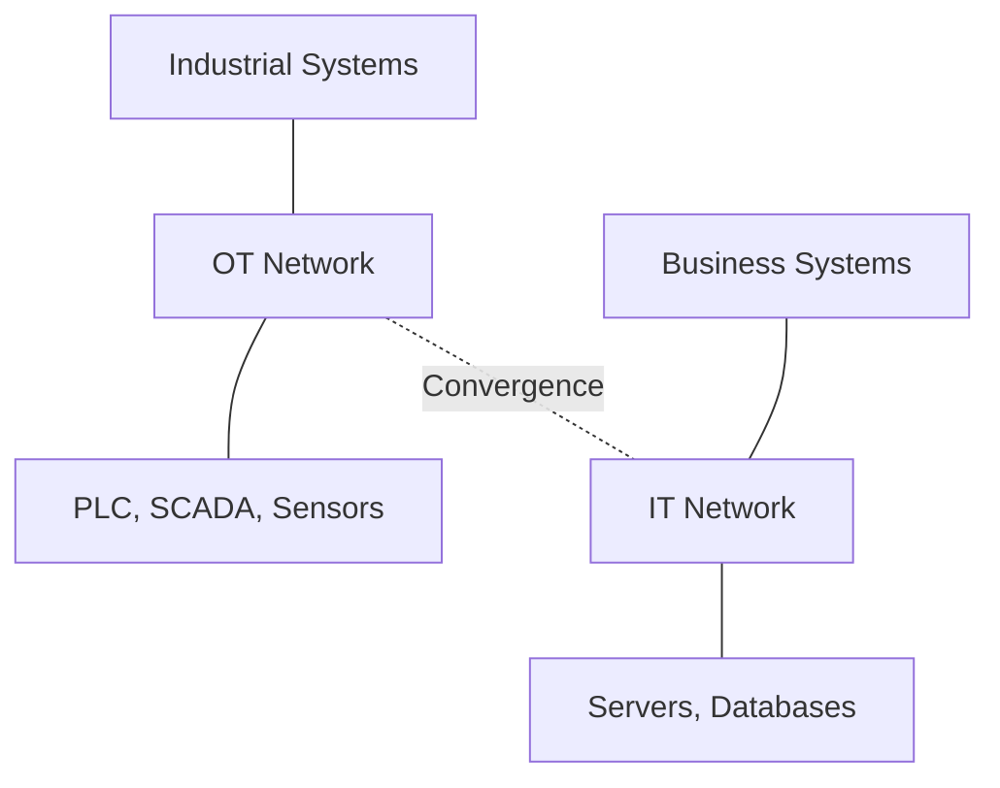
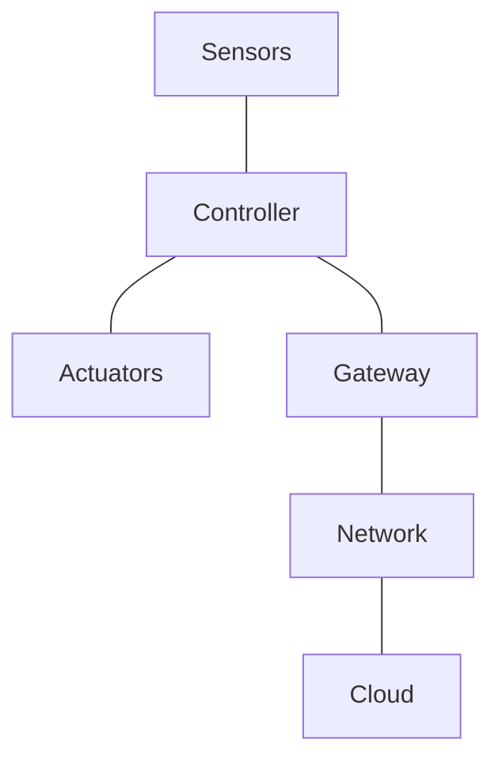
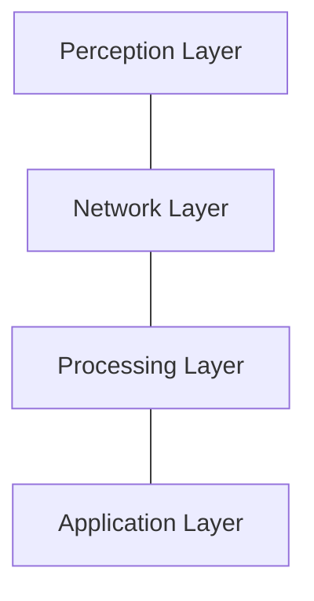
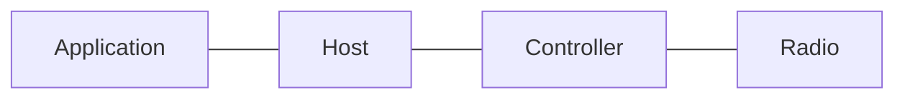
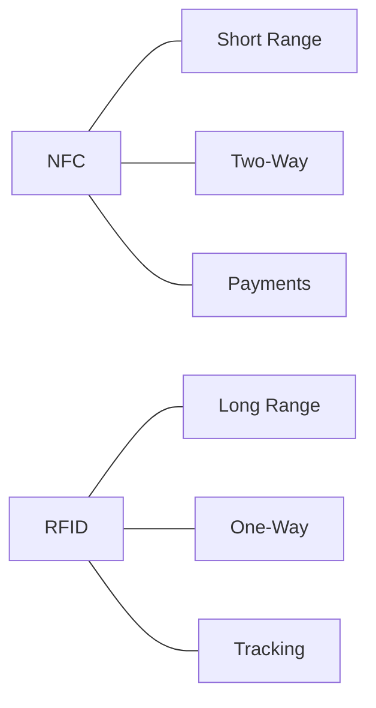
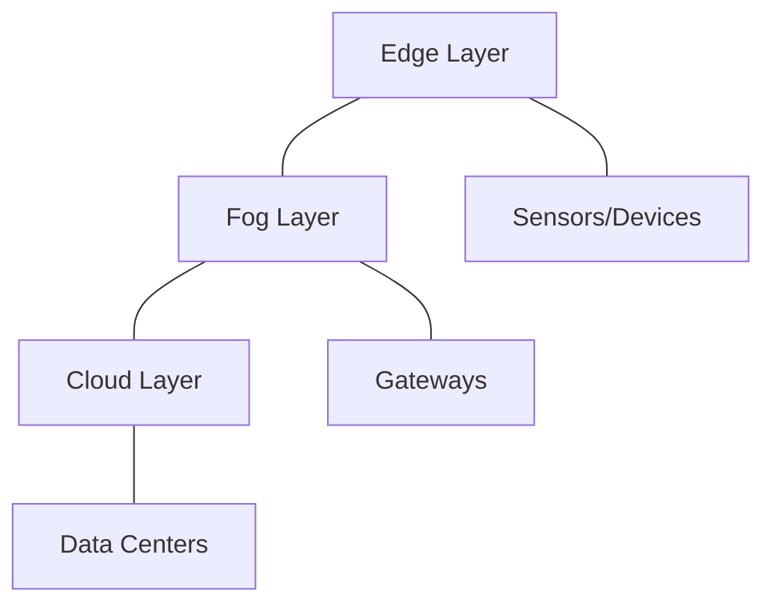
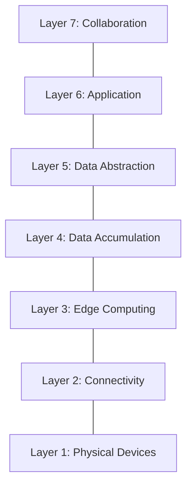
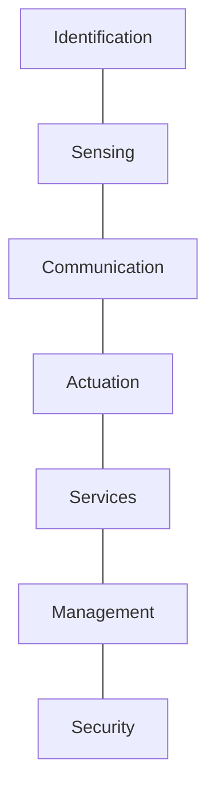
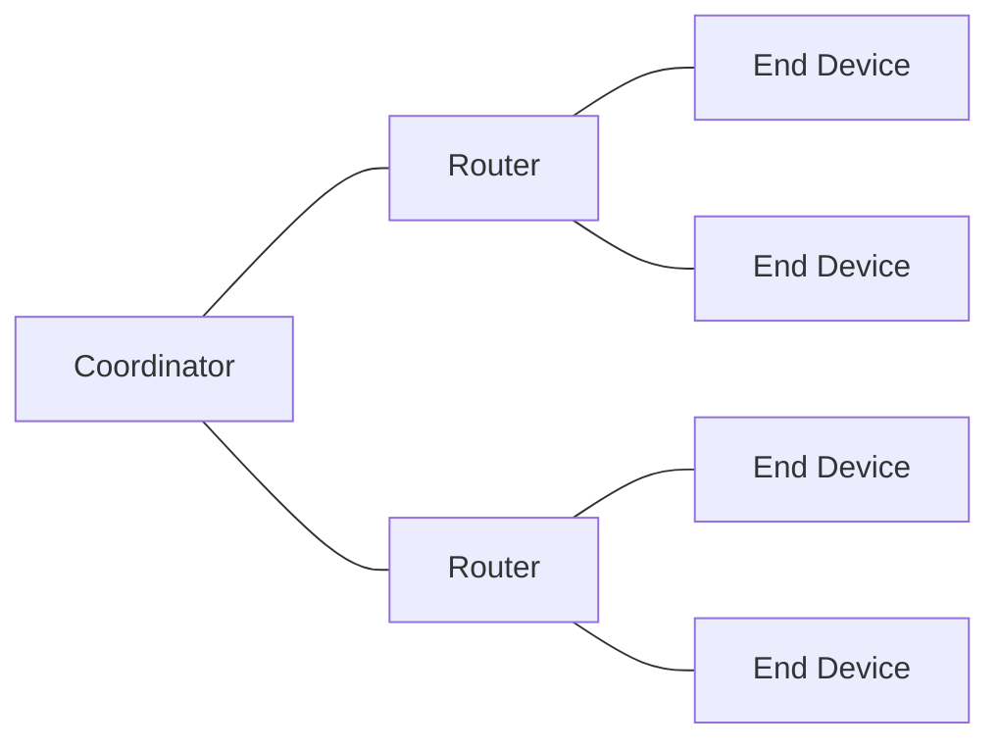
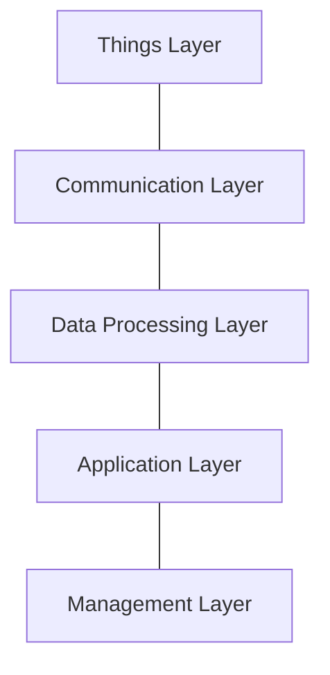

# 5 Marks Questions

 Q1. Explain OT (Operational Technology) and IT (Information Technology) networks, and differentiate between them.

OT Networks:
- Monitor and control physical industrial processes.
- Used in factories, power plants, utilities.
- Prioritize safety, reliability, and uptime.
- Include SCADA, PLC, DCS systems.
- Handle real-time deterministic communication.

IT Networks:
- Manage and process business information.
- Used in offices, data centers, enterprises.
- Prioritize confidentiality and data integrity.
- Include servers, databases, ERP systems.
- Handle best-effort communication.

Differentiation:

| Factor | OT Networks | IT Networks |
|---|---|---|
| Purpose | Control physical processes | Manage business data |
| Priority | Safety and availability | Confidentiality and integrity |
| Latency | Real-time deterministic | Best-effort acceptable |
| Lifespan | 15-20 years | 3-5 years |
| Protocols | Modbus, Profibus, HART | TCP/IP, HTTP, SMTP |
| Updates | Rare and risky | Frequent and easy |
| Security | Physical isolation | Firewalls and encryption |
| Users | Engineers and operators | Employees and managers |

---

 Q3. Describe the physical design of IoT, including the various components and devices involved.

Physical Design:
- Refers to actual hardware components in IoT.
- Includes devices, sensors, and actuators.
- Encompasses networking and communication hardware.
- Defines physical topology of IoT systems.

Things/Devices:
- Sensors: collect data from environment.
- Actuators: perform actions on environment.
- Controllers: process data and control devices.
- Gateways: bridge devices to network.

Sensors:
- Temperature, humidity, pressure sensors.
- Motion, proximity, light sensors.
- Gas, smoke, water quality sensors.

Actuators:
- Motors, relays, solenoids.
- Smart locks and valves.
- LED lights and displays.

Controllers:
- Microcontrollers like Arduino, ESP32.
- Single-board computers like Raspberry Pi.
- PLCs for industrial control.

Gateways:
- Aggregate data from multiple devices.
- Protocol translation between networks.
- Edge processing capabilities.

Communication Hardware:
- Wi-Fi, Bluetooth, ZigBee modules.
- LoRa, NB-IoT, cellular modems.
- Ethernet and serial interfaces.

---

 Q5. Explain the logical design of IoT, including its architectural layers and protocols.

Logical Design:
- Abstract representation of IoT system.
- Defines how components interact logically.
- Includes functional blocks and protocols.
- Independent of physical implementation.

Architectural Layers:

Perception Layer:
- Collects data from physical world.
- Includes sensors and actuators.
- Converts physical signals to digital data.

Network Layer:
- Transmits data between devices.
- Uses protocols like MQTT, CoAP.
- Handles routing and addressing.

Processing Layer:
- Processes and analyzes data.
- Includes edge and cloud computing.
- Performs data filtering and aggregation.

Application Layer:
- Provides user-facing services.
- Includes dashboards and APIs.
- Delivers IoT applications to users.

Protocols:
- MQTT: lightweight publish-subscribe.
- CoAP: constrained application protocol.
- HTTP: request-response protocol.
- AMQP: advanced message queuing.
- XMPP: real-time messaging protocol.

---

 Q6. Describe Bluetooth Low Energy technology, its architecture, and its significance in IoT communication.

Bluetooth Low Energy:
- Wireless personal area network technology.
- Designed for low power consumption.
- Operates in 2.4 GHz ISM band.
- Range typically 10-100 meters.
- Ideal for battery-powered IoT devices.

Architecture:

Controller:
- Physical layer and link layer.
- Handles radio communication.
- Manages advertising and scanning.

Host:
- Logical link control and adaptation.
- Attribute protocol (ATT).
- Generic attribute profile (GATT).
- Security manager protocol.

Application:
- User application profiles.
- GATT services and characteristics.
- Custom and standard profiles.

Significance in IoT:
- Ultra-low power consumption.
- Enables years of battery life.
- Low cost and small form factor.
- Widely supported in smartphones.
- Easy pairing and connection.
- Suitable for wearables and sensors.
- Supports mesh networking.

---

 Q8. Explain NFC and RFID technologies, and compare them in terms of their working, range, and applications.

NFC:
- Near Field Communication technology.
- Operates at 13.56 MHz frequency.
- Range up to 10 cm.
- Enables two-way communication.
- Used for contactless payments.
- Supports peer-to-peer data transfer.

RFID:
- Radio Frequency Identification technology.
- Uses radio waves for identification.
- Range from few cm to several meters.
- Includes tag and reader components.
- Passive tags powered by reader.
- Active tags have own power source.

Comparison:

| Factor | NFC | RFID |
|---|---|---|
| Frequency | 13.56 MHz | 125 kHz to 5.8 GHz |
| Range | Up to 10 cm | Up to 100 meters |
| Communication | Two-way | One-way mostly |
| Standard | ISO 14443, 18092 | ISO 18000 series |
| Power | Active and passive | Passive and active |
| Cost | Higher | Lower |
| Applications | Payments, access | Inventory, tracking |
| Data Transfer | Yes | Limited |

---

 Q9. Differentiate between Edge, Fog, and Cloud computing, and establish their hierarchical relationship.

Edge Computing:
- Processing at data source.
- Lowest latency and bandwidth.
- Limited computational resources.
- Real-time decision making.
- Examples: smart sensors, PLCs.

Fog Computing:
- Processing between edge and cloud.
- Intermediate layer of computing.
- Reduces data sent to cloud.
- Moderate latency and resources.
- Examples: gateways, local servers.

Cloud Computing:
- Centralized processing and storage.
- Highest latency and bandwidth.
- Unlimited computational resources.
- Long-term data storage.
- Examples: AWS, Azure, Google Cloud.

Hierarchical Relationship:

| Factor | Edge | Fog | Cloud |
|---|---|---|---|
| Location | Data source | Local network | Remote data center |
| Latency | Very Low | Low | High |
| Bandwidth | Minimal | Moderate | High |
| Compute | Limited | Moderate | Unlimited |
| Storage | Very Less | Moderate | Massive |
| Cost | Low | Medium | High |
| Use Case | Real-time control | Local analytics | Big data analytics |

---

 Q10. With the help of a neat diagram, elaborate on the architecture of the IoTWF (IoT World Forum) reference model.

IoTWF Reference Model:
- Seven-layer architecture for IoT.
- Developed by IoT World Forum.
- Provides standardized framework.
- Addresses interoperability challenges.
- Covers edge to cloud continuum.

Layer 1 - Physical Devices:
- Sensors, actuators, and controllers.
- Physical things in IoT system.
- Data generation and action execution.

Layer 2 - Connectivity:
- Communication between devices.
- Protocols and network technologies.
- Wired and wireless connections.

Layer 3 - Edge Computing:
- Data processing at edge.
- Filtering and optimization.
- Protocol conversion and analytics.

Layer 4 - Data Accumulation:
- Data storage and aggregation.
- Converting data to information.
- Database and storage management.

Layer 5 - Data Abstraction:
- Data normalization and integration.
- Creating unified data views.
- Managing diverse data sources.

Layer 6 - Application:
- Business applications and services.
- User interfaces and dashboards.
- Industry-specific solutions.

Layer 7 - Collaboration:
- People and process integration.
- Business workflow integration.
- Cross-organizational collaboration.

---

 Q11. Explain the functional blocks of IoT and describe the role of each block.

Functional Blocks:
- Building blocks of IoT systems.
- Define core capabilities of IoT.
- Enable modular system design.
- Include identification, sensing, communication.
- Also include actuation, services, management.
- Security is cross-cutting concern.

Identification:
- Unique identity for each device.
- Uses UUID, URI, EPC standards.
- Enables addressing and tracking.

Sensing:
- Collects data from environment.
- Includes various sensor types.
- Converts physical to digital signals.

Communication:
- Transmits data between devices.
- Uses various protocols and networks.
- Enables device connectivity.

Actuation:
- Performs actions on environment.
- Uses actuators and controllers.
- Executes commands from system.

Services:
- Provides IoT functionalities.
- Includes data analytics, storage.
- Cloud and edge services.

Management:
- Device and network management.
- Configuration and monitoring.
- Firmware updates and diagnostics.

Security:
- Protects data and devices.
- Authentication and encryption.
- Access control and privacy.

---

 Q12. Describe the various ZigBee devices and explain their operational modes and functions.

ZigBee:
- Low-power wireless mesh networking protocol.
- Based on IEEE 802.15.4 standard.
- Operates in 2.4 GHz, 900 MHz bands.
- Designed for low data rate applications.
- Supports large mesh networks.

ZigBee Devices:

Coordinator:
- Starts and manages the network.
- Selects channel and PAN ID.
- Allows devices to join network.
- Routes messages between devices.
- Only one per ZigBee network.

Router:
- Extends network coverage.
- Routes messages between devices.
- Always powered on device.
- Can have child devices.
- Mains-powered typically.

End Device:
- Performs specific sensing tasks.
- Can sleep to save power.
- Cannot route messages.
- Battery-powered typically.
- Communicates with parent.

Operational Modes:

Active Mode:
- Device is fully operational.
- Transmits and receives data.
- Higher power consumption.

Sleep Mode:
- Device conserves power.
- Wakes periodically to check.
- Lower power consumption.
- Used by end devices.

---

 Q16. Explain the core IoT functional stack, including its layers and the role of each layer.

Core IoT Functional Stack:
- Fundamental architecture of IoT.
- Defines essential layers and functions.
- Enables standardized IoT development.
- Covers device to application continuum.

Things Layer:
- Physical devices and sensors.
- Actuators and controllers.
- Data generation and action.

Communication Layer:
- Network connectivity.
- Protocol implementation.
- Data transmission.

Data Processing Layer:
- Data aggregation and filtering.
- Analytics and transformation.
- Edge and cloud processing.

Application Layer:
- User-facing applications.
- Business logic implementation.
- APIs and dashboards.

Management Layer:
- Device management.
- Network management.
- Security management.

Role of Each Layer:

| Layer | Role |
|---|---|
| Things | Generate data and perform actions |
| Communication | Transmit data reliably |
| Data Processing | Analyze and transform data |
| Application | Deliver services to users |
| Management | Monitor and control system |

---

# 2 Marks Questions

 Q2. Explain Li-Fi technology and its applications in the context of IoT.

Li-Fi:
- Light Fidelity uses visible light communication.
- Transmits data using LED light.
- High speed compared to Wi-Fi.
- Cannot penetrate walls, secure transmission.

Applications in IoT:
- Indoor positioning systems.
- Smart lighting and home automation.
- Hospital and aircraft communication.
- Underwater IoT applications.

---

 Q4. Define smart objects, and explain their characteristics and role in IoT.

Smart Objects:
- Physical objects with computing capabilities.
- Connected to network for communication.
- Sense and react to environment.

Characteristics:
- Unique identification.
- Sensing and actuation ability.
- Network connectivity.
- Local processing capability.
- Energy efficiency.

Role in IoT:
- Generate data from physical world.
- Act as building blocks of IoT.
- Enable automation and control.

---

 Q7. Explain Z-Wave technology, its working principle, and its applications in IoT.

Z-Wave:
- Wireless mesh network protocol.
- Operates at 908 MHz frequency.
- Low power and low data rate.
- Designed for home automation.

Working Principle:
- Controller manages network.
- Devices form mesh network.
- Messages routed through nodes.
- Range about 30 meters per hop.

Applications:
- Smart home lighting control.
- Security systems and locks.
- Thermostats and HVAC control.

---

 Q13. Differentiate between data analytics and network analytics in the context of IoT.

| Factor | Data Analytics | Network Analytics |
|---|---|---|
| Focus | Data content and patterns | Network traffic and performance |
| Purpose | Extract business insights | Monitor network health |
| Input | Sensor data and events | Network packets and logs |
| Output | Predictions and reports | Performance metrics |
| Tools | ML, statistics | Network monitoring tools |
| Users | Data scientists | Network administrators |

---

 Q14. Differentiate between analytics and control applications in IoT systems.

| Factor | Analytics Applications | Control Applications |
|---|---|---|
| Purpose | Analyze data for insights | Control physical processes |
| Timing | Batch or real-time | Real-time deterministic |
| Output | Reports and predictions | Commands and actions |
| Latency | Moderate acceptable | Very low required |
| Examples | Predictive maintenance | Smart thermostat control |
| Criticality | Business decisions | Safety and operations |

---

 Q15. Differentiate between data analytics and network analytics, and explain how data analytics contributes to business benefits.

| Factor | Data Analytics | Network Analytics |
|---|---|---|
| Focus | Data content and meaning | Network traffic patterns |
| Purpose | Business insights | Network optimization |
| Input | Sensor and business data | Packets and flow data |
| Output | Predictions and reports | Performance metrics |

Business Benefits of Data Analytics:
- Improves decision making with insights.
- Reduces operational costs.
- Enables predictive maintenance.
- Increases customer satisfaction.
- Identifies new revenue opportunities.