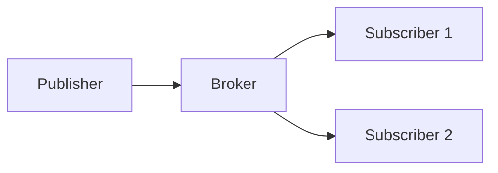
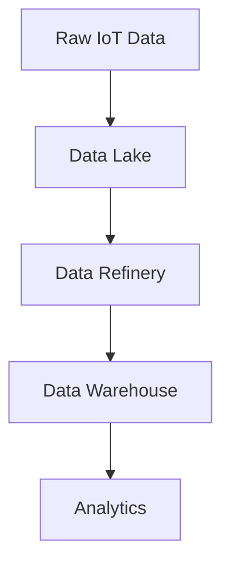
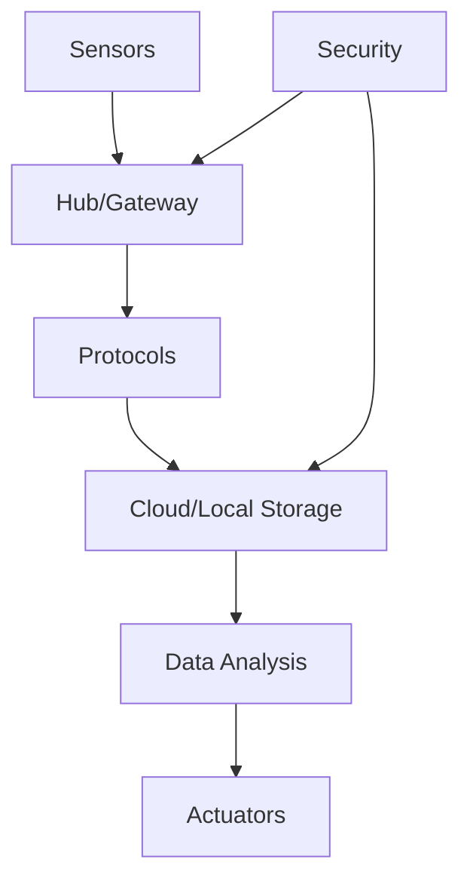
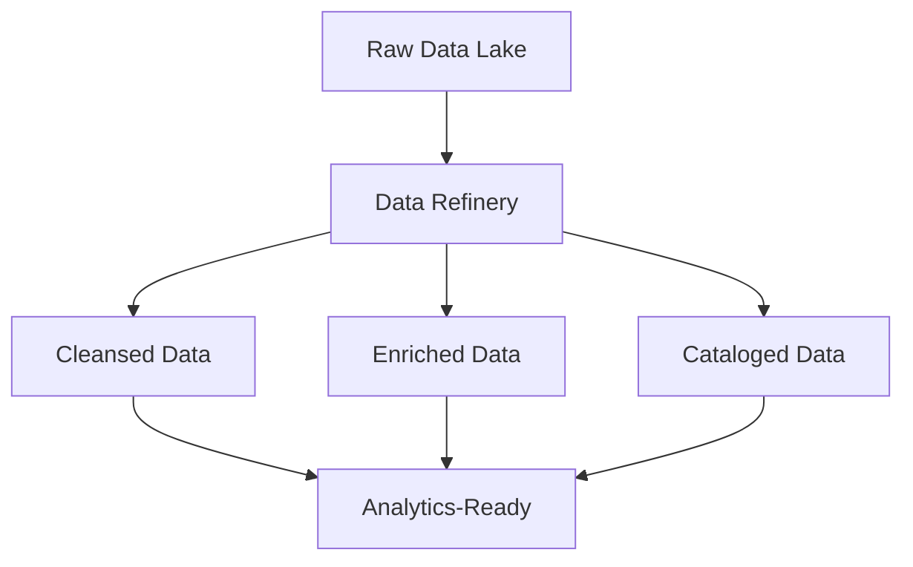
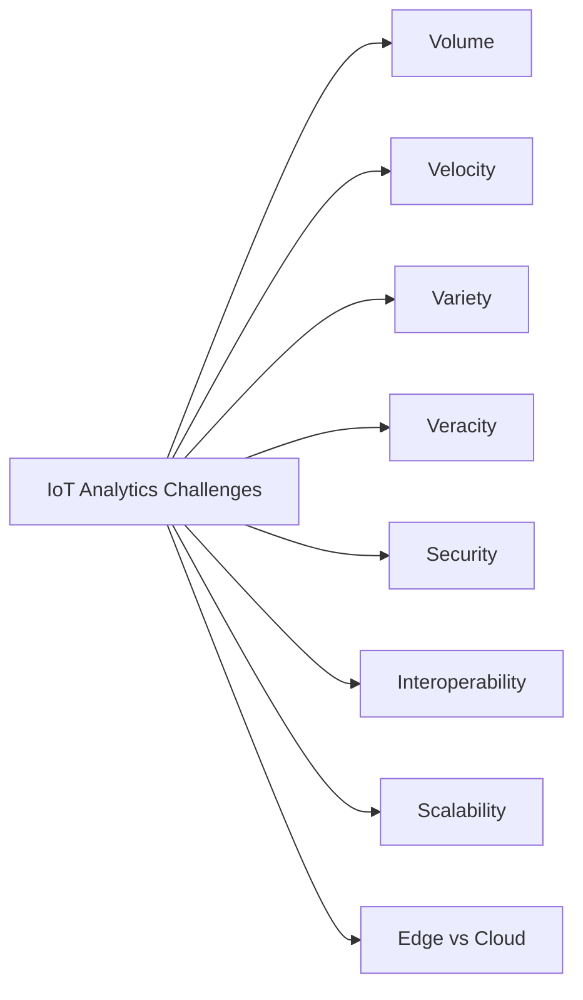

#### Explain Internet of Behavior (IoB) (2 marks)

**Internet of Behavior (IoB)** is an extension of IoT that focuses on collecting and analyzing behavioral data from connected devices to understand, predict, and influence human behavior.

**Key Aspects:**
- **Data Sources:** Wearables, smart home devices, social media, location tracking.
- **Goal:** Translate behavioral insights into actionable policies or recommendations.
- **Components:** IoT sensors + behavioral psychology + data analytics + persuasion.
- **Example:** Insurance companies using driving behavior data (speed, braking) to adjust premiums.

**Result:** IoB bridges technology and psychology, enabling personalized experiences and behavioral influence, but raises privacy and ethical concerns.

---

#### Differentiate between IIoT and IoT (2 marks)

| **Aspect** | **IoT (Consumer)** | **IIoT (Industrial)** |
|---|---|---|
| **Target** | Consumers | Industries/manufacturing |
| **Scale** | Smaller, general purpose | Large-scale, mission-critical |
| **Reliability** | Moderate | Extremely high |
| **Latency** | Tolerant | Ultra-low latency required |
| **Security** | Basic | Stringent, multi-layered |
| **Examples** | Smart home, wearables | SCADA, predictive maintenance |
| **Consequences of failure** | Inconvenience | Safety hazards, financial loss |

**Key Distinctions:** IIoT prioritizes reliability, security, and real-time performance, while consumer IoT emphasizes convenience and cost.

---

#### List the IoT patterns (2 marks)

IoT architectural and design patterns include:

1. **Device-to-Device (D2D)** : Direct communication between devices.
2. **Device-to-Cloud (D2C)** : Devices connect directly to cloud services.
3. **Device-to-Gateway (D2G)** : Devices connect via a local gateway.
4. **Back-End Data Sharing** : Multiple data sources share a common backend.
5. **Event-Driven** : Actions triggered by events.
6. **Request-Response** : Synchronous communication.
7. **Publish-Subscribe** : Asynchronous messaging via brokers.

**Summary:** These patterns define how devices, gateways, and cloud services interact in IoT ecosystems.

---

#### What is the purpose of using a dashboard for data visualization? (2 marks)

A **dashboard** provides a consolidated, interactive view of key metrics and trends.

**Purposes:**
- **Real-time monitoring** : Track live data streams.
- **Decision support** : Enable quick, data-driven decisions.
- **Pattern detection** : Visualize anomalies and trends.
- **Communication** : Share insights across teams.
- **KPI tracking** : Monitor performance against targets.

**Result:** Dashboards transform raw data into actionable insights, improving operational efficiency and strategic planning.

---

#### Explain IoT Data Analytics importance (2 marks)

**IoT Data Analytics** extracts value from the massive volume, velocity, and variety of IoT data.

**Importance:**
- **Predictive maintenance** : Anticipate failures before they occur.
- **Operational efficiency** : Optimize processes in real time.
- **Personalization** : Tailor services to user behavior.
- **Anomaly detection** : Identify security threats or faults.
- **Cost reduction** : Reduce downtime and resource waste.
- **Innovation** : Enable new business models and services.

**Result:** Without analytics, IoT data remains useless; analytics converts it into actionable intelligence.

---

#### Illustrate 3 methods for effective Data Visualization (2 marks)

1. **Charts and Graphs** : Bar charts for comparisons, line graphs for trends, pie charts for proportions.
2. **Heatmaps** : Use color intensity to represent density or value across a matrix.
3. **Geospatial Maps** : Plot data on maps to reveal location-based patterns.

**Summary:** Choosing the right visualization method depends on data type, audience, and the insight being conveyed.

---

#### List the four big data strategies (2 marks)

1. **Data Consolidation** : Centralize data from multiple sources into a unified repository.
2. **Data Governance** : Establish policies for quality, security, and compliance.
3. **Data Analytics** : Apply statistical and ML techniques to extract insights.
4. **Data Democratization** : Make data accessible to all relevant stakeholders.

**Summary:** These strategies ensure big data is managed, governed, analyzed, and utilized effectively.

---

#### Explain the role of NoSQL in IoT Data Analytics Challenges (2 marks)

**NoSQL databases** address IoT challenges that traditional relational databases cannot handle efficiently.

**Roles:**
- **Scalability** : Handle massive volumes of IoT data via horizontal scaling.
- **Flexibility** : Schema-less design accommodates diverse data formats.
- **Speed** : High write/read throughput for real-time analytics.
- **Variety** : Support for structured, semi-structured, and unstructured data.
- **Distributed architecture** : Enable edge and cloud deployment.

**Result:** NoSQL enables efficient storage and querying of IoT data, overcoming relational database limitations.

---

#### Explain HTTP and Web Sockets (2 marks)

**HTTP (Hypertext Transfer Protocol):**
- Request-response protocol.
- Stateless; each request is independent.
- Works over TCP.
- **Use:** Web browsing, REST APIs.

**Web Sockets:**
- Full-duplex, persistent connection.
- Stateful; connection remains open.
- Works over TCP after HTTP handshake.
- **Use:** Real-time applications (chat, live feeds, IoT dashboards).

| **Aspect** | **HTTP** | **Web Sockets** |
|---|---|---|
| **Communication** | Request-response | Full-duplex |
| **State** | Stateless | Stateful |
| **Overhead** | High (headers) | Low |
| **Latency** | Higher | Lower |
| **Use Case** | Web pages, APIs | Real-time IoT |

**Key Distinctions:** HTTP is simpler but less efficient for real-time; Web Sockets enable low-latency, bidirectional communication.

---

#### Elaborate MQTT with its working in detail and two advantages over CoAP (5 marks)

**MQTT (Message Queuing Telemetry Transport)** is a lightweight, publish-subscribe messaging protocol designed for constrained devices and low-bandwidth networks.

**Architecture:**
- **Publisher:** Sends messages to a topic.
- **Subscriber:** Receives messages from subscribed topics.
- **Broker:** Central server managing message routing.
- **Topics:** Hierarchical strings (e.g., `home/livingroom/temperature`).

**Working:**
1. Client connects to broker.
2. Publisher sends message to a topic.
3. Broker forwards message to all subscribers of that topic.
4. QoS levels ensure delivery:
   - QoS 0: At most once.
   - QoS 1: At least once.
   - QoS 2: Exactly once.

**Advantages over CoAP:**
1. **Publish-Subscribe Model** : Decouples producers and consumers, enabling many-to-many communication; CoAP uses request-response.
2. **QoS Support** : Provides guaranteed message delivery levels; CoAP lacks built-in QoS.

**Result:** MQTT is ideal for real-time, many-to-many IoT communication with reliable delivery.

---

#### Compare various protocols like MQTT, MQTT-SN, CoAP, AMQP, STOMP (5 marks)

| **Protocol** | **Transport** | **Model** | **QoS** | **Use Case** |
|---|---|---|---|---|
| **MQTT** | TCP | Publish-Subscribe | Yes (0,1,2) | IoT telemetry |
| **MQTT-SN** | UDP | Publish-Subscribe | Yes | Sensor networks |
| **CoAP** | UDP | Request-Response | No | Constrained devices |
| **AMQP** | TCP | Message Queue | Yes | Enterprise messaging |
| **STOMP** | TCP | Publish-Subscribe | No | Simple messaging |

**Key Distinctions:**
- **MQTT** is lightweight and reliable for IoT.
- **MQTT-SN** optimizes for UDP-based sensor networks.
- **CoAP** is RESTful and ideal for very constrained devices.
- **AMQP** is feature-rich for enterprise.
- **STOMP** is simple and text-based.

**Summary:** Protocol choice depends on device constraints, network reliability, and application requirements.

---

#### Detail the strategies to organize Data for IoT Analytics (5 marks)

**1. Data Lakes:**
- Store raw data in native format.
- Schema-on-read approach.
- **Challenge:** Risk of becoming "data swamps" without governance.

**2. Data Warehouses:**
- Structured, schema-on-write.
- Optimized for querying.
- **Challenge:** Less flexible for unstructured IoT data.

**3. Data Refineries:**
- Transform raw data into refined, usable datasets.
- Apply cleansing, enrichment, aggregation.
- **Goal:** Prevent data lakes from becoming swamps.

**4. Data Virtualization:**
- Access data without physical consolidation.
- Real-time integration.
- **Benefit:** Reduces storage redundancy.

**5. Tiered Storage:**
- Hot, warm, cold storage based on access frequency.
- **Benefit:** Cost optimization.

**Result:** A combination of these strategies ensures data is organized, accessible, and valuable for analytics.

---

#### Explain the ecosystem for IoT-enabled Smart Home with respect to sensors, actuators, framework, protocols, storage, data analysis, security (5 marks)

**Sensors:**
- Temperature, humidity, motion, door/window, smoke, cameras.

**Actuators:**
- Smart locks, lights, thermostats, blinds, speakers.

**Framework:**
- Home Assistant, OpenHAB, Apple HomeKit, Google Home.

**Protocols:**
- MQTT, Zigbee, Z-Wave, Wi-Fi, Bluetooth Low Energy.

**Storage:**
- Local (hub) and cloud (AWS IoT, Azure IoT).
- Time-series databases (InfluxDB).

**Data Analysis:**
- Real-time anomaly detection.
- Predictive automation (e.g., HVAC optimization).
- Voice assistant integration.

**Security:**
- Encryption (TLS/SSL).
- Authentication and authorization.
- Regular firmware updates.
- Network segmentation.

**Result:** A well-designed smart home ecosystem integrates these components for convenience, efficiency, and safety.

---

#### Illustrate the role of Data Refineries in preventing data lakes from turning into data swamps (5 marks)

**Data Lakes** store raw data but can become **Data Swamps** without governance—unusable, messy, and unreliable.

**Data Refineries** are processes and tools that transform raw data into refined, analytics-ready datasets.

**Roles:**
1. **Data Cleansing** : Remove duplicates, fix errors, handle missing values.
2. **Data Enrichment** : Add metadata, context, and external data.
3. **Data Aggregation** : Summarize and group data for analysis.
4. **Data Cataloging** : Index and tag data for discoverability.
5. **Data Governance** : Enforce quality, security, and compliance policies.
6. **Data Lifecycle Management** : Archive or delete stale data.

**Result:** Data refineries ensure data lakes remain valuable assets rather than becoming unusable swamps.

---

#### Explain IoT analytics challenges (5 marks)

**1. Data Volume:**
- Massive scale of IoT devices generates petabytes of data.
- **Challenge:** Storage and processing infrastructure.

**2. Data Velocity:**
- Real-time streaming data requires immediate processing.
- **Challenge:** Low-latency analytics.

**3. Data Variety:**
- Structured, semi-structured, unstructured data.
- **Challenge:** Integration and schema management.

**4. Data Veracity:**
- Noise, missing values, inaccurate sensors.
- **Challenge:** Ensuring data quality.

**5. Security and Privacy:**
- Sensitive data transmission and storage.
- **Challenge:** Compliance (GDPR, HIPAA).

**6. Interoperability:**
- Diverse protocols and standards.
- **Challenge:** Seamless integration.

**7. Scalability:**
- Growing number of devices and data.
- **Challenge:** Elastic infrastructure.

**8. Edge vs. Cloud:**
- Balancing processing location.
- **Challenge:** Latency, bandwidth, cost.

**Result:** Addressing these challenges requires robust architecture, governance, and advanced analytics tools.

