### **Module I: Introduction to IoT**

**Explain functional blocks of IoT (5 Marks, Dec 2023)**
**Explain functional blocks of IoT (5 Marks, Dec 2024)**
**Discuss the functional blocks of IoT architecture, highlighting their roles and interactions. Provide examples to illustrate the importance of each block in the overall functionality of IoT systems (10 Marks, May 2024)**

An IoT system is composed of functional blocks that together enable sensing, communication, processing, and action.

**1. Application Block**
- Provides user interface for interacting with the IoT system and sensor data.
- Supports data aggregation, simplification, visualization, and control functions.
- Interacts with the Services Block to access processed data and services.

**2. Security Block**
- Provides confidentiality, integrity, availability, and authentication services.
- Protects all blocks and secures data exchange across the architecture.
- Interacts with all blocks to enforce security policies and protect data.

**3. Management Block**
- Enables management of all other blocks in the IoT architecture.
- Governs Device, Services, Communication, Application, and Security blocks.
- Interacts with all blocks to monitor, configure, and coordinate operations.

**4. Services Block**
- Acts as middleware providing device identification and discovery services.
- Offers data processing and analysis capabilities to other blocks.
- Interacts with Device and Communication Blocks to deliver processed data.

**5. Communication Block**
- Contains wired and wireless protocols for data transfer to the Internet.
- Facilitates bidirectional data flow between devices and the Internet.
- Interacts with Device and Services Blocks to route data across the system.

**6. Device Block**
- Contains sensing, actuation, monitoring, and control functions for devices.
- Directly senses the environment and actuates physical device actions.
- Interacts with the Communication Block to send and receive data.

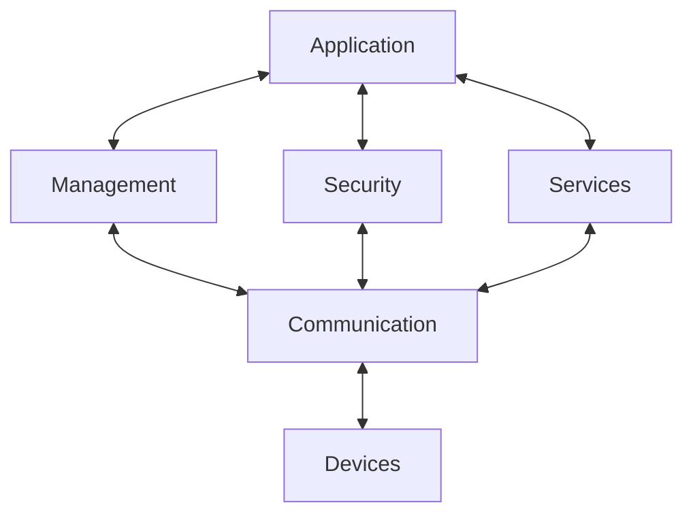

---

**Differentiate briefly Physical design of IoT and Logical design of IoT (5 Marks, Dec 2024)**
**Differentiate briefly Physical design of IoT and Logical design of IoT (5 Marks, Dec 2025)**

**Physical design focuses on hardware entities and their connections, while logical design focuses on abstract architecture, data flow, and functional logic.**

| Factor | Physical Design | Logical Design |
| :--- | :--- | :--- |
| **Definition** | Concrete device and network arrangement | Conceptual data flow and interaction blueprint |
| **Core Focus** | Actual hardware components and deployment | Abstract models and functional logic |
| **Primary Stakeholders** | Hardware engineers and site planners | Software architects and data engineers |
| **Main Components** | Sensors, actuators, gateways, communication modules | Protocols, data flow, APIs, application logic |
| **Connectivity Concern** | Physical wiring and network topology | Communication models and data interaction |
| **Failure Mode** | Hardware failure, power loss, interference | Logic errors, protocol mismatches, inconsistency |
| **Processing Concern** | Hardware specifications and placement | Data processing and business logic |
| **Abstraction Level** | Concrete, tangible implementation view | Abstract, functional design view |
| **Design Goal** | Build reliable physical infrastructure | Define system behavior and services |
| **Key Challenge** | Hardware constraints and environmental factors | Interoperability and data consistency |
| **Lifecycle** | Long; costly and slow replacement | Short; fast software updates |
| **Documentation** | Wiring diagrams, site plans, BOM | Architecture diagrams, data flows, API specs |
| **Security Concern** | Physical tampering and unauthorized access | Encryption, authentication, data integrity |
| **Dependency** | Constrained by physical environment limits | Constrained by logical consistency requirements |
| **Optimization Focus** | Power efficiency and signal coverage | Latency, throughput, and data accuracy |
| **Testing Method** | Field testing and signal measurement | Simulation, modeling, API testing |
| **Typical Example** | Sensor nodes deployed in a factory  | Analytics platform processing sensor data  |

---

**Explain the characteristic of IoT (5 Marks, May 2024)**

IoT is characterized by the following key properties:

- **Connectivity**: Devices connect to networks and to each other, enabling anytime, anywhere communication and data exchange.
- **Heterogeneity**: IoT integrates diverse devices, hardware platforms, and protocols (Wi-Fi, ZigBee, LoRa, BLE) that must interoperate.
- **Dynamic Nature**: Device states and network topology change continuously as devices join, leave, and move.
- **Enormous Scale**: Billions of devices generate massive volumes of data, requiring scalable addressing and infrastructure.
- **Sensing and Actuation**: Devices perceive the physical environment through sensors and act on it through actuators.
- **Intelligence**: Embedded processing, edge/cloud analytics, and ML enable context-aware decisions and automation.
- **Resource Constraints**: Many devices have limited CPU, memory, energy, and bandwidth, demanding lightweight protocols.
- **Security and Privacy**: Pervasive sensing and connectivity create a large attack surface and raise data-protection concerns.
- **Interoperability**: Standardized protocols and frameworks allow multi-vendor devices and services to work together.

---

**Define Smart Object in IoT and its characteristics (5 Marks, Dec 2025)**
**Define Smart Object in IoT and its characteristics (5 Marks, May 2025)**
**Elaborate the Smart Object with diagram and describe its characteristics (10 Marks, May 2024)**
**Elaborate the Smart Object with diagram and describe all the essential components required to make the object into the smart object (10 Marks, May 2023)**

A **Smart Object** is a physical object augmented with sensing, processing, communication, and actuation capabilities that enable it to collect data about its environment, share it over a network, and act autonomously or in coordination with other objects.

**Essential Components of a Smart Object:**
1. **Sensors**: Measure physical properties (temperature, motion, light) from the environment.
2. **Actuators**: Perform physical actions (motors, valves, switches) based on decisions.
3. **Processor/Microcontroller**: Processes sensor data, runs control logic, and coordinates operations.
4. **Communication Module**: Network interface (Wi-Fi, ZigBee, LoRa, BLE) for data exchange with other objects, gateways, or cloud.
5. **Power Supply**: Battery, solar, or mains energy source sustaining operation.
6. **Unique Identity**: A unique identifier (e.g., IP/MAC address) enabling addressing and discovery.
7. **Memory/Storage**: Local storage for data buffering, configuration, and firmware.

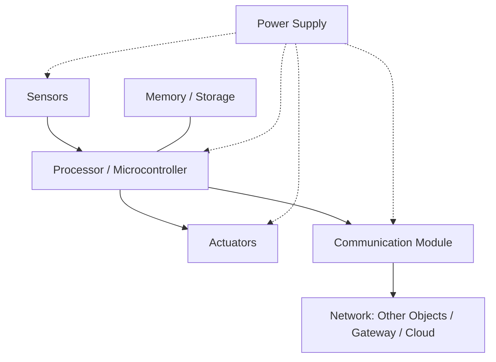

**Characteristics of Smart Objects:**
- **Sensing**: Perceives its environment through sensors.
- **Actuation**: Acts on the physical world through actuators.
- **Processing/Intelligence**: Performs local computation and decision-making.
- **Connectivity**: Communicates with other objects, gateways, and the cloud.
- **Unique Identity**: Has a distinct identifier for addressing and discovery.
- **Autonomy**: Operates and reacts without continuous human intervention.
- **Context-Awareness**: Adapts behavior based on sensed context.
- **Resource Constraints**: Typically limited in CPU, memory, and energy.
- **Interoperability**: Works with other devices through standard protocols.
- **Programmability/Manageability**: Can be configured, updated, and monitored remotely.

---

**Explain data acquisition in IoT (5 Marks, May 2025)**

Data acquisition in IoT is the process of collecting raw data from sensors and devices in the physical world and converting it into digital form for processing, transmission, and analysis.

- **Sensing**: Sensors measure physical parameters (temperature, humidity, motion, pressure) and produce analog or digital signals.
- **Signal Conditioning**: Analog signals are filtered, amplified, and scaled to remove noise and match the input range of the converter.
- **Analog-to-Digital Conversion (ADC)**: The conditioned analog signal is sampled and quantized into digital values by a microcontroller or data acquisition module.
- **Data Formatting/Tagging**: Readings are timestamped, tagged with device/sensor IDs, and structured (e.g., JSON) for transmission.
- **Transmission**: Acquired data is sent to a gateway, edge node, or cloud via protocols such as MQTT, CoAP, or LoRaWAN.
- **Validation/Cleaning**: Basic checks (range validation, outlier rejection) may be applied at acquisition to improve data quality.

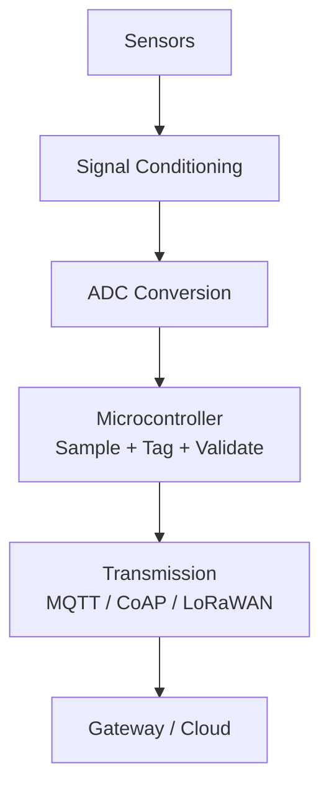

---

///
### **Module II: IoT Architecture**

**Elaborate the need of new network architecture in IoT (10 Marks, May 2023)**
**Elaborate the need of new network architecture in IoT (10 Marks, May 2024)**

Traditional network architectures (like TCP/IP) were designed for a few powerful host-centric endpoints, not for billions of heterogeneous, resource-constrained IoT devices. This shift creates requirements classical architectures cannot meet.

**Need for new network architecture in IoT:**
- **Scale & Addressing**: Massive device counts exceed IPv4/host-centric limits. Scalable addressing (6LoWPAN, IPv6) is needed.
- **Heterogeneity**: Diverse devices and technologies (ZigBee, BLE, LoRa, Wi-Fi, cellular) must interoperate.
- **Energy Constraints**: Battery-powered devices need lightweight protocols (MQTT, CoAP) and duty cycling.
- **Data-Centric Communication**: Content matters more than host identity. Publish-subscribe/data-centric models are needed.
- **Mobility & Dynamic Topology**: Devices frequently join, leave, and move. Self-configuration and self-healing are needed.
- **Real-Time & QoS**: Applications need varying latency and reliability. Traffic prioritization replaces best-effort delivery.
- **Security & Privacy at Scale**: Billions of devices form a huge attack surface. Lightweight end-to-end security is needed.
- **Interoperability**: Multi-vendor devices must work together. Layered standardized architectures (e.g., oneM2M) are required.
- **Edge/Fog Computing**: Cloud-only processing causes latency and bandwidth bottlenecks. Computation must span edge–fog–cloud.
- **Manageability**: Millions of devices need automated provisioning, updates, and remote monitoring.

---

**Describe IoT World Forum (IoTWF) Standardized Architecture (10 Marks, May 2023)**
**Describe IoT World Forum (IoTWF) standardized architecture (10 Marks, May 2025)**

The IoTWF Reference Model is a seven-layer architecture developed by the IoT World Forum that provides a standardized framework covering the edge-to-cloud continuum. It addresses interoperability challenges across IoT systems.

**Edge Layer 1 - Physical Devices:**
- Sensors, actuators, and controllers for IoT operations and control.
- Physical things deployed in the IoT system environment and field.
- Generates data and executes actions via device control interfaces.

**Edge Layer 2 - Connectivity:**
- Provides communication between connected IoT devices and systems.
- Uses protocols and network technologies for reliable data transport.
- Enables wired and wireless data transfer between devices and edge.

**Edge Layer 3 - Edge Computing:**
- Performs data processing at the network edge for faster response.
- Handles filtering and optimization of raw data before transmission.
- Performs protocol conversion and real-time analytics at the edge.

**Data Layer 4 - Data Accumulation:**
- Handles data storage and aggregation across the IoT architecture.
- Converts raw data into meaningful information for higher layers.
- Manages databases and storage for accumulated data and records.

**Data Layer 5 - Data Abstraction:**
- Performs data normalization and integration across all sources.
- Creates unified views across disparate and heterogeneous sources.
- Integrates diverse data sources into a single consistent view.

**Application Layer 6 - Application:**
- Delivers business applications and services to end users and teams.
- Provides user interfaces and dashboards for monitoring and control.
- Delivers industry-specific solutions to end users and stakeholders.

**Application Layer 7 - Collaboration:**
- Integrates people and processes across organizational boundaries.
- Supports business workflow integration across multiple systems.
- Enables cross-organizational collaboration and secure data sharing.

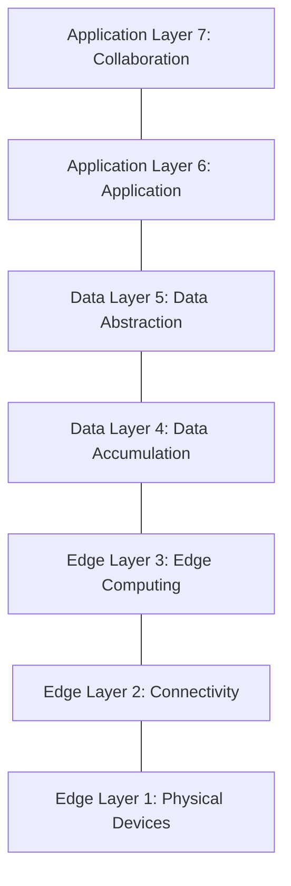

---

**With neat diagram, elaborate briefly the simplified 3 layered IoT architecture (10 Marks, Dec 2023)**
**Elaborate briefly the simplified 3 layered IoT architecture with neat diagram (10 Marks, Dec 2024)**
**Elaborate briefly the simplified 3 layered IoT architecture with neat diagram (10 Marks, Dec 2025)**

The simplified 3-layer IoT architecture is the basic reference model that organizes an IoT system into three functional layers: **Perception (Sensing) Layer**, **Network (Transmission) Layer**, and **Application Layer**.

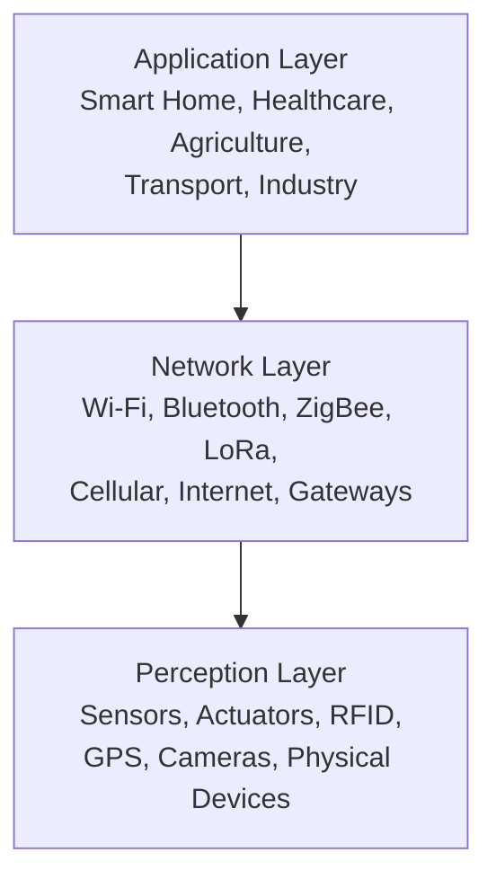

**1. Perception (Sensing) Layer**
- The bottommost layer that interacts directly with the physical world.
- Contains **sensors** (temperature, humidity, motion, etc.) that collect data and **actuators** that perform actions (motors, valves, switches).
- Also includes identification devices such as RFID tags, GPS, and cameras.
- **Function:** Sense the environment, gather raw data, and convert physical signals into digital data.

**2. Network (Transmission) Layer**
- The middle layer that connects perception devices to processing systems.
- Uses communication technologies such as **Wi-Fi, Bluetooth, ZigBee, LoRa, and cellular networks**.
- Includes **gateways** that aggregate and forward data, plus the Internet and cloud connectivity.
- **Function:** Reliably transmit the collected data to the application layer and route commands back to devices.

**3. Application Layer**
- The topmost layer that provides services to end users.
- Hosts **applications** in domains such as smart home, healthcare, agriculture, transportation, and industry.
- Performs data processing, analysis, storage, and decision-making; presents results through user interfaces and APIs.
- **Function:** Deliver IoT services, interpret data, and enable user interaction and business logic.

---

**Define the following: 1) Fog Computing 2) Internet of Behaviour (IoB) (5 Marks, Dec 2024)**
**Define the following: 1) Fog Computing 2) Internet of Behaviour (IoB) (5 Marks, Dec 2025)**

**1) Fog Computing**
Fog computing is a decentralized computing paradigm that extends cloud services to the edge of the network, placing computation, storage, and networking closer to IoT devices to reduce latency and bandwidth usage.
- Uses intermediate fog nodes (gateways, routers, local servers) to process data locally.
- Enables real-time, location-aware processing instead of sending all data to a distant cloud.
- Reduces latency, saves bandwidth, and improves response time for time-sensitive applications.

**2) Internet of Behaviour (IoB)**
The Internet of Behaviour (IoB) is an extension of IoT that analyzes data from connected devices to understand and influence human behaviour.
- Combines sensor, wearable, and online activity data with behavioural psychology and analytics.
- Derives insights into how and why people act in certain ways.
- Applied in personalized marketing, healthcare, insurance, and smart environments.
- Raises significant privacy and ethical concerns.

---

**Differentiate and give Hierarchy between Edge, Fog, and Cloud computing (10 Marks, Dec 2023)**
**Compare and contrast Edge, Fog, and Cloud Computing. Explain their usage with an example (10 Marks, May 2023)**
**Compare edge, fog and cloud computing w.r.to its hierarchy (10 Marks, May 2024)**

| Factor                  | Cloud Computing                       | Fog Computing                             | Edge Computing                         |
| :---------------------- | :------------------------------------ | :---------------------------------------- | :------------------------------------- |
| **Hierarchy Position**  | Centralized core data centers         | Intermediate layer between edge and cloud | Closest to data sources and devices    |
| **Processing Location** | Centralized, far from end devices     | Distributed, local network level          | On or near the device itself           |
| **Latency**             | High, multiple network hops           | Low, fewer network hops                   | Very low, single hop                   |
| **Computing Power**     | High, scalable centralized resources  | Moderate, distributed nodes               | Constrained, limited local hardware    |
| **Typical Usage**       | Long-term analytics and storage       | Local aggregation and filtering           | Real-time processing and control       |
| **Example**             | Training AI models on historical data | Smart city gateway filtering sensor data  | Autonomous vehicle detecting obstacles |
| **Connectivity**        | Requires WAN/internet connectivity    | Mostly LAN, local connectivity            | Local networks, high mobility support  |
| **Deployment Cost**     | Very high infrastructure investment   | Low to moderate cost                      | Low, depends on device scale           |

---

///
### **Module III: Principles of Connected Devices and Protocols in IoT**

**Explain ZigBee in brief (5 Marks, Dec 2023)**
**State various operating modes of Zigbee and its topologies with diagrams (10 Marks, May 2025)**

ZigBee is a low-cost, low-power, short-range wireless communication standard built on IEEE 802.15.4, designed for low-data-rate IoT applications such as home automation and sensor networks.

**Working:**
- Operates in 868 MHz, 915 MHz, and 2.4 GHz ISM bands with a maximum data rate of 250 kbps.
- Range is typically 20–30 m indoors and up to 100 m in free space.
- Targets battery-powered devices where long battery life (years) and low cost are primary requirements.
- Supports up to 65,536 nodes in a mesh network.

**Operating Modes (Device Roles):**
1. **ZigBee Coordinator (ZC)**: Starts and manages the network; one per network; stores security keys.
2. **ZigBee Router (ZR)**: Routes traffic between devices; extends network range.
3. **ZigBee End Device (ZED)**: Leaf node that communicates only with its parent; sleeps most of the time to save power.

**Topologies:**

**1. Star Topology**
All devices communicate directly with the central coordinator.

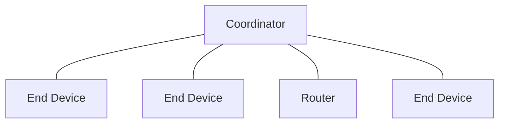

**2. Tree Topology**
Hierarchical arrangement with coordinator at root; routers form branches.

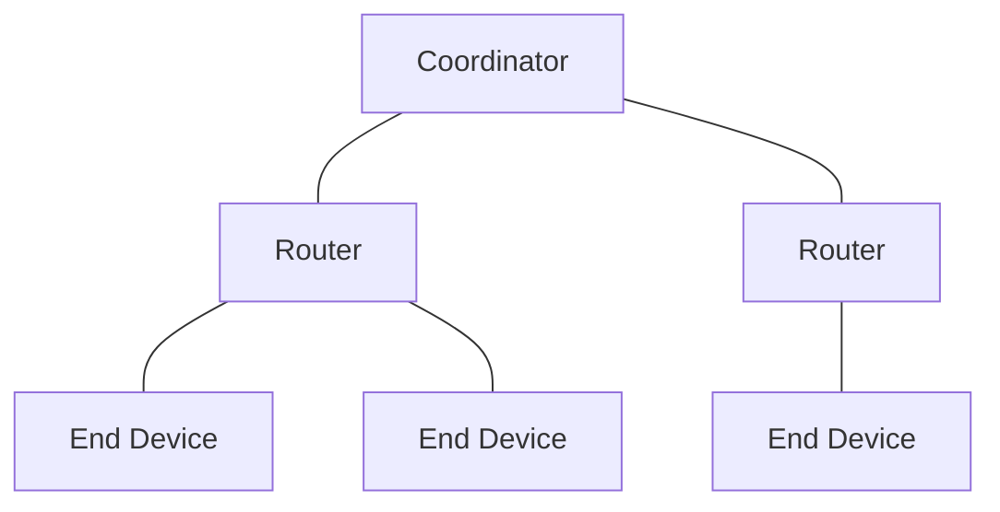

**3. Mesh Topology**
Most robust; routers connect to multiple routers, allowing multiple data paths.

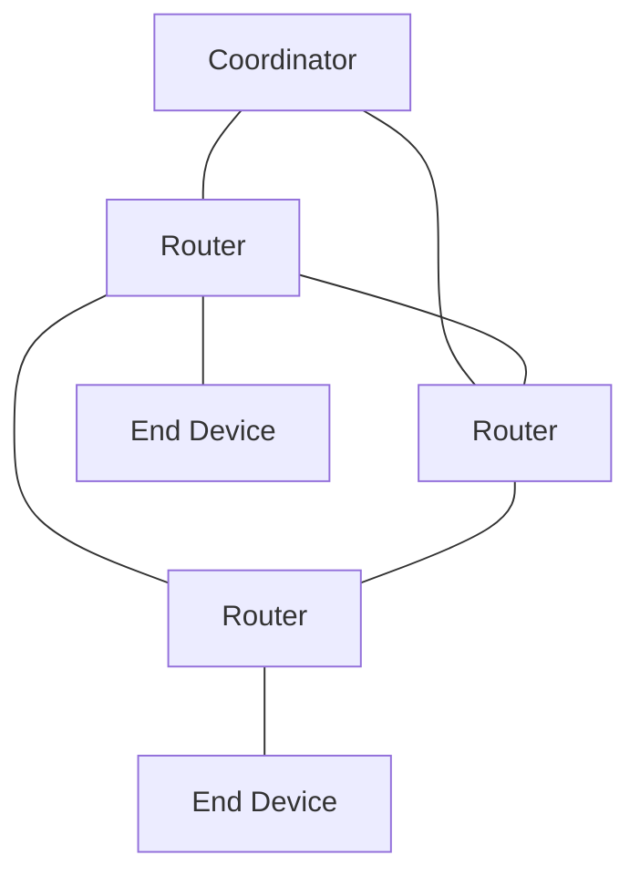

---

**Explain applications of Bluetooth Low Energy (BLE) (5 Marks, May 2023)**
**Explain Bluetooth Low Energy (BLE) role (5 Marks, May 2024)**

Bluetooth Low Energy (BLE) is a low-power, short-range wireless technology designed for IoT devices with strict energy constraints, enabling small data transfers between nearby devices over extended battery life.

**Applications of BLE:**
- **Health Monitoring**: Connects body sensors to smartphones via low-power network.
- **Indoor Positioning**: Beacons broadcast signals for location tracking in buildings.
- **Home Automation**: Links sensors, actuators, and gateways with low power use.
- **Asset Tracking**: Beacons enable item finding and proximity-based services.
- **Mobile Payments**: Enables location-aware payment experiences in stores.

**BLE Roles (GAP – Generic Access Profile):**
- **Central (Master)**: Scans for and initiates connections with peripherals.
- **Peripheral (Slave)**: Advertises and waits for connection requests.
- **Broadcaster**: Sends non-connectable advertising data like beacons.
- **Observer**: Listens for broadcast packets without initiating connections.

---

**Write a short note on Near Field Communication (5 Marks, Dec 2024)**
**Write a short note on Near Field Communication (5 Marks, Dec 2025)**

Near Field Communication (NFC) is a short-range, high-frequency wireless communication technology that enables data exchange between devices within a very close proximity, typically a few centimeters.

- **Standard & Frequency**: Based on ISO/IEC 18092 and ISO/IEC 14443 standards; operates at 13.56 MHz.
- **Range & Data Rate**: Works within approximately 4–10 cm; supports data rates of 106, 212, or 424 kbps.
- **Operating Modes**:
  - **Passive Mode**: One device (e.g., tag/card) is powered by the active device's electromagnetic field; the active device reads/writes data.
  - **Active Mode**: Both devices generate their own RF field and exchange data bidirectionally.
- **Key Features**: Fast connection setup (no pairing needed), low power consumption, and inherent security due to very short range.
- **Applications**:
  - **Mobile Payments**: Contactless payments (e.g., Google Pay, Apple Pay).
  - **Access Control**: Key cards, ID badges, and transit tickets.
  - **Data Sharing**: Tap-to-share contacts, photos, or pairing information.
  - **Smart Posters**: Embedded tags that trigger apps or websites.
- **Limitations**: Very short range, low data rate, and limited security for sensitive transactions without additional encryption.

---

**Write short note on RFID (5 Marks, May 2025)**
**Explain the architecture of RFID with its major applications (10 Marks, Dec 2025)**

RFID (Radio Frequency Identification) is a short-range wireless technology that uses radio waves to automatically identify and track objects tagged with a small electronic device, without requiring line-of-sight.
A reader emits a radio-frequency signal that has a tag within range responds with its stored unique identifier, enabling automatic identification and tracking.

- **Tag Types**: Passive tags (no battery, powered by reader's field) and active tags (built-in battery, longer range).
- **Key Advantage**: Unlike barcodes, RFID does not require line-of-sight scanning and can read multiple tags simultaneously, improving inventory accuracy and operational efficiency.

**Architecture of RFID:**
An RFID system consists of four main components working together :
1. **RFID Tag (Transponder)**: Attached to the object to be identified; contains a microchip storing a unique ID and an antenna. Passive tags harvest energy from the reader's signal; active tags use an onboard battery.
2. **RFID Reader (Transceiver)**: Emits radio-frequency signals to activate tags and reads their responses. Consists of an RF module, control unit, and antenna.
3. **RFID Antenna**: Radiates and receives radio signals; may be integrated with the reader or separate. Enables communication between reader and tag.
4. **Middleware / Backend System**: Software that processes raw tag data from readers, filters duplicates, and integrates with enterprise databases and applications.

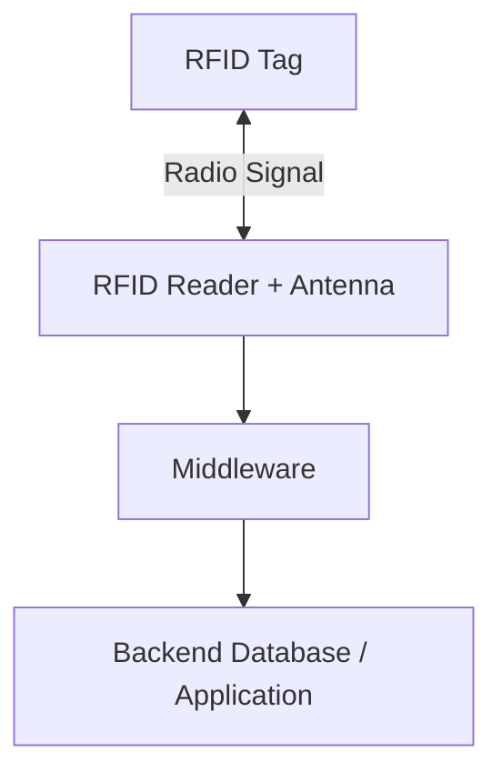

**Major Applications:**
- **Supply Chain & Inventory Management**: Real-time tracking of goods from manufacturing to retail; reduces stockouts and improves accuracy.
- **Access Control**: Contactless cards and key fobs for building entry and vehicle immobilizers.
- **Automated Payment**: Toll collection, transit fare cards, and contactless credit cards.
- **Asset Tracking**: Locating equipment in healthcare, manufacturing, and logistics.
- **Healthcare**: Patient identification, equipment tracking, and surgical instrument management.

---

**Explain the following access technologies with applications area of each: 1) IEEE 802.15.4 2) RFID (10 Marks, Dec 2023)**
**Explain the following access technologies with applications area of each: 1) Zigbee 2) RFID 3) 6LoWPAN 4) CoAP (10 Marks, May 2023)**
**Explain the following access technologies with applications area of each: 1) IEEE 802.15.4 2) Z-wave 3) LTE-A (10 Marks, May 2024)**

**1) IEEE 802.15.4**
IEEE 802.15.4 is the low-rate wireless personal area network (LR-WPAN) standard that defines the physical and MAC layers for low-power, low-data-rate, short-range IoT communication.
- **Frequency & Data Rate**: Operates in 868 MHz, 915 MHz, and 2.4 GHz ISM bands; data rate up to 250 kbps at 2.4 GHz.
- **Topologies**: Supports star and peer-to-peer (mesh) topologies with a PAN coordinator managing the network.
- **Features**: Ultra-low power consumption, low cost, small packet size, and support for duty cycling to extend battery life.
- **Applications**: Home automation, industrial sensing, smart metering, and wireless sensor networks (it is the base for ZigBee, 6LoWPAN, and Thread).

**2) RFID**
RFID (Radio Frequency Identification) is a wireless technology that uses radio waves to automatically identify and track objects tagged with electronic tags, without requiring line-of-sight.
- **Components**: Tag (transponder with microchip and antenna), reader (transceiver), antenna, and backend middleware.
- **Tag Types**: Passive tags (powered by the reader's field, short range) and active tags (onboard battery, longer range).
- **Features**: No line-of-sight needed, multiple tags readable simultaneously, fast automatic identification.
- **Applications**: Supply chain and inventory tracking, access control cards, toll collection, asset tracking, and healthcare patient/equipment identification.

**3) ZigBee**
ZigBee is a low-cost, low-power wireless mesh networking standard built on IEEE 802.15.4, designed for low-data-rate IoT applications.
- **Frequency & Data Rate**: Operates in 868 MHz, 915 MHz, and 2.4 GHz bands; data rate up to 250 kbps.
- **Device Roles**: ZigBee Coordinator (starts/manages network), Router (routes traffic), and End Device (sleeping leaf node).
- **Topologies**: Supports star, tree, and mesh topologies; mesh gives multiple redundant paths for reliability.
- **Applications**: Home automation, smart lighting, smart energy metering, industrial monitoring, and sensor networks.

**4) 6LoWPAN**
6LoWPAN (IPv6 over Low-Power Wireless Personal Area Networks) is an adaptation layer that enables IPv6 packets to be carried over IEEE 802.15.4 low-power networks.
- **Functions**: Header compression, fragmentation, and reassembly to fit IPv6 packets into small 802.15.4 frames.
- **Features**: Brings native IP connectivity to constrained devices, enabling end-to-end communication with the Internet.
- **Advantages**: Reuses existing IP infrastructure, supports interoperability, and enables seamless cloud connectivity for sensors.
- **Applications**: Smart grids, home/building automation, industrial IoT, and environmental monitoring.

**5) CoAP**
CoAP (Constrained Application Protocol) is a lightweight, UDP-based web transfer protocol designed for resource-constrained IoT devices and networks.
- **Design**: RESTful request/response model (GET, POST, PUT, DELETE) similar to HTTP but with a compact binary header.
- **Features**: Low overhead, supports observe (publish-subscribe) mode, block-wise transfer, and DTLS-based security.
- **Advantages**: Works well over 6LoWPAN and lossy networks; much lighter than HTTP for constrained devices.
- **Applications**: Smart home devices, industrial monitoring, smart agriculture, and M2M communication.

**6) Z-Wave**
Z-Wave is a low-power, short-range wireless protocol designed specifically for home automation and smart home control.
- **Frequency**: Operates in sub-1 GHz bands (e.g., 908 MHz in the US, 868 MHz in Europe), reducing interference with Wi-Fi.
- **Topology**: Mesh network supporting up to 232 nodes per network with source-routed communication.
- **Features**: Low power, good range through walls, and strong interoperability among certified devices.
- **Applications**: Smart home lighting, door locks, thermostats, security systems, and energy management.

**7) LTE-A (LTE-Advanced)**
LTE-Advanced is a 4G cellular standard offering high data rates, low latency, and wide coverage, extended to support IoT through LTE-M and NB-IoT variants.
- **Features**: Carrier aggregation, MIMO, high throughput (up to 1 Gbps), and improved spectral efficiency over basic LTE.
- **IoT Variants**: LTE-M (Cat-M1) for moderate-rate IoT and NB-IoT for low-power, low-rate, wide-area sensing.
- **Advantages**: Wide-area coverage, mobility support, reliability, and existing cellular infrastructure reuse.
- **Applications**: Connected vehicles, smart metering, wearables, remote monitoring, and industrial telemetry.

---

**Illustrate the components of IEEE 802.11 architecture with advantages (10 Marks, Dec 2024)**
**Illustrate the components of IEEE 802.11 architecture with advantages (10 Marks, Dec 2025)**

IEEE 802.11 is the family of wireless LAN (WLAN) standards, commonly known as Wi-Fi, that defines wireless communication in the 2.4 GHz, 5 GHz, and 6 GHz bands. Its architecture is built around a set of components that together form a Basic Service Set (BSS) connected to distribution systems.

**Components of IEEE 802.11 architecture:**

**1. Station (STA)**
- Any device with 802.11 wireless interface, such as a laptop, smartphone, or IoT sensor.
- Acts as the endpoint that sends and receives wireless frames.
- Can be an **AP station** (access point) or a **non-AP station** (client).

**2. Access Point (AP)**
- A special station that bridges the wireless network to the wired distribution system.
- Manages association of clients, beacons the network, and handles authentication.
- Forms the **Basic Service Set (BSS)** together with associated stations.

**3. Basic Service Set (BSS)**
- The fundamental building block: a group of stations controlled by a single AP (infrastructure BSS) or communicating directly (independent BSS/IBSS).
- Identified by a **BSSID** (usually the AP's MAC address).

**4. Extended Service Set (ESS)**
- Multiple BSSs connected through a **Distribution System (DS)** (typically wired Ethernet), allowing seamless roaming.
- Identified by an **SSID** (network name visible to users).

**5. Distribution System (DS)**
- The backbone (often wired) that interconnects APs in an ESS.
- Forwards frames between BSSs and to external networks.

**6. Portal**
- The logical gateway connecting the 802.11 network to external networks such as the Internet.

**7. Wireless Medium**
- The shared radio channel (2.4/5/6 GHz) accessed via CSMA/CA to avoid collisions.

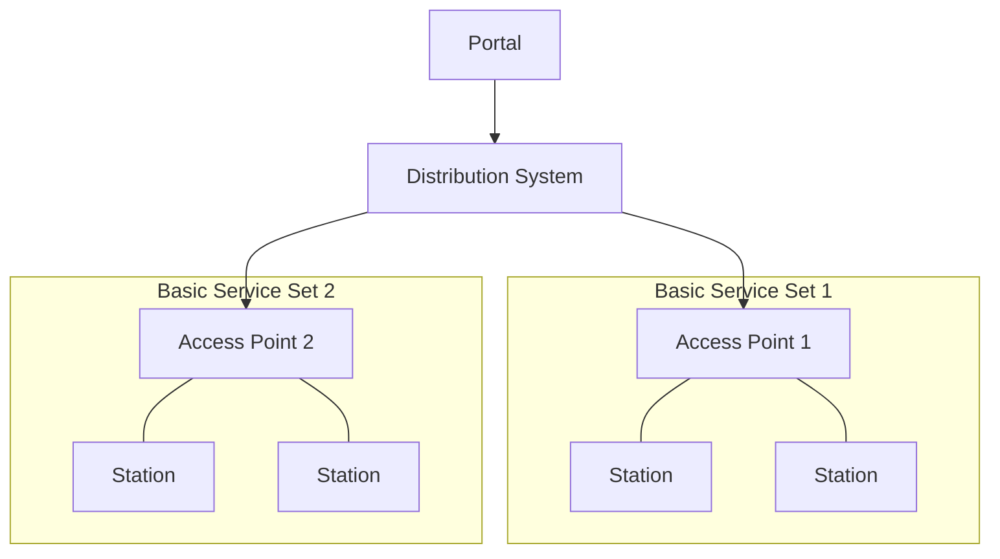

**Advantages:**
- **Mobility**: Users roam freely within an ESS without losing connectivity.
- **Ease of deployment**: No cabling required to each device; fast to install in homes, offices, and IoT environments.
- **Cost-effective**: Reduces wiring and infrastructure costs; shared medium supports many clients.
- **Scalability**: ESS allows expansion by adding more APs to cover larger areas.
- **Flexibility**: Supports infrastructure, ad-hoc (IBSS), and mesh modes for varied use cases.
- **Interoperability**: Standardized by IEEE, ensuring multi-vendor device compatibility.
- **High throughput**: Modern amendments (802.11n/ac/ax) deliver high data rates for bandwidth-intensive IoT and multimedia applications.

---

**Explain the Need of lightweight new communications protocols for IoT (5 Marks, Dec 2023)**

Lightweight communication protocols are needed in IoT because constrained devices and networks cannot afford the overhead of traditional protocols like HTTP and TCP.

- **Resource Constraints**: Devices have limited CPU, memory, and battery; lightweight protocols (MQTT, CoAP) use small headers and minimal processing, preserving energy and memory.
- **Low Bandwidth**: Many IoT links (LPWAN, 802.15.4) offer low data rates; compact protocols reduce payload and protocol overhead, making communication feasible.
- **Energy Efficiency**: Duty cycling, small packets, and fewer round trips extend battery life for multi-year operation.
- **Unreliable/Lossy Networks**: CoAP over UDP with confirmable messages and MQTT QoS provide reliability tailored to lossy links without the cost of full TCP handshakes.
- **Scalability**: Millions of devices need protocols with low per-connection state; broker-based pub/sub (MQTT) and UDP-based CoAP scale better than heavyweight session-oriented protocols.
- **Heterogeneity and Interoperability**: Standardized lightweight protocols enable multi-vendor constrained devices to interoperate.
- **Real-Time Responsiveness**: Minimal handshakes and low latency suit time-sensitive applications such as alarms and industrial control.
- **Fitting the MTU**: Protocols like 6LoWPAN and CoAP are designed around small 802.15.4 frame sizes, avoiding fragmentation where possible.
- **Cost**: Lower processing and bandwidth requirements reduce hardware and network costs for mass deployments.

---

**Describe the communication system and protocols involved in long range communication system of IoT (10 Marks, Dec 2023)**

Long-range IoT communication systems are built on Low-Power Wide-Area Network (LPWAN) technologies, which provide wide coverage at low power and low data rates for battery-operated sensors. The major systems and protocols are:

**1. LoRa / LoRaWAN**
- **Physical Layer (LoRa)**: Uses Chirp Spread Spectrum (CSS) modulation in unlicensed sub-GHz ISM bands, providing long range and robustness against interference.
- **Protocol (LoRaWAN)**: A star-of-stars network architecture where end devices transmit to multiple gateways, which forward packets to a central Network Server via backhaul (cellular, Ethernet, satellite). The server handles security, duplicate filtering, and adaptive data rates.
- **Device Classes**: Class A (lowest power, uplink-triggered receive windows), Class B (scheduled receive windows via beacons), Class C (always listening, mains-powered).
- **Range & Rate**: 5–15 km; up to 50 kbps.

**2. NB-IoT (Narrowband IoT)**
- **Standard**: 3GPP cellular LPWAN operating in licensed LTE bands; uses SC-FDMA uplink and OFDMA downlink.
- **Features**: 180 kHz bandwidth, high link budget for deep indoor penetration, massive device density per cell, and no duty-cycle restrictions.
- **Range & Rate**: 1–10 km; up to 250 kbps.

**3. Sigfox**
- **Approach**: A proprietary ultra-narrowband protocol operating in unlicensed sub-GHz ISM bands, using very low data rates and small payloads.
- **Architecture**: Star topology; devices transmit short messages to base stations, which forward to a cloud network server.
- **Use Case**: Simple, infrequent monitoring (smart meters, asset tracking) where low cost and long battery life are paramount.

**4. LTE-M (LTE Cat-M1)**
- **Standard**: 3GPP cellular technology within licensed LTE bands, offering higher data rates (up to 1 Mbps) than NB-IoT with support for mobility and voice.
- **Positioning**: Suited for wearables, connected vehicles, and applications needing moderate throughput.

| Protocol | Spectrum | Range | Data Rate | Key Strength |
|---|---|---|---|---|
| LoRaWAN | Unlicensed ISM | 5–15 km | ~50 kbps | Low cost, private deployment  |
| NB-IoT | Licensed LTE | 1–10 km | ~250 kbps | Deep penetration, QoS  |
| Sigfox | Unlicensed ISM | ~10+ km | ~100 bps | Ultra-low power, simplicity  |
| LTE-M | Licensed LTE | Cellular coverage | ~1 Mbps | Mobility, higher throughput  |

---

**Evaluate long-range communication systems and protocols such as LTE, LTE-A, LoRa, and LoRaWAN in the context of IoT connectivity. Discuss their suitability for different IoT use cases based on factors like coverage, data rate, power consumption, and scalability (10 Marks, May 2024)**

Long-range IoT connectivity is served by two distinct families: **cellular technologies** (LTE, LTE-A, and their IoT-optimized variants) that operate on licensed spectrum via operator infrastructure, and **LPWAN technologies** (LoRa/LoRaWAN) that typically operate on unlicensed ISM bands with self-deployed or operator-run gateways. Each trades off coverage, data rate, power, and scalability differently.

**1. LTE and LTE-A (Cellular Broadband)**
- **Coverage**: Wide-area coverage via existing cellular towers; LTE-A adds carrier aggregation and MIMO for improved spectral efficiency.
- **Data Rate**: LTE supports up to ~1 Gbps peak (LTE-A higher), far exceeding typical IoT sensor needs.
- **Power Consumption**: High relative to LPWAN; continuous signaling and higher throughput drain batteries quickly, unsuitable for years-long battery operation.
- **Scalability**: Network capacity is shared with human users; massive IoT device counts can congest cells unless using IoT-specific variants (NB-IoT, LTE-M).
- **Suitability**: Connected vehicles, video surveillance, industrial gateways, and applications needing high bandwidth or low latency which means not battery-constrained sensors.

**2. LoRa (Physical Layer) and LoRaWAN (Network Protocol)**
- **Coverage**: LoRa uses Chirp Spread Spectrum (CSS) in sub-GHz ISM bands, achieving 5–15 km in rural areas but often limited to ~1 km in dense urban environments due to obstacles. Higher spreading factors extend range at the cost of data rate.
- **Data Rate**: Very low which means typically 0.3–50 kbps depending on spreading factor and bandwidth. Suitable only for small, infrequent payloads.
- **Power Consumption**: Extremely low; devices can achieve 2+ years of battery life, with Class A devices optimized for battery usage.
- **Scalability**: LoRaWAN suffers from ALOHA-based medium access and duty-cycle limitations; collision rates rise significantly above ~1000 devices per gateway, degrading packet delivery. Adaptive Data Rate (ADR) helps but is mainly effective for stationary devices.
- **Suitability**: Smart metering, environmental sensing, agriculture monitoring, and asset tracking in private or operator-deployed networks where low cost and long battery life matter more than throughput or latency.

| Factor          | LTE / LTE-A                                    | LoRa / LoRaWAN                                               |
| --------------- | ---------------------------------------------- | ------------------------------------------------------------ |
| **Coverage**    | Wide-area cellular                             | 1–15 km (environment-dependent)                              |
| **Data Rate**   | High (Mbps–Gbps)                               | Very low (kbps)                                              |
| **Power**       | High                                           | Very low (years of battery)                                  |
| **Scalability** | Shared with human traffic; IoT variants needed | Limited by collisions/duty cycle above ~1000 devices/gateway |
| **Spectrum**    | Licensed (operator)                            | Unlicensed ISM                                               |
| **Best For**    | High-bandwidth, low-latency, mains-powered     | Low-power, low-rate, battery-operated sensors                |

---

**Explain the architecture of LoRaWAN with its major Characteristics (10 Marks, May 2023)**
**Explain the architecture of LoRaWAN with its major Characteristics (10 Marks, Dec 2024)**
**Explain the architecture of LoRaWAN with its major characteristics (10 Marks, May 2025)**

LoRaWAN is an open MAC-layer specification built on top of the LoRa physical layer (Chirp Spread Spectrum), designed for low-power, long-range, low-data-rate IoT communication in unlicensed ISM bands.

**Architecture of LoRaWAN:**
The network follows a **star-of-stars topology** in which end devices communicate directly (single-hop) with one or more gateways, and gateways forward packets to a central Network Server over IP backhaul.

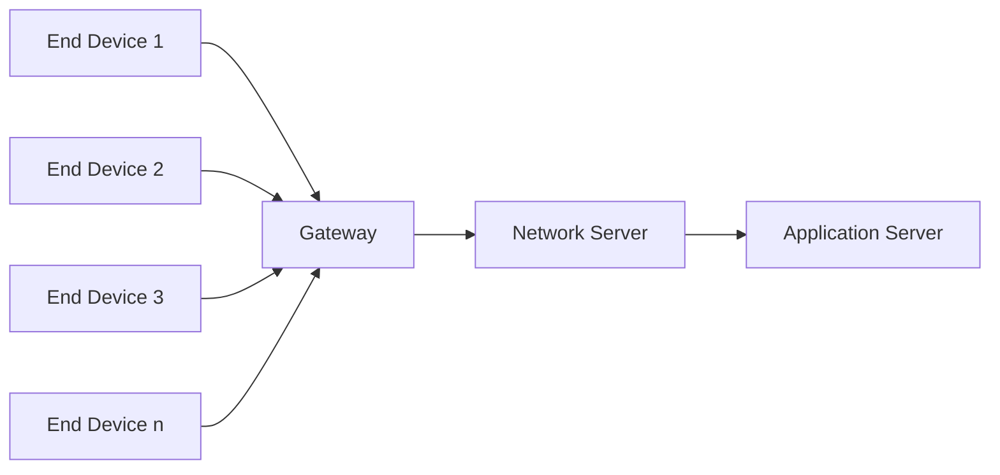

1. **End Devices**: Battery-powered sensors/actuators that transmit uplinks using ALOHA (random access, no carrier sense). They operate in one of three classes (A, B, or C) to balance energy consumption against downlink latency.
2. **Gateways**: Receive LoRa frames from end devices and forward them to the Network Server over Ethernet or cellular backhaul. Gateways are always powered on and perform no processing beyond packet forwarding.
3. **Network Server (NS)**: Manages the network, deduplicates packets arriving from multiple gateways, handles Adaptive Data Rate (ADR) control, and routes uplinks to the appropriate Application Server. It also manages security keys.
4. **Application Server (AS)**: Hosts the user application logic, processes payload data, and presents results to end users.
5. **Join Server (JS)**: Handles Over-the-Air Activation (OTAA) and manages device root keys for secure join procedures.

**Major Characteristics:**
1. **Long Range**: Achieves 2–5 km in urban areas and up to 15 km in rural line-of-sight conditions through Chirp Spread Spectrum modulation.
2. **Low Power Consumption**: Class A devices open receive windows only after uplink transmission, enabling 5–10 years of battery life on a single cell.
3. **Low Data Rate**: Supports 0.3–50 kbps depending on Spreading Factor (SF7–SF12) and bandwidth (125/250/500 kHz), sufficient for small, infrequent sensor payloads.
4. **Adaptive Data Rate (ADR)**: The Network Server instructs end devices to adjust Spreading Factor and transmit power to optimize airtime and energy based on link quality.
5. **Three Device Classes**: **Class A** (lowest power, uplink-triggered receive windows), **Class B** (scheduled receive windows via beacon synchronization), and **Class C** (always listening, mains-powered).
6. **Bidirectional Communication with Security**: Supports downlink messages and uses AES-128 encryption with separate Network Session Key and Application Session Key for end-to-end security.
7. **Scalability Trade-off**: ALOHA-based MAC causes collision probability to rise under dense deployments; duty-cycle limits (e.g., 1% in Europe) restrict throughput per device.

---

///
### **Module IV: Edge to Cloud Protocols**

**Elaborate MQTT with its working in details and two advantages over COAP (10 Marks, Dec 2023)**
**Draw and explain Architecture of MQTT with diagram (10 Marks, May 2023)**
**Explain in brief the MQTT Architecture with Advantages (10 Marks, Dec 2024)**
**Draw and explain the architecture of MQTT with diagram (10 Marks, May 2025)**
**Explain in brief the MQTT Architecture with Advantages (10 Marks, Dec 2025)**

**Elaborate MQTT with its working in details and two advantages over COAP. (10 Marks, Dec 2023)**
**Draw and explain Architecture of MQTT with diagram. (10 Marks, May 2023 / May 2025)**
**Explain in brief the MQTT Architecture with Advantages. (10 Marks, Dec 2024 / Dec 2025)**

MQTT (Message Queuing Telemetry Transport) is a lightweight, publish-subscribe messaging protocol built on TCP/IP, designed for resource-constrained IoT devices and unreliable, low-bandwidth networks.

**Architecture of MQTT:**
MQTT follows a **publish-subscribe** model with a central broker that decouples publishers from subscribers through topics.

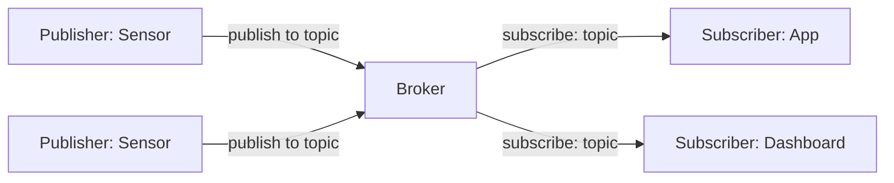

1. **Publisher (Client)**: A device or application that publishes messages to a topic on the broker. It does not know who receives the message.
2. **Subscriber (Client)**: A device or application that subscribes to one or more topics and receives matching messages from the broker.
3. **Broker**: The central server that receives all published messages, filters them by topic, and forwards them to matching subscribers. It manages client sessions, subscriptions, and message delivery guarantees.
4. **Topics**: Hierarchical, slash-separated strings (e.g., `home/room1/temperature`) used for message routing. Wildcards (`+` for single level, `#` for multi-level) allow flexible subscriptions.

**Working of MQTT:**
1. **Connect**: The client establishes a TCP connection to the broker and sends a CONNECT packet with a client ID and optional credentials.
2. **Authenticate & Session**: The broker authenticates the client (if configured) and returns CONNACK; persistent sessions can store subscriptions and queued messages.
3. **Subscribe**: A subscriber sends a SUBSCRIBE packet with a topic filter; the broker responds with SUBACK.
4. **Publish**: A publisher sends a PUBLISH packet to a topic; the broker forwards it to all matching subscribers.
5. **QoS Levels**: Delivery guarantees are set per message  which means  **QoS 0** (at most once, fire-and-forget), **QoS 1** (at least once, may duplicate), **QoS 2** (exactly once, four-way handshake).
6. **Keep-Alive & Disconnect**: Clients send PINGREQ packets to maintain the connection; a DISCONNECT packet closes the session cleanly.

**Advantages of MQTT over CoAP:**
1. **Publish-Subscribe Decoupling**: MQTT's broker-based model decouples publishers from subscribers, enabling one-to-many and many-to-many communication with flexible topic-based routing. CoAP is request-response oriented (like HTTP), requiring the client to know the server resource, making fan-out and event-driven delivery less natural.
2. **Reliable Delivery over TCP with QoS**: MQTT runs over TCP and offers three QoS levels (0, 1, 2) including exactly-once delivery. CoAP runs over UDP and provides only confirmable/non-confirmable messages without a true exactly-once guarantee, relying on application-level retries for reliability.

**Other Advantages:**
- **Lightweight overhead**: Minimal 2-byte fixed header suits constrained devices.
- **Persistent sessions**: Subscriptions and undelivered messages survive disconnections.
- **Scalability**: Brokers handle large numbers of clients and topics efficiently.
- **Last Will and Testament**: The broker notifies subscribers automatically if a client disconnects unexpectedly.

---

**Briefly elaborate the COAP (5 Marks, May 2024)**
**Explain working of Constraint Application Layer protocol (CoAP) (10 Marks, May 2025)**
**Explain the following terms: 1) CoAP 2) Data Lakes (10 Marks, Dec 2024)**
**Explain the following terms: 1) Constrained Application Protocol 2) Streaming Text Oriented Message Protocol (10 Marks, Dec 2025)**

**1) CoAP (Constrained Application Protocol)**

CoAP is a lightweight, UDP-based web transfer protocol designed for resource-constrained IoT devices and lossy networks, modeled on the RESTful HTTP request/response style.

**Working of CoAP:**
- **Request/Response Model**: Clients send requests (GET, POST, PUT, DELETE) to resources identified by URIs; servers respond with a status code and payload, mirroring HTTP semantics in a compact binary format.
- **Message Types**: **CON** (Confirmable  which means  requires ACK, reliable), **NON** (Non-confirmable  which means  no ACK, best-effort), **ACK** (acknowledgement), and **RST** (reset on error).
- **Message Layer**: Handles reliability over UDP via message IDs and retransmission timers for CON messages; detects duplicates.
- **Request/Response Layer**: Carries method and response codes; supports **piggybacked** responses (in the ACK) or **separate** responses for slow servers.
- **Observe Mode**: A client can register to receive notifications when a resource changes, enabling publish-subscribe-like behavior over UDP.
- **Block-wise Transfer**: Large payloads are split into blocks for transmission over constrained links.
- **Security**: Uses **DTLS** (Datagram TLS) for confidentiality, integrity, and authentication.

**Advantages:** Low header overhead (4-byte fixed header), works over UDP, suitable for 6LoWPAN, supports multicast and resource discovery (/.well-known/core).

**2) Data Lakes**

A data lake is a centralized repository that stores vast amounts of **raw, structured, semi-structured, and unstructured data** in its native format at any scale.
- **Schema-on-Read**: Unlike data warehouses (schema-on-write), a data lake applies structure only when data is read, allowing flexible exploration.
- **Storage**: Built on cheap, scalable object storage (e.g., HDFS, Amazon S3) holding logs, sensor streams, images, JSON, and more.
- **Processing**: Tools like Spark, Presto, and Hive query and transform data for analytics, machine learning, and reporting.
- **Use in IoT**: Stores high-volume device telemetry and multimodal data for later analytics, supporting predictive maintenance and pattern discovery.
- **Risks**: Without governance, a data lake can become a "data swamp"  which means  unorganized and hard to use.

**3) STOMP (Streaming Text Oriented Message Protocol)**

STOMP is a simple, text-based messaging protocol that provides an interoperable wire format for clients to communicate with message brokers.
- **Design**: Frames are text-based with a command, headers, and optional body (e.g., `CONNECT`, `SEND`, `SUBSCRIBE`, `MESSAGE`, `ACK`, `DISCONNECT`), making it easy to implement and debug.
- **Model**: Supports publish-subscribe and point-to-point messaging through brokers (e.g., ActiveMQ, RabbitMQ).
- **Transport**: Typically runs over TCP or WebSocket; language-agnostic, so any client that speaks the frame format can interoperate.
- **Use in IoT**: Enables lightweight messaging between devices and brokers, especially where WebSocket connectivity to browsers is needed.
- **Advantages**: Simplicity, cross-language interoperability, and broker independence; **limitation**: less feature-rich than MQTT for constrained devices and lacks built-in QoS semantics comparable to MQTT.

---

**Briefly elaborate the Advanced Message Queuing Protocol (AMQP) (5 Marks, May 2023)**
**Describe the Architecture of Advanced Message Queuing Protocol (AMQP) with major application (10 Marks, Dec 2024)**
**Describe the Architecture of Advanced Message Queuing Protocol (AMQP) with major application (10 Marks, Dec 2025)**
**Draw the Architecture diagram of Advanced Message Queuing Protocol (AMQP) with advantages (5 Marks, May 2025)**

AMQP is an open, binary wire-level messaging protocol designed for reliable, interoperable enterprise messaging between applications and brokers.

- **Standard & Nature**: OASIS and ISO/IEC standard; binary protocol over TCP for efficient, reliable message exchange.
- **Core Model**: Producer publishes to an **exchange**; exchange routes to **queues** via **bindings** and **routing keys**; consumer receives from queues.
- **Reliability**: Supports message acknowledgements, persistent messages, and transactions to guarantee delivery.
- **Use**: Enterprise messaging, financial transactions, and reliable IoT backends.

**Describe the Architecture of Advanced Message Queuing Protocol (AMQP) with major application. (10 Marks, Dec 2024 / Dec 2025)**
**Draw the Architecture diagram of Advanced Message Queuing Protocol (AMQP) with advantages. (5 Marks, May 2025)**

AMQP architecture is a broker-centric model where producers and consumers interact through exchanges and queues, decoupling message senders from receivers.

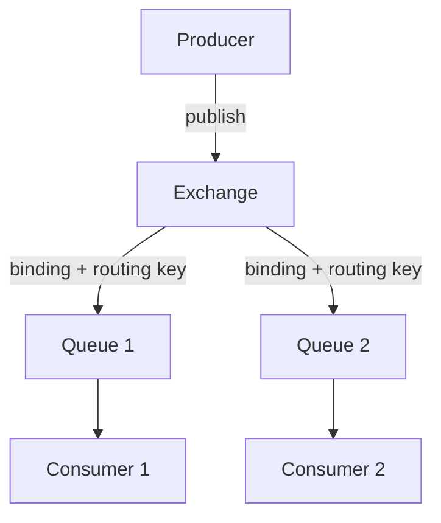

**Architecture Components:**
1. **Producer**: Application that publishes messages to an exchange. It sets a routing key and message attributes.
2. **Exchange**: Receives messages and routes them to queues based on **bindings** and **routing keys**. Common types: **direct** (exact match), **topic** (pattern match), **fanout** (broadcast), **headers** (header match).
3. **Queue**: Stores messages until consumed. Can be durable (persisted to disk) or transient; bound to exchanges via bindings.
4. **Binding & Routing Key**: Binding links a queue to an exchange; routing key is a message attribute the exchange uses to decide which queues receive the message.
5. **Consumer**: Application that subscribes to a queue and receives messages. Supports **acknowledgements**  which means  broker removes message only after consumer confirms processing.
6. **Broker**: The central server hosting exchanges and queues; manages connections, channels, security, and message persistence.

**Major Applications:**
- **Enterprise Messaging & Financial Systems**: Reliable transaction processing and order handling in banking and trading.
- **IoT Backend & Cloud**: Reliable device telemetry ingestion, especially where ordered, guaranteed delivery matters (e.g., Azure IoT Hub supports AMQP).
- **Microservices & Job Queues**: Asynchronous task distribution and inter-service communication.

**Advantages:**
- **High Reliability**: Acknowledgements, persistence, and transactions ensure messages are not lost.
- **Flexible Routing**: Multiple exchange types support complex routing patterns (direct, topic, fanout, headers).
- **Interoperability**: Open standard with implementations across languages and platforms.
- **Flow Control**: Built-in mechanisms prevent consumers from being overwhelmed.
- **Security**: Supports TLS and SASL authentication.

---

**State the Comparison's of all Protocols used in IOT for cloud Edge (10 Marks, Dec 2024)**
**State the Comparison's of all Protocols used in IOT for cloud Edge (10 Marks, Dec 2025)**

IoT cloud-edge communication relies on application-layer protocols that differ in transport, communication paradigm, reliability, and resource overhead.

**1. MQTT**
- **Transport**: TCP
- **Paradigm**: Publish/Subscribe via broker
- **QoS**: QoS 0, 1, 2 (at most once, at least once, exactly once)
- **Overhead**: Low (2-byte fixed header)
- **Best Suited For**: Low-power sensors, real-time telemetry, many-to-many messaging

**2. CoAP**
- **Transport**: UDP
- **Paradigm**: Request/Response (RESTful)
- **QoS**: Confirmable/Non-confirmable messages with retransmission
- **Overhead**: Very low (4-byte header)
- **Best Suited For**: Constrained devices, battery-operated nodes, lossy networks

**3. AMQP**
- **Transport**: TCP
- **Paradigm**: Publish/Subscribe via exchange and queue
- **QoS**: At-least-once, transactions, acknowledgements
- **Overhead**: High
- **Best Suited For**: Enterprise messaging, banking, reliable cloud backends

**4. HTTP**
- **Transport**: TCP
- **Paradigm**: Request/Response
- **QoS**: TCP-based reliability
- **Overhead**: Very high (text headers)
- **Best Suited For**: Web integration, devices with ample resources

**5. DDS**
- **Transport**: UDP/TCP
- **Paradigm**: Publish/Subscribe (peer-to-peer, brokerless)
- **QoS**: 20+ QoS policies (rich real-time control)
- **Overhead**: High (dynamic discovery)
- **Best Suited For**: Real-time autonomous systems, industrial control

**6. WebSocket**
- **Transport**: TCP
- **Paradigm**: Bidirectional full-duplex
- **QoS**: TCP-based reliability
- **Overhead**: Medium
- **Best Suited For**: Real-time bidirectional apps, dashboards, browser connectivity

---

**Explain the role of HTTP, WebSocket, and MQTT in IoT communication. Compare and contrast these protocols in terms of their characteristics, suitability for different IoT scenarios, and support for real-time data transmission (10 Marks, May 2024)**

HTTP, WebSocket, and MQTT serve different communication needs in IoT. HTTP provides a familiar request-response model for web integration, WebSocket enables persistent bidirectional channels for browser-based real-time interaction, and MQTT offers a lightweight publish-subscribe standard optimized for constrained devices and unreliable networks.

**1. HTTP (Hypertext Transfer Protocol)**
- **Role**: A request-response protocol over TCP where the client initiates a request and the server returns a response; widely used for web APIs and simple device-to-cloud interactions.
- **Characteristics**: Text-based headers with high overhead; stateless by default; each request opens a new connection (or reuses via keep-alive).
- **Real-Time Support**: Poor. The client must poll the server repeatedly for updates, introducing latency and wasted bandwidth.
- **Suitability**: Devices with ample resources (mains-powered gateways, cameras) and scenarios needing RESTful integration with existing web services; not ideal for constrained sensors or event-driven telemetry.

**2. WebSocket**
- **Role**: A full-duplex communication protocol over a single persistent TCP connection, enabling the server to push data to the client without polling.
- **Characteristics**: Low per-message overhead after the initial HTTP handshake; maintains a continuous connection; ideal for browser-based dashboards and interactive control.
- **Real-Time Support**: Strong. Both client and server can send messages at any time, enabling immediate updates and control commands.
- **Suitability**: Smart home control interfaces, live monitoring dashboards, and any IoT application where a web browser needs real-time bidirectional interaction with devices. Less suited to ultra-constrained battery devices due to the cost of maintaining a persistent TCP connection.

**3. MQTT (Message Queuing Telemetry Transport)**
- **Role**: A lightweight publish-subscribe protocol over TCP where a broker decouples publishers and subscribers; designed specifically for IoT with minimal code footprint and bandwidth usage.
- **Characteristics**: Small message headers; three QoS levels (0: at most once, 1: at least once, 2: exactly once); persistent sessions for unreliable networks; supports TLS and modern authentication.
- **Real-Time Support**: Good. The broker forwards messages immediately upon publication, and QoS 1/2 ensure reliable delivery, though higher QoS adds latency.
- **Suitability**: Constrained sensors and actuators, telemetry ingestion at scale, many-to-many messaging, and deployments over unreliable cellular networks. The de facto standard for device-to-cloud and cloud-to-device IoT messaging.

| Factor        | HTTP                                       | WebSocket                               | MQTT                                    |
| ------------- | ------------------------------------------ | --------------------------------------- | --------------------------------------- |
| **Transport** | TCP                                        | TCP (persistent)                        | TCP (via broker)                        |
| **Model**     | Request-Response                           | Full-duplex bidirectional               | Publish-Subscribe                       |
| **Overhead**  | High (text headers)                        | Low after handshake                     | Very low (small headers)                |
| **Real-Time** | Poor (polling)                             | Strong                                  | Good (broker push)                      |
| **Best For**  | Web API integration, resource-rich devices | Browser dashboards, interactive control | Constrained sensors, scalable telemetry |

---

///
### **Module V: IoT and Data Analytics**

**Explain the importance of IoT Data Analytics (5 Marks, Dec 2024)**
**Explain the importance of IoT Data Analytics (5 Marks, Dec 2025)**
**Explain the importance of IoT Data Analytics (5 Marks, May 2025)**

IoT data analytics is the process of collecting, processing, and analyzing the massive streams of data generated by IoT devices to extract actionable insights and drive intelligent decisions.

**Importance:**
- **Handles Data Volume**: IoT devices generate enormous volumes of continuous data; analytics filters, aggregates, and makes sense of it efficiently.
- **Enables Real-Time Decisions**: Stream analytics processes data as it arrives, supporting instant responses such as anomaly alerts and automated control actions.
- **Predictive Maintenance**: Analyzes device sensor trends to predict failures before they occur, reducing downtime and maintenance costs.
- **Improves Operational Efficiency**: Identifies patterns and inefficiencies in processes, enabling optimization of resources and energy usage.
- **Supports Business Intelligence**: Transforms raw sensor data into insights for forecasting, planning, and strategic decision-making.
- **Enhances Security and Safety**: Detects unusual patterns and threats in real time, enabling rapid incident response.
- **Enables Personalization and New Services**: Drives personalized recommendations, usage-based services, and new data-driven business models.
- **Reduces Cost**: Prevents failures, optimizes operations, and avoids unnecessary manual monitoring, lowering overall operational expenditure.

---

**Define the role of analytics in IoT technology and elaborate the challenges associated with it (10 Marks, May 2024)**

IoT analytics is the process of collecting, processing, and analyzing the massive streams of data generated by IoT devices to extract actionable insights and drive intelligent decisions.

**Role of Analytics in IoT Technology:**
1. **Data Processing and Sense-Making**: IoT devices generate enormous volumes of continuous, heterogeneous data. Analytics filters, aggregates, and converts raw sensor readings into meaningful information.
2. **Real-Time Monitoring and Response**: Stream analytics processes data as it arrives, enabling instant anomaly detection, alerts, and automated control actions (e.g., shutting off a valve when pressure exceeds a threshold).
3. **Predictive Maintenance**: Analyzes trends in device telemetry to predict failures before they occur, reducing downtime and maintenance costs.
4. **Operational Optimization**: Identifies inefficiencies in processes, energy usage, and resource allocation, enabling continuous improvement.
5. **Business Intelligence and Forecasting**: Transforms sensor data into insights for demand forecasting, capacity planning, and strategic decision-making.
6. **Security and Safety**: Detects unusual patterns and threats in real time, enabling rapid incident response and compliance monitoring.
7. **New Services and Personalization**: Drives personalized recommendations, usage-based services, and data-driven business models.

**Challenges Associated with IoT Analytics:**
1. **Volume and Velocity**: IoT generates massive, high-speed data streams that overwhelm traditional batch analytics; real-time processing demands scalable streaming infrastructure.
2. **Heterogeneity and Data Quality**: Data arrives in diverse formats from many device types; missing values, noise, and inconsistent schemas complicate integration and analysis.
3. **Latency Requirements**: Many applications need sub-second response times; moving data to a distant cloud introduces latency, requiring edge/fog analytics.
4. **Storage and Bandwidth Constraints**: Transmitting and storing all raw data is costly and often infeasible; decisions must be made about what to process locally versus centrally.
5. **Security and Privacy**: Analytics often involves sensitive personal or operational data; breaches and misuse raise serious privacy and compliance concerns.
6. **Interoperability**: Multi-vendor devices and protocols produce siloed data, making unified analytics difficult without standardization.
7. **Scalability**: Analytics pipelines must scale to millions of devices and growing data volumes without degradation.
8. **Skill and Cost**: Building and maintaining analytics infrastructure requires specialized expertise and significant investment.

---

**Compare and contrast IoT data analytics and IoT network analytics (5 Marks, May 2023)**

| Factor                | IoT Data Analytics                                                   | IoT Network Analytics                                                        |
| --------------------- | -------------------------------------------------------------------- | ---------------------------------------------------------------------------- |
| **Focus**             | Content of sensor/device data                                        | Traffic, connectivity, and network behavior                                  |
| **Data Analyzed**     | Sensor readings, telemetry, events, logs                             | Packet flows, link quality, latency, topology                                |
| **Goal**              | Derive business insights, predictions, anomalies in sensed phenomena | Ensure network performance, reliability, security, and resource optimization |
| **Techniques**        | Statistical analysis, ML, stream processing                          | Traffic monitoring, fault detection, QoS analysis                            |
| **Typical Questions** | "Will this machine fail?" "What is the trend in temperature?"        | "Is the network congested?" "Which nodes are dropping packets?"              |
| **Beneficiaries**     | Business users, operations, data scientists                          | Network operators, administrators, security teams                            |
| **Output**            | Dashboards, predictions, alerts on physical events                   | Network health reports, fault alerts, optimization actions                   |

---

**Describe the role of NoSQL in IoT Data Analytics Challenges (10 Marks, Dec 2024)**
**Describe the role of NoSQL in IoT Data Analytics Challenges (10 Marks, Dec 2025)**
**Explain the role of NoSQL in IoT data analytics (10 Marks, May 2025)**

NoSQL databases play a central role in addressing IoT data analytics challenges by providing scalable, flexible storage for the massive, heterogeneous, high-velocity data streams that traditional relational databases cannot handle efficiently.

**Role of NoSQL in IoT Data Analytics Challenges:**

**1. Handling Volume and Velocity (Scalability)**
- IoT generates massive volumes of sensor data at high rates. Distributed NoSQL datastores provide horizontal scalability through data partitioning and replication, unlike relational databases that struggle with scalability and single points of failure.
- NoSQL approaches demonstrate high horizontal scalability and the ability to absorb large volumes of high-velocity data with low latency even under heavy load.

**2. Managing Heterogeneity (Flexible Schema)**
- IoT devices produce diverse data formats. Relational databases with rigid schemas make managing heterogeneity difficult.
- NoSQL databases store data in schema-less or flexible structures, allowing complex and varied sensor data to be stored directly without rigid table definitions.

**3. Supporting High-Speed Data Ingestion**
- Relational databases exhibit slow loading of massive logs at high rates due to strong consistency mechanisms.
- NoSQL datastores are optimized for fast read and write processes with concurrent access involving large amounts of data, making them suitable for continuous sensor stream ingestion.

**4. Enabling Time-Series Data Management**
- IoT data is inherently time-series. NoSQL solutions like MongoDB, Cassandra, and InfluxDB are used for maintaining and retrieving gigabytes of real industrial IoT data.
- Key-Value NoSQL databases are suitable for applications retrieving short time segments without extensive queries, while time-series databases suit applications benefiting from time-series functions such as interpolation.

**5. Supporting Edge and Cloud Analytics**
- NoSQL datastores integrated with edge computing and in-memory query processing help overcome limitations of both RDBMS and NoSQL for advanced analytics.
- MongoDB is used in IoT sensor information management systems, with deployment at the edge of cloud infrastructure to improve message handling performance.

**Limitations of NoSQL in IoT Analytics:**
- **Limited Query Processing**: The simple query processing capabilities of NoSQL datastores limit advanced analytics compared to relational systems.
- **Consistency Trade-offs**: NoSQL approaches have limitations in consistency and transactional management, which may constrain critical IoT applications requiring strict data integrity guarantees.
- **Hybrid Approaches**: Integrating in-memory databases or edge computing with NoSQL backends can potentially overcome these limitations for advanced analytics.

---

**Elaborate in detail the strategies to organize Data for IoT Analytics (10 Marks, Dec 2023)**

IoT devices generate continuous streams of structured, semi-structured, and unstructured data. Organizing this data properly improves storage efficiency, processing speed, analytical accuracy, and decision-making.

**Strategies**
1. **Data classification**: Categorize information by source, type, importance, and purpose. For example, classify temperature readings, video streams, and device logs separately.
2. **Data filtering and cleaning**: Remove duplicate records, identify missing values, correct invalid readings, and handle noisy sensor data.
3. **Data integration:** Combine data from multiple sensors, gateways, databases, and external sources using common identifiers and timestamps.
4. **Data storage**: Select suitable storage systems according to the data and workload:
	- Relational databases for structured records.
	- NoSQL databases for flexible, high-volume data.
	- Time-series databases for timestamped sensor readings.
	- Data lakes for large collections of raw data.
5. **Metadata and cataloguing**: Maintain descriptions of datasets, their sources, formats, timestamps, ownership, and meanings. This makes data easier to discover and understand.
6. **Batch and stream processing**: Use batch processing for historical analysis and stream processing for immediate monitoring and alerts.
7. **Security and governance**: Apply access controls, encryption, retention policies, and data-quality rules.

---

**Illustrate the role of Data refineries in preventing data lakes to turn into data swamps (10 Marks, Dec 2023)**

A data refinery is a set of processes and tools that transforms raw data into clean, organized, documented, and trustworthy information suitable for analytics.

A data lake stores large volumes of raw data in its original format. Without proper organization and governance, it may become a data swamp, where data is difficult to find, understand, trust, or use.

**Role of data refineries**
1. **Data ingestion:** Collects data from IoT sensors, applications, databases, and other sources.
2. **Data cleansing**: Removes duplicates, corrects errors, and handles missing or inconsistent values.
3. **Data transformation**: Converts data into suitable formats, standardizes units, and aligns timestamps.
4. **Metadata management**: Adds descriptions, source information, ownership, and searchable catalogue entries.
5. **Data quality validation:** Checks completeness, accuracy, consistency, and validity before analytical use.
6. **Data governance**: Enforces access permissions, privacy rules, retention policies, and data ownership.
7. **Data preparation**: Produces curated datasets for dashboards, machine learning, and business intelligence.

|Aspect|Data Lake|Data Swamp|
|---|---|---|
|Organization|Managed and discoverable|Poorly organized|
|Metadata|Available and searchable|Missing or incomplete|
|Data quality|Monitored and validated|Uncertain or inconsistent|
|Governance|Access rules enforced|Weak controls|
|Analytical use|Suitable for analysis|Difficult to use|

---

**Explain data retention strategy (5 Marks, Dec 2023)**
**Explain data retention strategy (5 Marks, May 2024)**

A data retention strategy in IoT defines how long different types of device data are kept, where they are stored, and when they are deleted or archived, balancing analytical value against storage cost and compliance requirements.

**Key Elements:**
- **Tiered Storage**: Recent "hot" data stays in fast databases for real-time queries; older "cold" data moves to cheaper object storage (e.g., Blob, S3) for long-term archival.
- **Retention Periods by Data Type**: Raw telemetry may be kept for days (e.g., 3–5 days), aggregated hourly data for weeks, and daily summaries for months or years.
- **Aggregation Before Deletion**: High-frequency raw data is downsampled into coarser aggregates (e.g., hourly averages, daily totals) so analytical value survives after raw points are purged.
- **Automated Lifecycle Policies**: Rules trigger backup, archival, and deletion automatically once data exceeds its configured retention window.

**Goals:**
- Minimize storage cost while preserving data needed for trend analysis and compliance.
- Avoid retaining irrelevant or redundant data that increases management and security burden.

---

**Illustrate 3 methods for effective Data Visualization (10 Marks, Dec 2023)**
**Explain effective Data Visualization methods With suitable example (10 Marks, Dec 2024)**
**Explain effective Data Visualization methods With suitable example (10 Marks, Dec 2025)**

Effective data visualization selects the visual form that best matches the data and the insight to be communicated, making patterns, comparisons, and unusual readings easy to understand.

**1. Bar Chart**
- **Method**: Compares discrete categories using rectangular bars whose length encodes value.
- **Example**: Energy consumption by room (kitchen, bedroom, hall), making the highest-consuming room immediately visible.

**2. Line Chart**
- **Method**: Shows how a value changes over a continuous period, with time on the x-axis.
- **Example**: Hourly temperature across a day, revealing peaks, dips, and overall trend.

**3. Heat Map**
- **Method**: Uses color intensity to represent value magnitude across a matrix or spatial grid.
- **Example**: Room temperatures or sensor activity across a building floor, where darker shades flag hot or busy zones.

**4. Pie Chart**
- **Method**: Shows proportions of a whole as angular slices summing to 100%.
- **Example**: Percentage of total energy used by each appliance (AC, fridge, lighting), highlighting dominant consumers.

**5. Scatter Plot**
- **Method**: Plots two variables on x and y axes to reveal relationships, clusters, and correlations.
- **Example**: Humidity vs. temperature readings, showing whether higher humidity coincides with higher temperature.

**6. Geospatial Map**
- **Method**: Plots data on a geographic map to expose location-based patterns.
- **Example**: Pollution levels across a city, revealing hotspots near industrial or traffic-dense areas.

---

**State advantages of data visualisation. Give different tools used for it (10 Marks, May 2023)**

Data visualization is the graphical representation of data and information using charts, graphs, maps, and dashboards to make patterns, trends, and outliers easy to understand.

**Advantages of Data Visualization:**
1. **Faster Comprehension**: Visuals convey large amounts of information quickly, letting viewers grasp trends and patterns at a glance that would take hours to read as tables or text.
2. **Pattern and Trend Discovery**: Charts reveal correlations, seasonality, and anomalies that are hidden in raw data, supporting better analytical insight.
3. **Supports Data-Driven Decisions**: Clear visuals help stakeholders make faster, evidence-based decisions without needing deep statistical expertise.
4. **Improved Data Quality Awareness**: Visualizing data exposes missing values, outliers, and inconsistencies, prompting corrective action.
5. **Effective Communication**: Visual storytelling communicates findings to diverse audiences more persuasively than numbers alone, aiding reporting and presentations.
6. **Real-Time Monitoring**: Dashboards display live IoT metrics and alerts, enabling rapid operational response.
7. **Easy Comparison**: Side-by-side visual comparisons of categories, time periods, or groups make differences and benchmarks obvious.
8. **Better Retention and Engagement**: Humans remember visual information better than raw numbers, improving recall and audience engagement.
9. **Democratizes Data**: Self-service visualization tools let non-technical users explore data independently, reducing dependence on specialists.

**Tools Used for Data Visualization:**
**1. Tableau**
- Drag-and-drop dashboarding tool with rich chart types, live data connections, and strong interactive capabilities; widely used in business intelligence.
**2. Power BI (Microsoft)**
- Integrates with Microsoft ecosystem; offers interactive dashboards, natural-language queries, and cloud sharing for enterprise reporting.
**3. QlikView / Qlik Sense**
- Associative in-memory analytics engine that lets users explore relationships between data points dynamically.
**4. Google Data Studio (Looker Studio)**
- Free, cloud-based reporting tool ideal for web analytics and shareable dashboards.
**5. Python Libraries (Matplotlib, Seaborn, Plotly, Bokeh)**
- Programmable plotting libraries used in data science for custom static and interactive visualizations.

---

**Illustrate the following: 1) How to create and visualize alerts in IoT? 2) What are the main challenges of IoT? (10 Marks, May 2025)**

**1) How to Create and Visualize Alerts in IoT**
IoT alerts notify users or systems when sensor data crosses defined thresholds or when anomalous patterns are detected. Creating and visualizing them follows a pipeline from rule definition to notification.

**Steps to Create Alerts:**
- **Define Alert Rules**: Specify conditions on incoming telemetry, such as threshold rules (temperature > 40°C), rate-of-change rules (pressure rising too fast), or anomaly-detection rules (deviation from learned baseline).
- **Ingest and Evaluate**: Stream incoming device data through a rule engine (e.g., Grafana Alerting, AWS IoT Events, Azure Stream Analytics) that continuously evaluates the rules.
- **Set Severity and Conditions**: Classify alerts (critical, warning, info) and add conditions like duration (e.g., threshold exceeded for 5 minutes) to avoid false alarms.
- **Configure Notification Channels**: Route alerts via email, SMS, Slack, webhooks, or trigger automated actions (e.g., shut off a valve).
- **Log and Deduplicate**: Store alert history and suppress duplicate alerts to prevent alert fatigue.

**Visualizing Alerts:**
- **Dashboards**: Display live metrics with threshold lines; triggered alerts change color (e.g., green → red) on gauges and status panels.
- **Alert Panels and Timelines**: Show active alerts in a dedicated panel and plot alert events on a time-series timeline to correlate with data trends.
- **Geospatial Views**: Map alerts by device location so operators see affected zones at a glance.
- **Heat Maps and Status Boards**: Color-coded grids show which devices or sites are in alarm state.

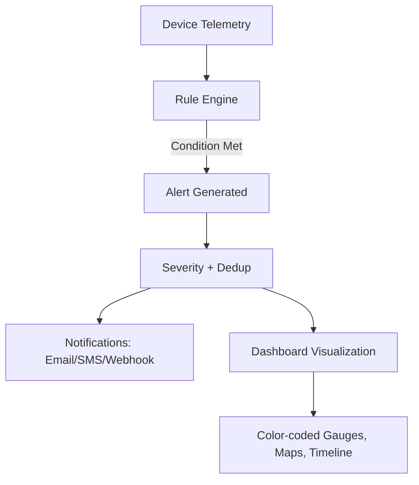

**2) Main Challenges of IoT**
- **Security and Privacy**: Billions of constrained devices expand the attack surface; weak authentication, unpatched firmware, and insecure data transmission risk breaches and privacy loss.
- **Scalability**: Managing millions of devices, connections, and data streams requires scalable addressing, ingestion, and storage infrastructure.
- **Interoperability**: Multi-vendor devices and heterogeneous protocols (ZigBee, BLE, LoRa, Wi-Fi) create integration and standardization challenges.
- **Resource Constraints**: Limited CPU, memory, and battery on devices restrict computation, security, and protocol overhead.
- **Data Volume and Analytics**: High-velocity, heterogeneous data demands real-time processing, edge/fog computing, and efficient storage.
- **Connectivity and Reliability**: Unreliable networks, limited coverage, and dynamic topologies affect consistent data delivery.
- **Power Management**: Battery-powered devices require ultra-low-power protocols and duty cycling for years of operation.
- **Latency**: Time-sensitive applications need edge processing because cloud round-trips introduce delay.
- **Standardization and Governance**: Lack of unified standards complicates deployment, regulation, and compliance.
- **Cost and Complexity**: Deployment, maintenance, and lifecycle management of large fleets are expensive and operationally complex.

---

**How can IoT analytics be effectively utilized within IoT-based healthcare systems? Additionally, what are some essential parameters that should be incorporated into the patient dashboard for comprehensive monitoring and management of health data? (10 Marks, May 2024)**

IoT analytics converts raw physiological data from wearables and medical sensors into actionable clinical insights across edge, fog, and cloud tiers.

**Effective Utilization of IoT Analytics in Healthcare:**
1. **Edge-Level Real-Time Detection**: Processes ECG, SpO₂, glucose, and temperature locally to detect abnormalities instantly, reducing network traffic and enabling immediate alerts.
2. **Cloud-Level Predictive Diagnostics**: ML models analyze historical trends to forecast deterioration, supporting proactive care for chronic diseases.
3. **Personalized Care via Data Aggregation**: Combining vital signs, biochemical, and contextual data enables precision medicine; Explainable AI (XAI) builds clinician trust.
4. **Remote Monitoring and Alerts**: Timely warnings to patients and caregivers reduce hospitalization and enable distant supervision.
5. **Resource Optimization**: Predictive analytics improves hospital workflow and reduces unnecessary in-person visits.

**Essential Parameters for the Patient Dashboard:**
1. **Vital Signs**: Heart rate, ECG, blood pressure, respiratory rate, SpO₂, body temperature.
2. **Biochemical Parameters**: Blood glucose and disease-specific lab metrics.
3. **Activity and Contextual Data**: Physical activity, sleep patterns, environmental context (temperature, humidity, CO₂).
4. **Alert Status**: Active alerts with severity classification and timestamped event logs.
5. **Trend Visualizations**: Time-series charts, baseline comparisons, and predictive risk scores.
6. **Patient Profile**: Demographics, diagnosed conditions, medications, and care-plan recommendations.

---

///
### **Module VI: IoT Application Design**

**Define sensor, actuators and their role and classifications in brief (10 Marks, Dec 2023)**

**Define sensor, actuators and their role and classifications in brief. (10 Marks, Dec 2023)**

Sensors and actuators are the two fundamental interface components of IoT: sensors convert physical phenomena into signals (input), while actuators convert commands into physical action (output).

**1. Sensors**
A **sensor** detects and measures a physical property (temperature, light, motion, pressure) and converts it into a readable signal.
**Role:** Data acquisition, environmental awareness, and providing input for analytics and control decisions.

**Classification:**
- **By Measured Quantity**: Temperature, humidity, pressure, light, motion, gas, proximity.
- **By Output Type**: Analog (continuous) and Digital (discrete/serial).
- **By Power**: Active (need external power) and Passive (generate own signal).
- **By Principle**: Resistive, capacitive, inductive, piezoelectric, optical.

**2. Actuators**
An **actuator** converts an electrical control signal into physical action or movement.
**Role:** Execute control decisions, perform physical actions, and enable closed-loop automation.

**Classification:**
- **By Motion**: Linear (solenoid, linear motor) and Rotary (DC motor, servo).
- **By Energy Source**: Electric, Pneumatic, Hydraulic.
- **By Control Type**: On/Off (relays, valves) and Proportional/Modulating (servo motors).
- **By Application**: Switches, valves, motors, relays, buzzers.

---

**While designing the IoT based smoke detection system what all parameters need to be considered before choosing the required sensor (5 Marks, May 2023)**

Selecting a smoke sensor for an IoT-based detection system requires evaluating parameters that affect detection reliability, power, and deployment feasibility.

- **Type of Smoke/Gas Detected**: Whether the sensor detects smoke particles (optical/photoelectric, ionization) or specific gases (CO, CO₂); photoelectric suits smoldering fires while ionization suits fast-flaming fires.
- **Sensitivity and Threshold**: Ability to detect low smoke concentrations early without excessive false alarms; adjustable thresholds help tune to the environment.
- **Response Time**: Time taken to trigger an alert; critical for life-safety systems where early warning matters.
- **False Alarm Immunity**: Resistance to interference from cooking fumes, dust, humidity, and temperature changes, reducing nuisance alarms.
- **Power Consumption**: Low-power sensors suit battery-operated nodes; heater-based or ionization sensors draw more current.
- **Operating Environment**: Tolerance to temperature range, humidity, dust, and corrosive atmospheres typical of kitchens, factories, or warehouses.
- **Output Interface**: Analog vs. digital output, and compatibility with the microcontroller/communication module (e.g., I²C, UART, GPIO).
- **Size and Form Factor**: Must fit the enclosure and placement location (ceiling, wall) without obstructing airflow to the sensing element.
- **Cost and Calibration**: Affordable per-node cost and ease of calibration/maintenance over the deployment lifecycle.
- **Reliability and Lifespan**: Sensor drift, long-term stability, and replacement interval under continuous operation.
- **Communication and Integration**: Compatibility with the chosen IoT stack (e.g., MQTT/CoAP over Wi-Fi/LoRa) and support for periodic reporting and alerting.
- **Standards and Certification**: Compliance with fire-safety standards (e.g., EN 54, UL 217) where regulatory approval is required.

---

**Explain the IOT enabled Home Automation system with respect to sensors, Actuators, framework, protocols, data analysis and security (10 Marks, Dec 2024)**
**Explain ecosystem for IoT enabled Smart Home Automation with respect to sensors, actuators, framework, protocols, storage, data analysis, security etc (10 Marks, May 2023)**
**Describe IoT enabled Smart Home Automation (10 Marks, May 2025)**

An IoT-enabled home automation system connects sensors, actuators, and appliances through a communication framework so that the home can be monitored, controlled, and automated locally or remotely, with data analytics and security supporting intelligent, safe operation.

**1. Sensors**
- **Environment**: Temperature, humidity, light, air-quality, and smoke/gas sensors.
- **Security**: Door/window contact sensors, PIR motion detectors, cameras, and glass-break sensors.
- **Utility**: Water-leak, energy-meter, and occupancy sensors.
- **Role**: Continuously collect context about the home and trigger automation rules or alerts.

**2. Actuators**
- **Lighting**: Smart bulbs, dimmers, and relays.
- **HVAC**: Thermostat-controlled dampers, smart AC/heater switches.
- **Access**: Smart door locks, motorized curtains, garage-door controllers.
- **Safety**: Smart valves (gas/water shut-off), sirens, and buzzers.
- **Role**: Execute commands from the controller or automation rules to act on the physical environment.

**3. Framework**
- **Edge/Gateway Layer**: A home hub or gateway (e.g., Raspberry Pi, smart speaker) runs local automation logic, protocol translation, and device management.
- **Cloud Layer**: Provides remote access, device provisioning, dashboards, and long-term storage.
- **Application Layer**: Mobile apps and voice assistants (Alexa, Google Assistant) for user interaction.
- **Automation Engine**: Rule-based and ML-driven engines that map sensor events to actuator actions (e.g., "if motion detected at night → turn on hallway light").

**4. Protocols**
- **Short-range**: ZigBee, Z-Wave, Bluetooth Low Energy, Wi-Fi for in-home device connectivity.
- **Application-layer**: MQTT (lightweight pub/sub telemetry), CoAP (constrained devices), HTTP/REST for app integration.
- **Discovery/Integration**: mDNS, UPnP, and Matter/Thread for cross-vendor interoperability.
- **Role**: Enable reliable, low-power communication between devices, gateway, and cloud.

**5. Storage**
- **Local**: Gateway or edge storage for buffering and offline operation.
- **Cloud**: Time-series databases for sensor history and NoSQL stores for device/event data.
- **Role**: Preserve telemetry for analytics, dashboards, and audit.

**6. Data Analysis**
- **Real-time**: Stream analytics for anomaly detection (e.g., unusual motion, gas leak) and instant alerts.
- **Historical**: Trend analysis of energy usage, occupancy patterns, and climate to optimize comfort and cost.
- **Predictive**: ML models for predictive maintenance of appliances and adaptive automation (e.g., learning preferred temperatures).

**7. Security**
- **Device Security**: Secure boot, firmware updates, and strong authentication (certificates, unique keys).
- **Communication Security**: TLS/DTLS for MQTT/CoAP, encrypted Wi-Fi (WPA3), and network segmentation (IoT VLAN).
- **Access Control**: Role-based access, multi-factor authentication for apps, and least-privilege device permissions.
- **Privacy**: Local processing where possible, data minimization, and encrypted storage of personal data.
- **Monitoring**: Intrusion detection, anomaly alerts, and regular patching to counter evolving threats.

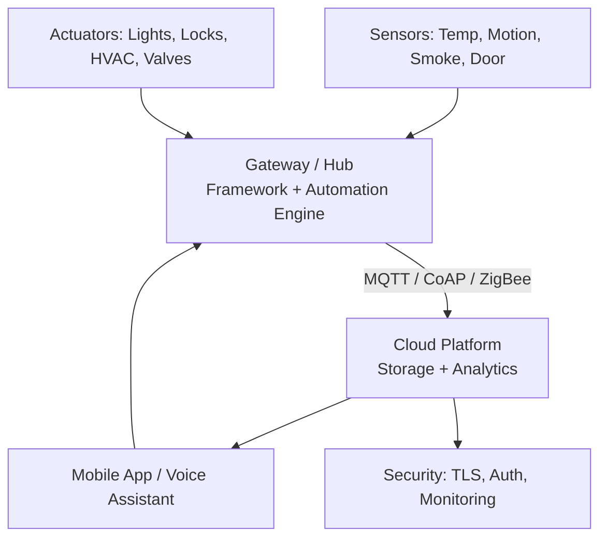

---

**Explain the IOT enabled Smart Parking system with respect to sensors, Actuators, framework, protocols, data analysis and security (10 Marks, Dec 2025)**

An IoT-enabled smart parking system detects occupancy, guides drivers to free spaces, automates entry/exit and payment, and provides operators with real-time visibility, reducing congestion and search time.

**1. Sensors**
- **Occupancy Sensors**: Ultrasonic, infrared, magnetometer, or camera-based sensors detect whether a parking bay is free or occupied.
- **Vehicle Detection**: Inductive loops and RFID/ANPR cameras at entry and exit gates identify vehicles.
- **Environmental Sensors**: CO/air-quality sensors for enclosed parking areas.
- **Role**: Continuously report bay status and vehicle identity to the system.

**2. Actuators**
- **Barrier Gates**: Motorized boom barriers open/close on authorization.
- **Display Boards**: LED signage showing free-space counts and directions.
- **Smart Locks/LED Indicators**: Per-bay lights showing free (green) or occupied (red).
- **Payment Terminals**: Automatic ticket dispensers and contactless payment devices.
- **Role**: Execute physical actions based on system decisions (access grant, guidance, payment).

**3. Framework**
- **Edge Layer**: Bay controllers and gate controllers process sensor data locally and control actuators.
- **Gateway/Fog Layer**: Aggregates bay data, runs local occupancy logic, and bridges to cloud.
- **Cloud Layer**: Central management for reservations, billing, analytics, and mobile app services.
- **Application Layer**: Driver app for finding/booking spots, operator dashboard for monitoring and revenue reporting.

**4. Protocols**
- **Short-range**: LoRa, ZigBee, BLE, or Wi-Fi for sensor-to-gateway links.
- **Application-layer**: MQTT for lightweight telemetry and real-time bay updates; CoAP for constrained sensors; HTTP/REST for booking and payment APIs.
- **Backhaul**: Cellular or Ethernet from gateway to cloud.
- **Role**: Ensure reliable, low-power, scalable communication across many bays.

**5. Data Analysis**
- **Real-time**: Occupancy detection, free-space guidance, and dynamic pricing.
- **Historical**: Peak-hour patterns, average dwell time, and revenue trends to optimize capacity and pricing.
- **Predictive**: Forecasting demand by time/day and predicting availability, supporting reservations and dynamic allocation.

**6. Security**
- **Device Security**: Secure boot and authenticated sensor/gateway registration.
- **Communication Security**: TLS/DTLS for MQTT/CoAP, encrypted Wi-Fi/cellular links.
- **Access Control**: Role-based operator access, MFA for admin apps, signed payment transactions.
- **Privacy**: ANPR data encryption, data minimization, and retention limits.
- **Monitoring**: Intrusion detection, tamper alerts on gates/sensors, and audit logging.

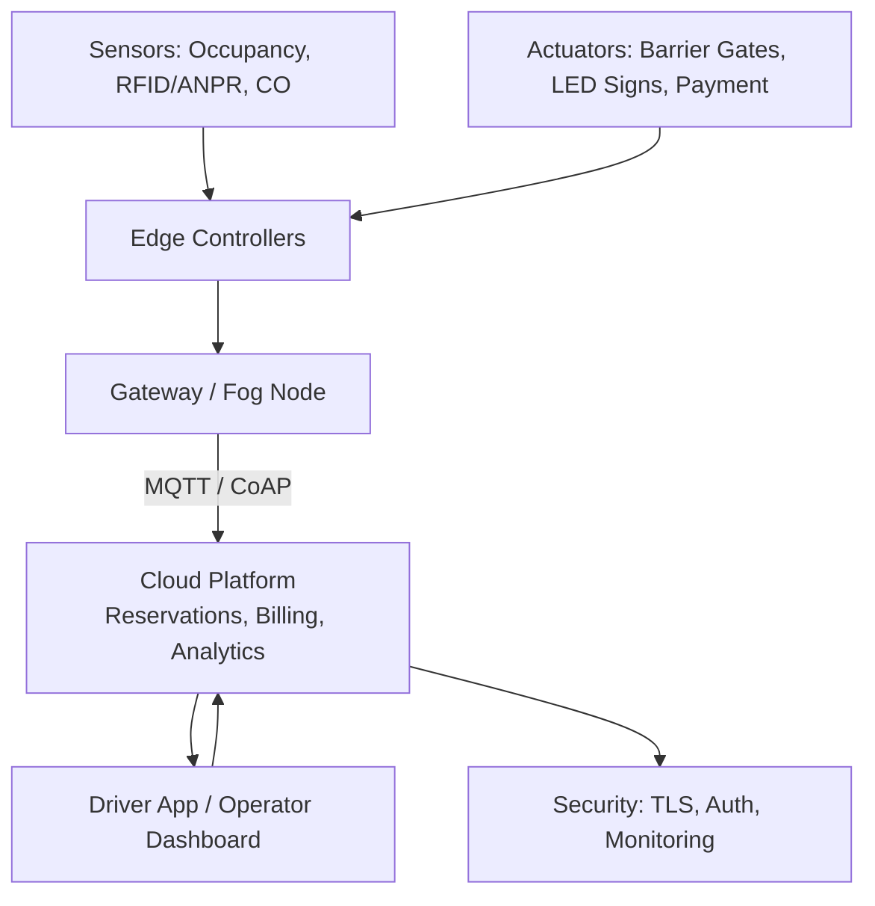

---

**Consider smart farming system. Elaborate its working and list down the different types of sensors and actuators required during the deployment scenario (10 Marks, May 2023)**

A smart farming system applies IoT sensing, actuation, and analytics to monitor field conditions and automate irrigation, fertilization, and climate control, improving yield while conserving resources.

**Working of Smart Farming System:**

1. **Sensing**: Field-deployed sensors continuously measure soil moisture, temperature, humidity, light, and other parameters, transmitting data to a gateway via LPWAN (LoRaWAN, NB-IoT) or Wi-Fi.
2. **Data Aggregation**: The gateway collects and forwards data to a cloud/fog platform, where it is stored and processed.
3. **Analysis and Decision-Making**: Analytics engines apply rule-based thresholds and ML models to decide actions which means e.g., "soil moisture below 30% → start irrigation."
4. **Actuation**: Commands are sent to actuators (valves, pumps, fans) to perform irrigation, nutrient dosing, or climate adjustment.
5. **Monitoring and Feedback**: Farmers view dashboards and receive alerts on mobile apps; the loop repeats as sensors report the effect of actions.
6. **Automation and Optimization**: Historical data drives predictive irrigation scheduling, pest/disease forecasting, and yield optimization.

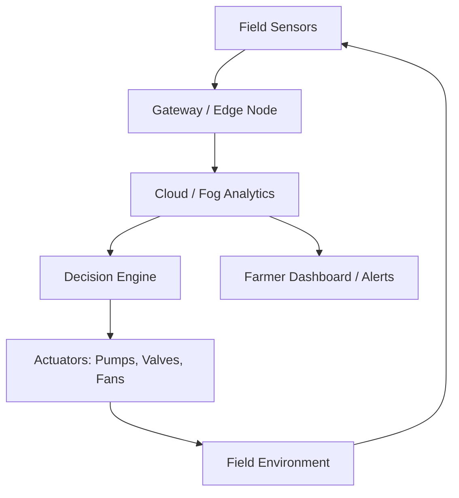

**Types of Sensors Required:**

- **Soil Moisture Sensor**: Measures volumetric water content to schedule irrigation.
- **Soil Temperature Sensor**: Monitors root-zone temperature for germination and growth.
- **Soil pH / NPK Sensor**: Assesses nutrient availability and soil health.
- **Temperature and Humidity Sensor**: Tracks ambient microclimate.
- **Light/Photosynthetically Active Radiation (PAR) Sensor**: Measures solar radiation for growth modeling.
- **Rainfall Sensor**: Detects precipitation to avoid over-irrigation.
- **Wind Speed/Direction Sensor**: Supports spray scheduling and microclimate analysis.
- **CO₂ Sensor**: Monitors greenhouse gas concentration in controlled environments.
- **Leaf Wetness Sensor**: Detects moisture on leaves for disease prediction.
- **Camera/NDVI Sensor**: Captures crop imagery for health and pest monitoring.
- **Water Level/Flow Sensor**: Monitors tank levels and irrigation flow.

**Types of Actuators Required:**

- **Water Pump and Solenoid Valves**: Control irrigation delivery to specific zones.
- **Drip/Sprinkler Controllers**: Regulate water flow and timing.
- **Fertilizer/Nutrient Dosing Pumps**: Inject precise nutrient amounts into irrigation.
- **Greenhouse Ventilation Fans and Windows**: Regulate temperature and humidity.
- **Heaters and Cooling Systems**: Maintain optimal growing conditions.
- **Shade Nets / Curtain Motors**: Adjust light exposure.
- **Pesticide/Herbicide Sprayers**: Automated targeted spraying.
- **Buzzers/Alert Devices**: Local warnings for abnormal conditions.

---

**Consider Smart Irrigation system. Elaborate its working with block diagram and list down the different types of sensors and actuators required during the deployment scenario (10 Marks, Dec 2023)**

**Working of Smart Irrigation System:**
A smart irrigation system monitors soil and weather conditions, decides when and how much to water, and automatically controls irrigation delivery which means conserving water while maintaining optimal soil moisture.

1. **Sensing**: Soil moisture sensors at root depth and weather sensors (temperature, humidity, rainfall, light) continuously measure field conditions.
2. **Data Transmission**: Sensor nodes send readings to a gateway/controller via LoRaWAN, ZigBee, or Wi-Fi.
3. **Processing and Decision**: The controller or cloud analytics compares moisture levels against crop-specific thresholds and evapotranspiration models to compute irrigation need.
4. **Actuation**: Commands open solenoid valves and start pumps for the required duration/zone; rainfall detection suppresses scheduled watering.
5. **Feedback Loop**: Post-irrigation sensor readings confirm moisture targets are met; the cycle repeats and historical data refines schedules.

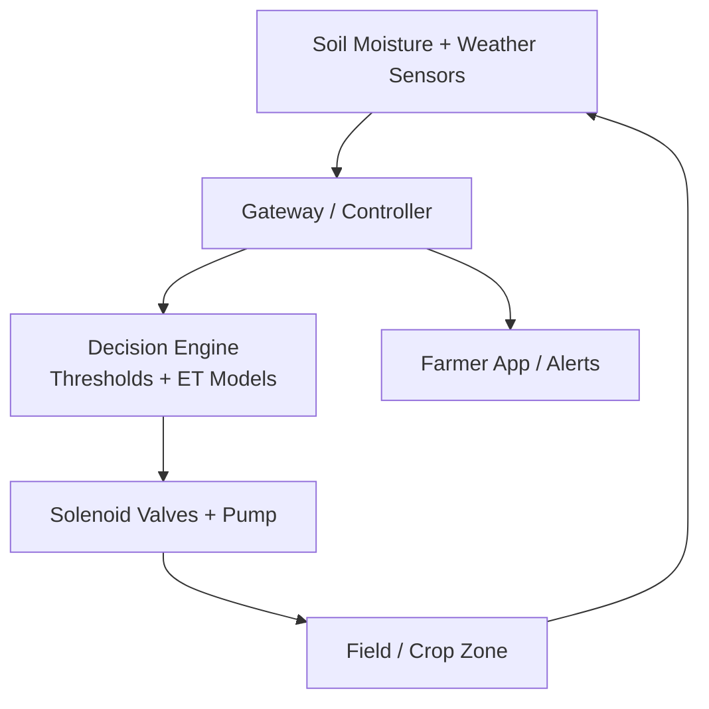

**Types of Sensors Required:**
- **Soil Moisture Sensor**: Measures volumetric water content at root depth to trigger irrigation.
- **Soil Temperature Sensor**: Monitors root-zone temperature affecting water uptake.
- **Rainfall Sensor**: Detects precipitation to suppress unnecessary watering.
- **Temperature and Humidity Sensor**: Computes evapotranspiration demand.
- **Light/Radiation Sensor**: Estimates solar-driven water loss.
- **Wind Speed Sensor**: Adjusts for evaporation and spray drift.
- **Water Flow Sensor**: Measures actual water delivered per zone.
- **Water Level Sensor**: Monitors tank/reservoir levels.
- **Soil pH/EC Sensor**: Assesses nutrient and salinity context for irrigation quality.

**Types of Actuators Required:**
- **Solenoid Valves**: Open/close water flow to individual irrigation zones.
- **Water Pump**: Pressurizes and delivers water from source to field.
- **Drip/Sprinkler Control Units**: Regulate emission rate and pattern.
- **Fertilizer Dosing Pump**: Injects nutrients into irrigation water (fertigation).
- **Motorized Ball Valves**: Zone isolation and flow routing.
- **Buzzer/Alert Devices**: Local warnings for leaks or dry conditions.
- **Relay Modules**: Switch pumps and valves on/off from controller signals.

---

**Consider smart smoke detection system. Elaborate its working and list down the different types of sensors and actuators required during the deployment scenario (10 Marks, May 2024)**

**Working of Smart Smoke Detection System:**
A smart smoke detection system continuously monitors for smoke and related fire indicators, analyzes readings to distinguish real threats from nuisance sources, and triggers alerts and suppression actions automatically.

1. **Sensing**: Smoke, gas, and temperature sensors continuously sample the environment and report readings to the local controller.
2. **Data Transmission**: Sensor nodes send data to a hub/gateway via ZigBee, Wi-Fi, or LoRa; the gateway forwards events to the cloud.
3. **Processing and Decision**: The controller applies thresholds and multi-sensor fusion (smoke + CO + temperature rise) to confirm a fire event and reduce false alarms.
4. **Alerting**: On confirmation, the system activates local sirens, sends push/SMS alerts to occupants and authorities, and logs the event.
5. **Actuation**: Commands trigger suppression or safety actions which means shutting off gas valves, activating sprinklers/exhaust fans, unlocking exits.
6. **Feedback and Learning**: Post-event data and routine monitoring refine sensitivity settings and identify drift or faulty sensors.

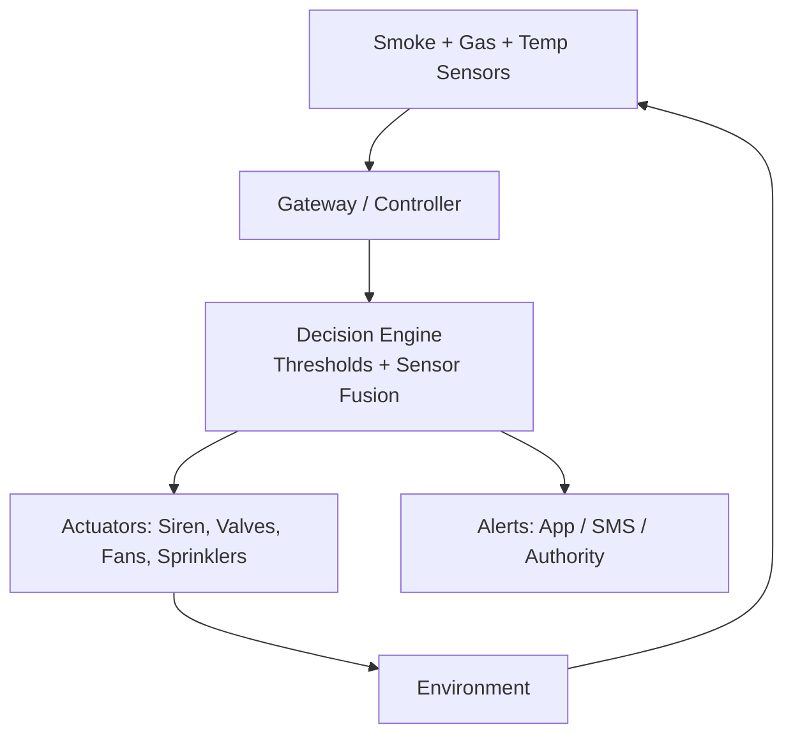

**Types of Sensors Required:**
- **Photoelectric Smoke Sensor**: Detects smoldering fires by light scattering from smoke particles.
- **Ionization Smoke Sensor**: Detects fast-flaming fires via ionized air current changes.
- **CO/CO₂ Gas Sensor**: Detects toxic combustion gases.
- **Temperature Sensor**: Identifies abnormal heat rise or rate-of-rise.
- **Humidity Sensor**: Provides environmental context and false-alarm filtering.
- **Flame/IR Sensor**: Detects open flames for rapid confirmation.
- **Air Quality/VOC Sensor**: Detects combustion by-products.

**Types of Actuators Required:**
- **Siren/Buzzer**: Local audible and visual alarm.
- **Gas Shut-off Valve**: Cuts fuel supply automatically on detection.
- **Exhaust/Smoke Extraction Fans**: Removes smoke from the zone.
- **Sprinkler/Suppression Control Valves**: Activates fire suppression.
- **Door Lock/Exit Controllers**: Unlocks emergency exits.
- **Relay Modules**: Switch sirens, fans, and valves from controller signals.

---

**Design the Forest Fire Detection system using IoT sensors (10 Marks, May 2025)**

A forest fire detection system deploys a network of low-power sensor nodes across forest zones to detect early fire indicators which means smoke, heat, flame, and gas which means and transmit alerts to a control center for rapid response.

**System Architecture:**
1. **Sensor Nodes**: Distributed across forest zones at strategic heights; each node hosts smoke, temperature, humidity, flame, and gas sensors with a microcontroller and radio module.
2. **Communication Layer**: Nodes transmit via LoRaWAN (long range, low power) or ZigBee mesh to cluster gateways; gateways use cellular/satellite backhaul to the cloud.
3. **Edge/Gateway Processing**: Local gateways apply threshold and sensor-fusion rules to filter false alarms before forwarding.
4. **Cloud Platform**: Stores telemetry, runs analytics (fire-risk models, weather fusion), and manages alerts and dashboards.
5. **Alerting and Response**: Sends SMS/app notifications and coordinates with fire authorities via GPS location of the triggering node.
6. **Power**: Solar panels with battery backup for node autonomy.

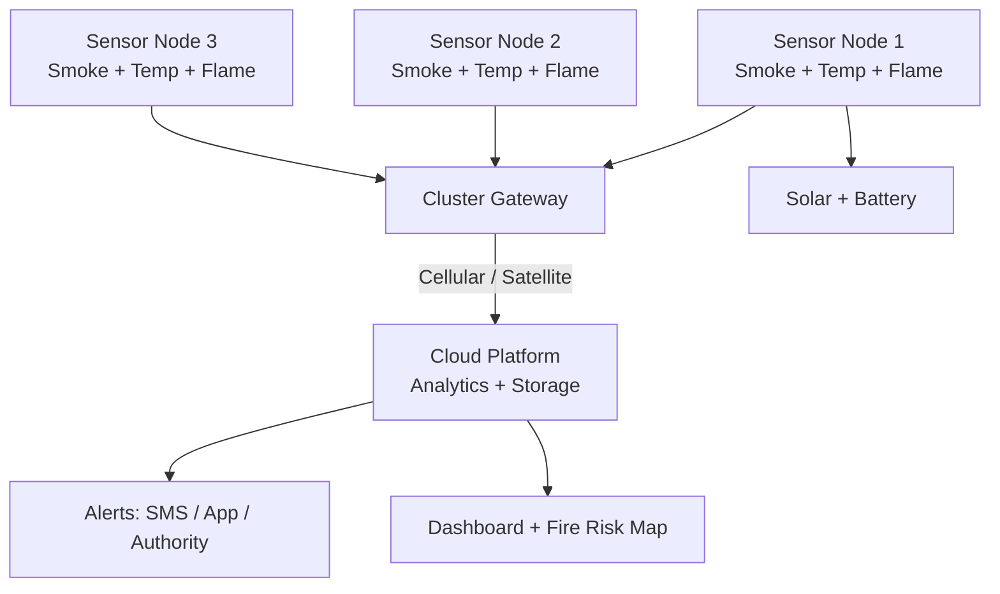

**Types of Sensors:**
- **Smoke Sensor**: Early detection of smoldering combustion.
- **Temperature Sensor (Thermistor/IR)**: Detects abnormal heat rise.
- **Flame/UV-IR Sensor**: Detects open flames.
- **CO/CO₂ Gas Sensor**: Detects combustion gases.
- **Humidity Sensor**: Low humidity increases fire risk.
- **Wind Speed/Direction Sensor**: Predicts fire spread.
- **Light/Lux Sensor**: Environmental context.
- **Camera (Optional)**: Visual confirmation via image analytics.
- **GPS Module**: Node location for precise alerting.

**Types of Actuators:**
- **Siren/Buzzer**: Local audible warning in high-risk zones.
- **Relay Modules**: Switch alerts and auxiliary devices.
- **Water Sprinkler/Mist Control Valves**: Localized fire suppression where infrastructure exists.
- **Alert Beacons/Strobes**: Visual signaling for patrol teams.

**Design Considerations:**
- **Low-Power Operation**: Duty-cycled sensing and LoRaWAN Class A for multi-year battery life.
- **Mesh Redundancy**: ZigBee mesh ensures connectivity if a node fails.
- **Sensor Fusion**: Combine smoke + temperature + gas to reduce false positives from fog or dust.
- **Harsh Environment Enclosure**: IP65+ rated housings for weather resistance.
- **Scalability**: Hierarchical clustering supports thousands of nodes over large forest areas.

---

**Write a short note on I-IoT (5 Marks, Dec 2023)**
**Explain the concept of I-IoT and its similarity with IoT (5 Marks, May 2024)**

I-IoT (Industrial Internet of Things) is the application of IoT technologies in industrial manufacturing and automation systems, enabling the interconnection of smart industrial devices with control and management platforms to improve productivity, efficiency, safety, and intelligence.

- **Focus**: Unlike consumer IoT, I-IoT targets industrial applications such as factory automation and process automation, with strict requirements for reliability, real-time control, and security.
- **Architecture**: Typically a three-layer model comprising the **physical layer** (sensors, actuators, machines), **communication layer** (5G, M2M, SDN, WSANs), and **application layer** (smart factories, smart supply chains).
- **Key Characteristics**: High reliability and availability, deterministic real-time capabilities, coexistence with legacy operational technology (OT), and robust cybersecurity.
- **Applications**: Predictive maintenance, process monitoring and optimization, quality control, and worker safety monitoring in manufacturing, healthcare, logistics, and transportation.
- **Challenges**: Security and privacy of industrial data, interoperability with legacy systems, scalability across tens of thousands of devices, and handling large volumes of industrial data.

**Similarity with IoT:**
- Both use the same core building blocks: sensors, actuators, connectivity, gateways, cloud/edge platforms, and analytics.
- Both rely on the same communication protocols such as MQTT, CoAP, HTTP, and LPWAN/cellular technologies.
- Both follow the same data pipeline: sense, transmit, store, analyze, and act or alert.
- Both share the same goals of automation, remote monitoring, data-driven decision-making, and efficiency improvement.
- Both follow the same architecture pattern of perception/sensing layer, network layer, and application layer.
- Both face the same challenges of security, interoperability, scalability, and data management.

The key difference is context and strictness: I-IoT applies the same IoT principles to industrial settings with much higher requirements for reliability, latency, and safety.

---

**What is the Internet of Behaviour (IoB) and why is it the future? (5 Marks, May 2023)**

The Internet of Behaviour (IoB) is an extension of IoT that analyzes data collected from connected devices to understand, predict, and influence human behaviour.

- It combines sensor, wearable, and online activity data with behavioural psychology and analytics.
- It goes beyond IoT's "what is happening" to answer "why it is happening" and "how behaviour can be changed."
- It derives insights into habits, preferences, and decision patterns of individuals and groups.

**Why IoB is the Future:**
- **Personalization**: Enables highly tailored services in marketing, healthcare, insurance, and smart environments.
- **Better Decisions**: Organizations can design products, policies, and interventions based on actual behaviour rather than assumptions.
- **Proactive Healthcare**: Supports behaviour-based wellness monitoring and early intervention.
- **Business Value**: Improves customer engagement, retention, and operational efficiency.
- **Smarter Automation**: Systems can adapt automatically to observed user habits and preferences.

---

**Explain the following terms: 1) CoAP 2) Internet of Behaviour (10 Marks, May 2025)**

**Explain the following terms: 1) CoAP 2) Internet of Behaviour. (10 Marks, May 2025)**

**1) CoAP (Constrained Application Protocol)**

CoAP is a lightweight, UDP-based web transfer protocol designed for resource-constrained IoT devices and lossy networks, modeled on the RESTful HTTP request/response style.

- **Request/Response Model**: Clients send requests (GET, POST, PUT, DELETE) to resources identified by URIs; servers respond with a status code and payload in a compact binary format.
- **Message Types**: CON (Confirmable, requires ACK), NON (Non-confirmable, best-effort), ACK (acknowledgement), and RST (reset on error).
- **Message Layer**: Handles reliability over UDP using message IDs and retransmission timers for CON messages; detects duplicates.
- **Request/Response Layer**: Carries method and response codes; supports piggybacked or separate responses.
- **Observe Mode**: Clients can register to receive notifications when a resource changes, enabling publish-subscribe-like behavior.
- **Block-wise Transfer**: Large payloads are split into blocks for transmission over constrained links.
- **Security**: Uses DTLS for confidentiality, integrity, and authentication.
- **Advantages**: Very low overhead (4-byte fixed header), works over UDP, suitable for 6LoWPAN, and supports multicast and resource discovery.

**2) Internet of Behaviour (IoB)**

The Internet of Behaviour (IoB) is an extension of IoT that analyzes data collected from connected devices to understand, predict, and influence human behaviour.

- **Data Sources**: Combines sensor data, wearable readings, and online activity with behavioural psychology and analytics.
- **Purpose**: Goes beyond IoT's "what is happening" to answer "why it is happening" and "how behaviour can be changed."
- **Insights**: Derives patterns in habits, preferences, and decision-making of individuals and groups.
- **Applications**: Personalized marketing, healthcare and wellness monitoring, insurance risk assessment, and smart environments.
- **Business Value**: Enables tailored services, proactive interventions, and adaptive automation based on observed behaviour.
- **Concerns**: Raises significant privacy and ethical issues, requiring consent, transparency, and strong data governance.