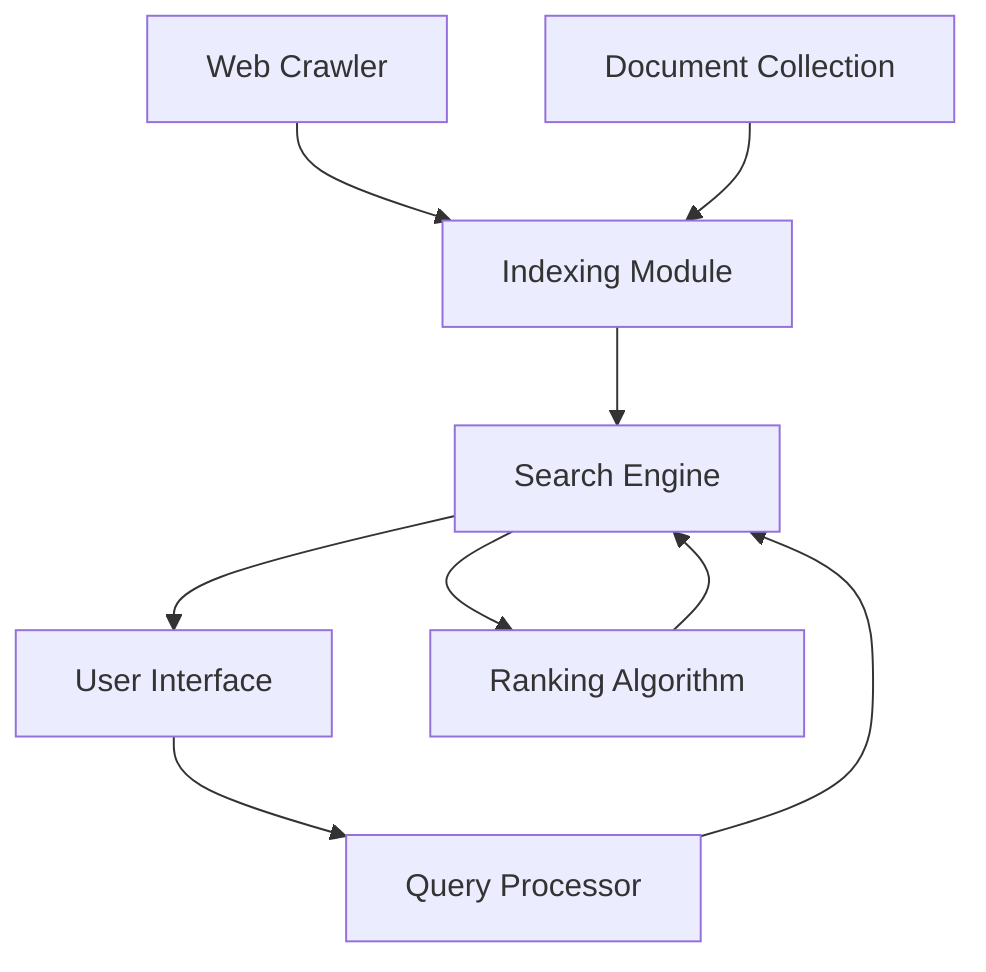
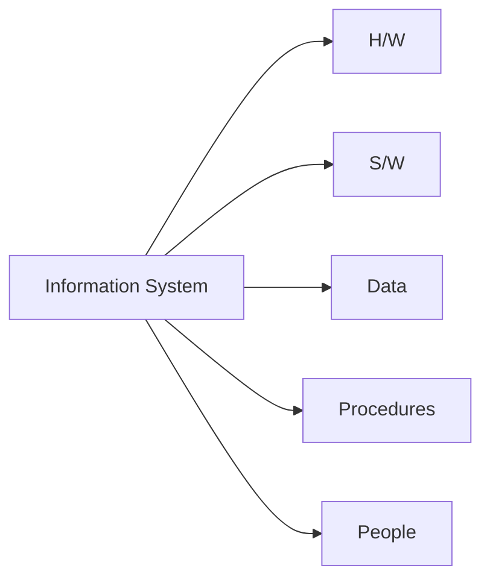
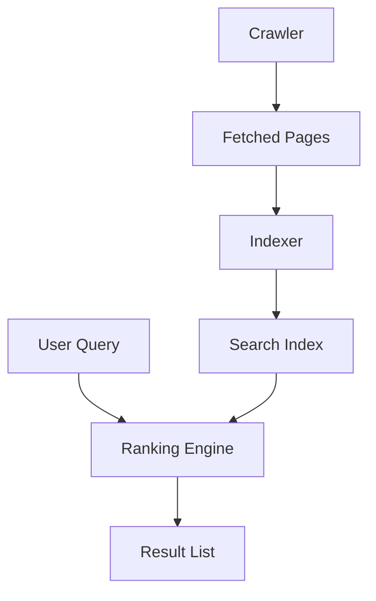
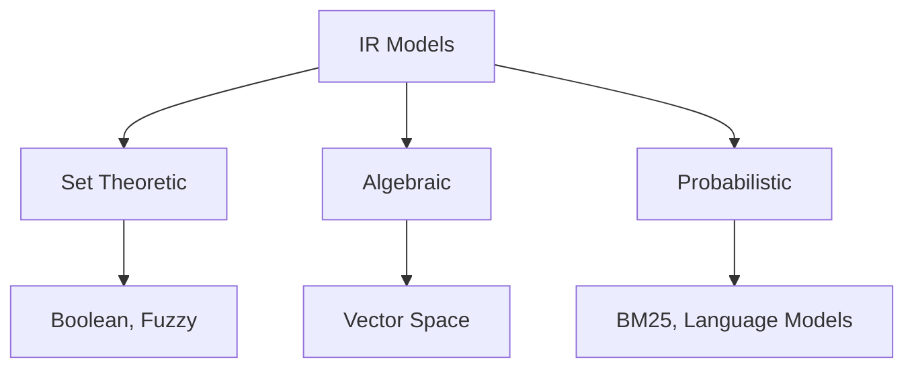
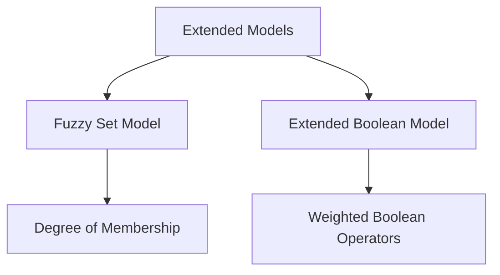
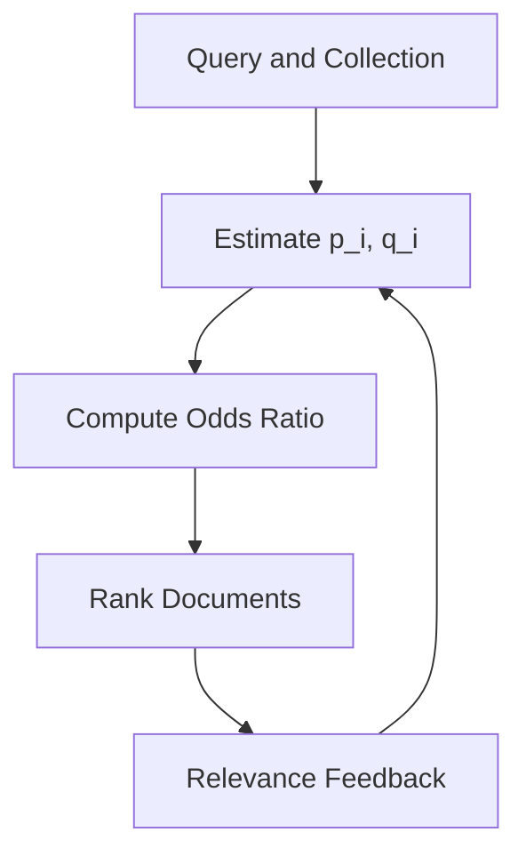
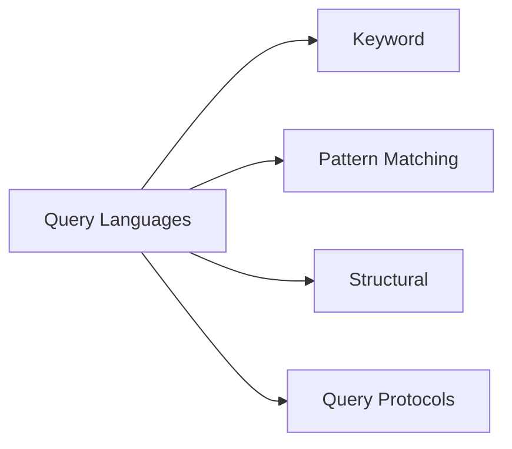

#### 1. Define an Information Retrieval System and state any two objectives of such a system.

- An Information Retrieval System is a software system that facilitates the storage, organization, and retrieval of information from large document collections. 
- The core principle involves matching user information needs against document  representations to deliver relevant results. 
- They operate on unstructured or semi-structured data unlike traditional database  systems.

**Objectives:**

- To minimize the retrieval of non-relevant documents while maximizing relevant document discovery.
- To provide efficient search capabilities that satisfy diverse user information needs effectively.

---

#### 2. Differentiate between Information Retrieval and Data Retrieval on any four points.

| Factor | Information Retrieval | Data Retrieval |
|:-- |:-- |:-- |
| Data Type | Unstructured or semi-structured data | Structured data with defined schemas |
| Query Type | Natural language or keyword queries | Formal query languages like SQL |
| Result Set | Ranked relevance-based results | Exact match deterministic results |
| Primary Goal | Find relevant information | Retrieve precise data records |
| Error Tolerance | Tolerates minor errors gracefully | Requires exact precision always |
| Data Model | Document-centric with statistical models | Relational or object-oriented models |

---

#### 3. List and briefly explain the components of an Information Retrieval System.

1. **Document Collection**: The repository of text documents, web pages, or multimedia content stored for retrieval purposes.
2. **Web Crawler:** Automated program that fetches web pages, extracts text, and passes it to the indexer.
3. **Indexing Module**: Processes documents to create inverted indexes and statistical representations for efficient searching.
4. **Query Processor**: Parses and transforms user queries into system-recognizable formats for execution.
5. **Search Engine**: Matches query representations against indexed documents to identify potential relevant results.
6. **Ranking Algorithm**: Computes relevance scores and orders retrieved documents by predicted usefulness.
7. **User Interface**: Provides interaction mechanisms between users and the retrieval system.

---

#### 4. List the classes of classic Information Retrieval models.

**Boolean Model:**
- Uses Boolean operators (AND, OR, NOT) for exact term matching.
- Terms are binary (present/absent) with no weighting.
- Returns unordered set of matching documents.

**Vector Space Model:**
- Represents documents and queries as weighted term vectors.
- Uses TF-IDF weights and cosine similarity for matching.
- Produces ranked list by decreasing similarity scores.

**Probabilistic Model:**
- Estimates relevance probability using Bayes theorem.
- Uses term distribution statistics for probability computation.
- Generates ranked list by decreasing relevance probability.

**Fuzzy Set Model:**
- Extends Boolean logic with partial membership degrees.
- Uses fuzzy operators (min for AND, max for OR).
- Produces ranked list by membership degree values.

**Extended Boolean Model:**
- Combines Boolean operators with term weighting.
- Uses p-norm formulas for relevance scoring.
- Generates ranked output for Boolean-style queries.

---

#### 5. Define Term Frequency and Inverse Document Frequency, and provide their respective formulas.

**Term Frequency (TF)**

**Term Frequency (TF)** measures how frequently a term appears within a specific document.

$$  
TF(t,d) = \frac{\text{Number of times term } t \text{ appears in document } d}{\text{Total number of terms in document } d}  
$$
Where:
- t = The term (word or keyword) whose importance is being calculated.
- d = The specific document in which the term appears.

**Inverse Document Frequency (IDF)**

**Inverse Document Frequency (IDF)** measures how rare or common a term is across the entire document collection.

$$  
IDF(t) = \log\left(\frac{N}{df(t)}\right)  
$$
Where:
- $N$ = Total number of documents in the collection
- $df(t)$ = Number of documents containing term $t$

**TF-IDF Weight**

The **TF-IDF weight** combines Term Frequency and Inverse Document Frequency to determine the importance of a term within a document.

$$  
TF\text{-}IDF(t,d) = TF(t,d) \times IDF(t)  
$$
Where:
- TF-IDF(t,d) = TF-IDF weight of term t in document d.
- TF(t,d) = Term Frequency of term t in document d.
- IDF(t) = Inverse Document Frequency of term t across the document collection.
- t = The term (word or keyword) whose importance is being calculated.
- d = The specific document in which the term appears.

---

### 6. State any four limitations of the Boolean model.

- Produces binary relevance decisions with no ranking or scoring of retrieved documents.
- Users require specialized training to formulate effective Boolean queries.
- Cannot capture partial matches or differentiate term importance.
- No support for term weighting or statistical relevance measures.
- Fails to retrieve documents containing synonyms unless explicitly specified.
- Morphological variations are not automatically recognized by the system.

---

#### 7. What is user relevance feedback, and why is it used in query processing?

 User relevance feedback is a mechanism where the user evaluates retrieved results and provides feedback to the system, helping refine and improve search outcomes. 

**Why It Is Used:** 
- **Bridges Real Information Need:** Helps the system understand the userʼs true intent beyond the typed query. 
- **Supports Query Expansion:** Adds synonyms and related terms from relevant documents back into the query. 
- **Improves Precision:** Iteratively modifies the query to filter noise and retrieve more accurate results.

---

#### 8. Explain keyword-based querying with a suitable example.

- Keyword-based querying allows users to express information needs using significant terms without Boolean operators. 
- The system retrieves documents containing these keywords and ranks them by relevance scores. 
- This approach simplifies user interaction while maintaining effective retrieval through statistical ranking methods.

**Forms with Examples:**

**Single-Word Query:**
- User enters a single term without any operators or modifiers.
- Matches documents containing that term anywhere in the text.
- Example: "python" matches programming, snake, or Monty Python content.

**Phrase Query:**
- User encloses multiple words in quotation marks for exact sequence matching.
- Matches documents containing the exact adjacent word order specified.
- Example: "state bank of india" finds only documents with that precise phrase.

**Proximity Query:**
- User specifies two terms must appear within a defined word distance.
- Matches documents where terms occur close together even if not adjacent.
- Example: information and retrieval within 5 words finds related concepts near each other.


---

#### 9. Define pattern matching in the context of query processing.

Pattern matching operates on character shapes rather than word meanings.

**Prefix Matching:**
- Finds terms starting with a specified character string.
- Example: "comput" matches computer, computation, computing.

**Substring Matching:**
- Matches a character sequence anywhere within a word.
- Example: "put" matches computer, input, output, put.

**Regular Expressions:**
- Uses formal syntax with wildcards for complex pattern specifications.
- Example: "colou?r" matches both color and colour variations.

**Approximate Matching:**
- Allows spelling errors using edit distance algorithms.
- Example: "pyhton" matches python despite the character error.

---

#### 10. Define a wildcard query and illustrate it with an example.

A wildcard query uses special characters to represent unknown portions of search terms. The asterisk (*) matches zero or more characters while question mark (?) matches exactly one character. For example, "comput*" retrieves documents containing computer, computing, computation, and computational. This query type helps users overcome spelling uncertainties and morphological variations effectively.

---

#### 11. Explain the Information Retrieval process with the help of a neat block diagram, and discuss the role of each component.

The Information Retrieval (IR) process converts user information needs into relevant document results. It involves several interconnected components that transform queries into ranked document lists. The process begins with query formulation and ends with relevance feedback.

**Components and their roles:**



1. **Document Collection**: The repository of text documents, web pages, or multimedia content stored for retrieval purposes.
2. **Web Crawler:** Automated program that fetches web pages, extracts text, and passes it to the indexer.
3. **Indexing Module**: Processes documents to create inverted indexes and statistical representations for efficient searching.
4. **Query Processor**: Parses and transforms user queries into system-recognizable formats for execution.
5. **Search Engine**: Matches query representations against indexed documents to identify potential relevant results.
6. **Ranking Algorithm**: Computes relevance scores and orders retrieved documents by predicted usefulness.
7. **User Interface**: Provides interaction mechanisms between users and the retrieval system.

---

#### Explain the components, parts, and types of Information Systems in detail

An Information System (IS) is an organized combination of people, hardware, software, data, and procedures that collect, process, store, and distribute information to support decision-making and operations.

**Core components:**

- **Hardware**: Physical devices such as servers, computers, and storage units.
- **Software**: System and application programs that process data.
- **Data**: Raw facts stored in databases, forming the foundation of the system.
- **Procedures**: Rules and instructions governing how the system is used.
- **People**: Users, analysts, and administrators who operate and maintain the system.

**Types of Information Systems:**

|Type|Description|
|---|---|
|Transaction Processing System (TPS)|Handles routine, day-to-day business transactions|
|Management Information System (MIS)|Provides summarized reports for middle management|
|Decision Support System (DSS)|Assists managers in making semi-structured decisions|
|Executive Support System (ESS)|Supports strategic decisions for top-level executives|
|Office Automation System (OAS)|Improves communication and productivity in offices|



Together these components and types form a hierarchy that supports operational, tactical, and strategic decision-making across an organization.

---

#### Describe the working of search engines and explain how they differ from web browsers

A search engine is a software system designed to search, index, and retrieve information from the web in response to a user query. It works in three major stages:

- **Crawling**: Automated bots called crawlers or spiders traverse the web, following hyperlinks to discover new and updated pages.
- **Indexing**: The crawled content is processed and stored in a structured, searchable index, typically using inverted index structures.
- **Query Processing and Ranking**: When a user submits a query, the engine matches it against the index and ranks results using algorithms such as PageRank or relevance scoring.



**Difference from web browsers:**

|Factor|Search Engine|Web Browser|
|---|---|---|
|Purpose|Finds information across the web|Displays and renders a specific web page|
|Function|Crawls, indexes, and ranks content|Interprets HTML, CSS, JavaScript|
|Examples|Google, Bing|Chrome, Firefox|
|Output|List of relevant links|Rendered visual page|

A search engine is a service accessed through a browser, while a browser is the client application used to access any web resource, including a search engine.

---

#### Explain the Vector Space Model in detail. For the query Q = "gold silver truck" and the documents D1, D2, D3, compute the similarity of each document with the query using TF-IDF and cosine similarity, and rank the documents accordingly

The Vector Space Model (VSM) represents both documents and queries as vectors in a multi-dimensional space, where each dimension corresponds to a unique term in the vocabulary. Term weights are typically computed using TF-IDF, and similarity between a query and a document is measured using the cosine of the angle between their vectors. A smaller angle (higher cosine value) indicates greater relevance.

**Given data:**

- D1 = "shipment of gold damaged in a fire"
- D2 = "delivery of silver arrived in a silver truck"
- D3 = "shipment of gold arrived in a truck"
- Q = "gold silver truck"

**Step 1: Term Frequency (content words only, stopwords removed)**

|Term|D1|D2|D3|Q|
|---|---|---|---|---|
|shipment|1|0|1|0|
|gold|1|0|1|1|
|damaged|1|0|0|0|
|fire|1|0|0|0|
|delivery|0|1|0|0|
|silver|0|2|0|1|
|arrived|0|1|1|0|
|truck|0|1|1|1|

**Step 2: IDF (N = 3 documents), using log base 10**

|Term|df|IDF = log(N/df)|
|---|---|---|
|shipment|2|0.176|
|gold|2|0.176|
|damaged|1|0.477|
|fire|1|0.477|
|delivery|1|0.477|
|silver|1|0.477|
|arrived|2|0.176|
|truck|2|0.176|

**Step 3: TF-IDF weights (tf × idf)**

|Term|D1|D2|D3|Q|
|---|---|---|---|---|
|shipment|0.176|0|0.176|0|
|gold|0.176|0|0.176|0.176|
|damaged|0.477|0|0|0|
|fire|0.477|0|0|0|
|delivery|0|0.477|0|0|
|silver|0|0.954|0|0.477|
|arrived|0|0.176|0.176|0|
|truck|0|0.176|0.176|0.176|

**Step 4: Cosine Similarity**

- |Q| ≈ 0.538, |D1| ≈ 0.719, |D2| ≈ 1.095, |D3| ≈ 0.352

|Document|Dot Product with Q|Cosine Similarity|
|---|---|---|
|D1|0.031|0.080|
|D2|0.485|0.824|
|D3|0.062|0.327|

**Ranking:** D2 > D3 > D1

D2 is most relevant since it contains "silver" and "truck" with high weight, D3 follows as it contains "gold" and "truck", while D1 is least relevant, sharing only "gold" with the query.

---

#### Compare and contrast the Boolean, Vector Space, and Probabilistic Information Retrieval models on the basis of representation, matching function, ranking, and limitations. Also, draw the taxonomy of IR models

**Comparison table:**

|Factor|Boolean Model|Vector Space Model|Probabilistic Model|
|---|---|---|---|
|Representation|Set-based, terms present or absent|Weighted term vectors|Probability of relevance|
|Matching Function|Exact logical match (AND, OR, NOT)|Cosine similarity|Probability Ranking Principle|
|Ranking|No ranking, binary result|Ranked by similarity score|Ranked by probability of relevance|
|Limitations|No partial matching, rigid|Assumes term independence|Requires relevance judgments to train|

**Taxonomy of IR models:**



The Boolean model is simple but inflexible since it only supports exact matches, the Vector Space Model introduces partial matching and ranking through weighted terms, and the Probabilistic Model directly estimates the likelihood that a document satisfies the user's information need, generally giving the most theoretically grounded ranking.

---

#### Explain the Fuzzy Set Model and the Extended Boolean Model with suitable examples

**Fuzzy Set Model:**

The Fuzzy Set Model extends the Boolean model by allowing documents to belong to a query term's set with a degree of membership between 0 and 1, instead of a strict true/false value. This allows partial matching, where a document can be considered partially relevant to a term even if the exact word is absent, based on semantic closeness.

_Example:_ For the query term "fast," a document containing "quick" may receive a membership value of 0.7, since it is semantically related, rather than being excluded entirely as in strict Boolean matching.

**Extended Boolean Model:**

The Extended Boolean Model combines the precision of Boolean logic with the ranking capability of the Vector Space Model, using term weights within Boolean operators. It is commonly implemented using p-norm distance, where the parameter p controls how strictly the AND/OR conditions are enforced.

_Example:_ For the query "database AND security," instead of requiring both terms to be strictly present, the model computes a similarity score based on term weights, allowing documents with only "database" but a high weight to still rank reasonably high.



Both models aim to overcome the rigidity of pure Boolean retrieval by introducing degrees of relevance while still preserving some Boolean query structure.

---

#### Discuss the Probabilistic Model in detail, along with its ranking function

The Probabilistic Model is based on the Probability Ranking Principle, which states that documents should be ranked in decreasing order of their estimated probability of relevance to the user's query, given the available evidence. It treats retrieval as a classification problem, dividing documents into relevant and non-relevant sets.

**Key concepts:**

- Documents are ranked based on the odds of relevance rather than a similarity score.
- The model estimates probabilities using term distributions in relevant versus non-relevant document sets.
- It typically requires initial relevance judgments, which are refined iteratively through feedback.

**Ranking function:**

The classic Robertson-Sparck Jones ranking formula estimates a document's relevance odds as:

```
O(R|D,Q) = Π [ (p_i × (1 - q_i)) / (q_i × (1 - p_i)) ]
```

where `p_i` is the probability that term i appears in a relevant document, and `q_i` is the probability that term i appears in a non-relevant document, multiplied across all matching query terms.



Modern extensions such as BM25 build on this foundation by incorporating term frequency and document length normalization, making the probabilistic approach one of the most widely used ranking strategies in practical search systems.

---

#### Analyze the different types of query languages, including keyword-based queries, pattern matching queries, structural queries, and query protocols, with suitable examples for each

Query languages define how users express their information needs to a retrieval system. They vary based on how much structure and precision they allow.

**Keyword-based Queries:** Simple queries composed of one or more terms, optionally combined with Boolean operators. _Example:_ `information AND retrieval NOT database`

**Pattern Matching Queries:** Allow searching using wildcards, regular expressions, or partial string matches rather than exact terms. _Example:_ A wildcard query `comput*` matches "computer," "computation," and "computing."

**Structural Queries:** Combine content-based search with the document's structure, such as searching within specific tags or sections in structured or semi-structured data like XML or HTML. _Example:_ An XPath-style query `//title[contains(text(),"AI")]` searches only within title tags.

**Query Protocols:** Standardized communication protocols that allow different retrieval systems to exchange queries and results in a common format. _Example:_ Z39.50 is a protocol that allows library systems to query remote bibliographic databases uniformly.



Together, these query types range from simple free-text search to precise, structure-aware retrieval, allowing IR systems to support varying levels of user expertise and data complexity.