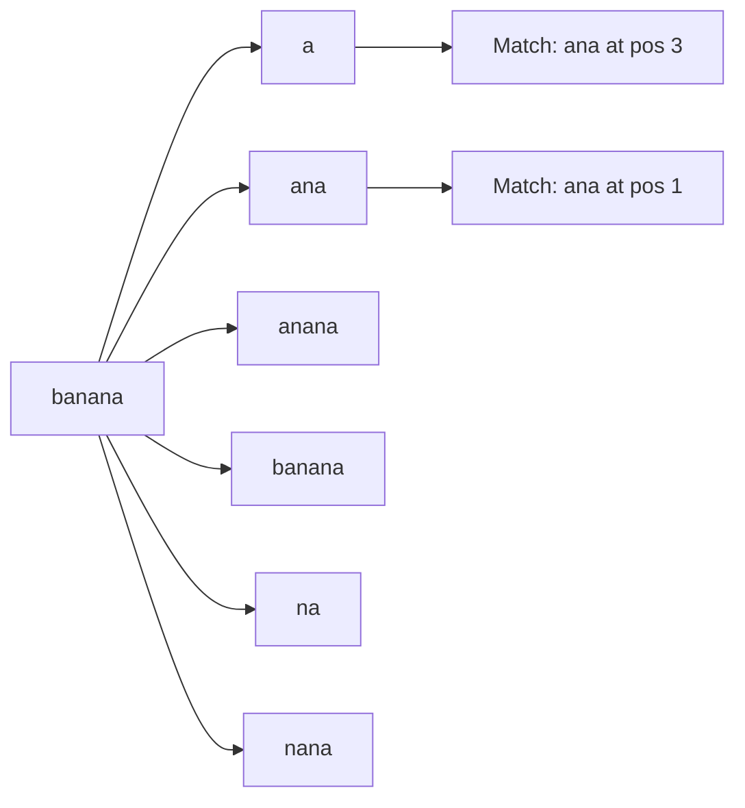
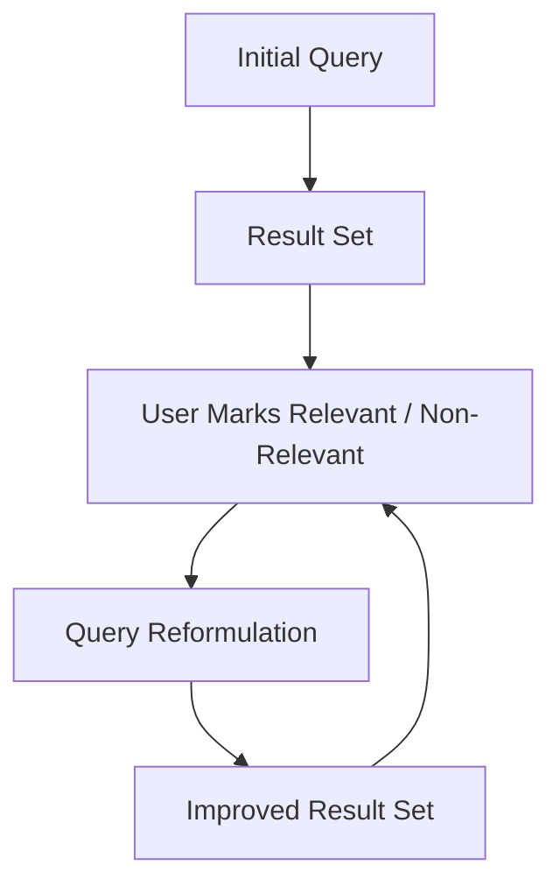
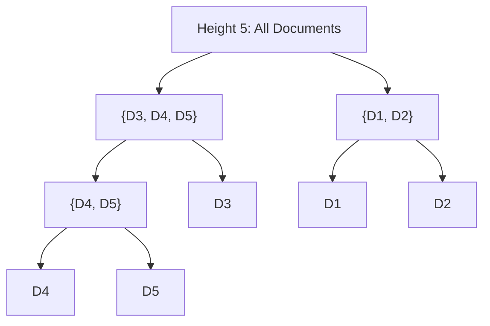
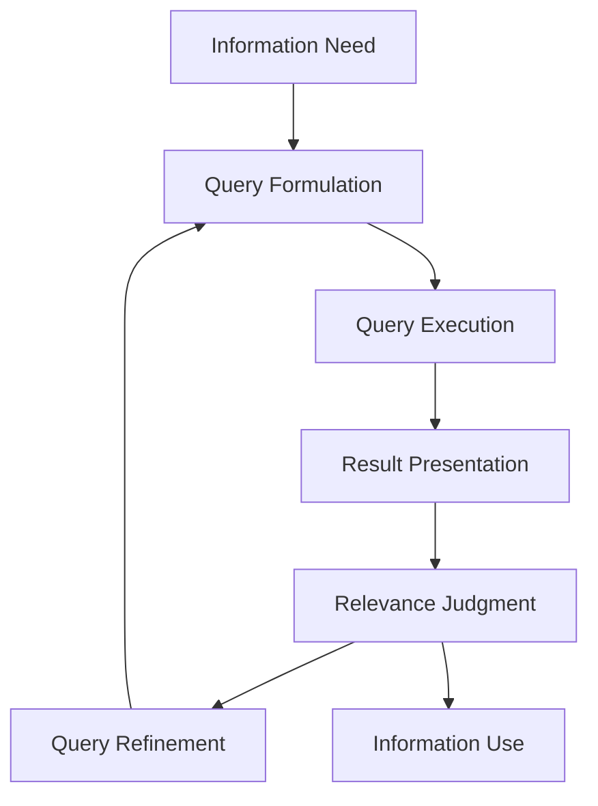
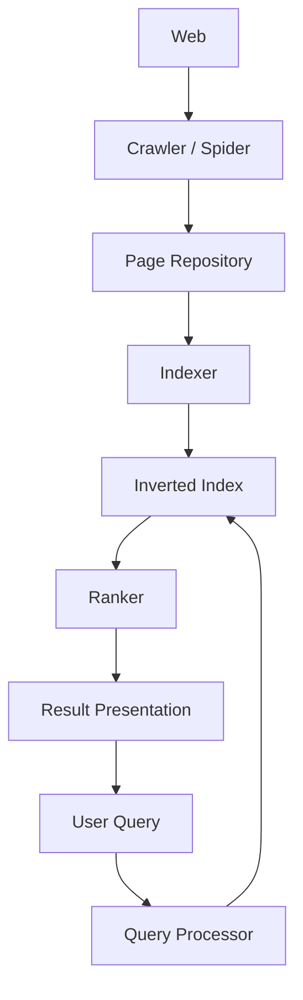

#### Define a feature vector in Multimedia IR and give one image feature example (2 marks)

In Multimedia Information Retrieval (MIR), a **feature vector** is an n-dimensional ordered list of numerical values that mathematically represents the key characteristics (features) of a multimedia object, such as an image, audio clip, or video

- **Definition:** An ordered set of extracted feature values, e.g., $\mathbf{v} = (f_1, f_2, \dots, f_n)$, that describes an object in a high-dimensional feature space.
- **Purpose:** Enables similarity computation (e.g., Euclidean or cosine distance) between a query and stored objects.

**Example of an image feature:** **Color histogram**: a vector counting the frequency of pixels in each color bin, e.g., \( (0.35, 0.20, 0.15, \dots) \).

---

#### Differentiate between browsing and searching on the Web (2 marks)

| **Aspect**     | **Browsing**                        | **Searching**                           |
| -------------- | ----------------------------------- | --------------------------------------- |
| **Goal**       | Exploratory, open-ended navigation  | Targeted retrieval of a specific answer |
| **User input** | Follows links, categories, or menus | Enters keywords/query into a search box |
| **Outcome**    | Serendipitous discovery             | Ranked list of relevant results         |
| **Direction**  | User-driven, no fixed target        | Query-driven, focused on a goal         |
| **Effort**     | Low cognitive load, casual          | Higher cognitive load, precise          |
| **Structure**  | Hierarchical or linked organization | Index-based, flat result list           |
| **Speed**      | Slower, time-consuming exploration  | Faster, immediate results               |
| **Best for**   | Vague or unknown information needs  | Clear, well-defined information needs   |

---

#### Define starting points in a search interface and give two examples (2 marks)

**Starting points** are entry mechanisms or seed resources offered by a search interface that help users begin their information-seeking task without needing to formulate a full query.

- **Examples:**
  1. **Directory/category links**: e.g., Yahoo!-style subject hierarchies.
  2. **Suggested queries or hot topics**: e.g., trending searches on Google.

---

#### Define SeeSoft and state its use (2 marks)

**SeeSoft** is a **visualization tool** that displays large text files (such as source code) as colored line-based views, where each line is represented as a thin colored strip.

- **Use:** It helps users perceive patterns, anomalies, and structure in large documents at a glance.
- **Application:** Software maintenance, code analysis, and document visualization in IR interfaces.

---

#### Define metadata and list two types (2 marks)

**Metadata** is **data about data**: structured information that describes, explains, locates, or otherwise makes it easier to retrieve and manage an information resource.

**Two types:**
  1. **Descriptive metadata**: e.g., title, author, subject keywords.
  2. **Structural metadata**: e.g., chapter hierarchy, page order, file format details.

---

#### Define a meta-search engine and give one example (2 marks)

A **meta-search engine** is a system that sends a user's query to **multiple independent search engines simultaneously**, aggregates their results, and presents a unified ranked list.

- **Characteristics:** No own index; relies on other engines' indexes; removes duplicates and re-ranks.
- **Example:** **Dogpile** (also MetaCrawler, Searx).

---

#### Define stemming and explain with two examples (2 marks)

**Stemming** is a text preprocessing technique in NLP that reduces words to their root or base form by removing prefixes and suffixes. It helps simplify and standardize text, making text analysis and processing more efficient.

- **Example 1:** "retrieval", "retrieve", "retrieved" → **retriev**
- **Example 2:** "studies", "studying", "studied" → **studi**

---

#### Define HCI and state its importance in an IR user interface (2 marks)

**Human-Computer Interaction (HCI)** is the study of how people interact with computer systems, focusing on the design, evaluation, and implementation of usable interfaces.

**Importance in IR:**
  - Helps design intuitive query formulation and result presentation.
  - Supports relevance feedback, query refinement, and result visualization.
  - Reduces cognitive load and improves user satisfaction and search effectiveness.

---

#### Define KWIC and state where it is used (2 marks)

**KWIC (Key Word In Context)** is a display format in which each occurrence of a search term is shown **within its surrounding text context**, typically aligned in a central column.

**Format Example:**

| Left Context | **Keyword** | Right Context |
|---|---|---|
| ...information | **retrieval** | is the study... |
| ...web search is a type of | **retrieval** | ... |
| ...data | **retrieval** | is different from... |

**Uses:**
- Concordances and text analysis
- Digital libraries and archives
- Legal document search
- Search result snippet presentation
- Linguistic and literary research

---

#### Differentiate between HTML and XML (2 marks)

| **Aspect**           | **HTML**                                | **XML**                                                |
| -------------------- | --------------------------------------- | ------------------------------------------------------ |
| **Purpose**          | Presentation and display of web content | Description, storage, and transport of structured data |
| **Tags**             | Predefined, fixed set                   | User-defined, extensible                               |
| **Case sensitivity** | Case-insensitive                        | Case-sensitive                                         |
| **Closing tags**     | Some optional                           | Mandatory for all elements                             |
| **Focus**            | How data looks                          | What data means                                        |
| **Error handling**   | Lenient, browsers forgive errors        | Strict, any error stops parsing                        |
| **Data storage**     | Not designed for data storage           | Designed for data storage and exchange                 |
| **Extensibility**    | Cannot define new tags                  | Users can define custom tags                           |
| **Parsing**          | Parsed by browsers                      | Parsed by XML parsers                                  |
| **Usage**            | Web pages                               | Configuration files, APIs, data exchange               |

---

#### Explain suffix trees and suffix arrays with an example; search 'ana' in 'banana' (5 marks)

**Suffix Tree:** A compressed tree containing all suffixes of a string, where each edge is labelled with a substring and each leaf represents a suffix position. It supports fast pattern matching in \(O(m)\) time for pattern length \(m\).

**Suffix Array:** A sorted array of all suffix starting positions of a string. It is more space-efficient than a suffix tree and supports binary-search-based pattern matching in \(O(m \log n)\).

**Example: Text:** `banana` (positions 0–5)

Suffixes:
- 0: banana
- 1: anana
- 2: nana
- 3: ana
- 4: na
- 5: a

Sorted suffixes and suffix array:

| Rank | Suffix | Start Position |
|---|---|---|
| 1 | a | 5 |
| 2 | ana | 3 |
| 3 | anana | 1 |
| 4 | banana | 0 |
| 5 | na | 4 |
| 6 | nana | 2 |

**Suffix array:** `[5, 3, 1, 0, 4, 2]`

**Searching pattern 'ana':**
- **Using suffix tree:** Traverse edges following characters `a → n → a`. The path exists and leads to leaves at positions 1 and 3.
- **Using suffix array:** Binary search for prefix `ana` among sorted suffixes. Matches found at ranks 2 and 3, corresponding to positions **3** and **1**.

**Result:** Pattern `ana` occurs in `banana` at positions **1** and **3**.

---

#### Explain the different Query Specification interfaces (Boolean, natural language, form-based and graphical) with suitable examples.

**1. Boolean Interface**
- Uses operators **AND, OR, NOT** to combine terms.
- **Example:** `(information AND retrieval) NOT data`
- **Strength:** Precise control; **Weakness:** Requires Boolean literacy.

**2. Natural Language Interface**
- Accepts plain-language questions or sentences.
- **Example:** "What is the difference between data retrieval and information retrieval?"
- **Strength:** Easy for casual users; **Weakness:** Ambiguous parsing.

**3. Form-Based Interface**
- Provides fields, dropdowns, and filters for structured input.
- **Example:** Google Advanced Search with fields for "all these words", "site", "file type".
- **Strength:** Guides users; **Weakness:** Can be rigid.

**4. Graphical Interface**
- Uses visual widgets such as sliders, Venn diagrams, or query builders.
- **Example:** A Venn diagram where users click regions to form Boolean queries.
- **Strength:** Intuitive for complex logic; **Weakness:** Screen-space intensive.

---

#### Explain relevance judgments and relevance feedback in IR interfaces (5 marks)

**Relevance Judgments:** Assessments by users (or assessors) of whether a retrieved document satisfies their information need. They form the ground truth for evaluating precision, recall, and ranking quality.

**Role in IR Interface:**
- Users mark results as **relevant / not relevant**.
- The system uses these labels to refine the query or re-rank results.
- Enables personalized and adaptive search.

**Relevance Feedback Process:**
1. User issues an initial query.
2. System returns an initial result set.
3. User marks some results as relevant or non-relevant.
4. System reformulates the query (e.g., Rocchio algorithm) by expanding the query vector toward relevant documents and away from non-relevant ones.
5. Improved results are returned.

---

#### Explain agglomerative hierarchical clustering; apply single-link on D1–D5 (5 marks)

**Agglomerative Hierarchical Clustering:** A bottom-up approach where each document starts as its own cluster, and the two closest clusters are repeatedly merged until one cluster remains.

**Single-Link Method:** Distance between two clusters = **minimum distance** between any pair of points across the clusters.

**Given Distance Matrix:**

| | D1 | D2 | D3 | D4 | D5 |
|---|---|---|---|---|---|
| D1 | 0 | 2 | 6 | 10 | 9 |
| D2 | 2 | 0 | 5 | 9 | 8 |
| D3 | 6 | 5 | 0 | 4 | 5 |
| D4 | 10 | 9 | 4 | 0 | 3 |
| D5 | 9 | 8 | 5 | 3 | 0 |

**Step-by-step merges:**
1. **Smallest distance = 2** between D1 and D2 → merge **{D1, D2}** at height 2.
2. **Next smallest = 3** between D4 and D5 → merge **{D4, D5}** at height 3.
3. **Next smallest = 4** between D3 and D4 (part of {D4, D5}) → merge **{D3, D4, D5}** at height 4.
4. **Next smallest = 5** between {D1, D2} and {D3, D4, D5} (via D2–D3 = 5) → merge all at height 5.

**Dendrogram:**

---

#### Construct inverted index and process Boolean queries (5 marks)

**Documents (stop words removed: is, a, of, from, the):**
- D1: information retrieval study information systems
- D2: web search type information retrieval
- D3: data retrieval different information retrieval

**Term frequencies per document:**

| Term | D1 | D2 | D3 |
|---|---|---|---|
| information | 1 | 1 | 1 |
| retrieval | 1 | 1 | 1 |
| study | 1 | 0 | 0 |
| systems | 1 | 0 | 0 |
| web | 0 | 1 | 0 |
| search | 0 | 1 | 0 |
| type | 0 | 1 | 0 |
| data | 0 | 0 | 1 |
| different | 0 | 0 | 1 |

**(a) Inverted Index (term, document id, term frequency):**

| Term | Postings (DocID, TF) |
|---|---|
| information | (D1, 1), (D2, 1), (D3, 1) |
| retrieval | (D1, 1), (D2, 1), (D3, 1) |
| study | (D1, 1) |
| systems | (D1, 1) |
| web | (D2, 1) |
| search | (D2, 1) |
| type | (D2, 1) |
| data | (D3, 1) |
| different | (D3, 1) |

**(b) Query Processing:**
- **(information AND retrieval):** Intersection of postings → {D1, D2, D3}
- **AND NOT data:** Remove documents containing "data" (D3) → **{D1, D2}**
- **web OR data:** Union of postings → {D2} ∪ {D3} = **{D2, D3}**

---

#### Describe the stages of the Information Access Process with a diagram and evaluate interface support (5 marks)

**Stages of the Information Access Process:**
1. **Information Need**: User recognizes a gap in knowledge.
2. **Query Formulation**: User translates the need into a query.
3. **Query Execution**: System matches the query against the index.
4. **Result Presentation**: Ranked results are displayed.
5. **Relevance Judgment**: User evaluates results.
6. **Query Refinement**: User reformulates based on feedback.
7. **Information Use**: User extracts and applies the information.

**Interface Support at Each Stage:**
- **Information Need** : Starting points, suggested topics, browsing categories.
- **Query Formulation** : Auto-complete, Boolean builders, natural language input, form-based fields.
- **Query Execution** : Progress indicators, query previews.
- **Result Presentation** : Snippets, KWIC, clustering, visualization (SeeSoft, scatter plots).
- **Relevance Judgment** : Relevance feedback buttons, highlighting, ranking explanations.
- **Query Refinement** : "More like this", query expansion, related searches.
- **Information Use** : Export, annotation, citation tools.

---

#### Analyse web search challenges and explain web search engine architecture (5 marks)

**Challenges in Searching the Web:**
- **Scale:** Billions of pages; distributed storage and parallel processing required.
- **Heterogeneity:** Diverse formats, languages, and quality levels.
- **Dynamic content:** Pages change, appear, and disappear rapidly.
- **Spam and SEO manipulation:** Adversarial content degrades ranking quality.
- **Deep web:** Content behind forms and databases is not directly crawlable.
- **Ambiguity:** Short queries with unclear intent.
- **Freshness:** Need for real-time indexing of news and social media.

**Architecture of a Typical Web Search Engine:**
1. **Crawler / Spider**: Traverses the web, fetches pages, and extracts links.
2. **Page Repository / Store**: Stores raw fetched pages.
3. **Indexer**: Parses pages, extracts terms, builds the inverted index.
4. **Index / Inverted Index**: Maps terms to document postings.
5. **Query Processor**: Parses the user query and retrieves candidate documents.
6. **Ranker**: Scores documents using link analysis (PageRank), relevance, and freshness.
7. **Result Presentation**: Displays ranked results with snippets and ads.

