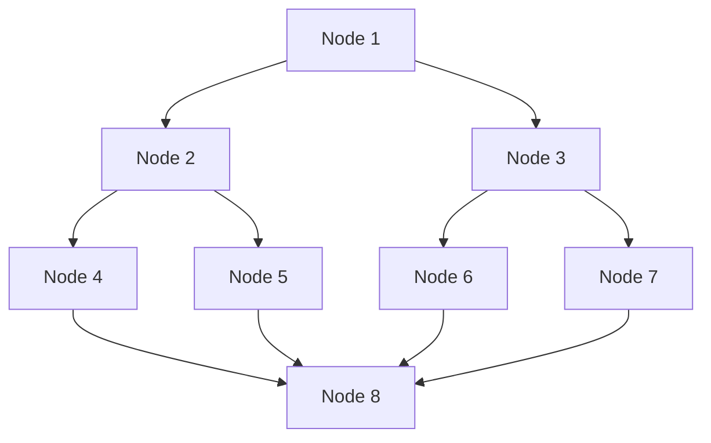
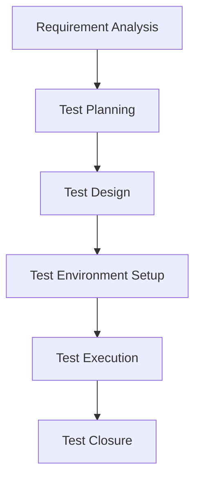
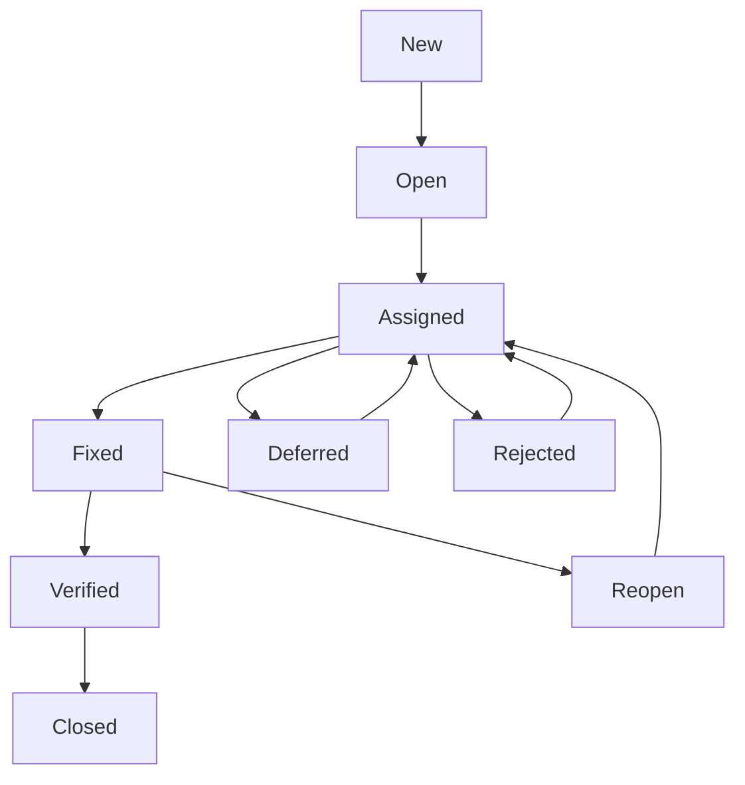
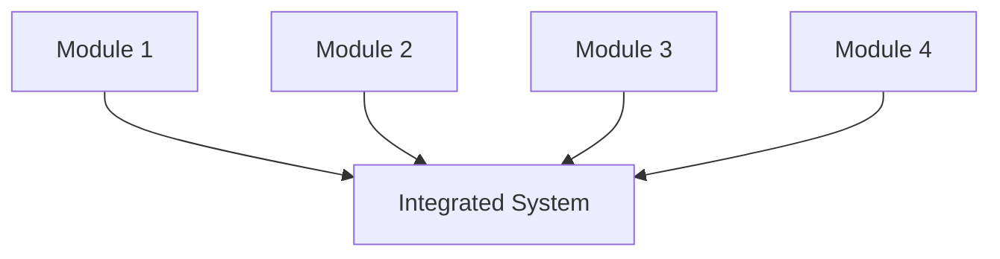
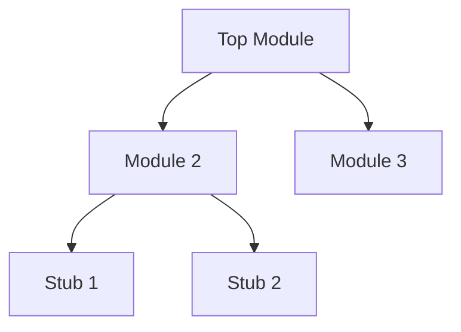
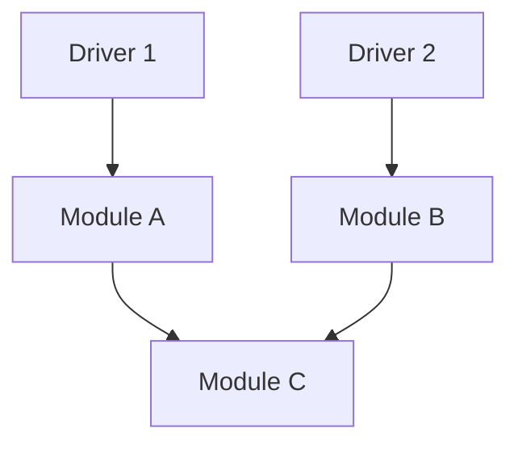
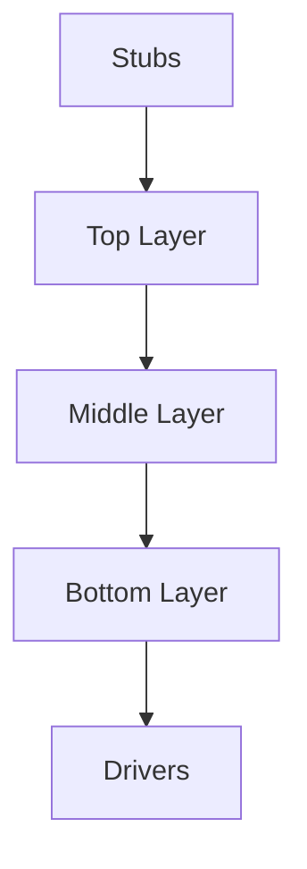
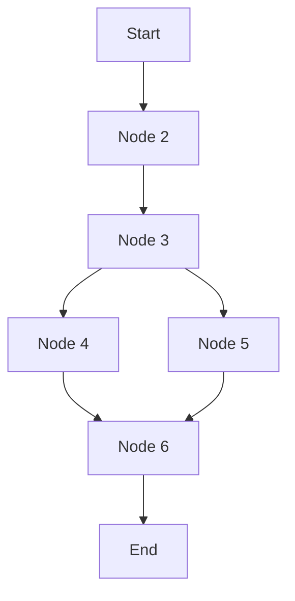

#### 1. Define the following terms: Bug, Defect, Error, Failure, and Fault.

**Bug:** A bug is a flaw in software that causes incorrect or unexpected behaviour during execution. It represents a deviation from the specified requirements.

**Defect:** A defect is an imperfection or flaw in the software product that reduces its quality. It indicates a deviation from the expected functionality.

**Error:** An error is a human mistake made during the software development life cycle activities. It results from incorrect reasoning or oversight.

**Failure:** A failure is the observable manifestation of a defect during software execution. It occurs when software does not meet its intended function.

**Fault:** A fault is an underlying defect in the code that can potentially cause a failure. It exists in the software product before execution.

---

#### 2. List and briefly define any four Black Box Testing techniques.

**Equivalence Partitioning:** 
- Divides input data into classes where each class yields similar results. 
- Tests only one representative value per class, assuming all values in that class behave the same way.

**Boundary Value Analysis:** 
- Tests input values at the exact boundaries between equivalence classes. 
- Focuses on minimum, maximum, and edge values (just inside and just outside the boundary) to catch boundary-related defects.

**Decision Table Testing:** 
- Uses tables to represent logical conditions and their corresponding actions. 
- Ensures all possible combinations of conditions are tested for complex business rules.

**State Transition Testing:** 
- Tests software behavior when transitioning between different states. 
- Focuses on valid and invalid state changes, triggered by events, to verify correct system flow.

---

#### 3. Explain the need for software metrics in the testing process.

**Progress Tracking:** Measures test execution completion against the planned schedule, giving real-time visibility into whether the testing phase is progressing as expected.

**Quality Assessment:** Evaluates software reliability by examining defect density and removal efficiency, providing a clear measure of the product's overall stability.

**Resource Optimization:** Pinpoints performance bottlenecks and underused areas, enabling managers to allocate team members, tools, and time more effectively.

**Process Improvement:** Reviews historical testing data to uncover recurring issues and inefficiencies, which can then be used to refine future testing approaches.

**Release Decision:** Offers stakeholders concrete, data-backed evidence about software quality, helping them decide if the product is ready for deployment.

**Cost Management:** Lowers total project expenses by detecting and resolving defects early in the cycle, avoiding expensive post-release fixes and rework.

---

#### 4. Differentiate between Static Testing and Dynamic Testing.

| Factor | Static Testing | Dynamic Testing |
|--------|---------------|-----------------|
| Execution | No code execution | Requires code execution |
| Timing | Performed early in development | Performed after code creation |
| Defects Found | Syntax and design errors | Runtime and behavioral errors |
| Tools Used | Review checklists, walkthroughs | Debuggers, profilers |
| Cost | Less expensive to fix | More expensive to fix |
| Techniques | Inspections, code reviews | Functional and performance testing |
| Output | Defect reports | Test results and logs |

---

#### 5. List the key components of a test plan as per the IEEE 829 standard.

The IEEE 829 standard defines the following key components for test plans:

1. **Test Plan Identifier:** Unique identifier for the document
2. **Introduction:** Overview of the software and testing scope
3. **Test Items:** Features and functions to be tested
4. **Features to be Tested:** Specific functionalities requiring testing
5. **Features Not to be Tested:** Excluded functionalities with rationale
6. **Approach:** Overall testing strategy and methodologies
7. **Item Pass/Fail Criteria:** Standards for determining test outcomes
8. **Suspension Criteria and Resumption:** Conditions for stopping and restarting tests
9. **Test Deliverables:** Documents and reports to be produced
10. **Testing Tasks:** Activities and responsibilities assigned to team members
11. **Environmental Needs:** Hardware, software, and facility requirements
12. **Responsibilities:** Roles assigned to different team members
13. **Staffing and Training:** Personnel allocation and skill requirements
14. **Schedule:** Timeline for testing activities and milestones
15. **Risks and Contingencies:** Potential problems and mitigation strategies
16. **Approvals:** Signatures confirming acceptance of the test plan

---

#### 6. List the attributes and the corresponding metrics used for monitoring and controlling the testing process.

1. **Test Progress:** Measures execution completion against planned schedule.
2. **Defect Discovery:** Tracks number of defects found each day.
3. **Test Effectiveness:** Shows defects detected per test case executed.
4. **Test Coverage:** Indicates percentage of requirements covered by tests.
5. **Defect Severity:** Shows distribution of critical and major defects.
6. **Test Efficiency:** Measures test cases executed per person-hour spent.
7. **Defect Aging:** Tracks average time taken to fix discovered defects.
8. **Reopened Defects:** Counts number of defects reopened after being fixed.
9. **Test Environment:** Monitors system availability and uptime percentage.
10. **Resource Utilization:** Compares staff allocation against planned resources.

---

#### 7. Differentiate between Verification and Validation.

| Factor | Verification | Validation |
|--------|-------------|------------|
| Focus | Are we building the product right? | Are we building the right product? |
| Timing | Performed during development stages | Performed after development completion |
| Methods | Reviews, walkthroughs, inspections | Testing, user acceptance, demonstration |
| Objective | Find defects in work products | Ensure user needs are satisfied |
| Participants | Developers and quality analysts | Testers and end users |
| Artifacts | Requirements, design documents | Working software product |
| Output | Defect reports and improvement suggestions | Acceptance decisions and feedback |

---

#### 8. What is cyclomatic complexity, and provide its formula.


Cyclomatic complexity is a software metric that measures the number of independent paths through a program's source code. It indicates the structural complexity and testability of a software module.

**Formula:**

$$M = E - N + 2P$$

Where:
- $E$ = Number of edges in the control flow graph
- $N$ = Number of nodes in the control flow graph
- $P$ = Number of connected components ($P = 1$ for a single program)

**Alternative Formula:**

$$M = \text{Decision Nodes} + 1$$

(For a single program with one entry point)

**Example:**

If a program has 10 edges and 8 nodes, then:

$$M = 10 - 8 + 2 = 4$$

Therefore, the program has **4 independent paths**.

**Control Flow Graph:**



**Verification:**

- **Edges ($E$):** 10
- **Nodes ($N$):** 8
- **Components ($P$):** 1

$$M = 10 - 8 + 2(1) = 4$$

**The 4 Independent Paths:**

| Path | Route |
|------|-------|
| Path 1 | Node 1 → Node 2 → Node 4 → Node 8 |
| Path 2 | Node 1 → Node 2 → Node 5 → Node 8 |
| Path 3 | Node 1 → Node 3 → Node 6 → Node 8 |
| Path 4 | Node 1 → Node 3 → Node 7 → Node 8 |

---

#### 9. Define Alpha Testing and Beta Testing.

**Alpha Testing:** 
- Alpha testing is performed by internal teams at the developer's site before software release. 
- It focuses on identifying defects in a controlled environment with simulated user interactions. 
- This testing occurs at the end of development before external distribution.

**Beta Testing:** 
- Beta testing is conducted by real users in a real-world environment after alpha completion. 
- It validates the software under actual usage conditions with diverse user scenarios. 
- This testing helps discover issues that emerge in different operating environments.

---

#### 10. Explain the terms Stub and Driver in the context of Integration Testing.

**Stub:** 
- A stub is a dummy module that simulates the behavior of a missing component. 
- It is called by the module being tested when called modules are unavailable. 
- Stubs provide minimal functionality to allow top-down integration testing. 
- They return controlled responses to enable testing of higher-level modules.

**Driver:** 
- A driver is a temporary program that invokes and controls a module being tested. 
- It simulates calling modules that are not yet developed in bottom-up integration. 
- Drivers supply test inputs and capture outputs from the module being tested. 
- They coordinate the execution sequence during integration testing activities.

---

#### 11. State the goals of software testing.

1. **Find Defects:** Identify errors, bugs, and faults in software
2. **Prevent Defects:** Discover issues early to prevent future failures
3. **Ensure Quality:** Verify that software meets specified standards
4. **Validate Requirements:** Confirm software satisfies user expectations
5. **Prevent Failures:** Reduce operational risks and system crashes
6. **Build Confidence:** Establish trust in software reliability
7. **Reduce Costs:** Minimize expenses associated with fixing defects
8. **Compliance:** Ensure adherence to regulatory and business standards
9. **Improve Process:** Identify weaknesses in development methodology
10. **Customer Satisfaction:** Deliver reliable and functional software products

---

#### 12. Illustrate the Software Testing Life Cycle with the help of a neat diagram, and explain each phase with a suitable example.

The Software Testing Life Cycle (STLC) is a systematic process that defines testing activities in a structured sequence from planning to closure.



**Requirement Analysis:** 
- Test team studies requirements and identifies testable items. 
- *Example: Analyzing login functionality requirements for an e-commerce website.*

**Test Planning:** 
- Test strategy, resource allocation, and schedule are determined. 
- *Example: Defining that login testing requires 3 testers and 5 days.*

**Test Design:** 
- Test cases and test data are created based on requirements.
- Example: Creating test cases for valid and invalid username/password combinations.*

**Test Environment Setup:** 
- Hardware, software, and network configurations are prepared. 
- *Example: Setting up test servers with Chrome, Firefox, and Safari browsers.*

**Test Execution:** 
- Test cases are run, and actual results are compared with expected results.
- Example: Running login tests and recording pass/fail status for each test case.

**Test Closure:** 
- Testing is completed, and summary reports are prepared. 
- *Example: Generating a test summary report showing 95% pass rate and defects found.*

---

#### 13. Apply Boundary Value Analysis and Equivalence Class Testing to design test cases for a program that accepts three sides of a triangle, each ranging from `1 to 100`, and identifies whether the triangle is Scalene, Isosceles, Equilateral, or Invalid.

**Equivalence Class Partitioning:**
- Equivalence partitioning divides input data into valid and invalid equivalence classes, where test cases from each class are considered equivalent.

**Valid Equivalence Classes:**

| #   | Class                      | Condition                                        |
| --- | -------------------------- | ------------------------------------------------ |
| 1   | Valid Scalene Triangle     | a+b>c, b+c>a, a+c>b, and all sides different     |
| 2   | Valid Isosceles Triangle   | a+b>c, b+c>a, a+c>b, and exactly two sides equal |
| 3   | Valid Equilateral Triangle | a+b>c, b+c>a, a+c>b, and all three sides equal   |

**Invalid Equivalence Classes:**

| #   | Class                         | Condition                                        |
| --- | ----------------------------- | ------------------------------------------------ |
| 4   | Invalid - Triangle Inequality | Sum of any two sides not greater than third side |
| 5   | Invalid - Side Below Range    | Any side value is less than 1                    |
| 6   | Invalid - Side Above Range    | Any side value is greater than 100               |

**Test Cases from Equivalence Partitioning:**

| #   | a   | b   | c   | Expected Output | Class Covered       |
| --- | --- | --- | --- | --------------- | ------------------- |
| 1   | 5   | 6   | 7   | Scalene         | Valid Scalene       |
| 2   | 5   | 5   | 6   | Isosceles       | Valid Isosceles     |
| 3   | 5   | 5   | 5   | Equilateral     | Valid Equilateral   |
| 4   | 1   | 2   | 3   | Invalid         | Triangle Inequality |
| 5   | 0   | 5   | 6   | Invalid         | Side Below Range    |
| 6   | 101 | 5   | 6   | Invalid         | Side Above Range    |

**Boundary Value Analysis:**
- Boundary value analysis tests values at the minimum, maximum, and just inside or outside these extremes.

**Boundary Values for Each Side:**

| Boundary | Values to Test |
|----------|----------------|
| Lower Boundary | 0 (below), 1 (minimum), 2 (just above) |
| Upper Boundary | 99 (just below), 100 (maximum), 101 (above) |

**Test Cases from Boundary Value Analysis:**

| # | a | b | c | Expected Output | Boundary Tested |
|---|----|----|----|-----------------|-----------------|
| 1 | 1 | 50 | 50 | Isosceles | Lower boundary of a |
| 2 | 2 | 50 | 50 | Isosceles | Just above lower boundary of a |
| 3 | 99 | 50 | 50 | Isosceles | Just below upper boundary of a |
| 4 | 100 | 50 | 50 | Invalid | Upper boundary of a |
| 5 | 50 | 1 | 50 | Isosceles | Lower boundary of b |
| 6 | 50 | 100 | 50 | Invalid | Upper boundary of b |
| 7 | 50 | 50 | 1 | Isosceles | Lower boundary of c |
| 8 | 50 | 50 | 100 | Invalid | Upper boundary of c |

**Explanation of Boundary Test Cases:**

- Test case 1 (1,50,50): 1+50 > 50 (51>50 true) and two sides equal, so Isosceles
- Test case 4 (100,50,50): 50+50 > 100 (100>100 false), so Invalid
- Test case 5 (50,1,50): 1+50 > 50 (51>50 true) and two sides equal, so Isosceles
- Test case 6 (50,100,50): 50+50 > 100 (100>100 false), so Invalid

**Triangle rule: a + b > c 
	(The sum of any two sides must be greater than the third side)**

---

#### 14. Analyze the different Regression Testing techniques and evaluate their applicability with a suitable example scenario.

**Regression Testing Techniques:**

**1. Progressive Regression Testing:** 
- Performed when new features are added to the application. 
- Existing test cases are updated and new ones are created to ensure new functionality does not break existing features.

**2. Regional Regression Testing:** 
- Verifies that code changes in one module do not affect other related modules.
- This prevents regression defects from spreading and improves overall integration stability.

**3. Complete Regression Testing:** 
- Executes the entire regression test suite to validate all application functionality after major changes. 
- This provides maximum release confidence but requires more testing time and resources.

**4. Unit Regression Testing:** 
- Verifies that changes within a single module do not introduce defects before integration. 
- This is commonly performed by developers and automated using unit testing frameworks.

**5. Partial Regression Testing:** 
- Verifies that recent code changes work correctly with the unchanged parts of the application. 
- This focuses on modified and connected modules while being faster than full regression testing.

**6. Selective Regression Testing:** 
- Executes only the test cases affected by recent code changes instead of running the entire suite. 
- This reduces execution time and improves overall testing efficiency.

**7. Corrective Regression Testing:** 
- Performed when there are no significant changes to functionality or requirements.
- Existing test cases are reused without modification, making it suitable for minor bug fixes.

**Example Scenario:** An e-commerce payment module is updated to support a new payment gateway. Regression testing ensures existing payment methods still work. Test case selection would focus on payment-related test cases, prioritization would place credit card processing tests first, and retest all could be used if the modification is extensive.

---

#### 15. Evaluate different Test Suite Prioritization techniques for a given project. Compare their effectiveness and discuss the metrics used to measure prioritization effectiveness.

**Test Suite Prioritization Techniques:**

**Total Statement Coverage:**
- Prioritizes tests based on total statements covered. 
- *Effectiveness: High for small projects with limited test suites.*

**Additional Statement Coverage:** 
- Prioritizes tests to maximize coverage with each addition.
- *Effectiveness: Better than total coverage for large projects.*

**Fault-Exposing Potential:** 
- Prioritizes tests based on historical fault detection. 
- *Effectiveness: Highly effective for mature systems with defect history.*

**Requirements-Based:** 
- Prioritizes tests covering critical business requirements.
- *Effectiveness: Best for meeting user expectations and business needs.*

**Risk-Based:** 
- Prioritizes tests based on risk assessment of modules.
- *Effectiveness: Most effective for high-stakes systems with critical components.*

**Effectiveness Metrics:**

| Metric    | Description                                    |
| --------- | ---------------------------------------------- |
| APFD      | Average Percentage of Faults Detected          |
| P-measure | Percentage of faults detected by first k tests |
| AUC       | Area Under the Cumulative Coverage Curve       |
| FDD       | Fault Detection Density per unit time          |

---

#### 16. Explain the Software Defect Life Cycle with a neat diagram and briefly define all its states.

The Software Defect Life Cycle describes the journey of a bug from discovery to closure through various states.



**States of Defect Life Cycle:**

- **New:** Defect is first reported. No action has been taken yet.
- **Open:** Development acknowledges and begins analyzing the defect.
- **Assigned:** Defect is assigned to a specific developer for fixing.
- **Fixed:** Developer corrects the code and commits changes to repository.
- **Verified:** Tester retests the fixed defect to confirm resolution.
- **Closed:** Defect is confirmed fixed. Testing is complete.
- **Reopen:** Defect is reopened when verification fails or issue reappears.
- **Deferred:** Defect is postponed to a future release due to constraints.
- **Rejected:** Defect is rejected as invalid, duplicate, or not reproducible.

---

#### 17. Describe the four Integration Testing strategies with diagrams, and explain the role of Stubs and Drivers in each.

**Integration Testing Strategies:**

**Big Bang:** All modules are integrated simultaneously and tested together.



**Top-Down:** High-level modules are tested first, using stubs for lower-level modules.



**Bottom-Up:** Low-level modules are tested first, using drivers for higher-level modules.



**Sandwich (Hybrid):** Combines top-down and bottom-up approaches for efficiency.



**Stubs:** Simulate lower-level modules not yet developed. Used in top-down testing to replace called modules and return test data.

**Drivers:** Simulate higher-level modules that call lower-level modules. Used in bottom-up testing to invoke and test lower-level modules with test data.

---

#### 18. Explain Basis Path Testing. For a given control flow graph, compute the cyclomatic complexity and determine the number of independent paths.

**Basis Path Testing:** A white-box testing technique that derives test cases from a program's control flow graph. It ensures that every possible path through the code is executed at least once.

**Steps for Basis Path Testing:**

1. Draw the control flow graph from source code.
2. Calculate cyclomatic complexity (V(G)).
3. Determine independent paths.
4. Design test cases for each independent path.




**Cyclomatic Complexity Calculation:**

Three formulas yield the same result:

$$V(G) = E - N + 2 \quad \text{(Edges - Nodes + 2)}$$

$$V(G) = P + 1 \quad \text{(Predicate nodes + 1)}$$

$$V(G) = \text{Number of regions}$$

**Given Control Flow Graph:**
- Nodes $(N) = 7$ (A, B, C, D, E, F, G)
- Edges $(E) = 7$ (A→B, B→C, C→D, C→E, D→F, E→F, F→G)
- Predicate Nodes $(P) = 1$ (Node C only; F has only one outgoing edge)

**Compute:**

$$V(G) = E - N + 2 = 7 - 7 + 2 = 2$$

$$V(G) = P + 1 = 1 + 1 = 2$$

**Independent Paths:**

| Path | Route |
|------|-------|
| Path 1 | A → B → C → D → F → G |
| Path 2 | A → B → C → E → F → G |

The cyclomatic complexity is **2**, indicating that **two independent paths** must be tested for complete basis path coverage.

---

#### 19. Analyze the Test Planning process in detail. Explain how Test Organization, Structure of the Testing Group, Detailed Test Design, and Test Specification contribute to effective test management. Illustrate your answer with a sample test plan outline.

**Test Planning Process Components**:

- **Test Planning**: Core management activity defining test objectives, resources, and processes for the test project
- **Demonstrates Policy Adherence**: Shows how testing will comply with existing organizational policies
- **Documents Means and Schedules**: Records methods, resources, and timelines for achieving test objectives
- **Ensures Criteria Satisfaction**: Confirms activities meet defined entry and exit criteria
- **Serves as Communication Tool**: Facilitates stakeholder understanding and project coordination

**Contributions to Effective Test Management**

| Component               | Contribution                                                                     |
| ----------------------- | -------------------------------------------------------------------------------- |
| Test Organization       | Establishes clear objectives, strategy, and framework for all testing activities |
| Testing Group Structure | Defines roles, responsibilities, and reporting relationships within test team    |
| Detailed Test Design    | Transforms test conditions into concrete, executable test cases and procedures   |
| Test Specification      | Documents precise test descriptions, data requirements, and expected results     |

**Sample Test Plan Outline:**

```
1.0 Introduction
   1.1 Purpose
   1.2 Scope
   1.3 References
2.0 Test Items
   2.1 Features to be tested
   2.2 Features not to be tested
3.0 Test Approach
   3.1 Testing levels
   3.2 Testing types
   3.3 Techniques used
4.0 Test Deliverables
   4.1 Test cases
   4.2 Defect reports
   4.3 Test summary reports
5.0 Resources
   5.1 Hardware
   5.2 Software
   5.3 Personnel
6.0 Schedule
   6.1 Milestones
   6.2 Dependencies
7.0 Risk Management
   7.1 Identified risks
   7.2 Mitigation plans
```