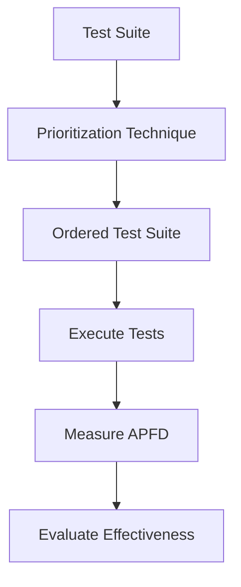
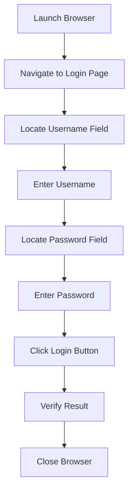
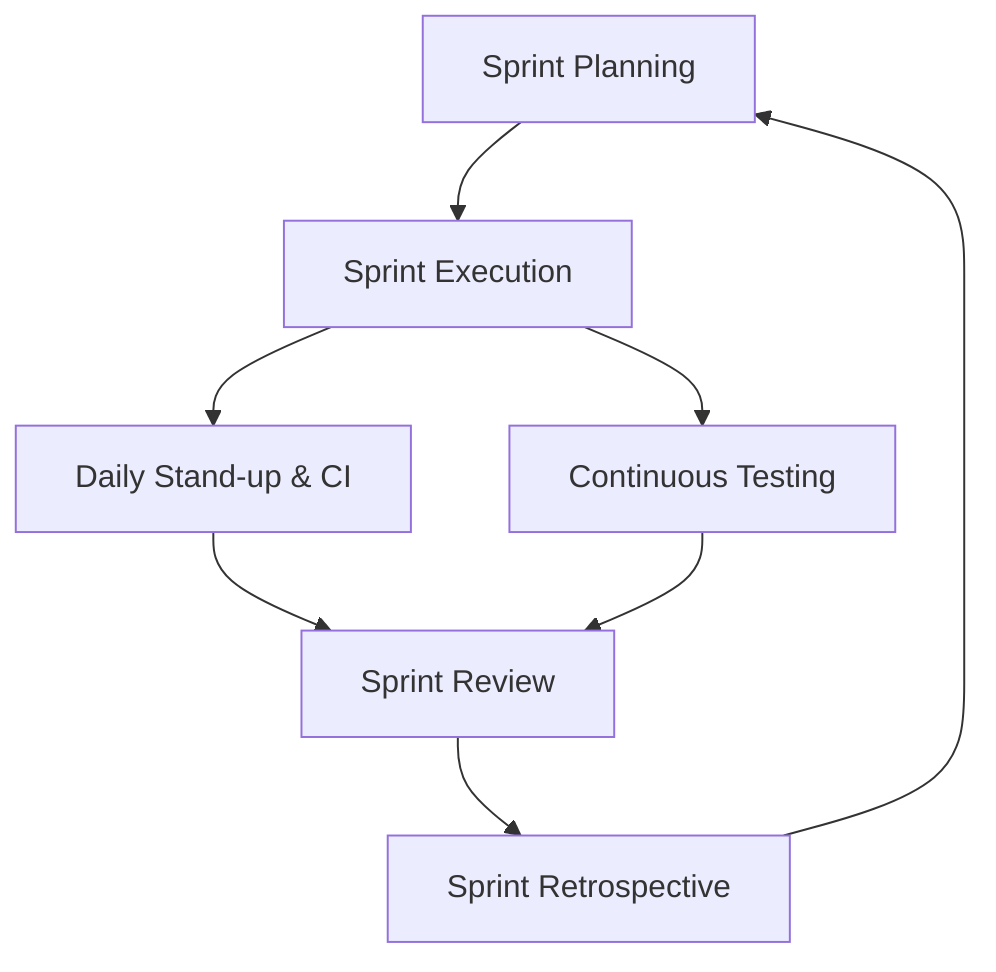

#### Define software metrics and classify them with one example of each class (2 marks)

**Software Metrics** are quantitative measures used to assess the quality, complexity, size, performance, or progress of software and the software development process.

**Classification of Software Metrics:**

| Class               | Description                                       | Example                                    |
| ------------------- | ------------------------------------------------- | ------------------------------------------ |
| **Product Metrics** | Measure attributes of the software product itself | Lines of Code (LOC), Cyclomatic Complexity |
| **Process Metrics** | Measure attributes of the development process     | Defect removal rate, review efficiency     |
| **Project Metrics** | Measure project-level attributes                  | Effort (person-months), schedule variance  |

**Result:** Software metrics are classified as product, process, and project metrics; each provides measurable insight for quality control and estimation.

---

#### Define test suite minimization and state two benefits (2 marks)

**Test Suite Minimization** is the process of reducing a test suite by removing redundant or less effective test cases while preserving the suite's fault-detection capability.

- **Benefits:**
  1. **Reduced execution time and cost** : fewer test cases means faster regression cycles.
  2. **Lower maintenance overhead** : fewer tests to update when the software changes.

**Result:** Test suite minimization improves regression efficiency without significantly sacrificing coverage or fault detection.

---

#### Why is test automation needed? State any four reasons (2 marks)

**Test Automation** is the use of tools and scripts to execute tests, compare actual and expected results, and report outcomes without manual intervention.

- **Four reasons:**
  1. **Repetitive regression testing** : automates frequent re-execution after changes.
  2. **Speed and efficiency** : runs thousands of tests quickly.
  3. **Consistency and accuracy** : eliminates human error in repetitive tasks.
  4. **24/7 execution** : supports continuous integration and overnight test runs.

**Result:** Automation is essential for speed, repeatability, coverage, and cost-effectiveness in modern software testing.

---

#### Differentiate between static and dynamic testing tools with one example each (2 marks)

| Aspect | Static Testing Tools | Dynamic Testing Tools |
|---|---|---|
| **Execution** | Do not execute the code | Execute the code |
| **Focus** | Analyze code, design, or documents | Analyze runtime behavior |
| **Stage** | Early in the lifecycle (reviews, analysis) | After code is built |
| **Example** | **SonarQube** (static code analysis) | **Selenium** (functional test execution) |

**Key Distinctions:** Static tools find defects without running the program; dynamic tools detect defects by executing the program.

---

#### Differentiate between JIRA and Bugzilla (any four points) (2 marks)

| Aspect | JIRA | Bugzilla |
|---|---|---|
| **Vendor** | Atlassian | Mozilla Foundation |
| **Primary use** | Agile project management and issue tracking | Bug tracking |
| **Customization** | Highly customizable workflows and boards | Moderate customization |
| **Integration** | Rich integration with CI/CD, Confluence, Bitbucket | Limited, plugin-based integration |
| **Licensing** | Commercial (free tier for small teams) | Open source, free |

**Key Distinctions:** JIRA is a broader project/issue management platform, while Bugzilla is a focused, open-source bug-tracking system.

---

#### List any four challenges in testing web-based software (2 marks)

- **1. Browser and device compatibility** : rendering and behavior vary across browsers, versions, and devices.
- **2. Performance and load** : unpredictable traffic spikes and network latency.
- **3. Security vulnerabilities** : SQL injection, XSS, CSRF, and session management risks.
- **4. Dynamic and evolving content** : pages change frequently, making regression testing difficult.

**Result:** Web testing must address compatibility, performance, security, and the dynamic nature of web content.

---

#### Differentiate between traditional and web-based software (any four points) (2 marks)

| Aspect | Traditional Software | Web-Based Software |
|---|---|---|
| **Deployment** | Installed on user machines | Accessed via browser; centrally hosted |
| **Updates** | Manual patches or installers | Server-side, immediate updates |
| **Users** | Known, limited user base | Large, unknown, concurrent user base |
| **Platform** | OS-dependent | Platform-independent (browser-based) |
| **Testing focus** | Functionality, installation | Functionality, compatibility, load, security |

**Key Distinctions:** Web-based software introduces multi-user concurrency, browser dependence, and security concerns absent in traditional desktop software.

---

#### Define Agile Testing and state two principles (2 marks)

**Agile Testing** is a software testing practice aligned with Agile development, where testing is continuous, collaborative, and integrated throughout the iterative development cycle rather than performed as a separate phase.

- **Two principles:**
  1. **Continuous feedback** : testing provides rapid feedback to guide development.
  2. **Collaboration** : testers, developers, and business stakeholders work together throughout.

**Result:** Agile testing emphasizes early, continuous, and collaborative quality assurance within short iterations.

---

#### List any four quality management principles of ISO 9000:2000 (2 marks)

- **1. Customer focus** : understand and meet customer requirements.
- **2. Leadership** : establish unity of purpose and direction.
- **3. Involvement of people** : full participation of all employees.
- **4. Process approach** : manage activities and resources as processes.
- *(Also: system approach, continual improvement, factual decision-making, mutually beneficial supplier relationships.)*

**Result:** ISO 9000:2000 principles provide a framework for consistent quality management across the organization.

---

#### Explain the DMAIC methodology of Six Sigma in brief (2 marks)

**DMAIC** is a data-driven improvement cycle used in Six Sigma to improve existing processes.

- **D : Define:** Define the problem, customer requirements, and project goals.
- **M : Measure:** Collect data and measure current process performance.
- **A : Analyze:** Identify root causes of defects and variation.
- **I : Improve:** Implement and validate solutions to eliminate root causes.
- **C : Control:** Sustain improvements through monitoring and standard controls.

**Result:** DMAIC provides a structured, evidence-based path from problem definition to sustained process improvement.

---

#### Apply Function Point Analysis: compute UFP and AFP; explain use in testing effort (5 marks)

**Given Data (all average complexity):**

| Component | Count | Weight (Average) |
|---|---|---|
| External Inputs (EI) | 24 | 4 |
| External Outputs (EO) | 16 | 5 |
| External Inquiries (EQ) | 22 | 4 |
| Internal Logical Files (ILF) | 4 | 10 |
| External Interface Files (EIF) | 2 | 7 |

**Step 1 : Unadjusted Function Points (UFP):**
\[
UFP = (24 \times 4) + (16 \times 5) + (22 \times 4) + (4 \times 10) + (2 \times 7)
\]
\[
UFP = 96 + 80 + 88 + 40 + 14 = 318
\]

**Result (UFP):** **318**

**Step 2 : Adjusted Function Points (AFP):**
\[
AFP = UFP \times (0.65 + 0.01 \times \Sigma F_i)
\]
\[
AFP = 318 \times (0.65 + 0.01 \times 42) = 318 \times (0.65 + 0.42) = 318 \times 1.07 = 340.26
\]

**Result (AFP):** **340.26** (approximately **340**)

**How function points help estimate testing effort:**
- **Size-based estimation:** AFP provides a technology-independent measure of system size.
- **Effort correlation:** Testing effort (test cases, execution time, defect density) scales with functional size.
- **Productivity benchmarks:** Industry data (e.g., test cases per FP, hours per FP) convert AFP into test effort.
- **Planning:** Helps allocate test resources, schedule, and budget early in the lifecycle.

**Result:** UFP = **318**, AFP ≈ **340**, and function points enable early, size-based estimation of testing effort.

---

#### Explain test suite prioritization, its types, techniques, and APFD measurement (5 marks)

**Test Suite Prioritization:** Ordering test cases in a sequence that maximizes early detection of faults, so that the most valuable tests run first within time or resource constraints.

**Types of Prioritization:**

| Type | Description |
|---|---|
| **General prioritization** | Uses code coverage and fault history; no specific modification focus |
| **Version-specific** | Targets a particular release or change set |
| **Requirements-based** | Orders by business priority or risk of requirements |
| **History-based** | Uses past fault detection and execution data |

**Techniques:**
- **Greedy algorithms** : select the test with maximum coverage of uncovered code.
- **Additional coverage** : iteratively add tests covering new statements/branches.
- **Cost-aware** : balance fault detection against execution cost.
- **Search-based** : genetic algorithms, hill climbing to optimize ordering.
- **Machine learning** : predict fault-prone tests and rank them higher.

**APFD (Average Percentage of Faults Detected):**
\[
APFD = 1 - \frac{TF_1 + TF_2 + \dots + TF_m}{n \times m} + \frac{1}{2n}
\]
- \(TF_i\) = position of the first test that detects fault \(i\)
- \(n\) = number of test cases, \(m\) = number of faults
- **Range:** 0 to 1; higher APFD = faster fault detection.

**Result:** Prioritization orders tests to detect faults earlier; APFD quantifies how quickly faults are found, with values closer to 1 being better.

---

#### Analyze guidelines and criteria for selecting a testing tool; costs; justify automation (5 marks)

**Guidelines and Criteria for Tool Selection:**

- **1. Requirement fit** : tool must support the application type (web, mobile, desktop), technologies, and test types.
- **2. Ease of use** : learning curve, scripting language, IDE integration.
- **3. Compatibility** : OS, browser, CI/CD, version control, and test management integration.
- **4. Vendor support** : documentation, training, updates, and community.
- **5. Scalability** : ability to handle growing test suites and parallel execution.
- **6. Reporting and analytics** : dashboards, logs, defect linkage.
- **7. Licensing and cost** : commercial vs. open source, per-seat vs. floating.
- **8. Proof of concept** : pilot on a real module before full adoption.

**Costs Incurred in Testing Tools:**

| Cost Type | Description |
|---|---|
| **Acquisition** | License purchase or subscription |
| **Training** | Upskilling testers and developers |
| **Implementation** | Setup, configuration, framework development |
| **Maintenance** | Script updates, tool upgrades, environment upkeep |
| **Operating** | Execution infrastructure, CI servers, cloud resources |
| **Transition** | Migration from manual processes, productivity dip |

**Justification for the Company (frequent regression cycles):**
- **High regression frequency** → automation provides strong ROI through repeated execution.
- **Long-term savings** → reduced manual effort and faster release cycles.
- **Consistency** → fewer human errors, better coverage.
- **Break-even analysis** → if regression runs are frequent and the suite is stable, automation cost is recovered within a few cycles.

**Result:** For a company with frequent regression cycles, investing in automation is **justified** when tool selection follows clear criteria, pilot validation succeeds, and long-term regression savings exceed total cost of ownership.

---

#### Apply Selenium WebDriver to automate login; design test cases and steps (5 marks)

**Application Under Test:** A web application with a login page (username, password, submit button).

**Positive Test Cases:**

| ID | Scenario | Input | Expected |
|---|---|---|---|
| TC1 | Valid login | valid user / valid pass | Redirect to dashboard |
| TC2 | Valid login, remember me | valid user / valid pass + checkbox | Session persists |

**Negative Test Cases:**

| ID | Scenario | Input | Expected |
|---|---|---|---|
| TC3 | Invalid password | valid user / wrong pass | Error message displayed |
| TC4 | Empty fields | blank / blank | Validation error |
| TC5 | SQL injection attempt | `' OR '1'='1` | Login denied, no DB error |

**Automation Steps (Selenium WebDriver):**

1. **Launch browser** : `WebDriver driver = new ChromeDriver();`
2. **Navigate** : `driver.get("https://app.example.com/login");`
3. **Locate username field** : `driver.findElement(By.id("username"));`
4. **Enter data** : `username.sendKeys("validUser");`
5. **Locate password field** : `driver.findElement(By.id("password"));`
6. **Enter password** : `password.sendKeys("validPass");`
7. **Click submit** : `driver.findElement(By.id("loginBtn")).click();`
8. **Verify result** : `Assert.assertEquals("Dashboard", driver.getTitle());`
9. **Close browser** : `driver.quit();`

**Selenium Suite Components Used:**

| Component | Role |
|---|---|
| **Selenium WebDriver** | Browser automation and element interaction |
| **Selenium IDE** | Record and playback for quick test creation |
| **Selenium Grid** | Parallel execution across browsers/machines |
| **Selenium RC** (legacy) | Older remote control API |

**Result:** Selenium WebDriver automates login via element location, data entry, action, and assertion; positive and negative cases validate both success and failure paths.

---

#### Design web-based test cases for an online shopping website (5 marks)

**Test Areas and Sample Test Cases:**

**1. Functionality:**

| ID | Test Case | Expected |
|---|---|---|
| F1 | Register a new user | Account created, confirmation email sent |
| F2 | Add product to cart | Cart count and total update correctly |
| F3 | Apply valid coupon | Discount applied to total |
| F4 | Checkout with valid payment | Order confirmed, confirmation shown |
| F5 | Cancel order before shipping | Order cancelled, refund initiated |

**2. User Interface / Usability:**

| ID | Test Case | Expected |
|---|---|---|
| U1 | Navigation menu links | All links work, no broken pages |
| U2 | Responsive layout on mobile | Layout adapts, no overlap |
| U3 | Error messages clarity | Clear, actionable messages |
| U4 | Font, color, contrast | Readable and consistent |

**3. Browser Compatibility:**

| ID | Test Case | Expected |
|---|---|---|
| B1 | Test on Chrome, Firefox, Edge, Safari | Consistent rendering and behavior |
| B2 | Test on different screen resolutions | Layout intact |
| B3 | Test on mobile browsers | Touch interactions work |

**4. Performance (Load):**

| ID | Test Case | Expected |
|---|---|---|
| P1 | 1000 concurrent users browse | Response time < 3s |
| P2 | 500 concurrent checkouts | No failures, DB consistent |
| P3 | Peak load during sale | System remains available |

**5. Security:**

| ID | Test Case | Expected |
|---|---|---|
| S1 | SQL injection in login/search | Input sanitized, no DB leak |
| S2 | XSS in review field | Script not executed |
| S3 | HTTPS enforced | All pages on TLS |
| S4 | Session timeout | Session expires after inactivity |
| S5 | Payment data handling | PCI-DSS compliance, no plain storage |

**Result:** Web-based testing for an online shopping site must cover functionality, usability, browser compatibility, load performance, and security to ensure a reliable and safe release.

---

#### Explain the Agile Testing Life Cycle and Scrum phase testing activities (5 marks)

**Agile Testing Life Cycle:** Testing is continuous and iterative, integrated into each sprint rather than a final phase. It emphasizes early feedback, collaboration, and automation.

**Phases and Testing Activities in Scrum:**

- **1. Sprint Planning:**
  - Define acceptance criteria for user stories.
  - Estimate testing effort and identify testable increments.
  - Plan test data and environments.

- **2. Sprint Execution (Development):**
  - **Unit testing** by developers (TDD/BDD).
  - **Continuous integration** with automated smoke tests.
  - **Exploratory testing** by testers on incremental builds.
  - **Daily stand-ups** to surface blockers.

- **3. Sprint Review:**
  - **Acceptance testing** against acceptance criteria.
  - **Demo** to stakeholders; gather feedback.
  - **Regression testing** of completed features.

- **4. Sprint Retrospective:**
  - Review defect trends and test effectiveness.
  - Identify process improvements for next sprint.

- **5. Release / Continuous:**
  - **System and integration testing** across sprints.
  - **Performance, security, and UAT** before release.
  - **Automated regression** suite runs continuously.

**Result:** The Agile Testing Life Cycle embeds testing in every Scrum phase, from planning through review and retrospective, ensuring continuous quality and rapid feedback.

---

#### Analyze McCall's quality factors for Internet Banking; identify critical factors and trade-offs (5 marks)

**McCall's Quality Factors and Criteria:**

| Factor | Description | Relevant Criteria for Internet Banking |
|---|---|---|
| **Correctness** | Meets specifications | Accuracy of transactions, balance calculations |
| **Reliability** | Performs consistently | Uptime, fault tolerance, recovery |
| **Efficiency** | Uses resources well | Fast response, low latency |
| **Integrity** | Data security | Encryption, access control, audit trails |
| **Usability** | Ease of use | Intuitive UI, accessibility |
| **Maintainability** | Ease of change | Modularity, testability |
| **Flexibility** | Adaptability | Support for new products, channels |
| **Testability** | Ease of testing | Automated test coverage |
| **Portability** | Platform independence | Works across devices/browsers |
| **Reusability** | Reuse of components | Shared services across modules |
| **Interoperability** | Integration with other systems | Payment gateways, core banking |

**Most Critical Factors for Internet Banking (with justification):**

1. **Integrity (Security)** : Financial data is highly sensitive; breaches cause financial and reputational loss.
2. **Reliability** : Customers expect 24/7 availability; downtime erodes trust.
3. **Correctness** : Transaction errors directly impact money and compliance.
4. **Usability** : Diverse user base; poor UX leads to errors and support costs.
5. **Performance/Efficiency** : Slow response times frustrate users and can cause duplicate transactions.

**Trade-off Example : Security vs. Usability:**

| Security | Usability |
|---|---|
| Multi-factor authentication, frequent re-login | Frictionless, fast access |
| Strict session timeouts | Longer sessions for convenience |
| Complex password policies | Simple, memorable credentials |

**Analysis:** Strong security (MFA, short sessions) reduces usability by adding steps and interruptions. Conversely, maximizing usability (fewer checks, longer sessions) increases risk. The right balance depends on transaction type : high-value transfers demand stronger security, while balance checks can be more convenient.

**Result:** For Internet Banking, **integrity, reliability, and correctness** are the most critical McCall factors; security–usability is a key trade-off that must be balanced based on risk and user context.
