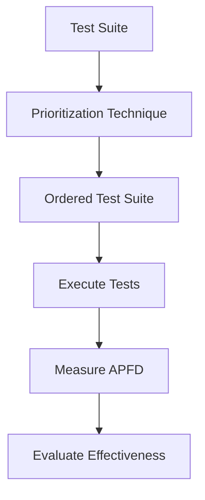
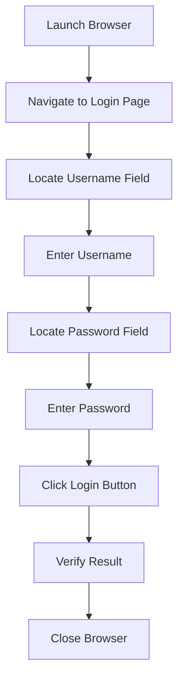
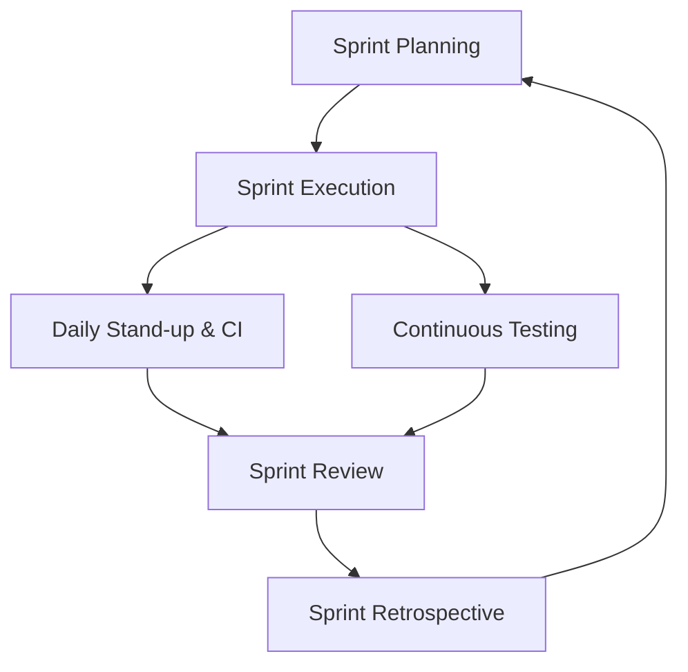

#### Define software metrics and classify them with one example of each class (2 marks)

**Software Metrics** are quantitative measures used to assess the quality, complexity, size, performance, or progress of software and the software development process.

**Classification of Software Metrics:**
- **Product Metrics** : Measure attributes of the software product itself.
    - Example: Lines of Code (LOC), Cyclometric Complexity
- **Process Metrics** : Measure attributes of the development process.
    - Example: Defect removal rate, review efficiency
- **Project Metrics** : Measure project-level attributes.
    - Example: Effort (person-months), schedule variance

---

#### Define test suite minimization and state two benefits (2 marks)

**Test Suite Minimization** is the process of reducing a test suite's size by eliminating redundant or low-value test cases while maintaining its fault-detection capability.

**Benefits:**
1. **Reduced execution time** : Fewer test cases means faster test runs.
2. **Lower cost** : Saves computational resources and human effort in regression testing.
3. **Efficient resource utilization** : Frees up hardware, software, and manpower for other testing tasks.
4. **Faster feedback** : Developers and testers receive quicker results, enabling faster decision-making.
5. **Easier maintenance** : A smaller test suite is simpler to manage, update, and debug.

---

#### Why is test automation needed? State any four reasons (2 marks)

**Test Automation** is the use of tools and scripts to execute tests, compare actual and expected results, and report outcomes without manual intervention.

**Reasons:**
1. **Faster execution** : Automated tests run much faster than manual tests, enabling quick feedback.
2. **Repeatability** : Tests can be run repeatedly with consistent and accurate results.
3. **Regression testing** : Enables frequent and reliable regression cycles without manual effort.
4. **Cost reduction** : Reduces long-term manual testing effort and operational cost.
5. **Parallel execution** : Multiple tests can run simultaneously across different environments.
6. **Improved coverage** : Allows execution of a large number of test cases that are impractical manually.
7. **24/7 operation** : Automated tests can run unattended at any time.
8. **Reusability** : Test scripts can be reused across multiple releases and projects.

---

#### Differentiate between static and dynamic testing tools with one example each (2 marks)

| **Aspect**    | **Static Testing Tools**                   | **Dynamic Testing Tools**                |
| ------------- | ------------------------------------------ | ---------------------------------------- |
| **Execution** | Do not execute the code                    | Execute the code                         |
| **Focus**     | Analyze code, design, or documents         | Analyze runtime behavior                 |
| **Stage**     | Early in the lifecycle (reviews, analysis) | After code is built                      |
| **Purpose**   | Find defects in code/documentation         | Find defects during runtime              |
| **Technique** | Inspections, reviews, static analysis      | Functional and performance testing       |
| **Input**     | Source code, design documents              | Executable code, test data               |
| **Output**    | Code quality reports, warnings             | Test results, logs, screenshots          |
| **Example**   | **SonarQube** (static code analysis)       | **Selenium** (functional test execution) |

---

#### Differentiate between JIRA and Bugzilla (any four points) (2 marks)

| **Aspect**        | **JIRA**                                           | **Bugzilla**                      |
| ----------------- | -------------------------------------------------- | --------------------------------- |
| **Vendor**        | Atlassian                                          | Mozilla Foundation                |
| **Primary use**   | Agile project management and issue tracking        | Bug tracking                      |
| **Customization** | Highly customizable workflows and boards           | Moderate customization            |
| **Integration**   | Rich integration with CI/CD, Confluence, Bitbucket | Limited, plugin-based integration |
| **Licensing**     | Commercial (free tier for small teams)             | Open source, free                 |
| **Agile Support** | Strong Agile/Scrum/Kanban support                  | Limited Agile support             |
| **Reporting**     | Advanced dashboards, reports, and analytics        | Basic reporting                   |
| **Ease of Use**   | Modern, intuitive UI                               | Dated, less intuitive UI          |

---

#### List any four challenges in testing web-based software (2 marks)

**Web-based software** is an application accessed through a web browser over a network, where testing must account for diverse environments, users, and real-time conditions.

1. **Browser compatibility** : Ensuring consistent behavior across different browsers (Chrome, Firefox, Safari, Edge).
2. **Load and performance** : Handling unpredictable user loads and traffic spikes.
3. **Security vulnerabilities** : Protecting against SQL injection, XSS, CSRF, and other attacks.
4. **Dynamic content** : Testing frequently changing content and asynchronous updates (AJAX).
5. **Multi-device support** : Ensuring responsiveness across desktops, tablets, and smartphones.
6. **Network dependency** : Handling varying network speeds, latency, and connectivity issues.
7. **Third-party integration** : Testing external APIs, payment gateways, and plugins.
8. **Session management** : Verifying session timeout, cookies, and user state across pages.

---

#### Differentiate between traditional and web-based software (any four points) (2 marks)

| **Aspect**        | **Traditional Software**       | **Web-Based Software**                       |
| ----------------- | ------------------------------ | -------------------------------------------- |
| **Deployment**    | Installed on user machines     | Accessed via browser; centrally hosted       |
| **Updates**       | Manual patches or installers   | Server-side, immediate updates               |
| **Users**         | Known, limited user base       | Large, unknown, concurrent user base         |
| **Platform**      | OS-dependent                   | Platform-independent (browser-based)         |
| **Testing focus** | Functionality, installation    | Functionality, compatibility, load, security |
| **Accessibility** | Requires local installation    | Accessible from any device with internet     |
| **Maintenance**   | Client-side maintenance needed | Centralized server-side maintenance          |
| **Scalability**   | Limited by local resources     | Highly scalable via cloud infrastructure     |

---

#### Define Agile Testing and state two principles (2 marks)

**Agile Testing** is a type of software testing that follows agile principles where testing is performed continuously alongside development phases like requirements, design, and coding.

**Principles:**
1. **Continuous feedback** : Feedback in every iteration reduces response time and cost.
2. **Parallel testing** : Testing is done alongside development, not after it.
3. **Team involvement** : All members (developers, testers, experts) participate.
4. **Lightweight documentation** : Uses simple checklists instead of heavy documents.
5. **Clean code** : Bugs are fixed in the same iteration.
6. **Constant feedback** : Regular responses help meet business needs.
7. **Customer focus** : Customers give feedback and can change requirements anytime.
8. **Test-driven approach** : Testing guides development and speeds up delivery.

---

#### List any four quality management principles of ISO 9000:2000 (2 marks)

**ISO 9000:2000** is a family of standards that provides a framework for quality management systems, based on eight principles that guide organizations to achieve consistent quality and customer satisfaction.

1. **Customer focus** : Understanding current and future customer needs and meeting requirements.
2. **Leadership** : Establishing unity of purpose and direction within the organization.
3. **Involvement of people** : Full involvement of employees at all levels for organizational benefit.
4. **Process approach** : Managing activities and related resources as a process.
5. **System approach to management** : Identifying, understanding, and managing interrelated processes as a system.
6. **Continual improvement** : Ongoing enhancement of overall organizational performance.
7. **Factual approach to decision making** : Making decisions based on analysis of data and information.
8. **Mutually beneficial supplier relationships** : Building value-adding relationships with suppliers.

---

#### Explain the DMAIC methodology of Six Sigma in brief (2 marks)

**DMAIC** is a data-driven improvement cycle used in Six Sigma to improve existing processes.

- **D : Define:** Define the problem, customer requirements, and project goals.
- **M : Measure:** Collect data and measure current process performance.
- **A : Analyze:** Identify root causes of defects and variation.
- **I : Improve:** Implement and validate solutions to eliminate root causes.
- **C : Control:** Sustain improvements through monitoring and standard controls.

---

#### A project has the following counts, all of average complexity: External Inputs = 24, External Outputs = 16, External Inquiries = 22, Internal Logical Files = 4 and External Interface Files = 2. The sum of the complexity adjustment factors (ΣFi) is 42. Apply Function Point Analysis to compute the Unadjusted Function Points and the Adjusted Function Points, and explain how function points help in estimating testing effort. (5 marks)

**Given:**

| **Component** | **Count** | **Complexity** | **Weight** |
|---|---|---|---|
| External Inputs (EI) | 24 | Average | 4 |
| External Outputs (EO) | 16 | Average | 5 |
| External Inquiries (EQ) | 22 | Average | 4 |
| Internal Logical Files (ILF) | 4 | Average | 10 |
| External Interface Files (EIF) | 2 | Average | 7 |
| Sum of Complexity Adjustment Factors (ΣFi) | 42 | — | — |

**Step 1: Compute Unadjusted Function Points (UFP)**
$$
UFP = \sum (\text{Count} \times \text{Weight})
$$
$$
UFP = (24 \times 4) + (16 \times 5) + (22 \times 4) + (4 \times 10) + (2 \times 7)
$$
$$
UFP = 96 + 80 + 88 + 40 + 14
$$
$$
UFP = 318
$$

**Step 2: Compute Adjusted Function Points (AFP)**

$$
AFP = UFP \times (0.65 + 0.01 \times \Sigma F_i)
$$
$$
AFP = 318 \times (0.65 + 0.01 \times 42)
$$
$$
AFP = 318 \times (0.65 + 0.42)
$$
$$
AFP = 318 \times 1.07
$$
$$
AFP = 340.26
$$

The **Unadjusted Function Points (UFP)** for the given project is **318**, and the **Adjusted Function Points (AFP)** is **340.26**.

**How Function Points Help in Estimating Testing Effort:**

1. **Functional size measurement** : Function points measure the functional size of software independent of technology or language.
2. **Effort estimation** : Testing effort can be estimated using:
   $$
   \text{Testing Effort} = AFP \times \text{Testing Productivity Factor}
   $$
   Example: If productivity factor = 2 hours per FP, then:
   $$
   \text{Testing Effort} = 340.26 \times 2 = 680.52 \text{ hours}
   $$
3. **Test case estimation** : More function points indicate more functionality, leading to more test cases.
4. **Early estimation** : Function points can be computed before code is written, enabling early test planning.
5. **Normalization** : Provides a standardized metric for comparing testing effort across different projects.
6. **Resource planning** : Helps in allocating testers, tools, and time based on functional size.
7. **Benchmarking** : Organizations can use historical FP data to predict future testing effort.

---

#### Explain test suite prioritization, its types and techniques. How is the effectiveness of a prioritized test suite measured (APFD)? (5 marks)

**Test Suite Prioritization:** Ordering test cases in a sequence that maximizes early detection of faults, so that the most valuable tests run first within time or resource constraints.

**Types of Prioritization:**

| Type                       | Description                                                          |
| -------------------------- | -------------------------------------------------------------------- |
| **General prioritization** | Uses code coverage and fault history; no specific modification focus |
| **Version-specific**       | Targets a particular release or change set                           |
| **Requirements-based**     | Orders by business priority or risk of requirements                  |
| **History-based**          | Uses past fault detection and execution data                         |

**Techniques:**
- **Greedy algorithms** : select the test with maximum coverage of uncovered code.
- **Additional coverage** : iteratively - add tests covering new statements/branches.
- **Cost-aware** : balance fault detection against execution cost.
- **Search-based** : genetic algorithms, hill climbing to optimize ordering.
- **Machine learning** : predict fault-prone tests and rank them higher.

**APFD (Average Percentage of Faults Detected):**
$$
\
APFD = 1 - \frac{TF_1 + TF_2 + \dots + TF_m}{n \times m} + \frac{1}{2n}
\
$$
- \(TF_i\) = position of the first test that detects fault \(i\)
- \(n\) = number of test cases, \(m\) = number of faults
- **Range:** 0 to 1; higher APFD = faster fault detection.

---

#### A company with frequent regression cycles plans to purchase an automated testing tool. Analyse the guidelines and criteria for selecting a testing tool and the various costs incurred in testing tools, and evaluate whether investing in automation is justified for this project. (5 marks)

**Guidelines and Criteria for Tool Selection:**
1. **Requirement fit** : tool must support the application type (web, mobile, desktop), technologies, and test types.
2. **Ease of use** : learning curve, scripting language, IDE integration.
3. **Compatibility** : OS, browser, CI/CD, version control, and test management integration.
4. **Vendor support** : documentation, training, updates, and community.
5. **Scalability** : ability to handle growing test suites and parallel execution.
6. **Reporting and analytics** : dashboards, logs, defect linkage.
7. **Licensing and cost** : commercial vs. open source, per-seat vs. floating.
8. **Proof of concept** : pilot on a real module before full adoption.

**Costs Incurred in Testing Tools:**
- **Acquisition** : License purchase or subscription.
- **Training** : Upskilling testers and developers.
- **Implementation** : Setup, configuration, framework development.
- **Maintenance** : Script updates, tool upgrades, environment upkeep.
- **Operating** : Execution infrastructure, CI servers, cloud resources.
- **Transition** : Migration from manual processes, productivity dip.

**Justification for the Company (frequent regression cycles):**
- **High regression frequency**: automation provides strong ROI through repeated execution.
- **Long-term savings**: reduced manual effort and faster release cycles.
- **Consistency**: fewer human errors, better coverage.
- **Break-even analysis**: if regression runs are frequent and the suite is stable, automation cost is recovered within a few cycles.

---

#### Apply Selenium WebDriver to automate the login functionality of a web application. Design positive and negative test cases, outline the automation steps (locating elements, entering data, verifying the result) and state the Selenium suite components used. (5 marks)

**Application Under Test:** A web application with a login page (username, password, submit button).

**Positive Test Cases:**

| ID | Scenario | Input | Expected |
|---|---|---|---|
| TC1 | Valid login | valid user / valid pass | Redirect to dashboard |
| TC2 | Valid login, remember me | valid user / valid pass + checkbox | Session persists |

**Negative Test Cases:**

| ID | Scenario | Input | Expected |
|---|---|---|---|
| TC3 | Invalid password | valid user / wrong pass | Error message displayed |
| TC4 | Empty fields | blank / blank | Validation error |
| TC5 | SQL injection attempt | `' OR '1'='1` | Login denied, no DB error |

**Automation Steps (Selenium WebDriver):**
1. **Launch browser** : `WebDriver driver = new ChromeDriver();`
2. **Navigate** : `driver.get("https://app.example.com/login");`
3. **Locate username field** : `driver.findElement(By.id("username"));`
4. **Enter data** : `username.sendKeys("validUser");`
5. **Locate password field** : `driver.findElement(By.id("password"));`
6. **Enter password** : `password.sendKeys("validPass");`
7. **Click submit** : `driver.findElement(By.id("loginBtn")).click();`
8. **Verify result** : `Assert.assertEquals("Dashboard", driver.getTitle());`
9. **Close browser** : `driver.quit();`

**Selenium Suite Components Used:**

| Component | Role |
|---|---|
| **Selenium WebDriver** | Browser automation and element interaction |
| **Selenium IDE** | Record and playback for quick test creation |
| **Selenium Grid** | Parallel execution across browsers/machines |
| **Selenium RC** (legacy) | Older remote control API |

---

#### An online shopping website is about to be released. Apply web-based testing techniques to design test cases covering functionality, user interface/usability, browser compatibility, performance (load) and security of the website. (5 marks)

**Test Areas and Sample Test Cases:**

**1. Functionality:**

| ID | Test Case | Expected |
|---|---|---|
| F1 | Register a new user | Account created, confirmation email sent |
| F2 | Add product to cart | Cart count and total update correctly |
| F3 | Apply valid coupon | Discount applied to total |
| F4 | Checkout with valid payment | Order confirmed, confirmation shown |
| F5 | Cancel order before shipping | Order cancelled, refund initiated |

**2. User Interface / Usability:**

| ID | Test Case | Expected |
|---|---|---|
| U1 | Navigation menu links | All links work, no broken pages |
| U2 | Responsive layout on mobile | Layout adapts, no overlap |
| U3 | Error messages clarity | Clear, actionable messages |
| U4 | Font, color, contrast | Readable and consistent |

**3. Browser Compatibility:**

| ID | Test Case | Expected |
|---|---|---|
| B1 | Test on Chrome, Firefox, Edge, Safari | Consistent rendering and behavior |
| B2 | Test on different screen resolutions | Layout intact |
| B3 | Test on mobile browsers | Touch interactions work |

**4. Performance (Load):**

| ID | Test Case | Expected |
|---|---|---|
| P1 | 1000 concurrent users browse | Response time < 3s |
| P2 | 500 concurrent checkouts | No failures, DB consistent |
| P3 | Peak load during sale | System remains available |

**5. Security:**

| ID | Test Case | Expected |
|---|---|---|
| S1 | SQL injection in login/search | Input sanitized, no DB leak |
| S2 | XSS in review field | Script not executed |
| S3 | HTTPS enforced | All pages on TLS |
| S4 | Session timeout | Session expires after inactivity |
| S5 | Payment data handling | PCI-DSS compliance, no plain storage |

---

#### Explain the Agile Testing Life Cycle and Scrum phase testing activities (5 marks)

**Agile Testing Life Cycle:** Testing is continuous and iterative, integrated into each sprint rather than a final phase. It emphasizes early feedback, collaboration, and automation.

**Phases and Testing Activities in Scrum:**

**1. Sprint Planning:**
  - Define acceptance criteria for user stories.
  - Estimate testing effort and identify testable increments.
  - Plan test data and environments.

**2. Sprint Execution (Development):**
  - **Unit testing** by developers (TDD/BDD).
  - **Continuous integration** with automated smoke tests.
  - **Exploratory testing** by testers on incremental builds.
  - **Daily stand-ups** to surface blockers.

**3. Sprint Review:**
  - **Acceptance testing** against acceptance criteria.
  - **Demo** to stakeholders; gather feedback.
  - **Regression testing** of completed features.

**4. Sprint Retrospective:**
  - Review defect trends and test effectiveness.
  - Identify process improvements for next sprint.

**5. Release / Continuous:**
  - **System and integration testing** across sprints.
  - **Performance, security, and UAT** before release.
  - **Automated regression** suite runs continuously.

---

#### Analyze McCall's quality factors and criteria for an Internet Banking application. Identify the factors most critical to its success with justification, and evaluate the trade-off (conflict) between any two quality factors. (5 marks)

**McCall's Quality Factors and Criteria:**
- **Correctness** : Accuracy of transactions, balance calculations.
- **Reliability** : Uptime, fault tolerance, recovery.
- **Efficiency** : Fast response, low latency.
- **Integrity** : Encryption, access control, audit trails.
- **Usability** : Intuitive UI, accessibility.
- **Maintainability** : Modularity, testability.
- **Flexibility** : Support for new products, channels.
- **Testability** : Automated test coverage.
- **Portability** : Works across devices/browsers.
- **Reusability** : Shared services across modules.
- **Interoperability** : Integration with payment gateways, core banking.

**Most Critical Factors for Internet Banking (with justification):**
1. **Integrity (Security)** : Financial data is highly sensitive; breaches cause financial and reputational loss.
2. **Reliability** : Customers expect 24/7 availability; downtime erodes trust.
3. **Correctness** : Transaction errors directly impact money and compliance.
4. **Usability** : Diverse user base; poor UX leads to errors and support costs.
5. **Performance/Efficiency** : Slow response times frustrate users and can cause duplicate transactions.

**Trade-off Example : Security vs. Usability:**

| Security | Usability |
|---|---|
| Multi-factor authentication, frequent re-login | Frictionless, fast access |
| Strict session timeouts | Longer sessions for convenience |
| Complex password policies | Simple, memorable credentials |
