### **Module I: Testing Methodology**

**Discuss verification and validation activities — 10 marks — Nov 2019**

**Verification and Validation (V&V) are two complementary quality assurance activities that run through the entire software lifecycle.** Verification focuses on "whether the product was built correctly" (conformance to specifications), while validation focuses on "whether the correct product was built" (satisfaction of intended use).

**Verification**
- **Definition**: The process of evaluating a system or component to determine whether the products of a given development phase satisfy the conditions imposed at the beginning of that phase. In simple terms, it answers the question "Did we build the software right?".
- **Core objective**: Ensure that work products (such as requirements specifications, design documents, code) correctly reflect the requirements specified for them, and that each stage's output conforms to the previous stage's input constraints.
- **Implementation timing**: Primarily occurs during the product development process, emphasizing early defect detection and prevention.
- **Typical activities**:
  - **Reviews and inspections**: Manually examining SRS, design documents, or code (i.e., static testing, no execution required).
  - **Static analysis**: Using tools to check code specifications and potential defects.
  - **Unit testing and integration testing**: Confirming that modules and interfaces conform to design specifications.
  - **Traceability checks**: Ensuring that design elements trace back to requirements, and code traces back to design.

**Validation**
- **Definition**: The process of evaluating a system or component during or at the end of the development process to determine whether it satisfies specified requirements. In simple terms, it answers the question "Did we build the right software?".
- **Core objective**: Demonstrate that the product, when placed in its intended environment, can fulfill its intended use and meet the user's genuine expectations.
- **Implementation timing**: Typically at the end of development or during the delivery acceptance phase, emphasizing confirmation of final product effectiveness.
- **Typical activities**:
  - **System testing**: Executing the complete system to verify end-to-end behavior.
  - **Acceptance testing**: Conducted by users or clients in a real or simulated environment.
  - **Alpha/Beta testing**: Validating product usability and stability in real-world usage scenarios.
  - **Verification of intended use**: Confirming that the software can operate correctly on the target platform and target environment.

| Dimension              | Verification                                                  | Validation                                             |
| :--------------------- | :------------------------------------------------------------ | :----------------------------------------------------- |
| **Core Question**      | Did we build the software right?                              | Did we build the right software?                       |
| **Reference Standard** | Specifications, design documents, phase constraints           | User requirements, intended use, business expectations |
| **Timing**             | Throughout the development lifecycle                          | Mainly at the end of development or delivery           |
| **Focus**              | Internal quality, process conformance                         | External effectiveness, product value                  |
| **Typical Methods**    | Reviews, static analysis, unit/integration testing            | System testing, acceptance testing, user trials        |
| **Defects Detected**   | Inconsistencies with specifications or previous stage outputs | Product does not meet actual user needs or is unusable |

---

**Differentiate between Effective Software Testing and Exhaustive Software Testing — 10 marks — Dec 2022**

| Factor                  | Effective Software Testing                       | Exhaustive Software Testing                  |
| :---------------------- | :----------------------------------------------- | :------------------------------------------- |
| **Definition**          | Testing that finds most defects efficiently      | Testing every possible input and path        |
| **Core Idea**           | Optimize defect detection with limited resources | Cover all combinations without exception     |
| **Feasibility**         | Practical and achievable in real projects        | Practically impossible for any real system   |
| **Resource Usage**      | Limited, planned, and cost-controlled            | Unlimited time, effort, and cost required    |
| **Test Case Selection** | Risk-based, prioritized, and selective           | Every input, path, and combination           |
| **Coverage**            | Sufficient coverage of critical areas            | 100% coverage of all possibilities           |
| **Defect Detection**    | High defect yield per test case                  | Theoretically complete but unattainable      |
| **Time Required**       | Short, fits project schedules                    | Infinite or astronomically large             |
| **Practical Use**       | Industry standard for real projects              | Only theoretical, never fully practiced      |
| **Example**             | Testing login with valid/invalid credentials     | Testing every possible character combination |

---

**Define each software testing terminology: i) Failure ii) Defect iii) Error iv) Testware v) Test oracle — 5 marks (Q1a) — Dec 2022**

**i) Error**
- A **human action** that produces an incorrect result.
- It is a mistake made by a developer, designer, or tester (e.g., a misunderstanding of requirements, a typo in code, a wrong logic decision).
- An error is the **root cause**; it may or may not lead to a defect in the product.

**ii) Defect (Fault/Bug)**
- An **imperfection or flaw in a work product** (code, design document, requirements spec) that can cause the system to fail.
- It is the **manifestation of an error** in the software artifact (e.g., a missing null check, an off-by-one loop condition).
- A defect, when executed under specific conditions, may result in a failure.

**iii) Failure**
- The **observable incorrect behavior** of a system during execution — the system does not perform as expected or specified.
- It is the **external manifestation of a defect** when the faulty code is executed with triggering inputs/environment.
- Example: a login page crashes or returns wrong results to the user.

**iv) Testware**
- The **set of artifacts produced for and used during testing**.
- Includes **test plans, test cases, test scripts, test data, expected results, test harnesses, and test reports**.
- Testware is designed, maintained, and reused like any other software deliverable.

**v) Test Oracle**
- The **mechanism or source of truth used to determine whether a test has passed or failed**.
- It provides the **expected result** against which actual outcomes are compared.
- Can be a specification, a reference implementation, a mathematical model, a heuristic, or a human expert.

---

///
### **Module II: Testing Techniques**

**Program reads three numbers A, B, C within range [1,100], prints the minimum — design test cases using BVC and Robust testing — 10 marks — Dec 2022**
**Program reads three numbers A, B, C with range [1,50], prints the largest — design test cases using equivalence class testing — 10 marks — Nov 2019**

**Part 1: Program reads A, B, C in range [1,100], prints the minimum**

**Boundary Value Analysis (BVC):** For a range [1, 100], the boundary values are min=1, min+=2, nominal=50, max-=99, max=100.

**Robust Testing:** Includes boundary values plus values just outside the range: min-1=0, min=1, min+=2, nominal=50, max-=99, max=100, max+1=101.

For 3 variables, BVC gives 4n+1 = 13 test cases; Robust gives 6n+1 = 19 test cases.

**BVC Test Cases (13)**

| TC | A | B | C | Expected Min |
|----|---|---|---|--------------|
| 1 | 50 | 50 | 50 | 50 |
| 2 | 1 | 50 | 50 | 1 |
| 3 | 2 | 50 | 50 | 2 |
| 4 | 99 | 50 | 50 | 50 |
| 5 | 100 | 50 | 50 | 50 |
| 6 | 50 | 1 | 50 | 1 |
| 7 | 50 | 2 | 50 | 2 |
| 8 | 50 | 99 | 50 | 50 |
| 9 | 50 | 100 | 50 | 50 |
| 10 | 50 | 50 | 1 | 1 |
| 11 | 50 | 50 | 2 | 2 |
| 12 | 50 | 50 | 99 | 50 |
| 13 | 50 | 50 | 100 | 50 |

**Robust Test Cases (19)**

| TC | A | B | C | Expected Min |
|----|---|---|---|--------------|
| 1 | 50 | 50 | 50 | 50 |
| 2 | 0 | 50 | 50 | Invalid |
| 3 | 1 | 50 | 50 | 1 |
| 4 | 2 | 50 | 50 | 2 |
| 5 | 99 | 50 | 50 | 50 |
| 6 | 100 | 50 | 50 | 50 |
| 7 | 101 | 50 | 50 | Invalid |
| 8 | 50 | 0 | 50 | Invalid |
| 9 | 50 | 1 | 50 | 1 |
| 10 | 50 | 2 | 50 | 2 |
| 11 | 50 | 99 | 50 | 50 |
| 12 | 50 | 100 | 50 | 50 |
| 13 | 50 | 101 | 50 | Invalid |
| 14 | 50 | 50 | 0 | Invalid |
| 15 | 50 | 50 | 1 | 1 |
| 16 | 50 | 50 | 2 | 2 |
| 17 | 50 | 50 | 99 | 50 |
| 18 | 50 | 50 | 100 | 50 |
| 19 | 50 | 50 | 101 | Invalid |

---

**Part 2: Program reads A, B, C in range [1,50], prints the largest — Equivalence Class Testing**

For range [1, 50], equivalence classes per variable:
- **Invalid low:** x < 1 (e.g., 0)
- **Valid:** 1 ≤ x ≤ 50 (e.g., 25)
- **Invalid high:** x > 50 (e.g., 51)

For 3 variables, we use **weak normal** (valid classes only) and **strong normal / robust** combinations.

**Weak Normal Equivalence Class Testing (valid classes only)**

| TC | A | B | C | Expected Largest |
|----|---|---|---|------------------|
| 1 | 25 | 25 | 25 | 25 |
| 2 | 25 | 25 | 25 | 25 (all valid — one representative each) |

Since all three variables share the same valid class, weak normal collapses to 1–3 cases. A more thorough **strong normal** approach:

| TC | A (class) | B (class) | C (class) | Expected |
|----|---|---|---|---|
| 1 | 25 (valid) | 25 (valid) | 25 (valid) | 25 |
| 2 | 50 (valid) | 1 (valid) | 25 (valid) | 50 |
| 3 | 1 (valid) | 50 (valid) | 25 (valid) | 50 |
| 4 | 25 (valid) | 25 (valid) | 50 (valid) | 50 |
| 5 | 1 (valid) | 1 (valid) | 1 (valid) | 1 |
| 6 | 50 (valid) | 50 (valid) | 50 (valid) | 50 |

**Robust Equivalence Class Testing (includes invalid classes)**

| TC | A | B | C | Expected |
|----|---|---|---|----------|
| 1 | 0 | 25 | 25 | Invalid (A<1) |
| 2 | 51 | 25 | 25 | Invalid (A>50) |
| 3 | 25 | 0 | 25 | Invalid (B<1) |
| 4 | 25 | 51 | 25 | Invalid (B>50) |
| 5 | 25 | 25 | 0 | Invalid (C<1) |
| 6 | 25 | 25 | 51 | Invalid (C>50) |
| 7 | 0 | 0 | 0 | Invalid |
| 8 | 51 | 51 | 51 | Invalid |
| 9 | 25 | 25 | 25 | 25 |
| 10 | 1 | 50 | 25 | 50 |
| 11 | 50 | 1 | 25 | 50 |
| 12 | 25 | 25 | 50 | 50 |
 
**Summary of Equivalence Classes**

| Variable | Invalid Low | Valid | Invalid High |
| -------- | ----------- | ----- | ------------ |
| A        | < 1         | 1–50  | > 50         |
| B        | < 1         | 1–50  | > 50         |
| C        | < 1         | 1–50  | > 50         |

**Total equivalence classes:** 3 per variable × 3 variables = 9 classes. Weak normal testing requires max(3) = 3 test cases; strong normal requires 3³ = 27; robust testing adds invalid classes.

---

**Explain State Table Based testing with example — 5 marks (Q1d) — May 2023**

**State table based testing** is a **black-box test design technique** used for systems whose behaviour depends on **current state** and **input events**.
- The system is modelled as a **finite state machine (FSM)**: states + events/inputs + transitions + actions/outputs.
- A **state table** lists all states (rows) against all possible inputs/events (columns); each cell holds the **next state** and the **action/output**.
- Test cases are derived by covering **every valid transition** (and invalid ones) — i.e., each state–event pair is exercised at least once.
- Also called **state transition testing**.

| Component             | Meaning                                                            |
| --------------------- | ------------------------------------------------------------------ |
| **States**            | Distinct conditions the system can be in                           |
| **Events / Inputs**   | Triggers that cause a transition                                   |
| **Transitions**       | Movement from one state to another                                 |
| **Actions / Outputs** | Behaviour produced on a transition                                 |
| **Invalid cells**     | State–event pairs that are not allowed (used for negative testing) |
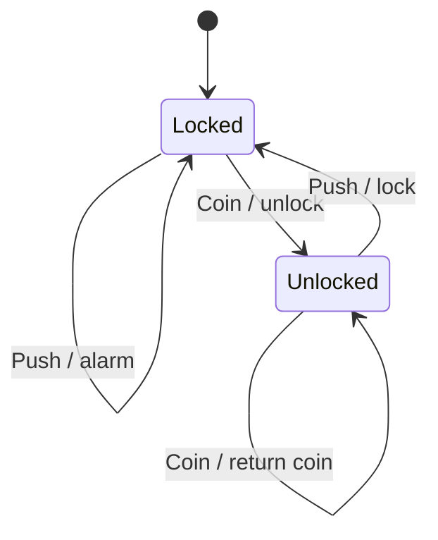

- **State coverage** — visit every state at least once.
- **Transition coverage (0-switch)** — exercise every valid transition at least once.
- **Path coverage (n-switch)** — exercise sequences of transitions (more thorough, more test cases).
- **Invalid transition testing** — verify the system rejects illegal state–event combinations.

**Advanatages**:
- Systematic as it guarantees coverage of all state–event combinations.
- Good for **event-driven / control systems** (vending machines, ATMs, traffic lights, parsers, protocols).
- Reveals **illegal transitions** and missing handling.
- Easy to derive and document test cases.

**Limitations**:
- State explosion for large systems (table grows as states × events).
- Only models **control behaviour**, not data-intensive logic.
- Does not cover timing/concurrency well without extension (statecharts).

---

**Explain Logic Coverage Criteria for Statement Coverage — 5 marks (Q1c) — May 2023**

Statement coverage is a white-box (structural) test coverage criterion requiring every executable statement in the program to be executed at least once during testing. It is the weakest logic coverage criterion.

**Formula:**
$$\text{Statement Coverage} = \frac{\text{Statements executed}}{\text{Total executable statements}} \times 100\%$$

**Working:**
- Only executable statements counted (not declarations/comments).
- Ignores decision outcomes (true/false branches) — hence weak.
- 100% statement coverage ≠ 100% branch coverage (a false path may never execute).
- Detects unreachable/dead code.
- Statement coverage ⊂ Branch coverage ⊂ Path coverage (in strength).

**Example:**
```c
1  int check(int a, int b) {
2      int x = 0;
3      if (a > 0) {
4          x = a + b;
5      }
6      return x;
7  }
```

Executable statements: lines 2, 3, 4, 5, 6 (5 total).
- **TC1:** a=5, b=3 → executes 2,3,4,5,6 → **100% statement coverage**.
- But false branch of `if (a>0)` never taken → branch coverage < 100%.

**CFG Diagram:**
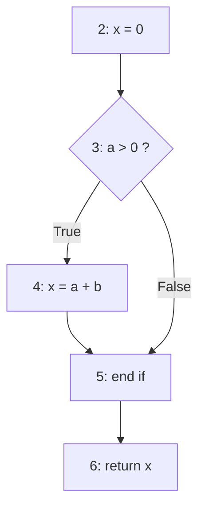
Statement coverage = visit every node at least once; branch coverage = traverse every edge at least once.

**Advantages:** Simple to measure, detects dead code, easy tool support (gcov, JaCoCo), good minimum baseline.

**Limitations:** Weakest criterion, ignores decision outcomes, misses condition-level and path-level bugs, cannot guarantee logic error detection in compound conditions.

---

**How to test simple loop in a program? — 5 marks (Q1b) — May 2023**

A **simple loop** runs from 0 to a maximum of **n** iterations, with no nested loops inside it. Loop testing is a **white-box (structural)** technique that focuses on the **validity of loop constructs**. For a simple loop with maximum **n** iterations, we design **five categories of test cases**.

For a simple loop with maximum **n** iterations, test with:
1. **Zero iterations** — skip the loop body entirely (minimum boundary).
2. **One iteration** — enter and exit once (lower boundary).
3. **Two iterations** — typical small count.
4. **Typical / average iterations** — a normal middle value (e.g., n/2).
5. **n − 1 iterations** — just below the maximum (upper boundary).
6. **n iterations** — exactly the maximum (upper boundary).
7. **n + 1 iterations** — one more than maximum (tests error handling / overflow).

```c
sum = 0;
for (i = 1; i <= n; i++)   // loop runs max n times
    sum = sum + a[i];
```

---

**Explain Bottom-up Integration Testing with one example — 5 marks (Q1a) — May 2023**

**Bottom-up integration testing** is an incremental integration strategy in which modules are integrated and tested **starting from the lowest-level modules and moving upward** toward the main/top module. Lower-level modules are tested first, and their **drivers** are used to simulate the calling (parent) modules until the top is reached. **Stubs are not required** (only drivers).

- Integration starts from **bottom (leaf) modules** → moves **up** the hierarchy.
- Uses **driver modules** to simulate the calling (higher-level) module that is not yet integrated.
- **Stubs are not needed**, all called (lower) modules already exist and are tested.
- Lower-level modules are tested **first in isolation**, then combined into **clusters (builds)**.
- Clusters are tested, then integrated upward until the **main module** is reached.
- **Best when the bottom of the hierarchy is stable and reusable** (e.g., utility/algorithm modules).

**Advantages**
- **No stubs required** — only drivers, which are simpler to write.
- Lower-level modules (often reusable utilities) are tested **early and thoroughly**.
- Faults in low-level modules are caught **early**.
- Easier when the **bottom of the hierarchy is stable**.

**Limitations**
- **Top-level (main) module tested last** — critical control logic validated late.
- **Drivers are needed** (extra code to write).
- Major design flaws in the top architecture are detected **late**, making fixes costly.
- Full system behaviour is not visible until the **final integration step**.
- Hard to test **end-to-end functionality** early.

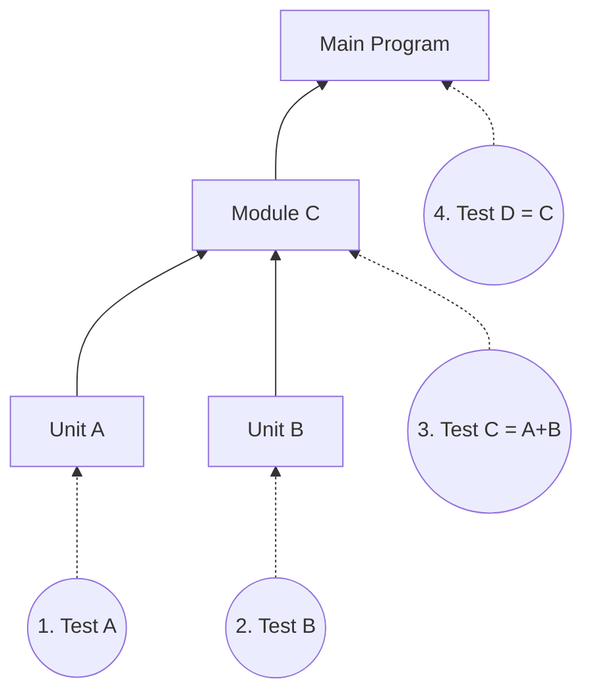

---

**Unit testing and Integration testing (short note) — 20 marks (Q6B) — Nov 2019**

**Unit Testing:**

- Unit testing is the **lowest level of testing** where **individual modules, functions, or components** of a program are tested **in isolation**.
- It verifies that each unit performs its intended function correctly as per its **detailed design/specification**.
- Performed by **developers** during the **coding phase** (white-box oriented).

**Objectives of Unit Testing:**

- Verify correctness of **individual module logic**.
- Detect **coding errors, logic faults, and boundary issues** early.
- Ensure each unit meets its **detailed design specification**.
- Isolate defects before integration, reducing debugging cost later.

**Techniques Used**

- **White-box testing** — statement coverage, branch coverage, path coverage, condition coverage.
- **Black-box testing** — equivalence partitioning, boundary value analysis for unit inputs.
- **Loop testing** — simple, nested, concatenated loops.
- **Static analysis** and **code reviews**.

**Integration Testing:**

- Integration testing is the level where **individual tested units are combined** and tested as a **group** to verify that they **interact correctly**.
- It focuses on **interfaces, data flow, and communication** between modules.
- Performed after unit testing, before system testing.

**Objectives of Integration Testing:**

- Verify **interfaces** between modules (parameter passing, data formats, protocols).
- Detect **interaction defects** (mismatched assumptions, timing, resource conflicts).
- Ensure **data flow** across module boundaries is correct.
- Validate that combined modules deliver **subsystem functionality**.

**Integration Strategies**

|Strategy|Description|Needs|
|---|---|---|
|**Big-Bang**|All modules integrated at once, tested together|None (but hard to debug)|
|**Top-Down**|Start from main, integrate downward|**Stubs** for lower modules|
|**Bottom-Up**|Start from leaf modules, integrate upward|**Drivers** for higher modules|
|**Sandwich (Hybrid)**|Combines top-down + bottom-up|Both stubs and drivers|
|**Incremental**|Modules added and tested one at a time|Drivers/stubs as needed|

| Factor           | Unit Testing                      | Integration Testing                      |
| ---------------- | --------------------------------- | ---------------------------------------- |
| **Level**        | Lowest (module level)             | Middle (module interaction)              |
| **Focus**        | Individual unit correctness       | Interfaces and interaction between units |
| **Performed by** | Developers                        | Testers / developers                     |
| **When**         | During coding                     | After unit testing                       |
| **Technique**    | White-box (mostly)                | Black-box + white-box (interface focus)  |
| **Aids needed**  | Drivers / stubs                   | Drivers / stubs (depends on strategy)    |
| **Detects**      | Coding/logic errors               | Interface, data-flow, interaction errors |
| **Scope**        | Single module in isolation        | Group of integrated modules              |
| **Goal**         | Verify unit meets detailed design | Verify modules work together             |

---

**What is Mutation Testing? Differentiate between primary and secondary mutants — 5 marks (Q1b) — Dec 2022**
**What is Mutation Testing? Explain primary mutant with an example — 10 marks — May 2023**
**What is Mutation Testing? Explain Mutation Testing Process — 10 marks — Nov 2019**

**Mutation** (in the context of software testing) is a deliberate, small, syntactic modification made to a program's source code to simulate a typical programming error — such as a typo, a wrong operator, an off-by-one mistake, or an incorrect constant. The purpose is not to fix or improve the code, but to create a faulty version that can be used to test whether the existing test suite is capable of detecting that kind of defect.

- **Single change:** A mutation is typically one localized edit — for example, replacing `+` with `-`, changing `>` to `>=`, swapping `&&` with `||`, altering a constant value (e.g., `0` → `1`), or deleting a statement.
- **Created by a mutation operator:** The rules that define what kinds of changes can be made are called *mutation operators*. Each operator targets a specific class of faults (arithmetic, relational, logical, etc.).
- **Produces a mutant:** The resulting modified program is called a **mutant**. The original unmodified program is called the **base program** (or original program).
- **Simulates real faults:** Mutations are designed to mimic mistakes real developers make, so that if the test suite catches the mutant, it is likely to catch similar real bugs.
- **Used for evaluation, not correction:** A mutation is intentionally incorrect; it exists only to measure the adequacy of tests. Once testing is done, mutants are discarded.

**Mutation Testing** is a white-box testing technique that evaluates the adequacy of a test suite by deliberately introducing small, single syntactic changes (mutations) into the source code and checking whether the existing tests can detect the resulting faults . Each modified version of the program is called a **mutant**. The underlying premise is that a strong test suite should fail when the program's behavior is altered; if tests still pass on a mutant, it reveals a deficiency in the suite's fault-detection ability .

**Primary Mutant with Example**

A **primary mutant** (also called a first-order mutant) is a mutant created by making exactly **one** modification to the original program using a single mutation operator . It represents the simplest form of injected fault.

**Example (C program):**

Consider the original statement:
```c
if (a > b)
    x = x + y;
else
    x = y;
printf("%d", x);
```

A primary mutant **M1** can be generated by applying a single arithmetic operator replacement—changing `+` to `-`:
```c
if (a > b)
    x = x - y;    // Mutation: + replaced by -
else
    x = y;
printf("%d", x);
```

**Test case demonstrating detection:**
- Input: `x = 2, y = 2, a > b` is true.
- Original program output: `x = 2 + 2 = 4`.
- Mutant M1 output: `x = 2 - 2 = 0`.
- Since the outputs differ (4 ≠ 0), the test case **kills** the mutant, proving the test suite can detect this specific fault .

**Mutation Testing Process**

**1. Generate Mutants**
The original program (base program) is duplicated multiple times. In each copy, a mutation operator is applied to introduce a single fault—such as replacing an arithmetic operator (`+` → `-`), a relational operator (`>` → `>=`), a logical operator (`&&` → `||`), or altering a constant value .

**2. Execute Tests Against Original and Mutants**
The existing test suite is first run against the original program to confirm all tests pass. Then, the same test suite is executed against each mutant .

**3. Classify Each Mutant**
Based on the test results, each mutant is classified into one of three categories:
- **Killed:** At least one test fails on the mutant, meaning the injected fault was detected .
- **Survived:** All tests pass on the mutant, indicating the test suite cannot distinguish the faulty version from the correct one—a gap in test coverage .
- **Equivalent:** The mutant behaves identically to the original program for all possible inputs (semantically equivalent). Such mutants cannot be killed by any test and are typically excluded from the mutation score calculation .

**4. Calculate Mutation Score**
Test effectiveness is quantified using the mutation score:
Mutation Score = (Killed Mutants) / (Total Non-Equivalent Mutants) × 100%
A higher score indicates a more thorough test suite capable of detecting injected faults .

**5. Improve Test Suite**
Surviving mutants highlight specific weaknesses in the test suite. Testers analyze why a mutant survived and write new test cases or strengthen assertions to kill it, thereby improving the suite's fault-detection capability .

| Aspect | Primary Mutant (First-Order Mutant) | Secondary Mutant (Higher-Order Mutant) |
|---|---|---|
| **Definition** | A mutant created by making a **single** modification to the original program using one mutation operator. | A mutant created by combining **two or more** primary mutations into a single program. |
| **Number of changes** | Exactly one change. | Two or more changes. |
| **Also called** | First-order mutant. | Higher-order mutant. |
| **Construction** | Apply one mutation operator once to the base program. | Apply multiple mutation operators (or one operator multiple times) to produce a combined mutant. |
| **Complexity** | Simple and easy to generate automatically. | More complex; generation and analysis are harder. |
| **Usage** | Standard unit in most mutation testing processes and tools. | Used mainly in research to simulate more realistic, complex faults or to reduce the number of equivalent mutants. |
| **Example** | Original: `x = x + y;` → Mutant: `x = x - y;` | Combine two changes: `x = x + y;` → `x = x - y;` and `if (a > b)` → `if (a >= b)` in the same program. |
| **Detection** | Easier for test suites to kill. | Harder to kill; may mask or interact with each other's effects. |

---

**C code (prime number program) — draw DD graph, calculate cyclomatic complexity, list independent paths, design test cases — 10 marks — Dec 2022**

```c
#include <stdio.h>

int main()
{
    int number, index;

    printf("Enter a number");
    scanf("%d", &number);
    index = 2;
    while(index <= number - 1)
    {
        if(number % index == 0)
        {
            printf("Not a prime number");
            break;
        }
        index++;
    }
    if(index == number)
        printf("prime number");
} // end main
```

**Decision-to-Decision (DD) Graph**

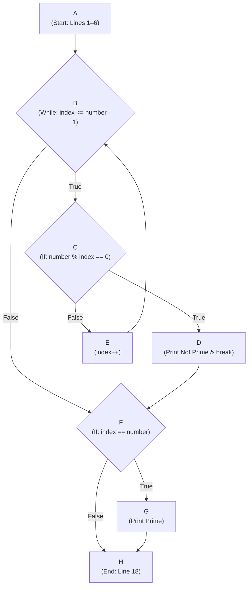

**Cyclomatic Complexity Calculation**

From the DD-graph above:

- **Number of Nodes (\(N\)):** 8 (`A, B, C, D, E, F, G, H`)
- **Number of Edges (\(E\)):** 10 (`A->B`, `B->C`, `B->F`, `C->D`, `C->E`, `D->F`, `E->B`, `F->G`, `F->H`, `G->H`)
- **Number of Connected Components (\(P\)):** 1

Method 1: Using Edges and Nodes

\(V(G)=E-N+2P\)  
\(V(G)=10-8+2(1)=4\)

Method 2: Using Predicate Nodes

There are **3** decision/predicate nodes (`B`, `C`, and `F`):  
$$
V(G)=\text{Number\ of\ Predicate\ Nodes}+1
$$
$$
V(G)=3+1=4
$$

Method 3: Using Bounded Regions

Looking at the graph, there are **3 enclosed regions** (loop `B-C-E-B`, bypass `B-C-D-F-B`, and diamond `F-G-H-F`) plus **1 outer region**:  
$$
V(G)=\text{Number\ of\ Regions}=4
$$

**Independent Paths (Basis Set)**

Since \(V(G) = 4\), there are **4 linearly independent paths** from start to exit:

- **Path 1:** `A -> B -> F -> H` _(Loop condition is immediately false; post-loop condition is false)_
- **Path 2:** `A -> B -> F -> G -> H` _(Loop condition is immediately false; post-loop condition is true)_
- **Path 3:** `A -> B -> C -> D -> F -> H` _(Enters loop; number is divisible on first check; breaks out)_
- **Path 4:** `A -> B -> C -> E -> B -> F -> G -> H` _(Enters loop; not divisible; increments index; exits loop; prints prime)_

**Test Cases**

Each test case is designed to execute one specific independent path:

| Test Case ID | Target Path                | Input (`number`)   | Execution Flow                                                                                            | Expected Output      |
| ------------ | -------------------------- | ------------------ | --------------------------------------------------------------------------------------------------------- | -------------------- |
| **TC-01**    | Path 1 (`A-B-F-H`)         | `1` (or `0`, `-5`) | `index = 2`. `2 <= 0` is False. `2 == 1` is False.                                                        | _(No output)_        |
| **TC-02**    | Path 2 (`A-B-F-G-H`)       | `2`                | `index = 2`. `2 <= 1` is False. `2 == 2` is True.                                                         | `prime number`       |
| **TC-03**    | Path 3 (`A-B-C-D-F-H`)     | `4`                | `index = 2`. `2 <= 3` is True. `4 % 2 == 0` is True -> prints & breaks. `2 == 4` is False.                | `Not a prime number` |
| **TC-04**    | Path 4 (`A-B-C-E-B-F-G-H`) | `3`                | `index = 2`. `2 <= 2` is True. `3 % 2 == 0` is False -> `index = 3`. `3 <= 2` is False. `3 == 3` is True. | `prime number`       |

---

**Factorial program — draw DD graph, calculate individual cyclomatic complexity for main() and fact(), then whole program — 10 marks — May 2023**
**Factorial program — draw DD graph, calculate individual cyclomatic complexity for main() and fact(), then whole program — 10 marks — Nov 2019**

```c
void main()
{
    int number;
    int fact();

    clrscr();
    printf("Enter the number whose factorial is to be found out");
    scanf("%d", &number);
    if(number < 0)
    printf("Facorial cannot be defined for this number");
    else
    printf("Factorial is %d", fact(number));
}

int fact(int number)
{
    int index;
    int product = 1;
    for(index = 1; index <= number; index++)
    product = product * index;
    return(product);
}
```

**Decision-to-Decision (DD) Graphs**

**(a) DD Graph of `main()`**

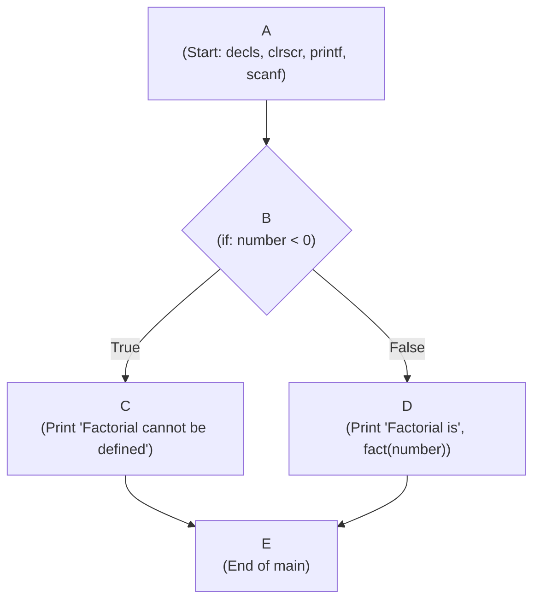

**Nodes:** A (start/init/input), B (if predicate), C (negative branch), D (else/call `fact()`), E (end).
**Edges:** A→B, B→C (T), B→D (F), C→E, D→E.

**(b) DD Graph of `fact()`**

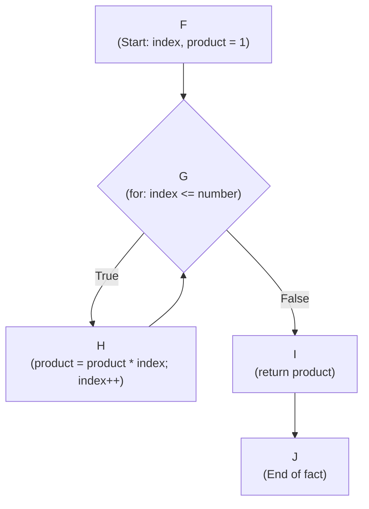

**Nodes:** F (start/init), G (for predicate), H (loop body + increment), I (return), J (end).
**Edges:** F→G, G→H (T), H→G, G→I (F), I→J.

**Cyclomatic Complexity**

**(a) `main()` — \(V(G)_{main}\)**

| Method | Formula | Calculation | Result |
|---|---|---|---|
| **Edges & Nodes** | \(V(G) = E - N + 2P\) | \(5 - 5 + 2(1)\) | **2** |
| **Predicate Nodes** | \(V(G) = \text{predicates} + 1\) | \(1 + 1\) (B) | **2** |
| **Bounded Regions** | \(V(G) = \text{regions}\) | 1 enclosed + 1 outer | **2** |

**\(V(G)_{main} = 2\)**

**b) `fact()` — \(V(G)_{fact}\)**

| Method | Formula | Calculation | Result |
|---|---|---|---|
| **Edges & Nodes** | \(V(G) = E - N + 2P\) | \(5 - 5 + 2(1)\) | **2** |
| **Predicate Nodes** | \(V(G) = \text{predicates} + 1\) | \(1 + 1\) (G) | **2** |
| **Bounded Regions** | \(V(G) = \text{regions}\) | 1 enclosed (loop F-G-H-F) + 1 outer | **2** |

**\(V(G)_{fact} = 2\)**

**(c) Whole Program — $V(G)_{total}$**

Two approaches give different conventions; both are shown:

**Approach 1 — Sum of module complexities (additive, treats modules separately):**

$$
V(G)_{total} = V(G)_{main} + V(G)_{fact} = 2 + 2 = 4
$$

**Approach 2 — Combined DD graph (merge through the call edge):**

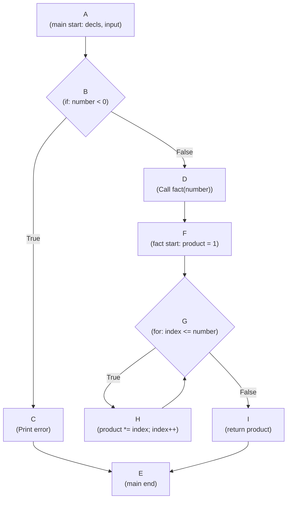

| Method | Calculation | Result |
|---|---|---|
| **Edges & Nodes** | \(N = 9\) (A–I), \(E = 10\), \(P = 1\): \(10 - 9 + 2(1)\) | **3** |
| **Predicate Nodes** | Predicates = B, G → \(2 + 1\) | **3** |
| **Bounded Regions** | 2 enclosed (if-branch, for-loop) + 1 outer | **3** |

**\(V(G)_{combined} = 3\)**

**Independent Paths (Basis Sets)**

(a) **`main()` — \(V(G) = 2\) → 2 paths**

| # | Path | Description |
|---|---|---|
| **M1** | A → B → C → E | `number < 0` true → error message |
| **M2** | A → B → D → E | `number >= 0` false branch → call `fact()` |

**(b) `fact()` — \(V(G) = 2\) → 2 paths**

| # | Path | Description |
|---|---|---|
| **F1** | F → G → I → J | Loop condition false immediately (number = 0) → return 1 |
| **F2** | F → G → H → G → I → J | Loop body executes ≥ 1 time → return product |

**c) Whole program — \(V(G)_{total} = 4\) (sum convention) → 4 combined paths**

| # | Combined Path | Description |
|---|---|---|
| **W1** | M1 alone (A-B-C-E) | Negative input; `fact()` never called |
| **W2** | M2 + F1 (A-B-D-F-G-I-E) | Non-negative input with `number = 0`; loop skipped |
| **W3** | M2 + F2, one iteration (A-B-D-F-G-H-G-I-E) | `number = 1`; loop runs once |
| **W4** | M2 + F2, multiple iterations (A-B-D-F-G-H-G-H-...-G-I-E) | `number >= 2`; loop runs multiple times |

**Test Cases**

| Test Case ID | Target Path | Input (`number`) | Execution Flow | Expected Output |
|---|---|---|---|---|
| **TC-01** | M1 (A-B-C-E) | `-5` | `number < 0` True → print error; `fact()` not called | `Factorial cannot be defined for this number` |
| **TC-02** | M2 + F1 (A-B-D-F-G-I-E) | `0` | `number < 0` False → call `fact(0)`; `1 <= 0` False → return 1 | `Factorial is 1` |
| **TC-03** | M2 + F2, 1 iter (A-B-D-F-G-H-G-I-E) | `1` | call `fact(1)`; `1 <= 1` True → product = 1; `2 <= 1` False → return 1 | `Factorial is 1` |
| **TC-04** | M2 + F2, multi iter (A-B-D-F-G-H-G-...-I-E) | `5` | call `fact(5)`; loop runs 5 times → product = 120; return 120 | `Factorial is 120` |

---

**What are graph metrics? Explain with example how to calculate cyclomatic complexity using graph metrics — 10 marks — May 2023**

**Graph metrics** are quantitative measures derived from a program's **Control Flow Graph (CFG)** a directed graph where nodes represent basic code blocks and edges represent possible execution paths between them. 
These metrics help assess structural properties of code, such as size, branching, and complexity. 
The most widely used graph metric in software testing is **Cyclomatic Complexity (CC)**, introduced by Thomas McCabe, which measures the number of linearly independent paths through a program and thus indicates the minimum number of test cases needed for path coverage.

**Calculating Cyclomatic Complexity Using Graph Metrics**

**Formula:**

$$M = E - N + 2P$$

Where:
- $E$ = Number of edges in the control flow graph
- $N$ = Number of nodes in the control flow graph
- $P$ = Number of connected components ($P = 1$ for a single program)

**Alternative Formula:**

$$M = \text{Decision Nodes} + 1$$

(For a single program with one entry point)

**Example:**

If a program has 10 edges and 8 nodes, then:

$$M = 10 - 8 + 2 = 4$$

Therefore, the program has **4 independent paths**.

**Control Flow Graph:**

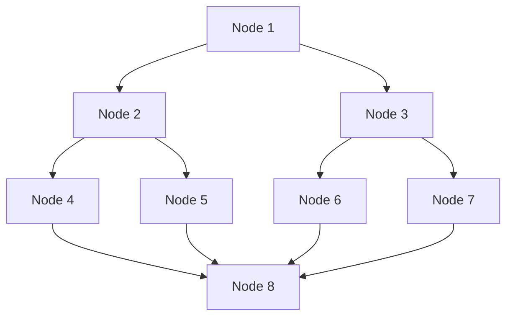

**Verification:**

- **Edges ($E$):** 10
- **Nodes ($N$):** 8
- **Components ($P$):** 1

$$M = 10 - 8 + 2(1) = 4$$

**The 4 Independent Paths:**

| Path | Route |
|------|-------|
| Path 1 | Node 1 → Node 2 → Node 4 → Node 8 |
| Path 2 | Node 1 → Node 2 → Node 5 → Node 8 |
| Path 3 | Node 1 → Node 3 → Node 6 → Node 8 |
| Path 4 | Node 1 → Node 3 → Node 7 → Node 8 |

---

**Comment on regression testing process — 10 marks — Nov 2019**

**Regression testing** is the process of re-executing a subset of existing test cases after a change has been made to the software, in order to ensure that the modification has not introduced new defects or broken previously working functionality. 
It is not a single test but a **process of verification and risk management** that spans the entire software lifecycle, particularly during maintenance and iterative development.

**Regression Testing Process**

**1. Change Identification & Impact Analysis** — Identify what changed and analyze which parts of the system could be affected. This defines the testing scope and avoids under- or over-testing.

**2. Test Selection** — Running the full suite is costly, so select a subset using strategies like:
- _Minimization_: minimal tests covering changed code.
- _Coverage-based_: all tests exercising modified components.
- _Safe approach_: every test that could reveal a difference between old and new versions.
- _Traceability_: all tests linked to an affected requirement (critical for safety requirements).

**3. Test Prioritization** — Order tests by criticality: **P0** (business-critical, security, data integrity) → **P1** (major features) → **P2** (minor features, edge cases). Ensures top risks are covered first if time runs short.

**4. Execution** — Run a **smoke/sanity test** first to confirm build stability, then execute the selected regression suite. Automation is strongly recommended since these tests repeat across versions.

**5. Result Analysis & Maintenance** — Classify results as **pass** (no regression) or **fail** (log defect and fix). Update the suite over time: remove obsolete tests, add tests for new functionality.

---

///
### **Module III: Managing the Test Process**

**What are Key elements of Test Management? Explain the structure of testing group — 10 marks — May 2023**
**What are Key elements of Test Management? Explain the structure of testing group — 10 marks (Q1B) — Nov 2019**
**Explain structure of testing Group — 5 marks (Q1d) — Dec 2022**

Test management ensures that testing is effective, transparent, and aligned with project goals. Its core elements include:

- **Test Organization:** This defines the structure, roles, and responsibilities of the testing team. It establishes clear reporting lines and coordinates interactions between testers, developers, and management.
- **Test Planning:** This involves creating a comprehensive test plan that outlines the scope, objectives, testing approach, and schedule. It also identifies entry and exit criteria to govern when testing starts and stops.
- **Test Estimation:** This is the process of predicting the effort, time, cost, and resources required to complete the testing lifecycle. Accurate estimation prevents schedule overruns and resource bottlenecks.
- **Test Monitoring and Control:** Monitoring involves tracking test progress using metrics such as test case execution rate and defect density. Control involves taking corrective actions when actual progress deviates from the test plan.
- **Configuration Management:** This ensures that all test artifacts—such as test plans, test cases, scripts, and test data—are properly version-controlled. It guarantees that testers are always executing tests against the correct build of the software.
- **Risk Management:** This identifies potential technical, operational, or schedule risks early in the lifecycle. Teams analyze the impact of each risk and prioritize testing efforts to mitigate high-risk areas first.
- **Incident and Defect Management:** This establishes a standardized workflow for logging, tracking, prioritizing, and resolving bugs. It ensures every discovered defect is verified before closure.

**Testing Group**:

A testing group (or Quality Assurance team) is a structured unit within a software organization responsible for verifying and validating software products to ensure they meet quality standards before release.

**Roles and Responsibilities**

- **Test Manager (or QA Manager):** Heads the entire testing group and oversees multiple projects. They are responsible for defining the overall test strategy, managing budgets, allocating resources, and communicating with upper management and clients.
- **Test Lead:** Reports to the Test Manager and manages the day-to-day testing activities of a specific project. They prepare the Test Plan, assign tasks to team members, track daily progress, and generate test summary reports.
- **Test Engineers (Manual Testers / Test Analysts):** Execute the core testing activities. They analyze software requirements, design detailed test cases, prepare test data, execute test scripts, and log defects in bug-tracking tools.
- **Automation Test Engineers:** Focus on automating repetitive and regression test cases. They select suitable automation tools, build test frameworks, write automated scripts, and maintain them across software builds.
- **Specialized Testers (Performance / Security):** Handle non-functional testing requirements. They evaluate the system's speed, scalability, load handling, and vulnerability to security threats using specialized tools.

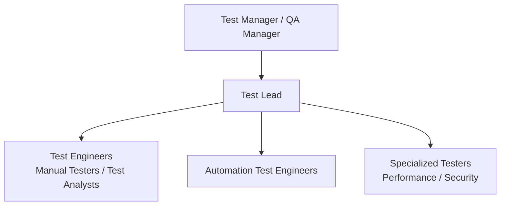


---

**What is the need of software measurement? Discuss the various types of software metrics — 10 marks — Dec 2022**

**Software measurement** is the process of assigning numbers or symbols to attributes of software entities to assess, track, and improve software quality and development processes. Without measurement, software engineering lacks objective data to make informed management and technical decisions.

**Need for Software Measurement**

Software measurement is essential across the entire Software Development Life Cycle (SDLC) for several reasons:

- **Accurate Estimation:** Historical measurement data helps project managers accurately estimate the cost, effort, and schedule required for future projects.
- **Project Tracking and Control:** Metrics allow teams to monitor progress against the baseline plan and detect schedule delays or budget overruns early.
- **Quality Assurance:** Measuring defect density, code complexity, and test coverage helps identify error-prone modules and ensures the final product meets reliability standards.
- **Process Improvement:** Measurement highlights bottlenecks in development workflows, enabling organizations to refine engineering practices and improve productivity.
- **Informed Decision-Making:** Quantitative data removes guesswork when making critical trade-offs, such as deciding whether to release a product or allocate more testing resources.
- **Risk Management:** Early warning indicators, like high requirements volatility or rising defect rates, help teams mitigate risks before they cause project failure.

**Types of Software Metrics**

Software metrics are broadly classified into three main categories based on what they measure, along with specific functional classifications.

**Product Metrics**

Product metrics measure the characteristics and quality attributes of the software deliverables at any stage of development.

- **Size Metrics:** Measure the physical or logical magnitude of the software, such as Lines of Code (LOC) and Function Points (FP).
- **Complexity Metrics:** Assess the structural difficulty of understanding and maintaining code, such as McCabe’s Cyclomatic Complexity and Halstead’s Software Science metrics.
- **Quality and Reliability Metrics:** Evaluate how well the software performs and its freedom from defects, including Defect Density, Mean Time Between Failures (MTBF), and customer satisfaction ratings.

**Process Metrics**

Process metrics measure the efficiency and effectiveness of the software development lifecycle and the methods used to build the product.

- **Defect Removal Efficiency (DRE):** Measures the ability of quality assurance activities to catch bugs before the software is delivered to end users.
- **Productivity Metrics:** Evaluate the output generated per unit of effort, such as Function Points delivered per person-month.
- **Cycle Time and Schedule Metrics:** Track the time taken to complete specific phases, resolve defects, or deploy new releases.

**Project Metrics**

Project metrics focus on the tactical execution of a specific software project to help managers monitor workflow and resource utilization.

- **Cost and Effort Metrics:** Track actual budget expenditure and person-hours spent compared to initial estimates.
- **Schedule Variance:** Measures the difference between planned milestones and actual completion dates.
- **Resource Utilization:** Monitors team workload, staffing levels, and hardware usage throughout the project timeline.

---

**Explain the process of test suite prioritization with its types in detail with example — 10 marks — May 2023**

**Test Suite Prioritization (Test Case Prioritization)** is a software testing technique that schedules test cases in a specific execution order to maximize certain objectives, such as detecting critical faults early in the testing lifecycle. It improves the rate of fault detection without discarding any test cases, which makes it especially valuable during regression testing when time and resources are limited.

**Process of Test Suite Prioritization**

The test suite prioritization process follows five structured steps:

- **Requirement and Impact Analysis:** Identify high-risk modules, recent code changes, and business-critical features. This step determines which parts of the application are most likely to contain severe defects.
- **Metric Selection:** Choose a measurable criterion to rank the test cases. Common metrics include code coverage, fault detection history, requirement priority, or execution cost.
- **Test Case Scoring and Ranking:** Assign a priority weight or score to each test case based on the selected metric. Sort the test suite in descending order so the highest-scoring tests appear first.
- **Prioritized Test Execution:** Execute the test cases strictly following the new ranked sequence. If testing is halted early due to time or budget constraints, the most critical tests have already run.
- **Feedback and Re-prioritization:** Record the test outcomes, defect rates, and execution times after the run. Use this historical data to dynamically adjust priorities for future regression cycles.

**Types of Test Suite Prioritization**

Test suite prioritization techniques are categorized into several key types based on the criteria used for ranking:

**Coverage-Based Prioritization**
This approach orders test cases based on how much of the source code structure they exercise.
- **Total Statement Coverage:** Ranks test cases according to the total number of code statements they execute, starting with the test that covers the highest count.
- **Additional Statement Coverage:** Selects the test case with the highest coverage first, then iteratively chooses subsequent tests that cover the maximum number of _not-yet-covered_ statements.
- **Branch and Path Coverage:** Prioritizes test cases that exercise the highest number of decision branches (if-else conditions) or unique execution paths.

**Requirement-Based Prioritization**
This method ranks test cases based on business value and user needs rather than internal code structure.
- **Customer Priority:** Places test cases linked to features deemed most important by stakeholders at the top of the queue.
- **Requirement Volatility:** Gives higher priority to test cases validating requirements that change frequently during development.
- **Fault Impact:** Prioritizes features where a failure would cause severe financial loss, security breaches, or system crashes.

**History-Based Prioritization**
This technique uses data from previous test execution cycles to predict where defects are most likely to appear.
- **Historical Fault Detection:** Assigns higher priority to test cases that have frequently uncovered bugs in past releases.
- **Execution Time:** Balances fault-finding ability against the time required to run the test, favoring fast tests that yield high defect detection.

**Risk-Based Prioritization**
This strategy evaluates the probability of failure alongside the severity of impact for each module. Test cases targeting complex, error-prone, or third-party integrated modules receive the highest priority.

**Cost-Aware Prioritization**
This approach considers the financial and computational resources needed to execute a test case. It prioritizes test cases that provide maximum fault detection per unit of cost or time.

**Example**

Consider an **E-Commerce Web Application** undergoing regression testing after an update to its payment module. The original test suite contains four test cases executed in arbitrary order (\(T_1 ---> T_2 ---> T_3 ---> T_4\)):

|Test Case ID|Test Scenario|Fault Severity|Code Coverage|Execution Time|
|---|---|---|---|---|
|**\(T_{1}\)**|Update user profile picture|Low|15%|2 mins|
|**\(T_{2}\)**|Process credit card checkout|Critical|45%|3 mins|
|**\(T_{3}\)**|Search product by keyword|High|30%|2 mins|
|**\(T_{4}\)**|View "About Us" static page|Very Low|10%|1 min|

**Applying Prioritization**

Using a combined **Risk-Based and Coverage-Based** approach, we evaluate each test case:

- **\(T_{2}\)** covers the newly modified payment module (Critical severity, 45% coverage) and is ranked **1st**.
- **\(T_{3}\)** validates core browsing functionality (High severity, 30% coverage) and is ranked **2nd**.
- **\(T_{1}\)** tests a secondary account feature (Low severity, 15% coverage) and is ranked **3rd**.
- **\(T_{4}\)** checks static content (Very Low severity, 10% coverage) and is ranked **4th**.

Prioritized Execution Order

The optimized execution sequence becomes: **\(T_2 ---> T_3 ---> T_1 ---> T_4\)**.

**Outcome:** If a critical bug exists in the payment gateway (\(T_{2}\)), it is caught within the first **3 minutes** of testing instead of waiting until earlier low-priority tests finish. Even if testing stops halfway through, 75% of the codebase and all high-risk workflows have already been verified.

---

**What is Test Plan? Explain different components of Test plan document — 10 marks — Nov 2019**
**What are the components of a test plan? Illustrate test plan hierarchy with a neat diagram — 10 marks — Dec 2022**

A **Test Plan** is a formal, detailed document that outlines the strategy, objectives, schedule, estimation, deliverables, and resources required to perform software testing. It acts as a blueprint for the entire testing process and follows the **IEEE 829 standard** for software test documentation.

**Components of a Test Plan Document**

A comprehensive Test Plan document consists of the following key components:

- **Test Plan Identifier:** A unique ID or reference number assigned to the document for easy tracking and version control.
- **Introduction:** Provides a brief overview of the project, the scope of the test plan, and the overall objectives of the testing effort.
- **Test Items:** Lists the specific software modules, features, or applications that are going to be tested, including their version numbers.
- **Features to be Tested:** Specifies the exact functionalities, user stories, or modules that fall within the scope of testing.
- **Features Not to be Tested:** Clearly defines what will be excluded from testing (such as third-party integrations or deprecated features) along with the reasons for exclusion.
- **Approach (Test Strategy):** Explains the overall testing methodology, including the types of testing to be performed (e.g., unit, integration, system, regression) and the tools used.
- **Item Pass/Fail Criteria:** Defines the specific conditions and metrics used to determine whether a software feature or test case has passed or failed.
- **Suspension Criteria and Resumption Requirements:** States the conditions under which testing activities must be temporarily halted (e.g., critical blocker bugs) and the criteria needed to restart testing.
- **Test Deliverables:** Lists all the documents, tools, and artifacts produced before, during, and after testing (e.g., test cases, test data, defect logs, test summary reports).
- **Testing Tasks:** Breaks down all the activities required to prepare for and execute the tests, identifying dependencies between tasks.
- **Environmental Needs:** Specifies the hardware, software, network configurations, databases, and test tools required to set up the test environment.
- **Responsibilities:** Assigns specific roles and duties to team members (e.g., Test Lead, QA Engineers, Developers) for managing and executing tasks.
- **Staffing and Training Needs:** Identifies the number of testers required, their skill sets, and any specialized training needed to use testing tools or understand the domain.
- **Schedule:** Provides a timeline with start and end dates for each testing phase, linked to project milestones.
- **Risks and Contingencies:** Identifies potential project or technical risks (e.g., delayed builds, resource shortages) and outlines mitigation plans for each.
- **Approvals:** Contains the names, titles, and signatures of key stakeholders (such as the Project Manager and QA Lead) who review and approve the test plan.

**Test Plan Hierarchy**

In large or complex projects, testing is organized into a structured hierarchy to manage different levels of testing effectively. The **Master Test Plan** sits at the top and oversees specific **Level Test Plans**

**Levels in the Hierarchy:**

- **Master Test Plan (MTP):** A high-level document that coordinates all testing activities across the entire project and defines the overarching strategy, schedules, and resource allocation.
- **Unit Test Plan:** Focuses on testing individual software components, functions, or modules in isolation, typically written and executed by developers.
- **Integration Test Plan:** Details the strategy for testing interfaces and interactions between combined modules to ensure data flows correctly.
- **System Test Plan:** Outlines end-to-end testing of the complete, integrated system against functional and non-functional requirements (e.g., performance, security).
- **Acceptance Test Plan (UAT):** Defines the criteria and scenarios used by end-users or clients to verify that the system meets business needs before final release.

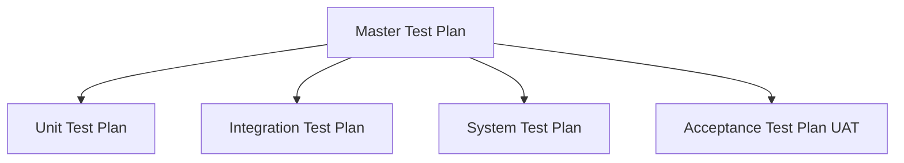

---

**Write short note on Test point analysis — 20 marks (Q6A) — Nov 2019**

**Test Point Analysis (TPA)** is a structured, metric-based estimation technique used to objectively calculate the effort, time, and resources required for **black-box testing—specifically system testing and acceptance testing. Developed as an extension to Function Point Analysis (FPA), TPA focuses solely on functional test activities because white-box and unit testing are already accounted for in standard development estimates.

**Elements:**

- **Size of the System.** Determined using Function Point Analysis (FPA) results, along with function complexity, interfacing, and uniformity.
- **Test Strategy.** Defines which system components and quality characteristics need testing and at what depth or coverage level.
- **Productivity.** Represents the testing team's skill level, domain knowledge, and environmental conditions (measured in test hours required per test point).

---

**Project with distribution of data (SDLC phase, no. of defects, defect age) — calculate defect spoilage — 10 marks — Dec 2022**

| SDLC Phase         | No. of Defects | Defect Age |
| :----------------- | :------------- | :--------- |
| Requirement Specs. | 34             | 2          |
| HLD                | 25             | 3          |
| LLD                | 17             | 7          |
| Coding             | 10             | 8          |

To calculate **Defect Spoilage**, we use the standard metric that assigns a **weight** to each SDLC phase based on how late the defect was found. The later a defect is found, the more expensive (spoil) it is to fix.

A common standard weighting scale used for this calculation is:
*   **Requirement Specs:** Weight = 1
*   **HLD (High-Level Design):** Weight = 2
*   **LLD (Low-Level Design):** Weight = 3
*   **Coding:** Weight = 4

 **1. Calculation Table**

| SDLC Phase | No. of Defects (A) | Defect Age (Weight) (B) | **Total Spoilage (A × B)** |
| :--- | :--- | :--- | :--- |
| Requirement Specs. | 34 | 1 | **34** |
| HLD | 25 | 2 | **50** |
| LLD | 17 | 3 | **51** |
| Coding | 10 | 4 | **40** |
| **Total** | **86** | | **175** |

**2. Formula & Calculation**

**Total Defect Spoilage** = Sum of (No. of Defects × Phase Weight)
**Total Defect Spoilage** = 34 + 50 + 51 + 40 = **175**

**Average Defect Spoilage** = 175 / 86 ≈ **2.03**

---

///
### **Module IV: Test Automation**

**What criteria will you consider for selection of test tools for automation testing — 5 marks (Q1c) — Dec 2022**

**Selecting the right testing tool requires evaluating the application's technology stack, project budget, and the technical skill set of the testing team.** Choosing the wrong tool can lead to high maintenance overhead and project delays.

**Guidelines/Criterias for Selecting Testing Tools**

- **Understand Project Requirements:** Clearly define the types of testing needed, such as functional, performance, security, or regression testing. Ensure the tool aligns with these specific testing goals.
- **Technology and Platform Compatibility:** Verify that the tool supports the programming languages, frameworks, browsers, and operating systems used by the application under test (AUT).
- **Budget and Licensing Costs:** Evaluate the total cost of ownership, including initial licensing fees, hardware requirements, and ongoing maintenance costs. Compare commercial tools against open-source alternatives like Selenium or JUnit.
- **Ease of Use and Team Skill Set:** Assess the learning curve of the tool against the current skills of your QA team. A tool with a simple scripting language or codeless recording features can speed up adoption.
- **Integration Capabilities:** Check whether the tool integrates seamlessly with existing project management, bug tracking (e.g., Jira), and CI/CD tools (e.g., Jenkins, GitLab).
- **Reporting and Analytics Features:** Ensure the tool generates clear, detailed test execution logs and dashboards. Good reporting helps developers quickly pinpoint the root cause of failures.
- **Vendor Support and Community Backing:** For commercial tools, check the quality of vendor customer support and training resources. For open-source tools, verify that there is an active community for troubleshooting.

---

**What is the need of automation testing activities? Differentiate between static and dynamic tools — 10 marks — Dec 2022**

**Test automation is essential in modern software development because it improves testing speed, accuracy, and overall software quality while reducing long-term costs.** Relying solely on manual testing becomes impractical as applications grow larger and release cycles become shorter.

**Importance/Need of Automation in Testing**

- **Faster Execution and Time-to-Market:** Automated test scripts run significantly faster than human testers. They can execute thousands of test cases overnight, allowing teams to release software updates more frequently.
- **High Accuracy and Reliability:** Automation eliminates human error caused by fatigue or repetition. Scripts perform the exact same steps consistently every time they run.
- **Increased Test Coverage:** Automated tools can execute complex test scenarios and check thousands of data inputs simultaneously. This ensures deeper coverage across multiple operating systems, browsers, and devices.
- **Reusability of Test Scripts:** Once created, automated test scripts can be reused across different versions and builds of the software. This makes regression testing highly efficient.
- **Early Bug Detection and Cost Reduction:** Automated tests can be integrated into Continuous Integration (CI/CD) pipelines to run after every code change. Catching defects early in the development lifecycle makes them much cheaper to fix.
- **24/7 Unattended Execution:** Automated tests do not require human supervision during execution. Teams can schedule heavy test suites to run overnight or over weekends and review the results the next morning.

| Parameter                     | Static Testing                                                                                         | Dynamic Testing                                                                                                   |
| ----------------------------- | ------------------------------------------------------------------------------------------------------ | ----------------------------------------------------------------------------------------------------------------- |
| **Definition**                | Examines software work products without executing the software.                                        | Evaluates software by executing it and observing its behavior.                                                    |
| **Primary Purpose**           | Find defects in requirements, designs, documentation, and code before or without execution.            | Find failures and defects that become observable during execution.                                                |
| **When Performed**            | Can begin from the requirements and design stages and continue during development.                     | Begins when an executable component or application is available.                                                  |
| **Execution**                 | Software execution is not required.                                                                    | Software execution is required.                                                                                   |
| **Techniques**                | Reviews, walkthroughs, inspections, and static analysis.                                               | Black-box, white-box, gray-box, functional, and non-functional testing techniques.                                |
| **Issues Identified**         | Requirement gaps, design issues, documentation errors, and coding issues detectable without execution. | Functional failures, runtime errors, integration issues, and non-functional problems observable during execution. |
| **Resources**                 | Primarily uses software artifacts and may use review or static analysis tools.                         | May require test environments, test data, and test execution tools.                                               |
| **Verification / Validation** | Commonly associated with verification activities.                                                      | Commonly associated with validation activities.                                                                   |
| **Example**                   | Reviewing source code for defects.                                                                     | Executing a login test and checking the result.                                                                   |

---

**Discuss the features and use of Bugzilla Testing Tool — 5 marks (Q1e) — May 2023**

**Features of Bugzilla**

- **Advanced Search Capabilities:** Users can filter bugs using simple keyword searches or complex boolean queries. It allows searching by status, severity, product, component, and assigned developer.
- **Automated Email Notifications:** Bugzilla automatically sends email alerts to relevant team members whenever a bug is created, updated, or resolved. Users can customize which changes trigger notifications.
- **Comprehensive Bug Life Cycle Tracking:** The tool tracks a defect from initial reporting through verification and closure. It maintains a complete audit trail of every status change and comment.
- **Customizable Workflow and Fields:** Administrators can tailor bug statuses, resolutions, and custom fields to match their specific organizational processes.
- **Detailed Reporting and Charts:** Bugzilla generates tabular reports and graphical charts to visualize bug trends over time. Teams can export these reports in formats like CSV for further analysis.
- **Patch Management and Time Tracking:** Developers can attach code patches directly to bug reports for peer review. It also lets teams estimate and log the actual hours spent fixing each issue.
- **Granular Security and Access Control:** Administrators can restrict visibility so sensitive bugs are only seen by authorized users or specific product groups.

**Uses of Bugzilla**

- **Defect Logging and Reporting:** Testers use Bugzilla to document software flaws with detailed reproduction steps, expected vs. actual results, and screenshots.
- **Task Prioritization and Assignment:** Project managers use severity and priority flags to assign critical defects to developers first.
- **Team Collaboration:** Developers, testers, and managers communicate directly within a bug thread to clarify requirements and discuss fixes.
- **Quality Assurance Metrics:** Teams analyze Bugzilla data to measure software stability, developer workload, and release readiness before deployment.

---

**Why is automation important in testing? What are the guidelines for selecting testing tools? — 10 marks — May 2023**
**Explain the need of automation in testing? Differentiate between manual testing and Automated Testing — 10 marks (Q1A) — Nov 2019**

**Test automation is essential in modern software development because it improves testing speed, accuracy, and overall software quality while reducing long-term costs.** Relying solely on manual testing becomes impractical as applications grow larger and release cycles become shorter.

**Importance/Need of Automation in Testing**

- **Faster Execution and Time-to-Market:** Automated test scripts run significantly faster than human testers. They can execute thousands of test cases overnight, allowing teams to release software updates more frequently.
- **High Accuracy and Reliability:** Automation eliminates human error caused by fatigue or repetition. Scripts perform the exact same steps consistently every time they run.
- **Increased Test Coverage:** Automated tools can execute complex test scenarios and check thousands of data inputs simultaneously. This ensures deeper coverage across multiple operating systems, browsers, and devices.
- **Reusability of Test Scripts:** Once created, automated test scripts can be reused across different versions and builds of the software. This makes regression testing highly efficient.
- **Early Bug Detection and Cost Reduction:** Automated tests can be integrated into Continuous Integration (CI/CD) pipelines to run after every code change. Catching defects early in the development lifecycle makes them much cheaper to fix.
- **24/7 Unattended Execution:** Automated tests do not require human supervision during execution. Teams can schedule heavy test suites to run overnight or over weekends and review the results the next morning.

**Selecting the right testing tool requires evaluating the application's technology stack, project budget, and the technical skill set of the testing team.** Choosing the wrong tool can lead to high maintenance overhead and project delays.

**Guidelines/Criterias for Selecting Testing Tools**

- **Understand Project Requirements:** Clearly define the types of testing needed, such as functional, performance, security, or regression testing. Ensure the tool aligns with these specific testing goals.
- **Technology and Platform Compatibility:** Verify that the tool supports the programming languages, frameworks, browsers, and operating systems used by the application under test (AUT).
- **Budget and Licensing Costs:** Evaluate the total cost of ownership, including initial licensing fees, hardware requirements, and ongoing maintenance costs. Compare commercial tools against open-source alternatives like Selenium or JUnit.
- **Ease of Use and Team Skill Set:** Assess the learning curve of the tool against the current skills of your QA team. A tool with a simple scripting language or codeless recording features can speed up adoption.
- **Integration Capabilities:** Check whether the tool integrates seamlessly with existing project management, bug tracking (e.g., Jira), and CI/CD tools (e.g., Jenkins, GitLab).
- **Reporting and Analytics Features:** Ensure the tool generates clear, detailed test execution logs and dashboards. Good reporting helps developers quickly pinpoint the root cause of failures.
- **Vendor Support and Community Backing:** For commercial tools, check the quality of vendor customer support and training resources. For open-source tools, verify that there is an active community for troubleshooting.

| Parameter                 | Manual Testing                               | Automation Testing                                          |
| ------------------------- | -------------------------------------------- | ----------------------------------------------------------- |
| **Definition**            | Test cases are executed manually by testers. | Test cases are executed using automation tools and scripts. |
| **Processing Time**       | Time-consuming.                              | Faster execution.                                           |
| **Resource Requirement**  | Requires human testers.                      | Requires tools and skilled professionals.                   |
| **Exploratory Testing**   | Possible.                                    | Not ideal (limited support).                                |
| **Framework Requirement** | No framework required.                       | Uses frameworks (Data-Driven, Keyword-Driven, etc.).        |
| **Reliability**           | Prone to human errors.                       | More reliable and consistent.                               |
| **Investment**            | Investment in human resources.               | Investment in tools and automation engineers.               |
| **Test Results**          | Recorded manually (e.g., Excel).             | Automatically generated reports/dashboards.                 |
| **Human Intervention**    | High.                                        | Minimal.                                                    |
| **Performance Testing**   | Not suitable for load/stress testing.        | Suitable (e.g., using JMeter).                              |
| **Batch Testing**         | Not possible.                                | Multiple tests can run together.                            |
| **Programming Knowledge** | Not required.                                | Required.                                                   |
| **Documentation**         | Limited documentation.                       | Scripts act as documentation.                               |
| **Best Used For**         | Exploratory, Usability, Ad-hoc testing.      | Regression, Load, Performance testing.                      |

---

**Explain a bug life cycle with a neat diagram in detail. List down the states of a bug — 10 marks — Dec 2022**
**Classify different types of bugs based on the Software development lifecycle with example — 10 marks — May 2023**
**Classify different types of bugs based on Software development lifecycle — 10 marks — Nov 2019**
**Bug Lifecycle (short note) — 20 marks (Q6C) — Nov 2019**

In the Software Development Process, the Defect Life Cycle is the life cycle of a defect or bug that goes through a specific set of states in its entire life. Mainly bug life cycle refers to its entire state, starting from a new defect detected to the closing off of that defect by the tester. Alternatively, it is also called a Bug Life Cycle.

**Bug Life Cycle**

1. **New:**
   - When a tester identifies a new defect, it enters the 'New' state, which is the first stage of the Bug Life Cycle.
   - The tester provides a proper Defect document to the development team so they can refer to it and fix the bug accordingly.

2. **Assigned:**
   - Defects in the 'New' state are approved, and the newly identified defect is assigned to the development team to work on and resolve.
   - Once the defect is assigned to the developer team, the status of the bug changes to the 'Assigned' state.

3. **Open:**
   - In the 'Open' state, the defect is being addressed by the developer team, who work on fixing the bug.
   - If the developer team feels the defect is not appropriate for a specific reason, it is transferred to either the 'Rejected' or 'Deferred' state.

4. **Fixed:**
   - After making the necessary code changes or fixing the identified bug, the developer team marks the status as 'Fixed'.

5. **Pending Retest:**
   - Once the defect fix is completed, the developer team passes the new code to the testing team for retesting.
   - Since the code/application is awaiting retesting on the tester's side, the status is assigned as 'Pending Retest'.

6. **Retest:**
   - At this stage, the tester begins retesting the defect to check whether the developer has fixed it.
   - The status is marked as 'Retesting' during this verification.

7. **Reopen:**
   - After 'Retesting', if the tester finds that the bug persists as before despite the developer's fix, the status is changed back to 'Reopened'.
   - The bug then returns to the 'Open' state and goes through the life cycle again, meaning it must be re-fixed by the developer team.

8. **Verified:**
   - The tester re-tests the bug after the developer team fixes it, and if no defect or bug is found, the bug is considered fixed.
   - The status assigned at this point is 'Verified'.

9. **Closed:**
   - This is the final state of the Defect Cycle; after the developer team fixes the defect and testing confirms the bug has been resolved and no longer persists, the defect is marked as 'Closed'.

## Mermaid Diagram

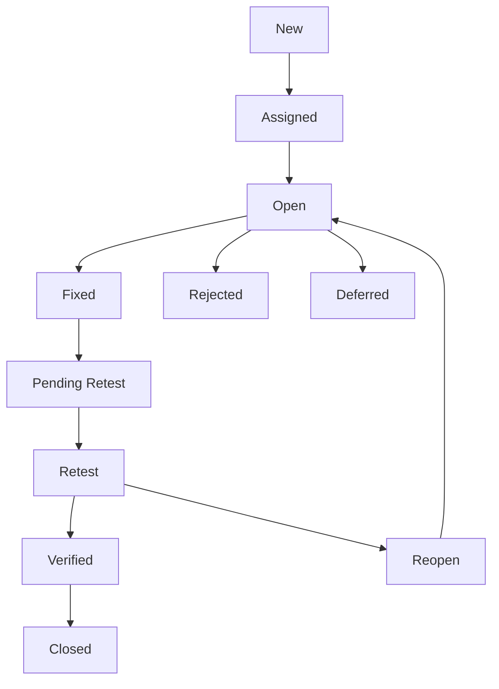

---

///
### **Module V: Testing for Specialized Environment**

**Explain Agile Testing Life Cycle and its challenges — 10 marks — Dec 2022**
**What is Agile testing? Explain challenges in Agile Testing — 10 marks — May 2023**
**Explain challenges in Agile Testing — 10 marks — Nov 2019**

The **Agile Testing Life Cycle (ATLC)** is a continuous, iterative quality assurance process that runs alongside Agile software development from day one rather than waiting until coding finishes. Its goal is to catch defects early, shorten feedback loops, and ensure every sprint delivers potentially shippable software.

**Phases of Agile Testing:**

- **Impact Assessment:** Feedback is collected from users and stakeholders to understand requirements, identify changes, and define testing objectives for the next iteration.
- **Agile Test Planning:** The team plans testing activities, including strategy, tools, resources, schedules, and risk management for the upcoming sprint.
- **Release Readiness:** Features are thoroughly tested to ensure they meet quality standards and are ready for deployment or need further improvement.
- **Daily Scrums:** Short daily meetings are conducted to track testing progress, discuss issues, and align the team on daily goals.
- **Test Agility Review:** Regular reviews are held with stakeholders to evaluate progress, gather feedback, and improve future testing cycles.

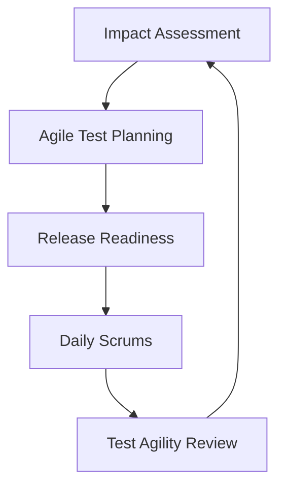

**Challenges in Agile Testing**:

- **Constantly Shifting Requirements.** Frequent backlog reprioritization and mid-sprint scope changes force testers to rewrite test cases and adjust automation scripts on the fly.
- **Tight Sprint Time Pressure.** Completing test design, manual exploratory checks, bug retesting, and test automation within a two-week sprint often creates bottlenecks near the end of the cycle.
- **In-Sprint Automation Maintenance.** Writing and stabilizing automated tests for brand-new features while the user interface or code is still evolving leads to flaky tests and high maintenance overhead.
- **Limited Documentation.** Because Agile favors working software over heavy documentation, testers often lack detailed specifications and must rely heavily on direct communication to uncover edge cases.
- **Broad Regression Coverage.** Frequent code merges increase the risk of breaking existing features, making it difficult to maintain fast, reliable regression suites without slowing down CI/CD pipelines.

---

**What is performance testing? Why is performance testing important? — 10 marks — May 2023**

**Performance testing** is a **non-functional testing type** that evaluates a system's **speed, responsiveness, scalability, stability, and resource usage** under a specific workload. It determines whether the system meets performance requirements (response time, throughput, resource utilization) and identifies bottlenecks before production.

**Why Performance Testing Is Important**

1. **User satisfaction and retention:** Slow systems frustrate users, and performance directly affects adoption and business revenue.
2. **SLA and contract compliance:** Performance testing verifies that the system meets the response-time and throughput commitments made to customers.
3. **Scalability validation:** It confirms that the system can handle expected and peak user loads, and it helps predict future capacity needs.
4. **Bottleneck identification:** It uncovers slow queries, memory leaks, inefficient code, and network or database limits before the system goes live.
5. **Cost optimization:** It right-sizes infrastructure such as servers and bandwidth, avoiding both over-provisioning and under-provisioning.
6. **Risk reduction:** It prevents production outages and crashes under load, such as those caused by Black Friday traffic spikes.
7. **Reliability and stability:** It detects memory leaks, resource exhaustion, and performance degradation over time.
8. **Benchmarking and regression:** It establishes baselines against which releases can be compared, helping teams catch performance regressions.
9. **Business reputation:** Downtime and slowness damage brand trust and can result in regulatory penalties.

**Types of Performance Testing**

1. **Load testing:**
   - Load testing evaluates how the system behaves under expected, normal user loads.
   - It verifies that the system meets its performance requirements under anticipated traffic conditions.

2. **Stress testing:**
   - Stress testing pushes the system beyond its normal limits to identify its breaking point.
   - It reveals how the system fails and whether it recovers gracefully under extreme conditions.

3. **Spike testing:**
   - Spike testing simulates sudden, sharp surges in load to observe how the system reacts.
   - It checks whether the system can handle abrupt traffic increases and recover without crashing.

4. **Endurance/Soak testing:**
   - Endurance testing applies a sustained load over a long period to uncover issues that appear only with prolonged use.
   - It is particularly effective at detecting memory leaks and gradual resource exhaustion.

5. **Scalability testing:**
   - Scalability testing examines how the system's behavior changes as load or resources are increased.
   - It determines whether the system can grow to meet rising demand by adding capacity.

6. **Volume testing:**
   - Volume testing subjects the system to very large data volumes to assess its performance.
   - It verifies that the system can process and store high quantities of data without degradation.

---

///
### **Module VI: Quality Management**

**Discuss Six Sigma — 5 marks (Q1e) — Dec 2022**

**Six Sigma** is a data-driven process improvement methodology that reduces variation and eliminates defects to target fewer than **3.4 defects per million opportunities (DPMO)**. Developed by engineer Bill Smith at Motorola in 1986, it uses statistical analysis and structured project phases to improve quality, efficiency, and customer satisfaction.

**DMAIC** is a data-driven improvement cycle used in Six Sigma to improve existing processes.

- **D : Define:** Define the problem, customer requirements, and project goals.
- **M : Measure:** Collect data and measure current process performance.
- **A : Analyze:** Identify root causes of defects and variation.
- **I : Improve:** Implement and validate solutions to eliminate root causes.
- **C : Control:** Sustain improvements through monitoring and standard controls.

---

**Explain McCall's Quality factors and Criteria — 10 marks — Dec 2022**
**McCall's Quality Factors and Criteria (short note) — 20 marks (Q6D) — Nov 2019**

**McCall's quality model** (1977) organizes software quality into **three perspectives** — Product Revision, Product Transition, and Product Operations — with **11 quality factors**, each decomposed into **quality criteria** (measurable attributes) that can be assessed during development.

**Product Operations**

1. **Correctness** — From the Product Operations perspective, correctness is the extent to which the program meets specifications and fulfills its mission. Its associated criteria are completeness, consistency, traceability, and accuracy.
2. **Reliability** — From the Product Operations perspective, reliability is the extent to which the program performs its intended function with required precision. Its associated criteria are accuracy, consistency, error tolerance, and simplicity.
3. **Efficiency** — From the Product Operations perspective, efficiency is the amount of computing resources and code required for a function. Its associated criteria are execution efficiency and storage efficiency.
4. **Integrity** — From the Product Operations perspective, integrity is the extent to which access to software and data is controlled. Its associated criteria are access control, access audit, and completeness.
5. **Usability** — From the Product Operations perspective, usability is the effort required to learn, operate, prepare input, and interpret output. Its associated criteria are operability, training, communicativeness, and input/output volume and rate.

**Product Revision**

1. **Maintainability** — From the Product Revision perspective, maintainability is the effort required to locate and fix an error in an operational program. Its associated criteria are consistency, simplicity, conciseness, modularity, and self-documentation.
2. **Flexibility** — From the Product Revision perspective, flexibility is the effort required to modify an operational program. Its associated criteria are modularity, generality, self-documentation, expandability, and instrumentation.
3. **Testability** — From the Product Revision perspective, testability is the effort required to test a program to ensure it performs its intended function. Its associated criteria are auditability, simplicity, instrumentation, self-documentation, and modularity.

**Product Transition**

1. **Portability** — From the Product Transition perspective, portability is the effort required to transfer a program from one environment to another. Its associated criteria are hardware independence, software independence, machine independence, self-documentation, and modularity.
2. **Reusability** — From the Product Transition perspective, reusability is the extent to which a program or its parts can be reused in other applications. Its associated criteria are generality, modularity, self-documentation, and machine independence.
3. **Interoperability** — From the Product Transition perspective, interoperability is the effort required to couple a system with another system. Its associated criteria are modularity, communication commonality, data commonality, and simplicity.

---

**Explain ISO 9000:2000 standard — 10 marks — May 2023**

**ISO 9000:2000** is a family of standards that provides a framework for quality management systems, based on eight principles that guide organizations to achieve consistent quality and customer satisfaction.

1. **Customer focus** : Understanding current and future customer needs and meeting requirements.
2. **Leadership** : Establishing unity of purpose and direction within the organization.
3. **Involvement of people** : Full involvement of employees at all levels for organizational benefit.
4. **Process approach** : Managing activities and related resources as a process.
5. **System approach to management** : Identifying, understanding, and managing interrelated processes as a system.
6. **Continual improvement** : Ongoing enhancement of overall organizational performance.
7. **Factual approach to decision making** : Making decisions based on analysis of data and information.
8. **Mutually beneficial supplier relationships** : Building value-adding relationships with suppliers.